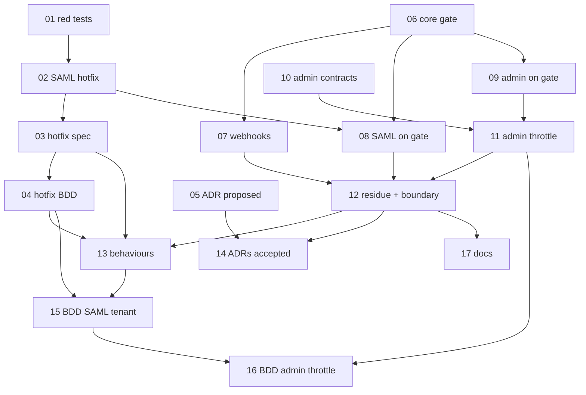

# Plan 31: One admin-tier gate in core, where the predicate sees the target

| Property | Value |
|---|---|
| Source | Architecture review 2026-11-09, batch 4, candidate 31 ("one admin-tier gate in core, where the predicate sees the target") |
| Strength | **Strong** (confirmed after re-verification, §1.4). A cross-organization write on SAML connections, by reading, is the evidence that the hand-written copies are unsafe |
| Dependency category | **in-process**. The gate moves no I/O seam. It reads a `Context.Key`, calls a host predicate, publishes an event and spends a rate-limit rule |
| Wave / position | Batch 4. **Wave 0 hotfix (tickets 01→04) ships alone**, before anything else, and touches only `@awthaq/saml`, its spec and its BDD. The deepening (tickets 05–17) is independent of every other batch-4 plan. It works with today's `Tenant.configInForce` (plan 36 owns the general accessor) and with today's `Api.UserPrincipal` (plan 40 owns the domain caller) |
| Touched packages | `@awthaq/core` (new `AdminTierGate.ts`, a doc comment in `AuthEventSchemas.ts`), `@awthaq/saml`, `@awthaq/webhooks`, `@awthaq/admin`; `spec/`, `features/`, three package READMEs, `docs/plugin-authoring.md` |
| Wire change | **Yes.** (1) SAML by-id operations: an administrator delegated to organization A who names B's connection gets `404 SamlConnectionNotFound` instead of a success; a strictly delegated administrator (`organizationId === A`) can now manage A's connection by id (it got `403` before). `auth.admin.actionDenied` from SAML names `organizationId`. (2) The `canManageSaml`, `canManageWebhooks` and `canAdministerTenants` inputs gain `tenantId` (additive). (3) SAML's `canManageSaml` and `adminRate` are read per operation, so a tenant's `SamlConfig` governs the admin group. (4) Admin, if Q2 is accepted: `429 RateLimited` on the three admin groups (tuned with `RateLimits.overrides`, no new `AdminConfig` field), `RateLimited` added to the three admin contracts |
| ADRs | New **ADR-EA-050** ("Admin-tier operations pass one core gate that sees the target"). Amends **ADR-EA-018 decision 8** (revision 1.7, claimed; assign in landing order). Reverses **plan 13 decision Q5** ("no shared core gate"), which is a plan decision, not an ADR. Consistent with ADR-EA-009 (the gate decides nothing; the host's predicate does) |
| Tickets | `tickets/01-…` to `tickets/17-…` (17 tickets) |
| Verified at | `architecture/deepening-plans-2` @ `04fa3526`, 2026-11-09. Uncommitted edits in `two-factor`, `roles`, `qadi` are someone else's work; none of the files this plan cites is among them. Effect `^4.1.2` (catalog) |

Vocabulary: **module, interface, implementation, depth, deep, shallow, seam, adapter, leverage, locality**. Domain terms come from `spec/glossary.md`. "Admin tier" is the `AdminAuthentication` tier (glossary: **Tier**). "Clearance" is the glossary's term: proof a gate passed, minted only by the gate.

---

## 0. How to read this plan

There are two tracks.

| | Track H (hotfix) | Track R (deepening) |
|---|---|---|
| Tickets | 01 → 02 → 03 → 04 | 05–17 |
| Problem | Six SAML by-id operations ask `canManageSaml` with `organizationId: undefined`, so a predicate that delegates one organization approves every connection | The "ask → publish `actionDenied` → typed 403 → throttle" steps are written by hand in three plugins and have drifted |
| Change | `SamlAdmin.ts` reads the connection first and asks with its organization | A deep core module `AdminTierGate`; the three plugins only declare actions, predicate, names and rate rule |
| Depends on | nothing | Q7 (reverse plan 13 Q5). Ticket 08 rebases on 02 |

Track H is a complete fix on its own and merges as one PR. Track R then moves the same semantics into core, so the next admin-tier plugin cannot write the bug.

---

## 1. Summary, goals, non-goals

### 1.1 Summary

Three plugins serve admin-tier groups behind `Api.AdminAuthentication`: `@awthaq/admin` (groups `admin`, `admin.accounts`, `admin.tenants`), `@awthaq/saml` (`saml.admin`) and `@awthaq/webhooks` (`webhooks.admin`). Each answers "may this administrator do this to that target?" with its own copy of the same steps:

1. read the plugin's configuration;
2. build the predicate input (an identity-only `AuthSubject`, sometimes a target, sometimes the tenant);
3. call the host's fail-closed predicate;
4. on refusal, publish `auth.admin.actionDenied` (a core event) and fail with a typed 403;
5. on a pass, spend the administrator's rate-limit rule.

The copies are `packages/admin/src/internal/AdminGate.ts:258-301`, `packages/saml/src/SamlAdmin.ts:134-153` and `packages/webhooks/src/Webhooks.ts:526-542`. Plan 13 decided (Q5) not to share them, because "the shared part is six lines". The copies have since drifted in five ways (§2.3), and one drift is a security hole: SAML's six by-id operations ask the predicate **before** reading the connection and without its organization, so a host predicate that delegates organization A to an administrator also approves B's connections on an untenanted admin surface. That administrator can rename B's connection, replace its certificates and IdP entity id, rotate its SP key or delete it, which is enough to sign in to B's tenant through an IdP the administrator controls.

This plan does two things:

- **Track H** fixes SAML now: by-id operations read the connection first (a connection outside the ambient tenant reads as absent, as today), ask the predicate with the connection's organization, and answer a refusal for a connection exactly like an absent one whenever the administrator holds the action in general. The denial event names the organization.
- **Track R** makes the gate one deep module in core, `AdminTierGate`. Its interface is three operations (`named`, `found`, `ask`) over a plugin's **declaration** (configuration key and built value, action prefix, predicate adapter, what a denial names, the plugin's typed 403, the throttle). Its implementation owns the fail-closed ordering, the per-operation configuration read through `Tenant.configInForce`, the tenant in the predicate input, the read-then-ask ordering for loaded targets with the uniform answer, the denial event, the throttle and the branded clearance. Admin keeps its typed action table, its private `AdminConfig` and its admin-specific clearances; SAML and webhooks keep their contracts. All three stop publishing `actionDenied` themselves.

### 1.2 Goals

1. A delegated SAML predicate cannot reach another organization's connection, on any surface (Track H, tickets 01–04).
2. One implementation of the admin-tier gate. `_tag: "auth.admin.actionDenied"` is published from exactly one file, `packages/core/src/AdminTierGate.ts` (baseline: 3 files).
3. "Read the target, then ask with it" is an operation of the gate (`found`), so a plugin that names a target by id gets the target into the predicate by construction, and the uniform answer is written once.
4. Every admin-tier predicate is read from the configuration in force per operation: SAML's `canManageSaml`/`adminRate` join admin's and webhooks' (ADR-EA-018 D8).
5. Every admin-tier predicate input carries `tenantId`; every denial event names what the call named.
6. Every admin-tier plugin declares a throttle; admin gets its first one (Q2).
7. Spec, ADR, BDD and changesets say what the code does.

### 1.3 Non-goals

- **Roles administration** (`packages/roles/src/RolesAdminApi.ts:26-27, 62-104`). It is authorized declaratively by qadi: each endpoint carries `RequiredPermission` and the group runs `RequirePermission` middleware (ADR-EA-009, "authorization is delegated to qadi"). There is no hand-written gate, no host predicate and no `actionDenied`, so nothing has drifted and nothing would move. Folding it in would replace qadi's enforcement with awthaq's, which ADR-EA-009 forbids.
- **Organization member/role authorization** (plan 30 Part A's `OrganizationAccess`). It is user tier, not admin tier, and already has its own access proof.
- **The general per-tenant configuration accessor.** Plan 36 owns it. This plan calls today's `Tenant.configInForce` in one place (the core gate), which leaves plan 36 one call site instead of three.
- **The domain caller** (`Actor`, plan 04 Q7). Plan 40 owns it. The gate takes `Api.UserPrincipal` and converts it to `Users.UserId` once; the clearance's `adminUserId` replaces post-gate `Users.UserId(caller.ref.id)` reads. Pre-gate reads (self-refusals, `actingAs`) stay for plan 40.
- **Throttling refusals.** Today a refused caller spends nothing (SAML, webhooks). Unchanged.
- **Making the rest of `SamlConfig` per tenant.** Only the admin-gate fields move (Q5).
- **The plugin template.** It has no admin-tier group; `docs/plugin-authoring.md` gets a section instead.

### 1.4 Go / no-go gate

**GO.**

Evidence for:
- **A cross-organization write, by reading** (§2.4, F1). `SamlConfig.ts:62-64` documents `organizationId` "so a host can let one administrator manage one tenant"; the shipped test `packages/saml/test/SamlAdmin.test.ts:148-150` pins exactly that delegated predicate, `organizationId === undefined || organizationId === permitted`, and its own comment says by-id operations are "gated on the action alone". With that predicate every by-id call is approved.
- **Five drifts among three copies** (§2.3), each of which a reviewer would have had to catch by hand.
- **Leverage.** One module serves 3 plugins, 5 groups and 33 operations that publish `actionDenied` today (16 admin + 8 SAML + 9 webhooks), plus admin's impersonation and episode paths, and every future admin-tier plugin.
- **Locality.** The uniform-answer rule, the fail-closed ordering and the throttle-after-pass rule each live in one place with one test suite.

Evidence against:
- Plan 13 Q5 rejected this ("the shared part is six lines; inputs, errors and throttling differ"). That was true of the *publish and fail* part. It missed that the ordering (when to read the target, what to answer when the target is refused) is the part that differs dangerously, and that is not six lines. The declaration absorbs the real differences (input shape via the predicate adapter, errors via `denied`, throttle via a closure), so the module is deep, not a lowest common denominator.
- Admin's `AdminGate.ts` stays as admin's declaration, so admin goes from one module to two. Accepted: admin's interface to its operations does not change (§3.4), and the generic part leaves.

If the user rejects Q7 (keep plan 13 Q5), Track H still ships and Track R is dropped; keep tickets 01–04 only.

### 1.5 must_haves (whole plan)

```yaml
must_haves:
  truths:
    - "An administrator whose predicate admits only organization A cannot read, change, rotate or delete organization B's SAML connection, tenanted or not"
    - "A refused or absent by-id target gets the same answer: 404 when the administrator holds the action in general, else 403"
    - "Exactly one module publishes auth.admin.actionDenied, and every denial names what the call named"
    - "A tenant's configuration governs every admin-tier predicate per request (admin, saml, webhooks)"
    - "Every admin-tier predicate sees the ambient tenant"
    - "Every admin-tier pass spends the plugin's per-administrator rate rule; a refusal spends nothing"
  artifacts:
    - path: "packages/core/src/AdminTierGate.ts"
      provides: "the admin-tier gate: named, found, ask, Clearance"
      exports: ["make", "Clearance", "Asked", "Declaration", "Named"]
    - path: "packages/core/test/AdminTierGate.test.ts"
      provides: "the gate's behaviour at its interface"
    - path: "packages/core/test/AdminTierGate.boundary.test.ts"
      provides: "only the core gate publishes actionDenied"
    - path: "spec/decisions/050-admin-tier-gate.md"
      provides: "ADR-EA-050"
  key_links:
    - from: "packages/saml/src/SamlAdmin.ts"
      to: "packages/core/src/AdminTierGate.ts"
      via: "gate.found(caller, action, existing(connectionId), (record) => record.organizationId, notFound)"
      pattern: "gate\\.found\\("
    - from: "packages/admin/src/internal/AdminGate.ts"
      to: "packages/core/src/AdminTierGate.ts"
      via: "AdminTierGate.make({ config: AdminConfig, built, ... })"
      pattern: "AdminTierGate\\.make\\("
    - from: "packages/webhooks/src/Webhooks.ts"
      to: "packages/core/src/AdminTierGate.ts"
      via: "gate.named(caller, action, Option.none())"
      pattern: "gate\\.named\\("
    - from: "packages/core/src/AdminTierGate.ts"
      to: "packages/ports/src/Tenant.ts"
      via: "Tenant.configInForce(declaration.config, declaration.built)"
      pattern: "configInForce"
```

---

## 2. Verified current state

### 2.1 Re-measurement commands (run at `04fa3526`)

```bash
# the three hand-written gates
sed -n 255,301p packages/admin/src/internal/AdminGate.ts
sed -n 134,153p packages/saml/src/SamlAdmin.ts
sed -n 520,542p packages/webhooks/src/Webhooks.ts
# files that publish actionDenied                                  -> 3 files
grep -rl '_tag: "auth.admin.actionDenied"' packages/*/src
# SAML by-id operations asked without the organization           -> 6
grep -c 'authorize(caller, "[a-zA-Z]*", undefined)' packages/saml/src/SamlAdmin.ts
# SAML's gate predicate is read from the build-time value         -> 1
grep -v '^\s*//' packages/saml/src/SamlAdmin.ts | grep -c 'settings.canManageSaml'
# admin has no throttle                                           -> 0 files
grep -rl 'RateLimits' packages/admin/src | wc -l
# admin contracts declare no RateLimited                          -> 0, 0, 0
grep -c 'RateLimited' packages/admin/src/AdminApi.ts packages/admin/src/AdminAccountsApi.ts packages/admin/src/AdminTenantsApi.ts
# tenantId in the SAML / webhooks predicate inputs                -> 0, 0
grep -c 'tenantId' packages/saml/src/SamlConfig.ts packages/webhooks/src/WebhooksConfig.ts
# caller.ref.id                                                   -> admin 28, organization 6, saml 4, webhooks 5 (= 43)
for p in admin organization saml webhooks; do grep -rc 'caller\.ref\.id' packages/$p/src --include='*.ts' | awk -F: '{s+=$2} END {print s}'; done
grep -c 'caller\.ref\.id' packages/admin/src/internal/AdminGate.ts packages/admin/src/Admin.ts packages/admin/src/AdminAccounts.ts packages/saml/src/SamlAdmin.ts packages/webhooks/src/Webhooks.ts
#                                                                 -> 13, 10, 5, 4, 5
npx vitest run packages/saml/test/SamlAdmin.test.ts              # 16 passed (1.4 s)
```

### 2.2 The three copies side by side

| Step | admin (`AdminGate.ts`) | saml (`SamlAdmin.ts`) | webhooks (`Webhooks.ts`) |
|---|---|---|---|
| Configuration | per operation, `Tenant.configInForce(AdminConfig, built)` (`:247`) | **once at build**, `yield* SamlConfig.SamlConfig` (`:132`) | per operation, `configInForce` (`:517`) |
| Predicate input | user predicates: `{ admin, target, tenantId }` (`:282-286`); `canAdministerTenants`: `{ admin, organizationId }`, **no `tenantId`** (`:281`, type `:116-119`) | `{ admin, action, organizationId }`, no `tenantId` (`:139-143`) | `{ admin, action }`, no `tenantId` (`:528-531`) |
| Target in the predicate | the id the request names; existence is read **after** the gate (`UserClearance.target`, `:225-229`) | create/list: the organization the request names; **by-id: `undefined`** (`:300, 307, 344, 360, 393, 419`) | none (the store scopes endpoints to the ambient tenant, `:549-557`) |
| Denial event | `actionDenied` with `targetUserId` / `organizationId` (`:262-268`, `:288-298`) | `actionDenied`, action `saml.<action>`, **no `organizationId`** although the predicate had it (`:145-149`) | `actionDenied`, action `webhooks.<action>` (`:533-537`) |
| Typed 403 | `AdminActionDenied` (`AdminApi.ts:55-58`) | `SamlActionDenied` (`SamlApi.ts:179`) | `WebhooksActionDenied` (`WebhooksApi.ts:22-25`) |
| Throttle | **none** (0 files in `admin/src` mention `RateLimits`; contracts declare no `RateLimited`) | after the gate, closure over `Saml`'s budget rule `admin` (`:152`; `Saml.ts:706-711, 823-833`) | after the gate, `limits.spend("admin", …)` (`:540`; rule `:373-380`) |
| Returns | branded clearance carrying the configuration (`:215-240`) | `void` | the settings in force |

### 2.3 Drift (what the candidate claimed, re-verified)

| # | Claim | Verified | Note |
|---|---|---|---|
| D1 | SAML by-id operations ask with `organizationId: undefined` before the lookup | **Yes**, 6 sites: `SamlAdmin.ts:300` (get), `:307` (update), `:344` (delete), `:360` (refreshMetadata), `:393` (rotateSigningKey), `:419` (listSigningKeys) | The live bug, §2.4 F1 |
| D2 | SAML reads `SamlConfig` once at build, so a tenant's `canManageSaml` is ignored | **Yes**, `SamlAdmin.ts:132`, and `Saml.ts:823-830` tunes `adminRate` with `Effect.succeed` (build time) | Conforms to today's spec: BEH-EA-236 lists saml as deployment-scoped. A design gap (plan 13 Q4, handed off), not a spec violation |
| D3 | SAML passes `organizationId` to its predicate but not to the denial event | **Yes** (`:139-149`); the event has the optional key (`core/src/AuthEventSchemas.ts:401-414`) | Allowed by BEH-EA-224 as written ("SAML and webhooks publish without them"). A gap |
| D4 | Predicate inputs differ: admin passes `tenantId`, SAML and webhooks do not | **Partly.** Admin passes it only to the user and impersonation predicates; `canAdministerTenants` does not get it either (`AdminGate.ts:116-119, 281`) | Admin is not uniform with itself |
| D5 | SAML and webhooks throttle after the gate; admin has no throttle | **Yes**; 0 `RateLimits` in `packages/admin/src` | Admin's contracts would need `RateLimited` (Q2) |
| D6 | 43 `caller.ref.id` sites in admin, organization, saml, webhooks | **Yes**: 28 + 6 + 4 + 5 | 13 are inside `AdminGate.ts`, 3 inside each of the SAML and webhooks gates |

### 2.4 Live bugs

**F1 — SAML: an administrator delegated to one organization reaches every organization's connections by id (security, high; by reading; ticket 01 reproduces).**

Preconditions: the `saml.admin` group is served on a request with no ambient tenant (an operator console, or any single-tenant deployment), and the host's `canManageSaml` delegates per organization the way `SamlConfig.ts:62-64` invites and `SamlAdmin.test.ts:148-150` pins:

- `getConnection(caller, B_id)`: `authorize(caller, "getConnection", undefined)` (`SamlAdmin.ts:300`) → predicate sees `organizationId: undefined` → `true`. `existing(B_id)` (`:221-233`) then finds B's connection, and `inScope` (`:158-162`) is `true` because there is no tenant. The DTO goes out.
- `updateConnection` (`:307`), `deleteConnection` (`:344`), `refreshMetadata` (`:360`), `rotateSigningKey` (`:393`), `listSigningKeys` (`:419`): same path. `UpdateConnectionPayload` can set `entityId`, `ssoUrl`, `certificates`, `trustsEmail` and `emailDomains` (`:105-117`), so the administrator can point B's connection at an IdP they control and sign in to B's tenant.

A host that writes the strict predicate instead (`organizationId === permitted`) has the opposite failure: every by-id call is refused (`undefined !== permitted`), so the delegated administrator cannot manage their own connections by id. That is not a security bug, but it shows the predicate input is wrong for both readings. Inside a tenant, `inScope` bounds the reach, so F1 needs an untenanted request.

No other live bug. D2–D5 conform to the spec as written; this plan changes the spec.

### 2.5 Evidence corrections

- `inScope` is `SamlAdmin.ts:157-162`, not `:162-166`.
- `SamlAdmin.test.ts` is `packages/saml/test/SamlAdmin.test.ts` (the predicate is at `:148-150`), not under `src/`.
- D2 and D3 are spec-conformant gaps, not bugs (see the table). Plan 13's Decisions taken (Q2) explicitly let SAML and webhooks publish without the target keys.
- D4 is broader than claimed: admin's `canAdministerTenants` lacks `tenantId` too.
- Webhooks has **no** F1 analogue: its predicate never sees a target, and the store answers another tenant's endpoint as absent (`Webhooks.ts:549-557`, BEH-EA-309). The security bug is SAML-only.
- Plan 13 did consider and reject this candidate (Q5, Decisions taken item 5). This plan reverses that decision on the strength of F1 (Q7).
- Of the 43 `caller.ref.id` sites, 37 are in the three gate packages and 6 in organization. The gate can remove the gate-internal ones and the post-gate event reads (§3.6); the rest are plan 40's.

### 2.6 Tests that exercise the gates today

| File | Cases about the gate |
|---|---|
| `packages/saml/test/SamlAdmin.test.ts` | `"the gate is fail-closed"`: every op denied (`:78-125`); the delegated-predicate case (`:127-157`); "learns nothing about which ids exist" (`:159-171`); "past the gate each administrator is limited per window" (`:173-199`) |
| `packages/webhooks/test/WebhooksAdmin.test.ts` | fail-closed block (`:63-133`); "an administrator is limited per window once past the gate" (`:378-404`); "declared and registered" (`:406-…`) |
| `packages/webhooks/test/WebhooksPingAndAudit.test.ts` | denial publishes and no mutation event (`:197`) |
| `packages/admin/test/AdminGate.test.ts` | the plan-13 matrix (15 cases, `:335-889`) |
| `packages/admin/test/AdminGate.boundary.test.ts` | `configInForce` and `"auth.admin.actionDenied"` only in `internal/AdminGate.ts` (`:31-41`) |
| `features/features/13-enterprise-federation/29-saml-sp.feature` | REQ-EA-1238 (every op denied, 403), REQ-EA-1242 (another tenant's connection is absent) |

---

## 3. Target design

### 3.1 Where the seam sits

```
 admin-tier HttpApi group (Api.AdminAuthentication + CSRF)
   │  caller = CurrentUser.current
   ▼
 plugin operation (deleteUser, updateConnection, rotateSecret, …)
   │  gate.named(caller, action, target)       target named by the request: ask before any read
   │  gate.found(caller, action, find, …)      target read first (by id): ask with what was read
   ▼
┌──────────────────────── @awthaq/core AdminTierGate (deep) ─────────────────────────┐
│ configuration in force: Tenant.configInForce(declaration.config, declaration.built) │
│ predicate input: adminUserId, action, tenantId (TenantContext), target              │
│ fail-closed ordering; found: read → ask(target) → ask(general) → uniform answer     │
│ denial: publish auth.admin.actionDenied { prefix+action, names(action, target) }    │
│         then the plugin's typed 403                                                 │
│ throttle after a pass (and before a 404 the caller is entitled to)                  │
│ Clearance (branded, minted only here): adminUserId, config, target [, record]       │
└─────────────────────────────────────────────────────────────────────────────────────┘
   │  cleared.config.* ; cleared.record ; cleared.adminUserId
   ▼
 domain operation (store write, AccountErasure, OrganizationDirectory, …)
```

What stays in each plugin (its **declaration**): the configuration key and built value, the action names, a predicate adapter that turns `Asked` into the host predicate's input (core does not depend on `@qadi/core`, so the plugin builds the `AuthSubject` with `makeSubject`), what a denial names, the typed 403, the throttle closure over the plugin's own budget, and for `found` the lookup and the not-found error.

What stays outside the gate: self-refusals and impersonation validation (BEH-EA-214/218 never reach the gate), the tenant scoping inside a lookup (SAML's `inScope`, webhooks' store), and the host's policy inside its predicate.

### 3.2 The interface (sketch; types and signatures only)

```ts
// packages/core/src/AdminTierGate.ts
import type { Api } from "@awthaq/api";
import type * as Brand from "effect/Brand";
import type * as Context from "effect/Context";
import type * as Effect from "effect/Effect";
import type * as Option from "effect/Option";
import type * as AuthEvents from "./AuthEvents.ts";
import type * as Users from "./Users.ts";

/** What a plugin's predicate is asked. `target` is `None` for "the action in general". */
export interface Asked<Action extends string, T> {
  readonly adminUserId: Users.UserId;
  readonly action: Action;
  readonly tenantId: Option.Option<string>;
  readonly target: Option.Option<T>;
}

/** What `auth.admin.actionDenied` names besides the caller and the action. */
export interface Named {
  readonly targetUserId?: Users.UserId;
  readonly organizationId?: string;
}

/** A plugin's whole contribution. */
export interface Declaration<I, A, Action extends string, T, E> {
  readonly config: Context.Key<I, A>;
  readonly built: A;
  /** "" for admin, "saml." and "webhooks." for the others; the event's `action` is prefix + action. */
  readonly prefix: string;
  readonly predicate: (config: A, asked: Asked<Action, T>) => Effect.Effect<boolean>;
  readonly names: (action: Action, target: T) => Named;
  readonly denied: () => E;
  readonly throttle: (
    adminUserId: Users.UserId,
    action: Action,
  ) => Effect.Effect<void, Api.RateLimited>;
}

/** Proof the gate passed. Only `AdminTierGate` can mint one (module-private `Brand.nominal`). */
export type Clearance<A, T> = {
  readonly adminUserId: Users.UserId;
  /** The configuration in force that authorized the operation. Read nothing else. */
  readonly config: A;
  readonly target: Option.Option<T>;
} & Brand.Brand<"awthaq/core/AdminTierClearance">;

/** The shape `make` yields (illustrative: the implementation's type is inferred, not annotated). */
interface Gate<A, Action extends string, T, E> {
  /** The request names the target (or none). Asked before anything is read; a refusal is the typed 403. */
  readonly named: <E2 = never>(
    caller: Api.UserPrincipal,
    action: Action,
    target: Option.Option<T>,
    /** admin's impersonation only: its own denial event and error replace actionDenied. */
    refuse?: (asked: Asked<Action, T>) => Effect.Effect<never, E2>,
  ) => Effect.Effect<Clearance<A, T>, E | E2 | Api.RateLimited>;
  /** The request names an id; the target is read first. `find` answers None for absent AND out of reach. */
  readonly found: <R, X, N>(
    caller: Api.UserPrincipal,
    action: Action,
    find: Effect.Effect<Option.Option<R>, X>,
    targetOf: (record: R) => T,
    notFound: () => N,
  ) => Effect.Effect<Clearance<A, T> & { readonly record: R }, E | N | X | Api.RateLimited>;
  /** A question, not a decision: no event, no throttle, no failure (admin's episode filter and superadmin check). */
  readonly ask: (
    caller: Api.UserPrincipal,
    question: (config: A, asked: Asked<Action, never>) => Effect.Effect<boolean>,
  ) => Effect.Effect<boolean>;
}

declare const make: <I, A, Action extends string, T, E>(
  declaration: Declaration<I, A, Action, T, E>,
) => Effect.Effect<Gate<A, Action, T, E>, never, AuthEvents.AuthEvents>;
```

Rules (no return-type annotation on `make`; no `as`):

- `make` is an `Effect.gen` yielded once in a plugin's `make`, like `SignIn.make` and `FederatedIdentity.make` (plan 13 §3.5's precedent for a `make` effect over a `Context.Service`).
- The configuration is read with `Tenant.configInForce(declaration.config, declaration.built)` on **every** call, never at build.
- A predicate's `Effect<boolean>` has no error channel. A defect in it propagates as a defect: the call dies (500); it never yields a clearance.

### 3.3 The ordering, written once

`named(caller, action, target)`:

1. `config` ← configuration in force; `allowed` ← `predicate(config, { adminUserId, action, tenantId, target })`.
2. Refused → if `refuse` is given, run it (it fails); else publish `actionDenied { adminUserId, action: prefix + action, ...Option.match(target, names) }` and fail `denied()`. Nothing is spent.
3. Allowed → `throttle(adminUserId, action)` → clearance `{ adminUserId, config, target }`.

`found(caller, action, find, targetOf, notFound)` — the **uniform answer**:

| `find` | predicate(target) | predicate(general) | Answer | Event | Throttle spent |
|---|---|---|---|---|---|
| `Some(r)` | true | (not asked) | clearance with `record: r` | none | yes |
| `Some(r)` | false | true | `notFound()` | `actionDenied` naming `names(action, targetOf(r))` | yes |
| `Some(r)` | false | false | `denied()` | `actionDenied` naming the target (one event) | no |
| `None` | (not asked) | true | `notFound()` | none | yes |
| `None` | (not asked) | false | `denied()` | `actionDenied` without names | no |
| fails `X` | (not asked) | (not asked) | `X` (e.g. `StoreUnavailable`) | none | no |

Why this rule: an administrator who holds the action somewhere sees "not found" for every id they may not act on, real or fake, which is how SAML already answers another tenant's connection (BEH-EA-318); an administrator who holds the action nowhere sees 403 for every id, which keeps REQ-EA-1238 (`all 8 are refused as "SamlActionDenied"`) and "a denial reveals nothing about which ids exist". In both cases the answer does not depend on whether a connection the caller may not manage exists. The audit trail still records the refused target. Probes that end in 404 cost budget.

`ask(caller, question)` reads the configuration in force and answers `question(config, { adminUserId, action, tenantId, target: None })`. Nothing else.

### 3.4 Each plugin after the change

**SAML** (`SamlAdmin.ts`, tickets 02 and 08). `Action` is the eight operation names; `T` is the organization id; `predicate` calls `config.canManageSaml({ admin: makeSubject({ id: asked.adminUserId }), action: asked.action, organizationId: Option.getOrUndefined(asked.target), tenantId: asked.tenantId })`; `names` is `(_, organizationId) => ({ organizationId })`; `denied` is `new SamlApi.SamlActionDenied()`; `throttle` is the existing closure. `createConnection` and `listConnections` call `named` with `Option.some(input.organizationId)` / `Option.some(organizationId)` (the in-tenant reach check after the gate is unchanged). The six by-id operations call `found(caller, action, existingOption(connectionId), (record) => record.organizationId, () => new SamlApi.SamlConnectionNotFound())`, where `existingOption` is today's `existing` (`:221-233`) answering `Option` instead of failing. They use `cleared.record` instead of a second lookup and `cleared.adminUserId` instead of `adminId(caller)`. `Saml.ts` tunes the `admin` rule per operation (`Effect.map(Tenant.configInForce(SamlConfig.SamlConfig, settings), …)`), like webhooks.

**Webhooks** (`Webhooks.ts`, ticket 07). `T` is `never`; every operation calls `named(caller, action, Option.none())` and reads `cleared.config` where it read `settings`. Behaviour is unchanged apart from `tenantId` in the predicate input.

**Admin** (`internal/AdminGate.ts`, ticket 09). The file keeps its interface to `Admin.ts`, `AdminAccounts.ts` and `AdminTenants.ts` (`collection`, `user`, `organization`, `impersonation`, `episode`, `visibleEpisodes`, `crossTenantScope`), its private `AdminConfig`, its typed action table and its admin clearances. Its `decide`/`refuse` (`:258-301`) and its own `inForce` (`:247`) go: `collection`/`user`/`organization` call `core.named` with `T = string` (the user or organization id; `names` reads `actions[action].on`); `impersonation` calls `core.named` with `refuse` publishing `auth.admin.impersonationDenied`; `episode`, `visibleEpisodes` and `crossTenantScope` call `core.ask` (the episode gate keeps its own `impersonationDenied`, because its predicate takes the episode row). `impersonate` joins the action table as `{ gate: "canImpersonate", on: "user" }`. `canAdministerTenants` gains `tenantId` in its input.

```ts
// admin's predicate adapter (sketch)
const predicate = (config: AdminConfigShape, asked: AdminTierGate.Asked<GatedAction, string>) =>
  actions[asked.action].gate === "canAdministerTenants"
    ? config.canAdministerTenants({ admin: subject(asked.adminUserId), organizationId: asked.target, tenantId: asked.tenantId })
    : config[actions[asked.action].gate]({ admin: subject(asked.adminUserId), target: Option.map(asked.target, subject), tenantId: asked.tenantId });
```

(The executor narrows `actions[asked.action].gate` with a local const so TypeScript selects the right predicate without an assertion; the plan-13 `GateOf` derivation stays.)

### 3.5 Module layout after the change

```
packages/core/src/AdminTierGate.ts          new: the gate (deep)
packages/core/src/index.ts                  + export * as AdminTierGate
packages/admin/src/internal/AdminGate.ts    admin's declaration + admin clearances (no publish of actionDenied, no configInForce)
packages/saml/src/SamlAdmin.ts              SAML's declaration; by-id operations through found
packages/saml/src/Saml.ts                   admin rule tuned per operation
packages/webhooks/src/Webhooks.ts           webhooks' declaration
```

### 3.6 The `caller.ref.id` residue

The clearance carries `adminUserId`, so every post-gate `Users.UserId(caller.ref.id)` in an event becomes `cleared.adminUserId`. Targets after ticket 12 (baselines in §2.1): `internal/AdminGate.ts` 13 → 0, `SamlAdmin.ts` 4 → 0, `Webhooks.ts` 5 → 0, `Admin.ts` 10 → at most 3 (the self-ban check `:762`, the self-impersonation check `:860`, `actingAs` `:873`), `AdminAccounts.ts` 5 → at most 2 (the self checks `:169`, `:225`). Organization's 6 are untouched. Total 43 → at most 11. If plan 40 lands first and the gate takes its domain caller, these targets still hold.

### 3.7 Alternatives rejected

- **Keep three copies and fix SAML only** (plan 13 Q5's stance). Rejected: F1 is the cost of that stance, and nothing stops a fourth admin-tier plugin from copying SAML.
- **Gate in `@awthaq/admin`.** Rejected: SAML and webhooks would have to depend on a peer plugin, and installing SAML would require installing admin.
- **Gate in `@awthaq/server`.** Rejected: webhooks does not depend on server (`packages/webhooks/package.json`), and the gate is domain logic (an event, a rate-limit rule, a clearance), not HTTP.
- **Core depends on `@qadi/core` to build the `AuthSubject`.** Rejected: core is qadi-free today (`packages/core/package.json`); the plugin's predicate adapter builds the subject, as admin's already does.
- **An `HttpApiMiddleware` gate.** Rejected: SAML's predicate needs the row the operation reads, and the operation needs the configuration that authorized it.
- **A `Context.Service` (`AdminTierGate` tag and layer).** Rejected for the reason plan 13 §3.5 gives: one more service in every composition; `make` effects are the precedent.
- **Loaded targets always 403 on refusal (and 404 when absent).** Rejected: a delegated administrator could tell B's real connection ids from fake ones.
- **Loaded targets always 404 on refusal.** Rejected as the default (Q1): a caller with no grant at all would get 404 for by-id calls, which changes REQ-EA-1238's 403.
- **Roles in the gate.** Rejected (§1.3, ADR-EA-009).

---

## 4. Phased migration

### 4.1 Waves

```
Wave 0   01 SAML red tests ─────────────┐   05 ADR-EA-050 (Proposed) + glossary   06 core AdminTierGate   10 admin contracts declare RateLimited (Q2)
Wave 1   02 SAML by-id hotfix ◄─────────┘   07 webhooks → gate (06)   09 admin → gate (06)
Wave 2   03 hotfix spec + changeset (02)    08 SAML → gate (02, 06)   11 admin throttle (09, 10)
Wave 3   04 hotfix BDD (03)                 12 residue + core boundary/types tests (07, 08, 11)
Wave 4   13 behaviours + traceability (03, 04, 12)   14 ADRs + event doc (05, 12)   17 READMEs + plugin-authoring (12)
Wave 5   15 BDD: SAML tenant gate (04, 13)
Wave 6   16 BDD: admin throttle (15)
```

Track H is the chain 01 → 02 → 03 → 04 (one PR, ships first). Track R is everything else. No ticket in Track H depends on Track R.

### 4.2 Ticket table

| Ticket | Title | Wave | Depends on | Type | Size | Files |
|---|---|---|---|---|---|---|
| 01 | SAML by-id red tests: a delegated predicate reaches another organization | 0 | — | tdd | S | `packages/saml/test/SamlAdmin.test.ts` |
| 02 | SAML by-id operations read the connection first and ask with its organization (hotfix) | 1 | 01 | tdd | M | `packages/saml/src/SamlAdmin.ts`, `packages/saml/test/SamlAdmin.test.ts` |
| 03 | Hotfix spec, traceability and changeset (BEH-EA-348) | 2 | 02 | execute | S | `spec/behaviors/29-saml-sp.md`, `spec/traceability.md`, `.changeset/saml-admin-by-id-organization.md` |
| 04 | Hotfix BDD: REQ-EA-1520, REQ-EA-1521 | 3 | 03 | execute | S | `features/features/13-enterprise-federation/29-saml-sp.feature`, `features/step-definitions/SamlFederationSteps.ts`, `features/traceability.md`, `spec/traceability.md` |
| 05 | ADR-EA-050 (Proposed) and the glossary entry | 0 | — | execute | S | `spec/decisions/050-admin-tier-gate.md`, `spec/decisions/index.yaml`, `spec/glossary.md` |
| 06 | Core `AdminTierGate` module and its suite | 0 | — | tdd | M | `packages/core/src/AdminTierGate.ts`, `packages/core/src/index.ts`, `packages/core/test/AdminTierGate.test.ts`, `spec/overview.md`, `.changeset/admin-tier-gate.md` |
| 07 | Webhooks declares its gate | 1 | 06 | execute | S | `packages/webhooks/src/Webhooks.ts`, `packages/webhooks/src/WebhooksConfig.ts`, `packages/webhooks/test/WebhooksAdmin.test.ts`, `.changeset/webhooks-admin-tier-gate.md` |
| 08 | SAML declares its gate; `canManageSaml`/`adminRate` per tenant | 2 | 02, 06 | tdd | M | `packages/saml/src/SamlAdmin.ts`, `packages/saml/src/Saml.ts`, `packages/saml/src/SamlConfig.ts`, `packages/saml/test/SamlAdmin.test.ts`, `.changeset/saml-admin-tier-gate.md` |
| 09 | Admin's gate sits on the core gate | 1 | 06 | execute | M | `packages/admin/src/internal/AdminGate.ts`, `packages/admin/test/AdminGate.test.ts`, `packages/admin/test/AdminGate.boundary.test.ts`, `.changeset/admin-on-admin-tier-gate.md` |
| 10 | Admin contracts declare `RateLimited` (Q2) | 0 | — | execute | S | `packages/admin/src/AdminApi.ts`, `packages/admin/src/AdminAccountsApi.ts`, `packages/admin/src/AdminTenantsApi.ts`, `packages/admin/test/AuthHttp.test.ts`, `.changeset/admin-rate-limit.md` |
| 11 | Admin declares its rate rules; the gate spends them (Q2) | 2 | 09, 10 | tdd | M | `packages/admin/src/internal/AdminGate.ts`, `packages/admin/src/Admin.ts`, `packages/admin/src/AdminAccounts.ts`, `packages/admin/src/AdminTenants.ts`, `packages/admin/test/AdminGate.test.ts` |
| 12 | Clearance carries the caller; core boundary and types tests | 3 | 07, 08, 11 | execute | S | `packages/admin/src/Admin.ts`, `packages/admin/src/AdminAccounts.ts`, `packages/core/test/AdminTierGate.boundary.test.ts`, `packages/core/test/AdminTierGate.types.test.ts` |
| 13 | Behaviours and traceability (BEH-EA-347, 349; 224, 236, 309, 318) | 4 | 03, 04, 12 | execute | S | `spec/behaviors/27-admin-impersonation.md`, `spec/behaviors/28-tenancy.md`, `spec/behaviors/34-webhooks.md`, `spec/behaviors/29-saml-sp.md`, `spec/traceability.md` |
| 14 | ADR-EA-050 Accepted, ADR-EA-018 rev 1.7, event doc | 4 | 05, 12 | execute | S | `spec/decisions/050-admin-tier-gate.md`, `spec/decisions/018-tenancy-is-an-organization.md`, `spec/decisions/index.yaml`, `packages/core/src/AuthEventSchemas.ts` |
| 15 | BDD: a tenant's configuration tightens the SAML admin gate (REQ-EA-1522) | 5 | 04, 13 | execute | S | `features/features/13-enterprise-federation/29-saml-sp.feature`, `features/step-definitions/SamlFederationSteps.ts`, `features/traceability.md`, `spec/traceability.md` |
| 16 | BDD: an administrator is rate limited (REQ-EA-1523, Q2) | 6 | 15, 11 | execute | S | `features/features/09-admin-and-impersonation/27-admin-impersonation.feature`, `features/step-definitions/AdminSteps.ts`, `features/traceability.md`, `spec/traceability.md` |
| 17 | READMEs and `docs/plugin-authoring.md` | 4 | 12 | execute | S | `packages/admin/README.md`, `packages/saml/README.md`, `packages/webhooks/README.md`, `docs/plugin-authoring.md` |

If Q2 is answered "no": drop 10, 11 and 16; ticket 09's no-op throttle stays with its `shortcut:` comment; ticket 12 depends on 09 instead of 11.

### 4.3 Dependency graph



---

## 5. Test plan

### 5.1 Tests at the new interface (`packages/core/test/AdminTierGate.test.ts`, ticket 06)

A test declaration over a test `Context.Reference` with a deny-all default, `AuthEvents.layer`, a throttle that records its calls and can be told to fail. Cases:

1. Default (deny-all): `named` with `None` fails `denied()`, publishes one `actionDenied` with `prefix + action` and no names, never calls the throttle.
2. `named` with `Some(target)` refused: the event carries `names(action, target)`.
3. `named` allowed: the throttle is called once with `(adminUserId, action)`, after the predicate; the clearance carries `adminUserId`, the configuration in force and the target.
4. Throttle refuses: the call fails `RateLimited`; the predicate was asked first.
5. Configuration in force: a value provided for the key in the calling fiber is what the predicate sees and what the clearance carries; without one, `built`.
6. Tenant: under `Tenant.withTenant("t1")` the predicate sees `tenantId: Some("t1")`; untenanted, `None`.
7. `found`: the six rows of §3.3, each asserting the answer, the number of `actionDenied` events (0 or 1) and the throttle calls.
8. `found` whose `find` fails: the failure passes through unchanged; the predicate is never asked.
9. `named` with `refuse`: no `actionDenied`; the override's error is the failure.
10. `ask`: answers the question over the configuration in force; publishes nothing; never throttles.
11. A predicate that dies: the call dies; no clearance.

`packages/core/test/AdminTierGate.types.test.ts` (ticket 12): a `Clearance` cannot be constructed outside the module (`@ts-expect-error` on an object literal assigned to `AdminTierGate.Clearance<…>`); `named` given a target of the wrong `T` does not compile.

`packages/core/test/AdminTierGate.boundary.test.ts` (ticket 12): over every `packages/*/src/**/*.ts`, `_tag: "auth.admin.actionDenied"` appears only in `core/src/AdminTierGate.ts`, and the literal `"auth.admin.actionDenied"` only there and in `core/src/AuthEventSchemas.ts`. Pattern: `packages/core/test/ErasureClearance.boundary.test.ts`.

### 5.2 Plugin-level tests that stay (they pin each declaration)

- SAML by-id matrix (ticket 01/02): 4 predicates × 3 targets × 6 by-id operations (§ ticket 01). Stays through ticket 08.
- SAML, webhooks, admin "every operation is denied by default and publishes one denial" cases: they prove each operation is wired to the gate with the right action name.
- Admin's plan-13 matrix (predicate pairing, opens/tightens per predicate, predicate inputs, `maxDuration`/`links` read per operation).
- The "declared and registered" rate-limit tests of SAML (`Saml.test.ts:780`) and webhooks (`WebhooksAdmin.test.ts:406`).

### 5.3 Tests deleted (replace, don't layer)

| Ticket | File | Case | Replaced by |
|---|---|---|---|
| 02 | `packages/saml/test/SamlAdmin.test.ts` | "the gate sees the action and the organization, so a host can let one administrator manage one tenant" (`:127-157`; its comment pins F1) | the by-id matrix (delegated and strict rows) plus one create/list case kept inside the matrix block |
| 02 | same | "a caller who fails the gate learns nothing about which ids exist; one who passes gets 404 for an unknown id" (`:159-171`) | the matrix's deny-all and allow-all rows |
| 07 | `packages/webhooks/test/WebhooksAdmin.test.ts` | "an administrator is limited per window once past the gate" (`:379-404`) | core cases 3–4; one wiring case "the webhooks.admin rule is spent through the gate" (limit 1: second call `RateLimited`) |
| 08 | `packages/saml/test/SamlAdmin.test.ts` | "past the gate each administrator is limited per window" (`:173-199`) | core cases 3–4; one wiring case for `saml.admin` (limit 1) |
| 09 | `packages/admin/test/AdminGate.test.ts` | "BEH-EA-236: with no tenant configuration the build-time value applies exactly as before" (`:502-511`) | core case 5 |
| 09 | `packages/admin/test/AdminGate.boundary.test.ts` | the `configInForce` and `"auth.admin.actionDenied"` assertions (`:31-41`) | rewritten: admin `src` has no `configInForce` and no `actionDenied` literal; the `"awthaq/admin/Config"` key and `impersonationDenied` stay only in `internal/AdminGate.ts`; plus core's boundary test |

### 5.4 Concurrency and Postgres

No SQL changes; `pnpm test:pg` is not required. Concurrency: a by-id update racing a delete of the same connection is answered by the store as today (`SamlConnections/NotFound` → `SamlConnectionNotFound`, `SamlAdmin.ts:328`); the gate adds no new window, because a connection's organization cannot change through `update` (`UpdateConnectionPayload` has no `organizationId`).

### 5.5 Measurable targets

| Gate | Baseline (`04fa3526`) | Target |
|---|---|---|
| `grep -rl '_tag: "auth.admin.actionDenied"' packages/*/src` | 3 files | `packages/core/src/AdminTierGate.ts` only (ticket 09 onward) |
| `grep -c 'authorize(caller, "[a-zA-Z]*", undefined)' packages/saml/src/SamlAdmin.ts` | 6 | 0 (ticket 02) |
| `grep -v '^\s*//' packages/saml/src/SamlAdmin.ts \| grep -c 'settings.canManageSaml'` | 1 | 0 (ticket 08) |
| `grep -rl 'RateLimits' packages/admin/src \| wc -l` | 0 | 3 (ticket 11) |
| `grep -c 'RateLimited' packages/admin/src/Admin{,Accounts,Tenants}Api.ts` | 0, 0, 0 | ≥ 1 each (ticket 10) |
| `grep -c 'tenantId' packages/saml/src/SamlConfig.ts packages/webhooks/src/WebhooksConfig.ts` | 0, 0 | ≥ 1 each (tickets 07, 08) |
| `caller.ref.id` in admin + organization + saml + webhooks `src` | 43 | ≤ 11 (ticket 12) |
| `npx vitest run packages/saml/test/SamlAdmin.test.ts` | 16 passed | green, with the matrix |

---

## 6. Spec, ADR, traceability, BDD, docs, changesets

### 6.1 Behaviours (reserved BEH-EA-347–349)

| Id | File | Title (draft) | Ticket |
|---|---|---|---|
| BEH-EA-347 | `spec/behaviors/27-admin-impersonation.md` | Every admin-tier operation passes one gate: configuration in force, fail-closed, the denial names its target, the throttle after a pass | 13 |
| BEH-EA-348 | `spec/behaviors/29-saml-sp.md` | A SAML by-id operation reads the connection first and asks the gate with its organization; a refused connection is answered like an absent one when the administrator holds the action at all | 03 |
| BEH-EA-349 | `spec/behaviors/27-admin-impersonation.md` | Each administrator is rate limited on the admin groups (Q2) | 13 |

Edited entries, each with a Document Control revision and a change-history line: BEH-EA-224 (published by core's gate for admin, saml and webhooks; SAML names `organizationId`), BEH-EA-236 (`28-tenancy.md`: the adopter list adds "saml's admin gate (`canManageSaml`, `adminRate`)"), BEH-EA-309 or the webhooks gate entry in `34-webhooks.md` (the predicate input gains `tenantId`), BEH-EA-318 (`canManageSaml({ admin, action, organizationId?, tenantId })`, per operation; by-id ⇒ BEH-EA-348).

### 6.2 ADR-EA-050 (new) — draft

> **ADR-EA-050: Admin-tier operations pass one core gate that sees the target**
>
> *Context.* Three plugins serve admin-tier groups and each wrote "ask the host predicate → publish `auth.admin.actionDenied` → typed 403 → throttle" by hand. Plan 13 judged the shared part shallow (its Q5). The copies drifted: SAML asked its predicate about by-id operations before reading the connection, without its organization, so a predicate that delegated one organization approved all of them (plan 31 §2.4 F1); SAML read its gate once at build; inputs and event names differed; admin had no throttle.
>
> *Decision.*
> 1. `@awthaq/core` owns the admin-tier gate, `AdminTierGate.make(declaration)`. A plugin declares its configuration key and built value, action prefix, predicate adapter, what a denial names, its typed 403 and its throttle. It does not publish `auth.admin.actionDenied` itself.
> 2. The gate reads the configuration in force on every call (`Tenant.configInForce`, ADR-EA-018 D8), passes the ambient `tenantId` to every predicate, publishes the denial naming what the call named, and spends the plugin's per-administrator rule after a pass. A refusal spends nothing.
> 3. A target the request names (an id the predicate can judge unread) is asked about before anything is read (`named`); a refusal is the plugin's 403. A target the predicate can only judge after reading it (`found`) is read first; a refused or absent target is answered with the plugin's not-found error when the administrator holds the action in general (target `None`), else with its 403. The answer never depends on whether a target the caller may not act on exists.
> 4. A pass yields a branded clearance carrying the configuration that authorized it; only the gate mints one.
> 5. The gate decides nothing itself: the host's predicate does (ADR-EA-009 unchanged). Core does not depend on qadi; a plugin's adapter builds the `AuthSubject`.
> 6. Roles administration stays qadi-enforced (ADR-EA-009) and is not an admin-tier gate in this sense.
>
> *Alternatives.* Keep per-plugin copies (plan 13 Q5); the gate in `@awthaq/admin` or `@awthaq/server`; middleware; always-403 or always-404 for loaded targets (plan 31 §3.7).
>
> *Consequences.* One test suite for the ordering; a fourth admin-tier plugin cannot reintroduce F1 without bypassing `found`; plan 36's accessor replaces one call; plan 40's domain caller enters through the clearance.

Ticket 05 writes it as **Proposed** (revision 1.0); ticket 14 marks it **Accepted — implemented** (revision 1.1) with an Implementation section listing the files and tests.

### 6.3 ADR-EA-018 decision 8 (revision 1.7, claimed)

Replace the admin sentence of decision 8 with: "Admin, SAML and webhooks read their admin-tier gate per operation through core's `AdminTierGate` (ADR-EA-050), which calls `Tenant.configInForce`; admin's `AdminConfig` reference stays private to `internal/AdminGate.ts`, which hands it to the core gate, and every other admin read comes from a clearance. SAML's `canManageSaml` and `adminRate` join the per-operation rule; the rest of `SamlConfig` stays boot-scoped." Add a revision note "(plan 31)". Revision numbers are assigned in landing order (`.planning/README.md`).

### 6.4 Traceability

`spec/traceability.md`: an ADR-EA-050 row (BEH-EA-347–349, `AdminTierGate.test.ts`, `.boundary`, `.types`); §1 rows for files 27 and 29 list the new BEH ids; §5 rows for the three core test files and the changed `SamlAdmin.test.ts`, `WebhooksAdmin.test.ts`, `AdminGate.test.ts`, `AdminGate.boundary.test.ts`; §6 rows for REQ-EA-1520–1523; the Document Control revision.

### 6.5 BDD (reserved REQ-EA-1520–1529; 1520–1523 used)

| REQ | Feature | Rule | Scenario | Ticket |
|---|---|---|---|---|
| REQ-EA-1520 | `29-saml-sp.feature` | `@BEH-EA-348` | An administrator delegated to one organization cannot reach another organization's connection by id | 04 |
| REQ-EA-1521 | `29-saml-sp.feature` | `@BEH-EA-348` | An administrator delegated strictly to one organization manages that organization's connection by id | 04 |
| REQ-EA-1522 | `29-saml-sp.feature` | `@BEH-EA-318` | A tenant's configuration tightens the SAML administrator's gate per request | 15 |
| REQ-EA-1523 | `27-admin-impersonation.feature` | `@BEH-EA-349` | An administrator is rate limited on user administration once past the gate | 16 |

`features/scripts/allocate-req-ea.py` gives an untagged scenario the next number after the highest in use, which is not necessarily 1520 once other batch-4 plans land. **Tag each new scenario with its reserved `@REQ-EA-15xx` by hand, then run the allocator** (it keeps existing tags) and commit the regenerated `features/traceability.md`. 1524–1529 stay unused.

### 6.6 Changesets (each with a `Migration:` line)

| File | Packages | Ticket | Migration |
|---|---|---|---|
| `.changeset/saml-admin-by-id-organization.md` | `@awthaq/saml`: minor | 03 | "`canManageSaml` now receives the connection's `organizationId` for get/update/delete/refreshMetadata/rotateSigningKey/listSigningKeys. A predicate that approved by-id calls through `organizationId === undefined` should be reviewed: `undefined` now means 'the action in general'." |
| `.changeset/admin-tier-gate.md` | `@awthaq/core`: minor | 06 | none (new module) |
| `.changeset/webhooks-admin-tier-gate.md` | `@awthaq/webhooks`: minor | 07 | none (the predicate input gains `tenantId`) |
| `.changeset/saml-admin-tier-gate.md` | `@awthaq/saml`: minor | 08 | "A tenant's `Saml.config(...)` in a `TenantConfig` lookup now governs `canManageSaml` and `adminRate` for that tenant's requests (a whole configuration, deny-all for unnamed predicates, like every plugin)." |
| `.changeset/admin-on-admin-tier-gate.md` | `@awthaq/admin`: minor | 09 | none (`canAdministerTenants` input gains `tenantId`) |
| `.changeset/admin-rate-limit.md` | `@awthaq/admin`: minor | 10 (covers 11) | "The admin groups answer `429` past 60 calls per administrator per minute per group by default; raise the `admin`, `admin.accounts` or `admin.tenants` rule with `RateLimits.overrides` (per tenant too: the overrides are read per request) for scripted bulk administration." |

### 6.7 Docs

`spec/glossary.md` (ticket 05): **Admin-tier gate** entry. `spec/overview.md` (ticket 06): Domain-stratum row for `AdminTierGate` (the inventory is diffed by `spec/scripts/check-drift.mjs`). READMEs of admin, saml and webhooks and a "Gating an admin-tier group" section of `docs/plugin-authoring.md` (ticket 17). `core/src/AuthEventSchemas.ts:390-400` doc comment (ticket 14).

---

## 7. Risks, mitigations, rollback

| Risk | Mitigation |
|---|---|
| A host predicate that relied on `organizationId === undefined` for by-id calls loses access to its own organization's connections by id when it is strict, or keeps it when delegated (intended) | Changeset migration line; BEH-EA-348 defines `undefined` as "the action in general" |
| A denied caller during a store outage now gets 503 on by-id SAML calls instead of 403 (the read comes first) | Accepted; the outage is real, and the answer still does not depend on which ids exist. Recorded in BEH-EA-348 |
| Admin's typed action table loses precision behind a generic `Action` | Ticket 09 keeps admin's `GateOf`/`UserAction`/`OrganizationAction` types and its own `AdminGate.types.test.ts` unchanged |
| The admin throttle breaks a scripted bulk job | Q2; default 60/min/group, tunable with `RateLimits.overrides` (per request, so per tenant) |
| TS2883 (declaration emit cannot name a type) when a plugin's inferred `make` type mentions core's generic gate | The precedent fix (plan 13 Decisions taken: an exported type alias) applies; ticket 07–09 actions say so |
| Two plans edit ADR-EA-018 | Revision assigned in landing order |

**Rollback.** Track H is one commit in `SamlAdmin.ts` plus its tests; reverting it restores F1, so revert only with its tests. Track R reverts per plugin (07, 08, 09 are independent of each other); the core module is additive and can stay unused. Ticket 11 (throttle) reverts without touching 09.

---

## 8. Interactions with other plans

- **13 (admin gate).** This plan builds on 13's design (action table, module-private configuration, branded clearances, `make` effect, boundary test) and reverses 13's Q5. 13's Q4 (SAML per tenant) is closed by ticket 08. 13's `AdminGate.test.ts` matrix stays as admin's declaration oracle.
- **06 (rate-limit budget).** SAML and webhooks keep their declared `admin` rules; admin declares three (ticket 11) the same way. The gate only calls the closure.
- **11 (credential resolution).** Handlers keep reading `CurrentUser.current`.
- **26 (request context).** The admin rules key by `Key.user`, so they read no request facts.
- **27 (password credential).** `AdminConfig.passwordPolicy` is already gone; nothing here touches it.
- **29 (plugin-owned events).** `auth.admin.actionDenied` stays a core event (`SamlEvents.ts:6` says so); only its doc comment changes.
- **30 A (organization access).** Precedent for "refusal answered like absence" (BEH-EA-284). Not admin tier; untouched.
- **36 (config scope, batch 4).** 36 owns the general accessor. This plan calls today's `Tenant.configInForce` in one place (`AdminTierGate.ts`); when 36 lands, that call is its one admin-tier site. Either order works; 31 does not wait.
- **40 (residue, batch 4).** 40 owns `CurrentUser` and the domain caller. If 40 lands first, `named`/`found`/`ask` may take 40's caller instead of `Api.UserPrincipal` (a signature change inside ticket 06's module only); the clearance's `adminUserId` is the bridge either way. 31 does not require 40. The `caller.ref.id` sites that precede the gate (§3.6) are 40's.
- **32–35, 37–39 (batch 4).** No shared files. 34/35 change `TestAuth`'s base; the SAML and admin tests here use `SamlLive`/the admin support helpers, not `TestAuth`'s base, apart from `TestAuth.withoutRequest`.

---

## 9. Acceptance checklist

- [ ] 01: the by-id matrix is red at HEAD exactly in the F1 rows, the strict-own rows and the event-names rows (recorded in the ticket's Comments)
- [ ] 02: the matrix is green; `authorize(..., undefined)` count is 0; the two replaced cases are deleted
- [ ] 03: BEH-EA-348 exists; BEH-EA-318 references it; changeset with `Migration:`
- [ ] 04: REQ-EA-1520/1521 scenarios pass under `pnpm test:bdd`; allocator `--check` passes
- [ ] 05: ADR-EA-050 Proposed is in `index.yaml`; glossary has **Admin-tier gate**
- [ ] 06: `AdminTierGate.test.ts` covers the 11 cases; `spec/overview.md` lists the module; `pnpm spec:verify:strict` passes
- [ ] 07: webhooks publishes no `actionDenied` itself; its predicate sees `tenantId`
- [ ] 08: SAML publishes no `actionDenied` itself; a tenant's `canManageSaml` applies per request; `adminRate` tuned per operation
- [ ] 09: admin publishes no `actionDenied` itself and has no `configInForce`; admin's boundary test rewritten
- [ ] 10, 11: admin contracts declare `RateLimited`; three rules registered; a pass spends, a refusal does not (Q2)
- [ ] 12: core boundary and types tests pass; `caller.ref.id` ≤ 11 across the four packages
- [ ] 13, 14: BEH-EA-347/349, ADR-EA-050 Accepted, ADR-EA-018 rev 1.7, traceability rows
- [ ] 15, 16: REQ-EA-1522/1523 scenarios pass
- [ ] 17: READMEs and `docs/plugin-authoring.md` describe the declaration; `pnpm check:readmes` passes
- [ ] Plan gate: `pnpm check` green

---

## 10. Open questions

1. **Q1. The uniform answer for loaded targets** (blocks Wave 0). A refused or absent by-id target answers 404 when the administrator holds the action in general, else 403 (§3.3).
   - **Recommended: yes.** It closes the existence oracle for delegated administrators and keeps REQ-EA-1238's 403 for administrators with no grant.
   - If "always 403": a delegated administrator can tell real foreign ids from fake ones; tickets 01/02/06 change one row each. If "always 404": REQ-EA-1238 and the first SAML fail-closed test change to 404 for the six by-id operations (a wire change for every unconfigured deployment).
2. **Q2. Does admin get a throttle?** (blocks tickets 10, 11, 16.)
   - **Recommended: yes**, one `Key.user` rule per admin group (`admin`, `admin.accounts`, `admin.tenants`), endpoint `"*"`, default 60 per minute like SAML and webhooks, tunable with `RateLimits.overrides` (read per request, so per tenant). No `AdminConfig.adminRate` knob: a knob read per operation would need the budget's `tune` to read admin's private configuration, and `RateLimits.overrides` already does the job. It adds `429` to three contracts.
   - If no: drop 10, 11, 16; admin's declaration passes a no-op throttle with a `shortcut:` comment; BEH-EA-349 is not written.
3. **Q3. Should webhooks' predicate see the endpoint (a `found` target)?**
   - **Recommended: no.** No host has asked; the store already scopes endpoints to the tenant. Adding it later is additive.
4. **Q4. Add `tenantId` to every admin-tier predicate input** (`canManageSaml`, `canManageWebhooks`, `canAdministerTenants`)?
   - **Recommended: yes** (additive; the gate has it in hand). If no, the gate still computes it and the adapters drop it.
5. **Q5. How much of `SamlConfig` becomes per tenant?**
   - **Recommended: only `canManageSaml` and `adminRate`** (the gate's fields), documented like ADR-EA-018 D8's boot-scoped list. A tenant's `SamlConfig` must still carry `baseUrl` (required by `SamlConfig.config`), which the other SAML operations keep reading at build.
   - If "all of it": a separate plan; ACS, metadata and SP keys would need per-tenant `baseUrl`, which is out of scope.
6. **Q6. Ship Track H alone, first, as a hotfix?**
   - **Recommended: yes.** It is the only part that changes what a deployment allows, and it touches one source file.
7. **Q7. Reverse plan 13's Q5 and build the core gate?** (blocks Track R.)
   - **Recommended: yes**, on the evidence of F1 and the five drifts. If no: ship Track H only and close Track R.

---

## Decisions taken
