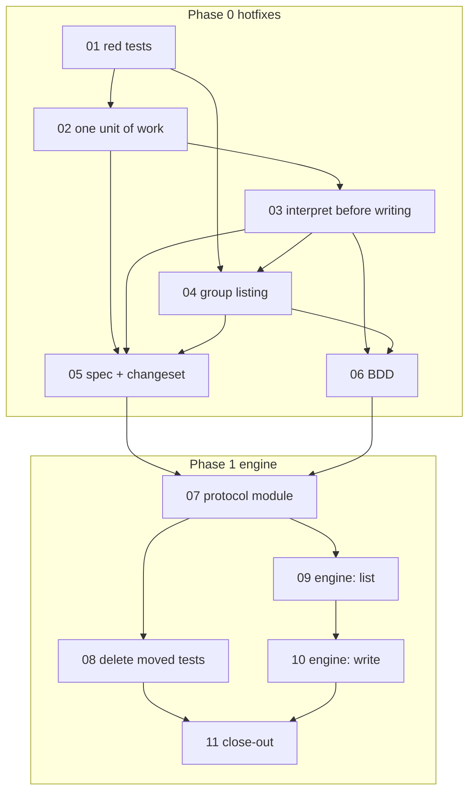

# Plan 32: A SCIM resource engine — one PATCH interpretation, one unit of work per write, one list path

| Property | Value |
|---|---|
| Source | Architecture review 2026-11-09, batch 4, candidate 32 ("SCIM resource engine") |
| Strength | **Strong** (confirmed). Four live bugs by reading, one more found while verifying (§2.4). Every one is turned into a red test by ticket 01 |
| Dependency category | **In-process** (the RFC 7644 protocol rules, pure) **plus local-substitutable** (the SQL transaction: `SqlTransaction.layerSql` over SQLite and Postgres, `layerNoop` over memory) |
| Wave / position | Independent of every other batch-4 plan. **Phase 0 (hotfixes, tickets 01–06)** ships first and does not depend on the engine. **Phase 1 (the engine, tickets 07–11)** follows on the same base |
| Touched packages | `@awthaq/scim` (src, tests, README). `features/` (BDD). `spec/` (behaviours, traceability). **No change to `@awthaq/organization`** under the recommended defaults (Q1, Q2) |
| Wire change | **Yes, four answers change** (§3.7): a refused group `PATCH`/`PUT` no longer leaves part of itself behind; a path-less `PATCH` object applies every managed attribute it names (was: only the first); group filters and paging reach groups past the 10,000th (were invisible); a `PATCH` publishes team-member events per net change (was: per operation). Plus one error: a `PATCH` `displayName` over 255 characters is `400` (Q7) |
| ADRs | **No new ADR** (ADR-EA-051 stays unused). The plan applies [ADR-EA-037](../../spec/decisions/037-unit-of-work-releases-events-on-commit.md) decision 4 (a nested unit is a savepoint; only the outermost unit releases its lanes) to SCIM and keeps plan 04's Q11 decision (no combined `applyGroupChange` on `OrganizationTeams`). No Accepted ADR is amended |
| Behaviours | BEH-EA-350 (a SCIM `PUT`/`PATCH` is applied whole or not at all), BEH-EA-351 (a list filter or page reaches every resource the connection provisioned, and only those). BEH-EA-248, 251 and 252 reworded. BEH-EA-352 left free |
| Requirements | REQ-EA-1530–1533 (four BDD scenarios). 1534–1539 left free |
| Tickets | `tickets/01-…` to `tickets/11-…` (11). Phase 0: 01–06. Phase 1: 07–11 |
| Verified at | `04fa3526` on `architecture/deepening-plans-2`, 2026-11-09. The working tree's uncommitted edits (two-factor, roles, qadi) touch no file this plan reads or writes (`git status --short packages/scim packages/organization` is empty) |

Conventions: [`.planning/README.md` § Shared conventions](../README.md#shared-conventions-apply-to-every-plan) and [`.planning/IMPLEMENTING.md`](../IMPLEMENTING.md) apply. No `as` in library source; no return-type annotations on new Effect or Layer consts; type-system first; replace, don't layer, when tests move. Effect is `effect@4.1.2` from the catalog; check signatures in `node_modules/.pnpm/effect@4.1.2/node_modules/effect`. Vocabulary: **module, interface, implementation, depth, deep, shallow, seam, adapter, leverage, locality**. "System interface" keeps plan 04's meaning: what trusted code calls with an explicit `Actor` (`OrganizationTeams`, `OrganizationMembers`). "Unit of work" keeps ADR-EA-037's meaning.

---

## 0. How to read this plan

Two different things are wrong with SCIM's resource handling, and they are fixed in two phases:

| | Phase 0: hotfixes (tickets 01–06) | Phase 1: the engine (tickets 07–11) |
|---|---|---|
| Problem | Group `PATCH`/`PUT` commit operation by operation, so a refusal at operation N leaves operations 1…N−1 behind. Group listing scans at most 10,000 mappings. A SCIM deactivation commits the suspension apart from the session revocation | The RFC 7644 rules (filter, paging, PATCH operations) are written twice, inline, inside a 1,513-line module. The order every write must keep (read, interpret, vet, one unit, render) is restated by hand in four handlers |
| Change | One unit of work per write (`SqlTransaction`, already declared, never used). A pure group-PATCH interpreter that refuses before the first write. Listing through the store's own lookups | A pure protocol module (`internal/protocol.ts`) and an engine (`internal/engine.ts`) with one list path and one write path. Users and Groups become two adapters at that seam |
| Lands even if the engine is NO-GO | All of it | — |

Read §2 for the evidence, §3 for the design, §4 for the ticket table. Every ticket file is self-contained.

---

## 1. Summary, goals, non-goals

### 1.1 Summary

`packages/scim/src/Scim.ts` serves `/scim/v2` for one organization's directory. Users already have a pure PATCH interpreter (`interpretUserPatch`, `Scim.ts:338-367`) and list through the store's paging (`listUsers`, `:752-781`). Groups have neither:

- `patchGroup` (`:1336-1408`) reads, refuses and writes inside one loop. Each operation reaches a different module call (`renameGroup` → `OrganizationTeams.rename`; `records.setExternalId`; `applyRoster`/`replaceProvisioned` → `OrganizationTeams.applyRoster`), and nothing holds them in one unit. A refusal at operation N answers `400`/`403`/`409` with operations 1…N−1 committed. RFC 7644 §3.5.2 says the opposite: "A patch request, regardless of the number of operations, SHALL be treated as atomic. If a single operation encounters an error condition, the original target resource MUST be restored, and a failure status SHALL be returned."
- `replaceGroup` (`:1298-1321`) commits the new `externalId` before the rename's veto runs.
- `listGroups` (`:1153-1181`) loads at most 10,000 mappings, resolves each with its own `teams.find`, then filters and pages in memory. Group 10,001 onwards is invisible to `displayName eq`, `externalId eq` and paging, so an IdP that looks a group up before pushing it creates a duplicate.

The fix that matters ships first and small: open one unit of work per write (the `SqlTransaction` port SCIM already declares at `:517` and never uses), interpret a group PATCH completely before the first write, and look groups up through the store. The engine then puts the RFC rules in one pure module and the write order in one place.

### 1.2 Goals (goal-backward)

The outcome: **a directory's write to a group or user is applied whole or not at all, and a directory can always find the groups it provisioned.**

```yaml
must_haves:
  truths:
    - "On SQL, a group PATCH or PUT refused for any reason (unknown op, empty displayName, a member the connection did not provision, a team veto, a member limit, an externalId conflict, a store outage) leaves the team, its roster and the mapping exactly as they were, and publishes no event"
    - "On memory, every refusal that can be decided before a write (unknown op, empty or over-long displayName, a member the connection did not provision, an externalId held by another group, a rename veto on PUT) leaves the group unchanged"
    - "On SQL, a SCIM deactivation commits the suspension and the session revocation together: an outage in either leaves the user active with its sessions, and a retry completes both"
    - "A path-less PATCH object applies every managed attribute it names (displayName, externalId, members)"
    - "displayName eq and externalId eq find a group however many groups the connection has, and never list a team the connection did not provision"
    - "The RFC 7644 filter, paging and PATCH rules live in one pure module, tested without building a composition"
    - "Users and Groups list through one path and write through one path, and every write is one unit of work"
  artifacts:
    - path: "packages/scim/test/ScimAtomicity.test.ts"
      provides: "Red-then-green atomicity cases, memory and SQL (tickets 01-03)"
    - path: "packages/scim/test/ScimGroupsListing.test.ts"
      provides: "The past-10,000 and connection-scoping listing cases (tickets 01, 04, 09)"
    - path: "packages/scim/src/internal/protocol.ts"
      provides: "parseFilter, paging, interpretUserPatch, interpretGroupPatch, groupReplacement, namedMembers, settleRoster"
    - path: "packages/scim/src/internal/engine.ts"
      provides: "ScimEngine.make: list(listing) and write(writable, operation)"
    - path: "packages/scim/test/ScimProtocol.test.ts"
      provides: "Pure tests and properties of the protocol module"
    - path: "spec/behaviors/30-scim.md"
      provides: "BEH-EA-350, BEH-EA-351; revision 1.7 (and 1.8)"
  key_links:
    - from: "packages/scim/src/Scim.ts"
      to: "@awthaq/ports SqlTransaction"
      via: "sqlTransaction.withTransaction around every write; SqlError mapped by Errors.storeUnavailable"
      pattern: "sqlTransaction\\.withTransaction"
    - from: "Group listing (displayName eq)"
      to: "ScimRecords.find(connection.id, \"Group\", teamId)"
      via: "every candidate team is kept only if this connection maps it"
      pattern: "records\\.find\\(connection\\.id, \"Group\""
    - from: "packages/scim/src/internal/engine.ts"
      to: "ScimRecords.list"
      via: "unfiltered listing pages in the store (offset, count)"
      pattern: "records\\.list\\("
    - from: "packages/scim/src/Scim.ts"
      to: "packages/scim/src/internal/protocol.ts"
      via: "interpretGroupPatch / interpretUserPatch / parseFilter imported, not re-derived"
      pattern: "from \"./internal/protocol.ts\""
```

### 1.3 Non-goals

- A combined team operation on `OrganizationTeams` (plan 04 Q11 decided against it; Q2 here keeps that).
- Memory-backend rollback. `SqlTransaction.layerNoop` has none by design (ADR-EA-037 decision 5, DRS-006); §3.4 says exactly what memory guarantees.
- New filter operators, `sortBy`, `/Bulk`, ETags, `excludedAttributes` (BEH-EA-252 lists them as unsupported; unchanged).
- The per-member resolution inside `groupResource` (`provisionedMembers`, `:1053-1065`, one `records.find` per team member). It is bounded by one team's roster and is not one of the candidate's bugs; §2.4 records it, Q8 asks whether to follow up.
- `createUser`, `createGroup`, `deleteGroup` and the erasing `deleteUser`: each already runs inside its own unit (`SignUp.createWith`, `OrganizationTeams.create`/`remove` with `attach`, `AccountErasure.eraseAccount`).
- Editing `scripts/test-pg.sh` (plan 37 owns it; §8).

### 1.4 Go / no-go gate

**Phase 0: GO, ungated.** The bugs violate RFC 7644 §3.5.2 and BEH-EA-251 ("an abort is `403` and nothing is written"), and the 10,000 cap loses data an IdP relies on. Ticket 01 reproduces each one before any fix.

**Phase 1 (engine): GO.** Evidence for:
- The unknown-op refusal is written twice (`Scim.ts:346`, `:1345`); the path rules for groups exist only inline (`:1349-1403`), which is where the path-less bug lives (§2.4 F5).
- After Phase 0, four handlers (`replaceUser`, `patchUser`, `replaceGroup`, `patchGroup`) each restate the same order: owned resource outside the unit, interpret, vet, apply inside one unit, render after commit. Getting it wrong is silent: putting `ownedGroup` inside the unit rolls back its stale-mapping cleanup (§7 R3).
- `listUsers` and `listGroups` restate filter parsing, paging and the `ListResponse` assembly.
- The four filter properties in `ScimFilter.property.test.ts` each build a composition per run; two of them test only the parser and would run as pure properties.

Evidence against: Phase 0 alone fixes every bug; the engine adds two internal files and an adapter interface. **If, after Phase 0, a reviewer finds the four handlers short and identical enough to read as one, tickets 10 (write path) may be dropped; 07–09 still pay for themselves** (the duplicated RFC rules and the slow property tests). Record the call in "Decisions taken".

---

## 2. Verified current state

### 2.1 Re-measurement commands

Run from the repo root. Baselines at `04fa3526`:

| # | Command | Baseline |
|---|---|---|
| M1 | `wc -l packages/scim/src/Scim.ts` | 1513 |
| M2 | `grep -c 'sqlTransaction' packages/scim/src/Scim.ts` | 0 |
| M3 | `grep -c 'SqlTransaction' packages/scim/src/Scim.ts` | 2 (the import at `:53`, `ports:` at `:517`) |
| M4 | `grep -c '10_000' packages/scim/src/Scim.ts` | 1 (`:1156`) |
| M5 | `grep -n 'Unknown patch op' packages/scim/src/Scim.ts` | `:346`, `:1345` |
| M6 | `grep -n 'setExternalId(' packages/scim/src/Scim.ts` | `:929` (user), `:1308` (PUT group), `:1366` (PATCH group) |
| M7 | `grep -n 'requireMembers(' packages/scim/src/Scim.ts` | `:1209`, `:1306`, `:1389`, `:1392` |
| M8 | `grep -n 'renameGroup(\|applyRoster(\|replaceProvisioned(' packages/scim/src/Scim.ts` | `:1119`, `:1147`, `:1316`, `:1317`, `:1363`, `:1390`, `:1393`, `:1401` |
| M9 | `ls packages/scim/src/internal` | no such directory |
| M10 | `grep -n 'maximumTeams: Number.POSITIVE_INFINITY' packages/organization/src/OrganizationConfig.ts` | `:103` (no default team quota) |
| M11 | `npx vitest run packages/scim/test/ScimGroups.test.ts` | 17 passed |
| M12 | `grep -c 'it.effect.prop' packages/scim/test/ScimFilter.property.test.ts` | 4 (`:38`, `:50`, `:81`, `:112`) |

### 2.2 How a SCIM write reaches storage today

- **The port is declared, never opened.** `Scim.layer` lists `ports: [SqlTransaction.SqlTransaction]` (`Scim.ts:517`), but `make` (`:622-1450`) never yields it (M2 = 0). Compare `AdminAccounts.ts:162`, `Erasure.ts:146`, `SignUp.ts:120`, which do.
- **What a nested unit does.** `SqlTransaction.transactional` (`packages/ports/src/SqlTransaction.ts:86-122`) runs `sql.withTransaction` with a fresh `UnitOfWork`; a nested call is a savepoint that hands its commit lane to the parent on success (ADR-EA-037 decision 4; `spec/behaviors/05-persistence-stratum.md:85`: "nested calls become savepoints"). State-change events write their audit row inline (so it rolls back) and release their bus copy `onCommit`; observe hooks (`After*`) run `onCommit`; veto hooks run inline (ADR-EA-037 decisions 2–3). So a SCIM unit around `OrganizationTeams` calls is the ordinary case, not a new one: a tenanted Postgres deployment already runs every handler inside `TenantScope.withTenant`'s transaction (ADR-EA-037, Context).
- **Memory has no rollback.** `SqlTransaction.layerNoop` (`SqlTransaction.ts:139-142`) is a passthrough; `Persistence.memory` provides it (ADR-EA-041 decision 4). Its own doc comment (`:128-137`) states the limit: atomic per `Ref` only, "acceptable for development and tests, never for production".
- **What each group step costs.**
  - `OrganizationTeams.rename` (`packages/organization/src/OrganizationTeams.ts:478-495`): gate, `BeforeUpdateTeam` veto, one `updateTeam` write, event, `AfterUpdateTeam`. **No transaction of its own.**
  - `records.setExternalId`: one statement (`ScimRecords.ts`), fails `ScimLinkConflict` on the unique index.
  - `OrganizationTeams.applyRoster` (`OrganizationTeams.ts:223-243`, body near `:713`): every veto first, the member limit on the final count, then **its own transaction**.
- **Team names are not unique.** `organization_team` has no unique index on `(organizationId, name)` (`OrganizationMigrations.ts:178-241`; the only unique team index is `organization_team_membership_team_user`, `:347`). A `displayName eq` filter may match several teams.

### 2.3 How listing works today

- `listUsers` (`:752-781`): unfiltered → `records.list(connection.id, "User", { offset, limit: count })` (store paging, `ScimRecords.ts:388-397` memory, `:609` SQL `LIMIT … OFFSET …`); filtered → `records.findByName` / `records.findByExternalId` (one row). Then one `users.findById` per link on the page (≤ `maxResults`, default 200).
- `listGroups` (`:1153-1181`): always `records.list(connection.id, "Group", { offset: 0, limit: 10_000 })`, then `teams.find` per link (up to 10,000 point reads), then filter and slice in memory. `records.list` orders by `createdAt, resourceId` (oldest first), so the groups that fall off are **the newest**, the ones a directory is pushing now.
- `ScimRecords` already has the primitive the `externalId eq` filter needs: `findByExternalId(connectionId, "Group", value)` (`ScimRecords.ts:125-129`). `displayName` is not stored on the mapping (a group link has no `name`, `Scim.ts:1222-1227`); it lives in `organization_team.name`.

### 2.4 Findings

| # | Finding | Where | Status |
|---|---|---|---|
| F1 | A group `PATCH` refused at operation N (unknown op, empty or removed `displayName`, a member the connection did not provision) answers `400` with operations 1…N−1 committed, on every backend | `Scim.ts:1341-1404` (`return yield* ScimApi.badRequest` inside the loop at `:1344`, `:1361`; `requireMembers` at `:1389`, `:1392` after earlier ops wrote) | **Live, by reading; reproduced by ticket 01** (A1–A3) |
| F2 | A group `PATCH` whose later team call is refused (a `BeforeUpdateTeam`/`BeforeAddTeamMember` veto, `TeamMemberLimitReached`, an `externalId` conflict) answers `403`/`409` with earlier operations committed. Contradicts BEH-EA-251 "an abort is `403` and nothing is written" | same loop; each step its own commit (§2.2) | **Live, by reading; reproduced by ticket 01** (A5, SQL) |
| F3 | `PUT /Groups/:id` commits the new `externalId` (`:1307-1315`) before `renameGroup` (`:1316`) can be vetoed, and before the roster's limit/veto (`:1317`) | `Scim.ts:1298-1321` | **Live, by reading; reproduced by ticket 01** (A4) |
| F4 | Group 10,001 onwards is invisible to `displayName eq`, `externalId eq` and to paging; `totalResults` is capped at the live count of the first 10,000; and listing costs up to 10,000 `teams.find` reads per request. Nothing caps a connection below 10,000 groups (M10) | `Scim.ts:1156-1161` | **Live, by reading; reproduced by ticket 01** (L1) |
| F5 | **(new)** A path-less `PATCH` object applies only the first branch it matches: `{ "op": "replace", "value": { "displayName": "X", "members": [...] } }` renames and drops the members; a path-less `{ "externalId": "…" }` is ignored (the `externalid` branch tests only `path`). Users do not have this bug: `interpretUserPatch` folds every entry (`:351-353`) | `Scim.ts:1351-1403` (`if` / `else if` chain; `attribute === "externalid"` at `:1364` reads the path only) | **Live, by reading; reproduced by ticket 01** (A6) |
| F6 | **(new)** `applyActive` (`:714-748`) commits `users.setStatus("suspended")` and then `sessions.revokeAll`. An outage between them leaves a suspended user with live sessions, and a retry is a no-op because the user is already suspended (`:720` tests `user.status === "active"`). Session verification does not re-read the user's status (`grep -c 'suspended' packages/core/src/Sessions.ts` = 0; `assertCanSignIn` is called only at sign-in, `internal/signInSteps.ts:106`) | `Scim.ts:714-748`; callers `:804`, `:897`, `:959`, `:1019` | **Latent, by reading** (needs an outage); **reproduced by ticket 01** on SQL with an injected failure (A7) |
| F7 | `replace` with a filtered members path (`members[value eq "x"]`) is a silent no-op: it fails the bare-`members` test at `:1388` and is neither `add` nor `remove` | `Scim.ts:1388-1402` | By reading; behaviour kept (Q6) |
| F8 | `PATCH displayName` has no length check; `POST` and `PUT` refuse over 255 (`:1186`, `:1302`) | `Scim.ts:1355-1363` | By reading; aligned in ticket 03 (Q7) |
| F9 | `groupResource` resolves members with one `records.find` per team member (`provisionedMembers`, `:1053-1065`) | `Scim.ts:1053-1065`, `:1071` | By reading; out of scope (Q8) |
| F10 | User writes are already validated before their first write (`userName` mutability at `:916-925`; `Users.updateProfile`/`setStatus` carry no veto, `packages/core/src/Users.ts:258`, `:308`), but `applyUserChanges` (`:910-962`) is still three commits; only an outage can split them | `Scim.ts:910-962` | By reading; closed by ticket 02's unit |

### 2.5 Evidence corrections (candidate vs code)

1. *"Each operation commits on its own: `renameGroup`, `records.setExternalId`, and `applyRoster`/`replaceProvisioned`, each in its own transaction."* Only `applyRoster` opens a transaction. `OrganizationTeams.rename` writes once with no transaction (`OrganizationTeams.ts:485-487`), and `setExternalId` is one statement. The conclusion (no enclosing unit, each step commits alone) holds.
2. *"`SqlTransaction` is already declared as a port (line 517)."* True, and it is **never yielded** (M2 = 0), so SCIM opens no unit anywhere. The fix needs no manifest change.
3. *"Lines 1211 and 1412 describe how `OrganizationTeams` owns its own transaction."* True for `create` and `remove`, whose `attach` callbacks put the mapping write inside the team's transaction. There is no `attach` on `rename` or `applyRoster`, so that route cannot carry a multi-operation PATCH; the ambient unit (§3.3) can.
4. *"Groups beyond 10,000 are invisible to `displayName eq` and `externalId eq`."* True, and also to paging (`startIndex` > 10,000 returns nothing), and they are the newest groups (§2.3).
5. *"`listUsers` pages in the store."* True for the unfiltered case; a filtered user lookup reads one row and slices in memory, which is correct (at most one match).
6. The candidate lists four bugs; verification adds F5 (path-less object) and F6 (deactivation split).
7. *Wave 0 hotfix "wrap `patchGroup` and `replaceGroup` in one transaction, if that is possible without the engine"*: possible, and done by ticket 02 in under 30 lines. It fixes F1–F3 on SQL only. Memory needs ticket 03 (validate before the first write), which is also engine-independent.

### 2.6 Live bugs, summary

| Bug | Backend | Ticket that reproduces | Ticket that fixes |
|---|---|---|---|
| F1 partial PATCH on a `400` | memory, SQL | 01 (A1–A3) | 02 (SQL), 03 (memory) |
| F2 partial PATCH on a veto / limit / conflict | SQL | 01 (A5) | 02 |
| F3 PUT commits `externalId` before the vetoed rename | memory, SQL | 01 (A4) | 02 (SQL), 03 (memory) |
| F4 10,000 cap and N+1 | both | 01 (L1) | 04 |
| F5 path-less object drops attributes | both | 01 (A6) | 03 |
| F6 deactivation split by an outage | SQL | 01 (A7) | 02 |

---

## 3. Target design

### 3.1 The seam

Between the wire (`ScimApi` payloads) and the two domains a directory writes (`Users` for users; `OrganizationTeams` + `ScimRecords` for groups) sits one **SCIM resource engine**:

```
HTTP handler (ScimApi)                         unchanged
   │
Scim (ScimShape: listUsers … deleteGroup)      unchanged interface
   │
internal/engine.ts   list(listing) · write(writable, operation)       ◄─ the seam
   │        ▲                ▲
   │   User adapter     Group adapter          (in Scim.ts make: close over Users / OrganizationTeams)
   │
internal/protocol.ts  parseFilter · paging · interpretUserPatch · interpretGroupPatch · settleRoster   (pure)
```

- **Behind the seam (the engine's implementation):** the order of a write (owned resource → interpret → vet → one unit of work → render), the `SqlError` → `StoreUnavailable` mapping (ADR-EA-028), and the list algorithm (filter → store lookup; no filter → store page; resolve each link on the page; `ListResponse`).
- **The adapters:** what "owned", "vet", "apply", "render", "lookup" mean for a user and for a group. Two adapters, so the seam is real.
- **The protocol module:** pure. It requires nothing from the context and fails only with `ScimBadRequest`.

`ScimShape` and every handler keep their types; no export of `@awthaq/scim` changes (`packages/scim/package.json` exports only `"."`, so `src/internal/*` is package-private, the convention `packages/organization/src/internal/` already uses).

### 3.2 `internal/protocol.ts` (pure)

```ts
import type * as Data from "effect/Data";

export interface Filter<A extends string> {
  readonly attribute: A;
  readonly value: string;
}
/** `attr eq "value"`, case-insensitive on the attribute and operator; anything else is 400 invalidFilter. */
export declare const parseFilter: <const A extends string>(
  filter: string | undefined,
  attributes: readonly [A, ...ReadonlyArray<A>],
) => Effect.Effect<Option.Option<Filter<A>>, ScimApi.ScimBadRequest>;

export interface Page {
  readonly startIndex: number; // 1-based, floor 1
  readonly count: number;      // 0..maxResults
  readonly offset: number;     // startIndex - 1
}
export declare const paging: (query: ScimApi.ListQuery, maxResults: number) => Page;

// Users: moved unchanged from Scim.ts:285-367 (UserChanges, noChanges, assign, interpretUserPatch),
// plus the input helpers splitName, joinName, nameFromInput, emailFromInput, stringOf, coerceBoolean, isRecord.

export type RosterStep = Data.TaggedEnum<{
  Replace: { readonly ids: ReadonlyArray<string> };
  Add: { readonly ids: ReadonlyArray<string> };
  Remove: { readonly ids: ReadonlyArray<string> };
  Clear: {};
}>;
export interface GroupChanges {
  readonly displayName: Option.Option<string>;              // validated: non-empty, at most 255
  readonly externalId: Option.Option<Option.Option<string>>; // Some(None) clears
  readonly roster: ReadonlyArray<RosterStep>;                // in request order
}
export declare const interpretGroupPatch: (
  patch: ScimApi.PatchRequest,
) => Effect.Effect<GroupChanges, ScimApi.ScimBadRequest>;
/** PUT: displayName replaced, externalId replaced (absent clears), members replaced. */
export declare const groupReplacement: (
  input: ScimApi.GroupInput,
) => Effect.Effect<GroupChanges, ScimApi.ScimBadRequest>;
/** Every id an Add or Replace step names: what must be provisioned and a member before any write. */
export declare const namedMembers: (changes: GroupChanges) => ReadonlyArray<string>;
/** Folds the steps over the provisioned members now; the net roster change, one applyRoster call. */
export declare const settleRoster: (
  steps: ReadonlyArray<RosterStep>,
  current: ReadonlyArray<string>,
) => { readonly add: ReadonlyArray<string>; readonly remove: ReadonlyArray<string> };
```

`interpretGroupPatch` rules (ticket 03 writes them; they keep today's accepted forms and add F5):

| Operation | Result |
|---|---|
| `op` not `add`/`replace`/`remove` (trimmed, any case) | `400 invalidSyntax`, the existing "Unknown patch op" message |
| path `displayName` (any case) | `remove` → `400` "displayName cannot be empty"; empty or non-string value → same `400`; over 255 → `400` (F8, Q7); else `displayName = Some` |
| path `externalId` | `remove` → `Some(None)`; else `Some(stringOf(value))` (an empty string clears, as today) |
| path `members` (bare, or `members.<sub>`) | `replace` → `Replace(ids)`; `add` → `Add(ids)`; `remove` with no ids → `Clear`; `remove` with ids → `Remove(ids)` |
| path `members[value eq "x"]` | `add` → `Add([x])`; `remove` → `Remove([x])`; `replace` → nothing (F7, Q6) |
| no path, value an object | **each entry** is applied as if it were a path (`displayName`, `externalId`, `members`; F5). `remove` with no path applies to `members` only (today's tolerance) |
| any other path or attribute | ignored (IdPs send many; BEH-EA-248's rule) |

`settleRoster` semantics: start from `current` (the team members this connection provisioned); `Replace` sets the set, `Add` unions, `Remove` subtracts (an id not in the set is a no-op, so a hand-added member can never be removed), `Clear` empties. `add` = final − current, `remove` = current − final. Sequential RFC semantics are kept for validation: every id an `Add`/`Replace` step names is checked by `namedMembers`, even if a later step removes it again.

### 3.3 `internal/engine.ts`

```ts
type Connection = ScimApi.ScimConnectionIdentity;
type StoreUnavailable = Errors.StoreUnavailable;

export interface Listing<A extends string, R> {
  readonly kind: ScimRecords.ResourceKind;
  readonly filters: readonly [A, ...ReadonlyArray<A>];
  /** The mappings a filter names, scoped to `connection`. */
  readonly lookup: (
    connection: Connection,
    filter: Filter<A>,
  ) => Effect.Effect<ReadonlyArray<ScimRecords.ResourceLink>, StoreUnavailable>;
  /** The resource a mapping names; `None` when it vanished (skipped, as listUsers does today). */
  readonly render: (
    connection: Connection,
    link: ScimRecords.ResourceLink,
  ) => Effect.Effect<Option.Option<R>, StoreUnavailable>;
}

export interface Writable<Owned, Changes, R, E> {
  /** Outside the unit: a 404 and its stale-mapping cleanup must persist. */
  readonly owned: (connection: Connection, id: string) => Effect.Effect<Owned, ScimApi.ScimNotFound | StoreUnavailable>;
  /** Reads only: every refusal that needs no write, before the first write. */
  readonly vet: (
    connection: Connection,
    owned: Owned,
    changes: Changes,
  ) => Effect.Effect<void, ScimApi.ScimBadRequest | ScimApi.ScimConflict | StoreUnavailable>;
  /** The writes; the engine runs them inside one unit of work. */
  readonly apply: (connection: Connection, owned: Owned, changes: Changes) => Effect.Effect<Owned, E | StoreUnavailable>;
  /** After commit. */
  readonly render: (connection: Connection, owned: Owned) => Effect.Effect<R, StoreUnavailable>;
}

/**
 * Yielded once in Scim.ts make (like `SignUp.make`, Scim.ts:625). Takes `maxResults` as an argument rather than
 * reading `ScimConfig`, which Scim.ts defines (an import would be a cycle). Yields ScimRecords and SqlTransaction.
 */
export declare const make: (maxResults: number) => Effect.Effect<
  {
    readonly list: <A extends string, R>(
      listing: Listing<A, R>,
    ) => (
      connection: Connection,
      query: ScimApi.ListQuery,
    ) => Effect.Effect<
      { readonly schemas: ReadonlyArray<string>; readonly totalResults: number; readonly startIndex: number; readonly itemsPerPage: number; readonly Resources: ReadonlyArray<R> },
      ScimApi.ScimBadRequest | StoreUnavailable
    >;
    readonly write: <Owned, Changes, R, E>(
      writable: Writable<Owned, Changes, R, E>,
      operation: string, // the StoreUnavailable label, e.g. "Scim.patchGroup"
    ) => (
      connection: Connection,
      id: string,
      changes: Effect.Effect<Changes, ScimApi.ScimBadRequest>,
    ) => Effect.Effect<R, ScimApi.ScimNotFound | ScimApi.ScimBadRequest | ScimApi.ScimConflict | E | StoreUnavailable>;
  },
  never,
  ScimRecords.ScimRecords | SqlTransaction.SqlTransaction
>;
```

The `make` sketch above carries an explicit type only to show the shape; the implementation is a plain `Effect.gen` with no annotation (convention). `write` keeps today's precedence: owned (404) before the body is interpreted (400).

**The list algorithm.** No filter: `records.list(connection.id, kind, { offset, limit: count })` and `render` per link on the page (≤ `maxResults`); `totalResults` is the store's total. A filter: `lookup`, then `render` each, then slice `[offset, offset + count)`; `totalResults` is the number rendered. No cap anywhere.

**The two adapters** (closures in `Scim.ts` `make`):

| | User adapter | Group adapter |
|---|---|---|
| `lookup` | `userName` → `records.findByName(…, "User", v)`; `externalId` → `records.findByExternalId(…, "User", v)` | `externalId` → `records.findByExternalId(…, "Group", v)`; `displayName` → `teams.list(organizationId)` filtered by exact `name`, then `records.find(connection.id, "Group", team.id)` per candidate, keeping only mapped ones (Q1) |
| `render` | `users.findById` → `userResource`; `UserNotFound` → `None` | `teams.find` → `groupResource`; `None` → `None` |
| `owned` | `ownedUser` (`:669-681`) | `ownedGroup` (`:1041-1050`) |
| `vet` | the `userName` mutability check (moved out of `applyUserChanges`, `:916-925`) | `requireMembers(namedMembers(changes))`; a `Some(Some(v))` `externalId` held by another group of this connection → `409` (pre-read with `records.findByExternalId`) |
| `apply` | `applyUserChanges` minus the check: `setExternalId`, `updateProfile`, `applyActive` | roster first (`settleRoster` over `provisionedMembers`, one `applyRoster` when non-empty), then `renameGroup` when the name differs, then `setExternalId`, then `groupChanged("updated")` |
| `render` | `userResource` | `groupResource` |

Group apply order: the roster goes first because its refusals (member limit, per-member vetoes) are the likeliest and `applyRoster` vets everything before writing; the mapping goes last because its only refusal (a conflict) is pre-read in `vet`.

### 3.4 What each backend guarantees after the plan

| Refusal | SQL (SQLite, Postgres) | Memory (`layerNoop`) |
|---|---|---|
| unknown op, empty/over-long `displayName`, a member not provisioned | nothing written (interpreted / vetted before the unit) | nothing written |
| `externalId` held by another group | nothing written (pre-read; a race is caught by the unique index and rolls back) | nothing written (pre-read; a race may leave earlier steps: DRS-006) |
| roster veto or member limit | nothing written (`applyRoster` refuses before writing, and it is the first write) | nothing written |
| rename veto after a roster change | rolled back | **the roster change stays** (Q2; DRS-006, documented in BEH-EA-350) |
| outage mid-unit | rolled back, `503` | n/a (memory has no outages) |
| events | audit rows roll back with the unit; bus copies and `After*` taps run on commit only | run as they happen (ADR-EA-037 decision 5) |

### 3.5 Module layout after the change

```
packages/scim/src/
  Scim.ts               the plugin, the two adapters, the handlers          (~1,250 lines, from 1,513)
  ScimApi.ts            unchanged
  ScimConnections.ts    unchanged
  ScimEvents.ts         unchanged
  ScimRecords.ts        unchanged (no new store operation)
  index.ts              unchanged (internal/ is not exported)
  internal/protocol.ts  NEW, pure: filter, paging, user and group PATCH interpretation, roster fold
  internal/engine.ts    NEW: ScimEngine.make → { list, write }
packages/scim/test/
  ScimAtomicity.test.ts      NEW (ticket 01): A1–A7, memory and SQL
  ScimGroupsListing.test.ts  NEW (ticket 01): L1 past-10,000, L2 connection scoping; ticket 09 adds SQL cases
  ScimProtocol.test.ts       NEW (ticket 07): pure cases and properties
  support.ts                 + ScimLiveSql
```

### 3.6 Alternatives rejected

- **(a) A combined `OrganizationTeams.applyGroupChange` (rename + roster + `attach`).** It would make memory atomic for a rename veto too. Plan 04 Q11 decided against it ("no caller needs a combined operation"); the ambient unit of work gives SQL the same guarantee with no new system-interface operation, and memory's remaining gap is the documented DRS-006 one. Kept as Q2.
- **(b) Compensation on memory (rename back, roster back).** The compensating calls run the vetoes and publish events again; a compensating rename can itself be vetoed. Rejected.
- **(c) Store the group's `displayName` on its mapping (`scim_resource.name`) and filter with `findByName`.** The `name` column is unique per connection and kind (BEH-EA-247), so two groups could not share a name, and a rename made outside SCIM would leave it stale. Rejected.
- **(d) A new `TeamRecords.findTeamsByName` behind `OrganizationTeams.findByName`.** Pushes the name filter into SQL, but adds a system-interface operation, a record-store operation with its `RecordsContract` verdict (plan 25, ADR-EA-041 decision 9), and an index to make it worth it. Today's real cost of the in-memory filter is one `listTeamsByOrganization` read per filtered request, bounded by the organization's own teams. Kept as Q1 with "no" as the default.
- **(e) Batch-resolve a page of groups with `teams.list(organizationId)` instead of `teams.find` per link.** One read instead of ≤200, but it reads every team of the organization on every page. The per-page lookup matches `listUsers` and is bounded by `maxResults`. Rejected.
- **(f) Leave the four handlers hand-written after Phase 0 (no engine).** Viable; §1.4 says when to take it.

### 3.7 Wire changes

| Request | Before | After |
|---|---|---|
| Group `PATCH` refused at operation N | `4xx`, operations 1…N−1 kept | `4xx`, nothing kept (memory: except a rename veto after a roster change, §3.4) |
| Group `PUT` with a vetoed rename | `403`, new `externalId` kept | `403`, nothing kept |
| Path-less `{ displayName, members }` / `{ externalId }` | first attribute only / ignored | every managed attribute applied |
| Group `PATCH` with several member operations | one `applyRoster` per operation, events per operation | one `applyRoster`, `auth.organization.teamMember*` and `After*TeamMember` per **net** change (Q3) |
| `PATCH displayName` over 255 characters | written | `400 invalidValue` (Q7) |
| `GET /Groups?filter=…` past 10,000 groups | not found | found |
| `GET /Groups` unfiltered `totalResults` | live mappings among the first 10,000 | every mapping of the connection (a mapping whose team was removed elsewhere is counted and skipped on its page, as `GET /Users` does; Q4) |
| SCIM deactivation hit by an outage | user suspended, sessions live, retry a no-op | nothing written, `503`, retry completes |

---

## 4. Phased migration

### 4.1 Phase 0: hotfixes (tickets 01–06; one PR, or one PR per ticket)

1. **01 (red).** `ScimAtomicity.test.ts` and `ScimGroupsListing.test.ts` with every case of §2.6 as `it.effect.fails`, so the tree stays green. `support.ts` gains `ScimLiveSql`.
2. **02 (one unit of work).** An `atomically` helper over the yielded `SqlTransaction`; `applyActive`, the `applyUserChanges` calls of `replaceUser`/`patchUser`, and the write part of `replaceGroup`/`patchGroup` run inside it. Flips the SQL cases A1–A5 and A7.
3. **03 (interpret before writing).** `interpretGroupPatch`, `groupReplacement`, `namedMembers`, `settleRoster` in `Scim.ts` (beside `interpretUserPatch`); `replaceGroup` and `patchGroup` share one vet-then-apply sequence. Flips the memory cases A1–A4 and A6 on both modes.
4. **04 (listing).** Group listing through `records.findByExternalId`, the connection-scoped name lookup, and store paging. Flips L1.
5. **05 (spec).** BEH-EA-350/351, BEH-EA-248/251/252 reworded, traceability, README, changeset.
6. **06 (BDD).** REQ-EA-1530–1533.

### 4.2 Phase 1: the engine (tickets 07–11)

7. **07.** `internal/protocol.ts`: move the pure helpers and both interpreters out of `Scim.ts`; `ScimProtocol.test.ts` tests them directly.
8. **08 (replace, don't layer).** Delete the composition-level cases now proven by `ScimProtocol.test.ts` (named in the ticket).
9. **09.** `internal/engine.ts` with `list`; `listUsers` and `listGroups` become two `Listing` values.
10. **10.** `write`; `replaceUser`, `patchUser`, `replaceGroup`, `patchGroup` become `write(adapter, …)` calls.
11. **11.** Close-out: traceability rows, BEH-EA-30 Implementation note, `pnpm check`.

### 4.3 Ticket table

| Ticket | Title | Wave | Depends on | Type | Size | Files |
|---|---|---|---|---|---|---|
| [01](tickets/01-red-tests.md) | Red tests: atomicity (memory, SQL) and the 10,000 cap | 0 | — | tdd | M | `packages/scim/test/support.ts`, `packages/scim/test/ScimAtomicity.test.ts` (new), `packages/scim/test/ScimGroupsListing.test.ts` (new) |
| [02](tickets/02-one-unit-of-work.md) | One unit of work per SCIM write | 1 | 01 | tdd | S | `packages/scim/src/Scim.ts`, `packages/scim/test/ScimAtomicity.test.ts` |
| [03](tickets/03-interpret-group-patch.md) | Interpret a group PATCH or PUT before the first write | 2 | 02 | tdd | M | `packages/scim/src/Scim.ts`, `packages/scim/test/ScimAtomicity.test.ts`, `packages/scim/test/ScimGroups.test.ts` |
| [04](tickets/04-group-listing.md) | Group listing through the store: no cap, no scan | 3 | 01, 03 | tdd | S | `packages/scim/src/Scim.ts`, `packages/scim/test/ScimGroupsListing.test.ts` |
| [05](tickets/05-spec-and-changeset.md) | Spec, traceability, README and changeset for Phase 0 | 4 | 02, 03, 04 | execute | S | `spec/behaviors/30-scim.md`, `spec/traceability.md`, `packages/scim/README.md`, `.changeset/scim-group-writes-atomic.md` (new) |
| [06](tickets/06-bdd-scenarios.md) | BDD: REQ-EA-1530–1533 | 4 | 03, 04 | execute | M | `features/features/13-enterprise-federation/30-scim.feature`, `features/step-definitions/ScimSteps.ts`, `features/step-definitions/ScimWorld.ts`, `features/traceability.md` |
| [07](tickets/07-protocol-module.md) | `internal/protocol.ts`: the RFC 7644 rules in one pure module | 5 | 05, 06 | tdd | M | `packages/scim/src/internal/protocol.ts` (new), `packages/scim/src/Scim.ts`, `packages/scim/test/ScimProtocol.test.ts` (new) |
| [08](tickets/08-replace-moved-tests.md) | Replace, don't layer: delete the composition cases the protocol tests now prove | 6 | 07 | execute | S | `packages/scim/test/ScimFilter.property.test.ts`, `packages/scim/test/ScimUsers.test.ts`, `packages/scim/test/ScimGroups.test.ts` |
| [09](tickets/09-engine-list-path.md) | `internal/engine.ts`: one list path, two listings | 6 | 07 | execute | M | `packages/scim/src/internal/engine.ts` (new), `packages/scim/src/Scim.ts`, `packages/scim/test/ScimGroupsListing.test.ts` |
| [10](tickets/10-engine-write-path.md) | One write path, two adapters | 7 | 09 | execute | M | `packages/scim/src/internal/engine.ts`, `packages/scim/src/Scim.ts`, `packages/scim/test/ScimAtomicity.test.ts` |
| [11](tickets/11-close-out.md) | Close-out: traceability, Implementation note, `pnpm check` | 8 | 08, 10 | execute | S | `spec/traceability.md`, `spec/behaviors/30-scim.md`, this `PLAN.md` ("Decisions taken") |

Same-wave tickets share no file: wave 4 (05: spec/README/changeset; 06: features), wave 6 (08: three test files; 09: engine, `Scim.ts`, listing test).

### 4.4 Dependency graph



---

## 5. Test plan

### 5.1 Tests at the new interface

| File | Cases | Modes |
|---|---|---|
| `ScimAtomicity.test.ts` | A1 rename + non-provisioned member → `400`, name and roster unchanged, no `auth.organization.teamUpdated` row. A2 add + unknown op → `400 invalidSyntax`, roster unchanged. A3 rename + empty `displayName` → `400`, name unchanged. A4 `PUT` new `externalId` + vetoed rename → `403`, `externalId` unchanged. A5 add + vetoed rename → `403`, roster unchanged. A6 path-less `{ displayName, members }` applies both; path-less `{ externalId }` applies. A7 deactivation with an injected `DELETE` failure on `sessions` → `StoreUnavailable`, user active, session verifies; a retry suspends and revokes. Ticket 03 adds A8: `[add ada, add bo, replace members [bo]]` publishes one `teamMemberAdded` (bo), none for ada | A1–A4, A6: memory and SQL. A5, A7: SQL only (§3.4; memory has no outage) |
| `ScimGroupsListing.test.ts` | L1 10,001 groups (the newest created after a `TestClock.adjust`): `displayName eq`, `externalId eq`, and `startIndex=10001&count=1` each return it. L2 `displayName eq "Eng"` lists only this connection's "Eng", not an admin-created "Eng" or another connection's "Eng". Ticket 09 adds L3: paging and both filters for Users and Groups on SQL | L1: memory. L2: memory and SQL. L3: SQL |
| `ScimProtocol.test.ts` | `parseFilter` properties (moved from the composition, §5.2); `interpretGroupPatch` table of §3.2 row by row; `settleRoster` properties: a hand-added id is never in `remove`; `add ∩ remove = ∅`; the result equals applying the steps one by one; `interpretUserPatch` forms (Okta path-less, Entra capitalized ops and string booleans, ignored attributes, unknown op) | pure |

### 5.2 Tests deleted (replace, don't layer: ticket 08)

- `ScimFilter.property.test.ts:50-79` ("only `attr eq "value"` is supported…") and `:112-128` ("an attribute the resource type does not support…"): parser-only properties, each building a composition per run; they move to `ScimProtocol.test.ts` as pure properties over `parseFilter`. `:38-48` (never a defect at both list endpoints) and `:81-110` (finds exactly the user) stay: they test the list path end to end.
- `ScimUsers.test.ts:368-397`: the `oktaStyle` ignored-attribute assertion and the `malformed` unknown-op assertion move to pure cases; the Entra apply assertions (given name joined with the stored family name; `"False"` suspends) stay, because they test `applyUserChanges`.
- `ScimGroups.test.ts:156-189`: the trailing `nonMember` assertion moves (A1 covers it at the interface with the stronger "nothing written"); the roster-and-rename sequence stays.

### 5.3 SQL and Postgres coverage

`TestAuth.layer(built, { records: "sql", suite })` runs SQLite `:memory:` in `pnpm test` and a per-suite Postgres schema under `AWTHAQ_POSTGRES_URL` (`packages/test/src/TestAuth.ts:330-343`, `TestSql.ts:124-130`). SQLite proves rollback and savepoint nesting. Postgres adds READ COMMITTED and the aborted-transaction rule; it runs only if `scripts/test-pg.sh` lists `packages/scim/test/ScimAtomicity.test.ts` and `ScimGroupsListing.test.ts`, which plan 37 owns (§8, Q5). Every SQL case uses its own connection name, so slugs never collide on a shared Postgres schema.

### 5.4 Concurrency

No new race primitive. The `externalId` pre-read in `vet` can lose a race to a concurrent link; on SQL the unique index refuses the write inside the unit and the whole unit rolls back (`409`); on memory the earlier steps stay (DRS-006). `applyRoster`'s own atomicity (plan 25's `within`) is unchanged.

### 5.5 Measurable targets

| Target | Gate | Baseline → after |
|---|---|---|
| No cap in listing | `grep -c '10_000' packages/scim/src/Scim.ts` | 1 → 0 (ticket 04) |
| Units opened | `grep -c 'withTransaction(' packages/scim/src/Scim.ts` and the same on `packages/scim/src/internal/engine.ts` | `Scim.ts`: 0 at HEAD → 1 after 02 (the `atomically` helper) → at most 1 after 10 (only `applyActive`'s own unit). `engine.ts`: 1 after 10 |
| One unknown-op refusal | `grep -rc 'Unknown patch op' packages/scim/src` (sum) | 2 → 1 (ticket 07, in `internal/protocol.ts`) |
| Red cases left | `grep -c 'it.effect.fails' packages/scim/test/ScimAtomicity.test.ts` | 12 (after 01) → 6 (02) → 0 (03) |
| `Scim.ts` size | `wc -l packages/scim/src/Scim.ts` | 1513 → ≤ 1300 (after 10) |
| Filter properties per composition | `grep -c 'it.effect.prop' packages/scim/test/ScimFilter.property.test.ts` | 4 → 2 (ticket 08) |

---

## 6. Spec, ADR, traceability, BDD, docs, changesets

### 6.1 ADR

No new ADR; ADR-EA-051 is not used. Nothing in ADR-EA-037, 040 or 041 changes: the plan uses ADR-EA-037 decision 4 as written and keeps plan 04 Q11. If Q2 is answered "yes", that answer reverses plan 04 Q11 (a decision, not an ADR) and must be recorded in plan 04's "Decisions taken" as superseded.

### 6.2 Behaviours (`spec/behaviors/30-scim.md`, revision 1.6 → 1.7 in ticket 05; 1.8 in ticket 11)

**BEH-EA-350 (new): A SCIM `PUT` or `PATCH` is applied whole or not at all.**

```text
REQUIREMENT: A `PUT` or `PATCH` to a provisioned user or group MUST be
             interpreted and checked in full before anything is written: an
             unknown `op`, an empty or over-long `displayName`, or a member the
             connection did not provision (in any operation, even one a later
             operation would undo) MUST be refused with nothing written. The
             writes MUST then run in one unit of work (ADR-EA-037): a team
             veto, a team member limit, an `externalId` held by another
             resource of the connection, or a store outage MUST leave the
             resource, its roster and its mapping as they were, and publish
             nothing. A `PATCH` with several member operations MUST change the
             roster once, by their net effect, so team-member events and
             observers follow per user actually added or removed. A SCIM
             deactivation MUST commit the suspension and the session
             revocation together.
```

Note under it: on the in-memory backend (`SqlTransaction.layerNoop`, development and tests only, DRS-006) a refusal that can only be decided by a write after another write (a rename veto after a roster change) leaves the earlier write; every refusal decided before the first write leaves nothing. RFC 7644 §3.5.2: "A patch request, regardless of the number of operations, SHALL be treated as atomic." (Ticket 05 quotes the RFC sentence verbatim after checking it against rfc-editor.org, as plan 04 Q11 asked.)

**BEH-EA-351 (new): A list filter or page reaches every resource the connection provisioned, and only those.**

```text
REQUIREMENT: `GET /Users` and `GET /Groups` MUST page in the store, and
             `userName eq`, `externalId eq` and `displayName eq` MUST find a
             resource however many resources the connection has. A
             `displayName eq` filter MUST list only teams the connection
             provisioned, never a same-named team created by an
             administrator or by another connection. A mapping whose resource
             was removed elsewhere is skipped on its page.
```

Reworded: **BEH-EA-248** (the user `PATCH` rules point at BEH-EA-350 for atomicity); **BEH-EA-251** ("an abort is `403` and nothing is written" now holds for multi-operation `PATCH` and `PUT`; a path-less object applies every managed attribute; team events per net change); **BEH-EA-252** (filters and paging have no cap; point at BEH-EA-351). Document Control: revision 1.7, change history line naming architecture plan 32.

### 6.3 Traceability (`spec/traceability.md`)

- §1 row for file 30: range `246-253, 350-351`.
- Row `packages/scim/test/*` (line 388 at HEAD): add `ScimAtomicity.test.ts` (BEH-EA-350, memory and SQL), `ScimGroupsListing.test.ts` (BEH-EA-351), later `ScimProtocol.test.ts` (BEH-EA-248/251/252, pure).
- §6 row for `13-enterprise-federation/30-scim.feature`: REQ-EA-1530–1533 added.
- Document Control: a new revision line naming plan 32 (ticket 05), and one more for ticket 11.

### 6.4 BDD (`features/features/13-enterprise-federation/30-scim.feature`)

| REQ | Scenario |
|---|---|
| REQ-EA-1530 | A PATCH that renames the group and then adds a user the connection did not provision is 400 and the group keeps its name |
| REQ-EA-1531 | A PUT whose rename a veto hook refuses is 403 and the group keeps its externalId |
| REQ-EA-1532 | A path-less PATCH object renames the group and replaces its members together |
| REQ-EA-1533 | A displayName filter lists only the connection's own group, never a same-named team an administrator created |

Tags are written by hand (the allocator keeps an existing tag, `features/scripts/allocate-req-ea.py:8`) and `features/traceability.md` is regenerated with `python3 features/scripts/allocate-req-ea.py`.

### 6.5 Docs

`packages/scim/README.md:27-28, 42`: the `PATCH` row says a request is applied whole or not at all (memory caveat), and the Groups paragraph says a filter reaches every provisioned group.

### 6.6 Changeset

`.changeset/scim-group-writes-atomic.md`, `"@awthaq/scim": patch`. Body lists §3.7. `Migration:` none for most hosts. A host whose tap or subscriber counts `auth.organization.teamMember*` events or `After*TeamMember` calls per SCIM `PATCH` operation now sees one per net change; a host that relied on a partially applied `PATCH` (it should not) sees nothing applied; `PATCH displayName` over 255 characters is now `400`.

---

## 7. Risks, mitigations, rollback

| # | Risk | Mitigation |
|---|---|---|
| R1 | Veto taps now run inside an open transaction on SQL, holding row locks and `SqlStore.atomically` advisory locks (held to the outer transaction's end) while host code runs | Already the case in every tenanted Postgres deployment (the handler runs inside `TenantScope.withTenant`'s transaction, ADR-EA-037 Context). Documented in BEH-EA-350's note. A tap doing slow I/O should not; unchanged advice |
| R2 | Postgres aborts a transaction on any failed statement; a caught-and-continued SQL error inside the unit would poison it | Inside the unit every SQL failure ends the unit (`ScimLinkConflict` → `409`, `SqlError` → `StoreUnavailable`); nothing catches and continues. The audit insert already runs in its own savepoint (ADR-EA-037 decision 7). Ticket 02's action states the rule |
| R3 | Putting `ownedGroup`/`ownedUser` inside the unit would roll back the stale-mapping cleanup on the `404` path (`Scim.ts:1045-1047`, `:675-677`) | The engine's `owned` runs outside the unit by construction (§3.3); ticket 02 keeps it outside by hand; the existing test "a group whose team was removed elsewhere is not found, and its stale mapping is dropped" (`ScimGroups.test.ts:223-253`) guards it |
| R4 | Event cardinality change surprises a host (Q3) | Changeset `Migration:` line; BEH-EA-350 states it; A8 pins it |
| R5 | `it.effect.fails` passes for any failure, including a broken setup | Ticket 01 runs each red case once as a plain `it.effect` and records the observed failing assertion in its Comments before switching to `.fails` |
| R6 | `displayName eq` reads every team of the organization | Bounded by the organization's own teams, one query, no per-team read; Q1 is the escape hatch |
| R7 | L1 seeds 10,001 teams and mappings; slow on a loaded machine | Seeded through the record stores directly (no hooks, no events), one test, a 60-second timeout; memory only |
| R8 | The memory gap of §3.4 is mistaken for a bug later | BEH-EA-350's note, the ticket 01 file header and this plan say why there is no memory A5 case |

**Rollback.** Each ticket is one commit. Phase 0 reverts ticket by ticket (02 and 03 are independent in effect: either alone fixes part of §2.6). Phase 1 is behaviour-preserving; reverting 07–10 restores Phase 0's code with all tests green, because the interface tests (`ScimAtomicity`, `ScimGroupsListing`, `ScimGroups`, `ScimUsers`, `ScimHttp`) do not import `internal/*` (ticket 08's moved tests would have to be restored with it).

---

## 8. Interactions with other plans

| Plan | Interaction |
|---|---|
| 04 (organization system modules, done) | Q11 ("no `applyGroupChange`") is kept; atomicity comes from the ambient unit instead. `OrganizationTeams` is reached only through its system interface, as plan 04 requires; nothing writes `TeamRecords` from SCIM except ticket 01's test seeding |
| 25 (record-store contract, done) | No record-store operation is added, so no `RecordsContract` verdict is needed. If Q1 is answered "yes", the new `TeamRecords` operation needs a verdict (`read`) and cases in `packages/organization/test/contract/TeamRecords.ts` |
| 29 (plugin-owned events, done) | `ScimEvents` unchanged; `groupChanged` now publishes inside the unit (its audit row rolls back with a refused write) |
| 37 (store contract runner, batch 4) | Owns `scripts/test-pg.sh`. This plan asks 37 to list `packages/scim/test/ScimAtomicity.test.ts` and `packages/scim/test/ScimGroupsListing.test.ts` (or to run every `records: "sql"` suite by glob). Either order works; until then the SQL cases run on SQLite only |
| 34 (scoped test app, batch 4) | Owns `TestAuth`'s base. `ScimLiveSql` calls `TestAuth.layer(built, { records: "sql", suite, services, taps })`; if 34 renames that option, the second to land adjusts `support.ts` (one function) |
| 36 (config scope, batch 4) | None: `ScimConfig` is read at layer build and not per tenant; `OrganizationTeams` keeps reading `teams.*` through `configInForce` |
| 40 (residue, batch 4) | If 40 reshapes `OrganizationActor` (`Actor`, plan 04 Q7), `actorOf` in `Scim.ts:684` follows; one line |
| 31, 33, 35, 38, 39 | None |
| 26, 27, 28, 30 | None |

---

## 9. Acceptance checklist

- [ ] A1–A7 exist and fail for the stated reason at HEAD (ticket 01)
- [ ] L1 fails at HEAD, L2 passes at HEAD (ticket 01)
- [ ] `grep -c 'sqlTransaction.withTransaction' packages/scim/src/Scim.ts` ≥ 1; SQL A1–A5, A7 green (ticket 02)
- [ ] Memory A1–A4, A6 and SQL A6 green; A8 added and green; `grep -c 'it.effect.fails' packages/scim/test/ScimAtomicity.test.ts` = 0 (ticket 03)
- [ ] `grep -c '10_000' packages/scim/src/Scim.ts` = 0; L1 green (ticket 04)
- [ ] BEH-EA-350/351 in `30-scim.md` revision 1.7; traceability rows; README; changeset with `Migration:` (ticket 05)
- [ ] REQ-EA-1530–1533 scenarios pass in `pnpm test:bdd`; `features/traceability.md` regenerated (ticket 06)
- [ ] `internal/protocol.ts` exists; `grep -rc 'Unknown patch op' packages/scim/src` sums to 1; `ScimProtocol.test.ts` green (ticket 07)
- [ ] The cases of §5.2 are deleted, not duplicated; filter properties in the composition file = 2 (ticket 08)
- [ ] `listUsers` and `listGroups` are `engine.list(…)`; L3 green on SQL (ticket 09)
- [ ] The four PUT/PATCH handlers are `engine.write(…)`; `Scim.ts` ≤ 1300 lines (ticket 10)
- [ ] Traceability and BEH-EA Implementation note name the new files; `pnpm check` green (ticket 11)

---

## 10. Open questions

| # | Question | Recommended default | If the answer differs |
|---|---|---|---|
| Q1 | Should `displayName eq` use a new `TeamRecords.findTeamsByName` (behind `OrganizationTeams.findByName`) instead of filtering `OrganizationTeams.list` in memory? | **No.** One read per request, bounded by the organization's teams; no new system-interface or record-store operation | Ticket 04 splits: a new organization ticket adds the operation (memory + SQL), its `RecordsContract` verdict and cases (plan 25), and an index on `(organizationId, name)`; the group `lookup` calls it |
| Q2 | Must memory also undo a roster change when the later rename is vetoed? | **No** (DRS-006; production uses SQL; plan 04 Q11) | Add `OrganizationTeams.applyGroupChange` (all vetoes first, one transaction, memory compensation like `create`'s), reversing plan 04 Q11; the group adapter's `apply` becomes one call. Organization tickets, +1 wave |
| Q3 | Team-member events per net change (one `applyRoster`) or per operation? | **Per net change.** An atomic PATCH has no observable intermediate state | Keep one `applyRoster` per `Add`/`Remove`/`Replace` step inside the unit; `settleRoster` is then used only for validation. Drop A8 and the changeset note |
| Q4 | A mapping whose team was removed elsewhere, met while paging: skip, or skip and drop the mapping? | **Skip** (as `GET /Users` does); `getGroup` already drops it on read | `render` unlinks it (a write in a `GET`, outside any unit); `totalResults` becomes exact after one pass |
| Q5 | Who adds the SCIM SQL suites to `scripts/test-pg.sh`? | **Plan 37**, which owns the file | This plan adds two lines to `test-pg.sh` in ticket 11 after coordinating with 37 |
| Q6 | `replace` on `members[value eq "x"]`: keep the silent no-op? | **Keep** (a member has no sub-attribute SCIM can change) | `400 noTarget` from the interpreter; one table row and one test |
| Q7 | Refuse a `PATCH displayName` over 255 characters, like `POST`/`PUT`? | **Yes**, `400 invalidValue` | Drop the check from `interpretGroupPatch` and the line from the changeset |
| Q8 | Follow up F9 (`groupResource` reads one mapping per team member)? | **Not in this plan**; record it in "Decisions taken" as a follow-up candidate | A `ScimRecords` operation listing which of a set of ids this connection maps (a `read` verdict and contract cases), used by `provisionedMembers` |

None of these blocks Phase 0 if the defaults are taken. Q3 should be confirmed before ticket 03 merges, because it is the one host-visible behaviour choice.

---

## Decisions taken
