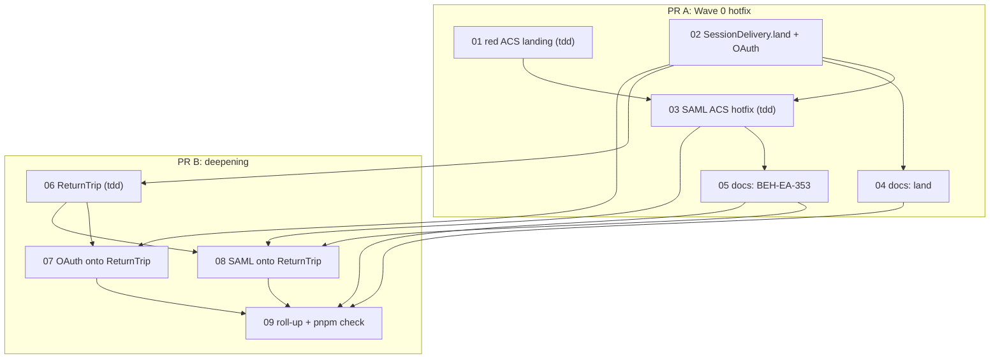

# Plan 33: a browser return trip is one module, and the SAML ACS lands signed in

| Property | Value |
|---|---|
| Source | Architecture review 2026-11-09, batch 4, candidate 33 ("a browser return-trip module that owns the redirect landing") |
| Strength | **Strong** (unchanged after re-verification: one live defect at the default configuration, plus three-way duplication at a trust boundary) |
| Dependency category | in-process |
| Wave / position | Wave 0 hotfix PR (tickets 01–05), then the deepening PR (tickets 06–09). No dependency on another batch-4 plan |
| Touched packages | `@awthaq/server`, `@awthaq/oauth`, `@awthaq/saml` (code); `spec/`, `docs/`, package READMEs (docs) |
| Wire change | **Yes.** (1) Wave 0: under the default `Host` (`SameSite=Strict`) session cookie, `POST /auth/saml/acs` answers `200 text/html` (the same-site interstitial) instead of `302`; the `Set-Cookie` is unchanged; `HostLax`/`HostEmbedded`/a non-strict `SecureDomain` keep the `302`. (2) Wave 0: the ACS contract declares `302` or `text/html`. (3) Deepening: `slo`, `sloPost` and `saml.account.logout` declare the `200 text/html` self-submitting form they already send (documentation-only change; bytes on the wire unchanged) |
| ADRs | Amends **ADR-EA-045** decision 2 (`SessionDelivery.redirect` is replaced by `SessionDelivery.land`), revision 1.1. **ADR-EA-052 is not used** (no new architectural decision; see Q3). Reads ADR-EA-047 (unchanged: the new module reads no request facts) |
| Behaviours | New **BEH-EA-353** (the SAML ACS's first landing request carries a `Strict` session). Amended: BEH-EA-055 (07-sessions), BEH-EA-122 (16-oauth, one sentence), BEH-EA-315 (29-saml-sp, contract). 354–355 unused |
| Requirements | REQ-EA-1540 – REQ-EA-1547 (vitest-labelled; no BDD scenario, see §6) |
| Tickets | 9 (`tickets/01-…` to `tickets/09-…`) |
| Verified at | `04fa3526` on `architecture/deepening-plans-2`, 2026-11-09. Uncommitted edits in two-factor, roles and qadi are someone else's and are not touched |

## 0. How to read this plan

Section 2 is the evidence; every count has its command and its baseline at `04fa3526`. Section 3 is the interface. Section 4's ticket table maps one-to-one onto `tickets/*.md`, which are the executable prompts. Line numbers were measured at `04fa3526`; re-verify before editing, since ticket 02 shifts `OAuth.ts` and ticket 03 shifts `Saml.ts`.

Vocabulary is the codebase-design glossary (module, interface, implementation, depth, seam, adapter, leverage, locality). A "return trip" is a browser navigation out to an identity provider and back: OAuth authorize → callback, SAML login → ACS, SAML account logout → SLO. "Landing" is the response that ends the return leg and sends the browser to the application's `callbackURL`.

## 1. Summary, goals, non-goals

**Problem.** Every return trip does the same five things: set a single-use state cookie on the outbound leg; read it on the return leg and expire it with the same attributes on every response (success or typed failure); send `Referrer-Policy: no-referrer` on both legs; answer some responses with a `no-store` HTML page; land the session. Each handler writes those steps by hand: three state-cookie writes, three expiries, two copies of the no-referrer handler, three no-store HTML responses (§2.2). The one step that differs by cookie mode (PV-016's same-site interstitial) was written once, inside OAuth, so SAML never got it: **the SAML ACS lands its first request signed out under the default cookie mode** (§2.3).

**Goals.**
1. G1 (hotfix, wave 0): under a `SameSite=Strict` session cookie, the SAML ACS answers the same-site interstitial, so the first landing request carries the session. The contract says so. The behaviour has an id and a test that models a real browser.
2. G2 (hotfix, wave 0): the choice "interstitial or `302`" lives in one place, `SessionDelivery.land`, which replaces `SessionDelivery.redirect`. OAuth and SAML pass only the location, what was minted, and (OAuth only) its `bounce` knob.
3. G3 (deepening): a `ReturnTrip` module in `@awthaq/server` owns the state cookie (one attribute set, derived from how the provider comes back), the no-referrer header on both legs, and the navigation response (`302` or a `no-store` HTML page). OAuth and SAML hand-write none of these.
4. G4: the SAML logout endpoints' declared success matches what they send.

**Non-goals.**
- The `callbackURL` open-redirect guard, duplicated in `OAuth.ts:258-294` and `Saml.ts:364-376`. It is a real duplicate at a trust boundary, but OAuth's copy carries native-scheme rules SAML lacks. Q5 recommends leaving it out of this plan.
- A `SamlConfig.bounce` knob (Q1 recommends none; `HostLax` is the opt-out).
- A typed browser page for `Hooks.TwoFactorRequired` at the ACS or callback (it is a JSON 4xx today, for both protocols).
- Expiring the session cookie on an IdP-initiated SLO (sessions are revoked server-side by NameID; the dead cookie is harmless).
- Any change to the session cookie, the CSRF cookie, `SessionCookie` in core, or `SecurityHeaders`.

**Go / no-go gate.**
- *For (GO):* the ACS defect is confirmed by reading against the exact mechanism OAuth's PV-016 test already proves in this repo's browser model (§2.3). The duplication is measured: 3 state-cookie writes, 3 expiries, 2 no-referrer handlers, 3 no-store HTML responses, and the attribute sets are spelled out in three places (§2.2). The one piece of return-trip logic that lived in one plugin was missed by the other, which is the locality failure the module removes.
- *Against:* the duplication is shallow (each copy is 5–10 lines) and the SAML attribute set is already declared once (`requestCookieOptions`). A refactor without the bug would be "worth exploring", not strong.
- *Decision:* **GO.** Tickets 01–05 (hotfix) land whatever happens to the deepening. If ticket 01's red test passes at HEAD (the reading was wrong), stop: keep only the regression tests from ticket 01, and tickets 02–09 become NO-GO.

```yaml
must_haves:
  truths:
    - "Under the default Host (SameSite=Strict) cookie, a browser that posts a valid SAMLResponse to /auth/saml/acs and follows the response is signed in on its first landing request (GET /session answers 200, not 401)"
    - "Under HostLax the ACS still answers 302 and the first landing request is signed in"
    - "The OAuth callback's wire behaviour is unchanged: interstitial under Strict with bounce on, 302 with bounce off, under Lax, or for a native return"
    - "Every response of every return trip, success or typed failure, carries Referrer-Policy: no-referrer, and every return-leg response expires the trip's state cookie with the attributes it was set with"
    - "No plugin source sets, expires or names the attributes of a return-trip state cookie, or builds a text/html response, by hand"
    - "The ACS, slo, sloPost and saml.account.logout contracts declare the text/html success they can send"
  artifacts:
    - "packages/server/src/internal/BrowserPage.ts (page, bounce)"
    - "packages/server/src/SessionDelivery.ts exports land; redirect is gone"
    - "packages/server/src/ReturnTrip.ts (make, navigate, Navigation, Trip)"
    - "packages/server/test/ReturnTrip.test.ts"
    - "packages/saml/test/SamlHttp.test.ts: the PV-016 landing chain for the ACS"
    - "spec/behaviors/29-saml-sp.md: BEH-EA-353"
  key_links:
    - "Saml.ts acs handler -> SessionDelivery.land -> SessionCookie.isStrict(SessionCookieConfig) -> BrowserPage.bounce"
    - "OAuth.ts callback -> SessionDelivery.land(location, session, { bounce: config.bounce && !native })"
    - "OAuth.ts and Saml.ts handlers -> ReturnTrip.make(...).start / .back -> one setCookie and one expireCookie in ReturnTrip.ts"
    - "SamlApi.ts acs success [Empty(302), text/html] <- what land can answer"
```

## 2. Verified current state

### 2.1 Re-measurement commands (run from the repo root; baselines at `04fa3526`)

| # | Command | Baseline | Target after ticket |
|---|---|---|---|
| C1 | `grep -c -F '"referrer-policy"' packages/oauth/src/OAuth.ts packages/saml/src/Saml.ts` | 1 / 1 | 0 / 0 (07, 08) |
| C2 | `grep -c -F 'expireCookie(' packages/oauth/src/OAuth.ts packages/saml/src/Saml.ts` | 1 / 2 | 0 / 0 (07, 08) |
| C3 | `grep -c -F 'setCookie(' packages/oauth/src/OAuth.ts packages/saml/src/Saml.ts` | 1 / 2 | 0 / 0 (07, 08) |
| C4 | `grep -c -F 'text/html' packages/oauth/src/OAuth.ts packages/saml/src/Saml.ts` | 1 / 2 | 0 after 02 / 0 after 08 |
| C5 | `grep -c -F 'sameSite:' packages/oauth/src/OAuth.ts packages/saml/src/Saml.ts` | 2 / 1 | 0 / 0 (07, 08) |
| C6 | `grep -c -F 'bouncePage' packages/oauth/src/OAuth.ts` | 2 | 0 (02) |
| C7 | `grep -rn -F 'SessionDelivery.redirect' packages features examples --include='*.ts' \| grep -v /lib/ \| grep -v node_modules \| wc -l` | 4 (`OAuth.ts:521` comment, `OAuth.ts:524`, `Saml.ts:478`, `SessionLifecycle.test.ts:130`) | 0 (02) |
| C8 | `grep -c -F 'contentType: "text/html"' packages/saml/src/SamlApi.ts` | 0 | 1 (03), 4 (08) |
| C9 | `grep -c -F 'HttpApiSchema.Empty(302)' packages/saml/src/SamlApi.ts` | 5 | 5 (the union keeps the 302 member) |
| C10 | `ls packages/server/src/ReturnTrip.ts packages/server/src/internal/BrowserPage.ts` | both absent | both present (06, 02) |

`npx vitest run packages/saml/test/SamlHttp.test.ts` was run at `04fa3526`: 8 passed (1.3 s). It is the grounded verify command for the SAML tickets.

### 2.2 Findings (with `file:line` at `04fa3526`)

**OAuth (`packages/oauth/src/OAuth.ts`, 1,213 lines).**
- `:81` `OAUTH_STATE_COOKIE = "__Host-oauth-state"`.
- `:91-93` `noReferrer`, a pre-response handler that sets `referrer-policy: no-referrer` (PDR-004). Used at `:447` (authorize) and `:497` (callback).
- `:99-107` `expireStateCookie` (CSS-006): `expireCookie` with `{ httpOnly, secure, sameSite: "lax", path: "/" }`. The comment at `:98` says "Same attributes the cookie was set with".
- `:109-115` `escapeHtml`; `:118-131` `bouncePage(location)`: the PV-016 interstitial, `200 text/html; charset=utf-8`, `cache-control: no-store`, meta referrer `no-referrer`, `noindex`, meta refresh and an anchor fallback.
- `:474-484` authorize: `HttpServerResponse.setCookie(redirect, OAUTH_STATE_COOKIE, url.state, { httpOnly, secure, sameSite: "lax", path: "/", maxAge: FLOW_TTL })`. The same attribute set as `:102-107`, spelled a second time.
- `:489-528` callback: `noReferrer`, `expireStateCookie`, `request.cookies[OAUTH_STATE_COOKIE]`, `oauth.callback(...)`, then `:513-520` `bounce = (yield* configNow).bounce && outcome.native !== true && SessionCookie.isStrict(cookieConfig)`, `bouncePage(callbackURL)` or `HttpServerResponse.redirect(callbackURL)`, then `SessionDelivery.redirect(response, outcome.session)` or `SessionDelivery.decline(MintGrant)`.

**SAML (`packages/saml/src/Saml.ts`, 1,228 lines).**
- `:106` `REQUEST_COOKIE = "__Host-saml-request"`; `:107` `LOGOUT_COOKIE = SamlSlo.LOGOUT_COOKIE` (`"__Host-saml-logout"`, `SamlSlo.ts:51`). Both are exported; 19 test references outside `src/`.
- `:418-424` `requestCookieOptions = { httpOnly, secure, sameSite: "none", path: "/" } as const`, with the comment "same attributes when set and when cleared". Shared by both SAML cookies.
- `:426-430` `expireRequestCookie`; `:432-434` `noReferrer` (second copy).
- `:450-460` login: `noReferrer`, `saml.authnRequest`, `setCookie(redirect, REQUEST_COOKIE, …, { ...requestCookieOptions, maxAge: settings.requestTtl })`.
- `:462-482` ACS: `noReferrer`, `expireRequestCookie`, `saml.acs({ cookieState: request.cookies[REQUEST_COOKIE] })`, then **`:478-481` `SessionDelivery.redirect(HttpServerResponse.redirect(outcome.callbackURL), outcome.session)`**: a plain `302` whatever the cookie mode.
- `:484-529` `slo`/`sloPost`: `noReferrer`, `saml.slo({ cookieState: request.cookies[LOGOUT_COOKIE] })`, `respondToBrowser`.
- `:533-535` `expireLogoutCookie`; `:537-549` `respondToBrowser`: `302` for `redirect` and `done`, `200 text/html` + `no-store` for `postForm` (second no-store HTML response).
- `:559-581` `saml.account.logout`: `noReferrer`, `SessionDelivery.end`, then a `302` or a `200 text/html` + `no-store` (`:569-573`, third no-store HTML response) with `setCookie(…, LOGOUT_COOKIE, …, { ...requestCookieOptions, maxAge })` at `:575-580`.

**Server.**
- `packages/server/src/SessionDelivery.ts:86-102` `redirect(response, issued)`: requires `MintGrant`, renders the session cookie, `setCookie` on the caller-built response (`Effect.orDie`), settles `delivered`. Callers: `OAuth.ts:524`, `Saml.ts:478`, `SessionLifecycle.test.ts:130`.
- `packages/core/src/SessionCookie.ts` (not `server/src/SessionCookie.ts`): `Mode` `Host` (default, Strict), `HostLax`, `HostEmbedded` (None), `SecureDomain` (caller's choice); `isStrict(cfg)` at `:137-138`. `SessionCookieConfig` is a `Context.Reference` with a default, so reading it adds no requirement. `packages/server/src/internal/SessionCookie.ts` holds the writers (ADR-EA-045 decision 7).
- The `Mints` marker already makes every declared response `no-store` (ADR-EA-045 decision 3), so the ACS interstitial is `no-store` twice over.

**Contracts.**
- `packages/oauth/src/OAuthApi.ts:187-195` callback success: `[HttpApiSchema.Empty(302), Schema.String.pipe(HttpApiSchema.asText({ contentType: "text/html" }))]`.
- `packages/saml/src/SamlApi.ts:118-129` acs success: `HttpApiSchema.Empty(302)` only.
- `SamlApi.ts:132-147` slo/sloPost and `:165-169` logout: `HttpApiSchema.Empty(302)` only, while the comment at `:133-134` says "or … a self-submitting HTML form (200): the handler chooses", and the handlers do send it.

**Tests.**
- `packages/oauth/test/AuthHttp.test.ts:397-456` (`landingChain`): the browser model (`@awthaq/web`'s `UserAgent` via `TestAuth.app(...).agent()`) withholds a `Strict` cookie from a cross-site `302` chain and sends it on a same-origin request; `:445-456` proves the landing is `401` with `bounce: false`. `:458-466` tests HTML escaping of the interstitial.
- `packages/saml/test/SamlHttp.test.ts:198-233` asserts the ACS answers `302` with `location: /dashboard`; `:176` asserts `302` in the ADR-EA-047 probe. No SAML test follows the landing. `postToAcs` (`:63-68`) already posts cross-site as a navigation.
- `GET /session` (`packages/api/src/Session.ts:75`) answers `401` anonymous and `200` signed in; `packages/jwt/test/AuthHttp.test.ts:291-336` uses it as a landing probe.

### 2.3 Live bugs

| Id | Bug | Status |
|---|---|---|
| B1 | **The SAML ACS lands the first request signed out under the default `Host` (`SameSite=Strict`) cookie.** The IdP's form POST to the ACS is a cross-site top-level navigation. The browser stores the `Strict` `__Host-session` from the ACS response, but the `302 Location: <callbackURL>` keeps the next request inside a redirect chain that began cross-site, so `Strict` withholds the cookie and a server-rendered landing page sees an anonymous request. This is PV-016 exactly; OAuth fixed it with the interstitial (BEH-EA-122), SAML did not. | **By reading**, against the mechanism `AuthHttp.test.ts:445-456` already proves in this repo's browser model. **Reproduced by ticket 01.** |
| B2 | `slo`, `sloPost` and `saml.account.logout` declare `302` only but can answer `200 text/html`. The OpenAPI document and a generated client mis-describe them. | By reading (`SamlApi.ts:138, 146, 167` vs `Saml.ts:546-548, 569-573`). Fixed in ticket 08. Not a browser-visible defect. |

**SLO landing: no defect.** The candidate asked whether the SLO landing has B1's issue. It does not. The `done` landing (`Saml.ts:543-544`) ends the user's *own* logout, so the session is already gone and a signed-out landing is correct. An IdP-initiated `LogoutRequest` revokes sessions server-side by NameID/SessionIndex (`SamlSlo.ts:354-380`) and never relies on the session cookie.

### 2.4 Evidence corrections

1. **Line numbers.** OAuth `noReferrer` is `:91-93` (candidate: `:91-108`, which also spans `expireStateCookie` `:99-107`); `bouncePage` is `:118-131`; the callback is `:489-528`, with the bounce at `:513-520`. SAML ranges are right; the ACS's plain redirect is `Saml.ts:479` inside the `SessionDelivery.redirect` call at `:478`.
2. **"`spec/behaviors/29-saml-sp.md` says nothing about it": true, but the gap is documented elsewhere, and documented wrongly.** `spec/behaviors/07-sessions.md:154` (BEH-EA-055, `HostLax`) names "an OAuth or SAML callback" as the case `HostLax` fixes. `packages/saml/README.md:100` says "A session cookie in `SameSite=Strict` mode is not sent on the first navigation after a cross-site POST … use the default or `Lax` mode". **The default *is* `Strict`**, so that advice is wrong. B1 is a known limitation that was never fixed and is described as if the default were safe.
3. **"Same attributes when set and when cleared exists only as comments, twice": half right.** SAML already declares the attribute set once (`requestCookieOptions`, `Saml.ts:418-424`) and reuses it four times. OAuth spells its set twice (`:102-107` and `:476-483`). The leverage is still real: two plugins each decide the attributes, and the `SameSite` value is derived by hand from how the provider comes back (`lax` for a GET redirect, `none` for a form POST).
4. **Counts confirmed:** `noReferrer` defined 2×; cookie-expire handler 3× (`OAuth.ts:101`, `Saml.ts:426`, `Saml.ts:534`); state cookie set 3× (`OAuth.ts:476`, `Saml.ts:455`, `Saml.ts:575`); `no-store` HTML response 3× (`OAuth.ts:125-131`, `Saml.ts:546-548`, `Saml.ts:571-573`).
5. **Found in addition:** B2 above, and the duplicated `callbackURL` guard (§1 non-goals, Q5).
6. **`SessionCookie` lives in core** (`packages/core/src/SessionCookie.ts`), with its writers in `packages/server/src/internal/SessionCookie.ts`, as the candidate suspected.

## 3. Target design

### 3.1 The seams

Two seams, each where the knowledge it hides already lives:

1. **`SessionDelivery.land`** (in `@awthaq/server`, beside the session cookie writers). The interstitial-or-`302` choice depends only on the *session* cookie's `SameSite` and on whether a session is delivered. It belongs where the session cookie is written and where `MintGrant` is settled. It replaces `SessionDelivery.redirect`, whose only two callers built the same `302`-or-page response before calling it.
2. **`ReturnTrip`** (new, `@awthaq/server`). It owns everything about the *state* cookie and the navigation: the cookie's attribute set (declared once, `SameSite` derived from how the provider returns), its write on the outbound leg, its read and expiry on the return leg (on success and on typed failure), `Referrer-Policy: no-referrer` on both legs (registered before the caller's effect runs, so typed failures carry it), and the navigation response (`302`, or a `no-store` HTML page).

Behind both sits `internal/BrowserPage.ts`, the one `text/html` builder (`page`) and the PV-016 interstitial (`bounce`), moved verbatim from `OAuth.ts:109-131`.

Plugins supply only their payloads: OAuth its provider URL, state and `bounce` knob; SAML its AuthnRequest location or LogoutRequest form, state and TTL.

### 3.2 Interface sketches (types and signatures only)

```ts
// packages/server/src/internal/BrowserPage.ts  (internal; not exported from the package)
/** A `200 text/html; charset=utf-8` page with `cache-control: no-store`: an interstitial or a self-submitting form. */
export declare const page: (html: string) => HttpServerResponse.HttpServerResponse;
/** PV-016: the same-site interstitial that meta-refreshes to `location` (HTML-escaped). */
export declare const bounce: (location: string) => HttpServerResponse.HttpServerResponse;
```

```ts
// packages/server/src/SessionDelivery.ts  (replaces `redirect`)
/**
 * A browser landing after a return trip (OAuth callback, SAML ACS). While the session cookie is
 * `SameSite=Strict` and `bounce` holds (default `true`), the same-site interstitial; otherwise a `302`.
 * Delivers `issued` on that response, or declines `Mints` when nothing was minted (an account link,
 * a native deep link).
 */
export declare const land: (
  location: string,
  issued: Sessions.IssuedSession | undefined,
  options?: { readonly bounce?: boolean },
) => Effect.Effect<HttpServerResponse.HttpServerResponse, never, SessionLifecycle.MintGrant>;
```

```ts
// packages/server/src/ReturnTrip.ts  (exported as `ReturnTrip` from `@awthaq/server`)
export type Navigation =
  | { readonly _tag: "redirect"; readonly location: string }
  | { readonly _tag: "postForm"; readonly html: string };

/** A navigation as a response: a `302`, or a `no-store` HTML page. */
export declare const navigate: (navigation: Navigation) => HttpServerResponse.HttpServerResponse;

export interface Trip<Name extends `__Host-${string}`> {
  readonly cookie: Name;
  /**
   * Outbound leg. Registers no-referrer, runs `begin`, answers its navigation and, when `state` is
   * present, sets the state cookie (`maxAge`) with the trip's one attribute set.
   */
  readonly start: <E, R>(
    begin: Effect.Effect<
      { readonly navigation: Navigation; readonly state?: Redacted.Redacted<string> | undefined },
      E,
      R
    >,
    maxAge: Duration.Duration,
  ) => Effect.Effect<HttpServerResponse.HttpServerResponse, E, R>;
  /**
   * Return leg. Registers no-referrer and the state cookie's expiry (same attributes) on whatever
   * response this request ends with, then runs `finish` with the value the browser brought back.
   */
  readonly back: <A, E, R>(
    request: HttpServerRequest.HttpServerRequest,
    finish: (cookieState: string | undefined) => Effect.Effect<A, E, R>,
  ) => Effect.Effect<A, E, R>;
}

/** `returnsBy`: a top-level GET redirect carries a `Lax` cookie; a cross-site form POST needs `None`. */
export declare const make: <const Name extends `__Host-${string}`>(options: {
  readonly cookie: Name;
  readonly returnsBy: "redirect" | "post";
}) => Trip<Name>;
```

Type-system-first points: the `__Host-` prefix is a template-literal constraint, so a name that would silently lose the prefix guarantee (CSS-001) does not compile. `SameSite` is derived from `returnsBy` and cannot be chosen independently. `land` requires `MintGrant`, so the ADR-EA-045 gate is unchanged. No `as` anywhere. The existing `as const` on `requestCookieOptions` is deleted with the object.

### 3.3 Callers after the change (prose)

- OAuth `authorize`: `oauthTrip.start(effect yielding { navigation: redirect(url.location), state: Redacted.make(url.state) }, FLOW_TTL)`, where `oauthTrip = ReturnTrip.make({ cookie: "__Host-oauth-state", returnsBy: "redirect" })`.
- OAuth `callback`: `oauthTrip.back(request, (cookieState) => oauth.callback(…) then SessionDelivery.land(outcome.callbackURL, outcome.session, { bounce: config.bounce && outcome.native !== true }))`.
- SAML `login`: `requestTrip.start(…, settings.requestTtl)` with `requestTrip = ReturnTrip.make({ cookie: REQUEST_COOKIE, returnsBy: "post" })`.
- SAML `acs`: `requestTrip.back(request, (cookieState) => saml.acs(…) then SessionDelivery.land(outcome.callbackURL, outcome.session))`.
- SAML `slo`/`sloPost`: `logoutTrip.back(request, (cookieState) => saml.slo(…) mapped to ReturnTrip.navigate)`, where `done` becomes `{ _tag: "redirect", location: callbackURL }`.
- SAML `saml.account.logout`: `logoutTrip.start(effect running SessionDelivery.end and saml.logout, mapping local to a redirect with no state, settings.requestTtl)`.

### 3.4 Module layout after the change

```
packages/server/src/
  ReturnTrip.ts            NEW   make, navigate, Navigation, Trip
  SessionDelivery.ts       land replaces redirect
  internal/BrowserPage.ts  NEW   page, bounce (moved from OAuth.ts:109-131)
  internal/SessionCookie.ts      unchanged
  index.ts                 + export * as ReturnTrip
packages/oauth/src/OAuth.ts      - noReferrer, expireStateCookie, escapeHtml, bouncePage, attribute literals
packages/saml/src/Saml.ts        - requestCookieOptions, expireRequestCookie, expireLogoutCookie, noReferrer, respondToBrowser's HTML
packages/saml/src/SamlApi.ts     acs, slo, sloPost, logout declare [Empty(302), text/html]
```

`ReturnTrip.ts` imports `internal/BrowserPage.ts`; `SessionDelivery.ts` imports `internal/BrowserPage.ts`. Neither imports the other, so `pnpm circular` stays clean.

### 3.5 Alternatives rejected

- **(a) Put `land` inside `ReturnTrip`** (one module for everything). Rejected: `land` settles `MintGrant` and writes the session cookie. ADR-EA-045 makes `SessionDelivery` "the one way a handler changes the caller's credential". Moving a grant-settling writer out of it would split that rule across two modules for no caller's benefit.
- **(b) Export `bouncePage` from `@awthaq/oauth`** for SAML to import. Rejected: SAML does not depend on OAuth, and the choice would still be written twice.
- **(c) Put the module in `@awthaq/core`.** Rejected: it builds `HttpServerResponse`s and registers pre-response handlers. ADR-EA-045 decision 7 moved exactly such writers out of core.
- **(d) A shared contract constant for the `[302, text/html]` success union in `@awthaq/api`.** Rejected: four inline declarations of two schemas do not justify a new public export, and the contract package stays ignorant of server modules.
- **(e) Keep `SessionDelivery.redirect` beside `land`.** Rejected (replace, don't layer): after ticket 02 it has no caller.

## 4. Phased migration

**PR A, Wave 0 hotfix (tickets 01–05).** It needs nothing from the deepening and ships on its own. Ticket 02 puts the shared landing in server and moves both callers onto it with no wire change: SAML passes `{ bounce: false }`, so the tree stays green. Ticket 01 is the red test. Ticket 03 drops SAML's `bounce: false` (the hotfix), then 04 and 05 do the docs. **Execution order inside wave 0 is 02 then 01**: one agent works in the tree at a time, and 01's red cases stay uncommitted until 03. 01 and 03 land in one commit. The red run of 01 is recorded in the commit body, with no red commit on the branch (plan 30 precedent).

**PR B, deepening (tickets 06–09).** It needs PR A merged. It builds `ReturnTrip` (06), moves OAuth (07) and SAML (08) onto it, then rolls up docs and traceability (09).

| Ticket | Title | Wave | Depends on | Type | Size | Files |
|---|---|---|---|---|---|---|
| 01 | Red: the SAML ACS's first landing request is signed out under `Strict` | 0 | — | tdd | S | `packages/saml/test/SamlHttp.test.ts` |
| 02 | `SessionDelivery.land` replaces `redirect`; the interstitial moves to server; OAuth and SAML call it (no wire change) | 0 | — | execute | M | `packages/server/src/internal/BrowserPage.ts`, `packages/server/src/SessionDelivery.ts`, `packages/server/test/SessionLifecycle.test.ts`, `packages/oauth/src/OAuth.ts`, `packages/saml/src/Saml.ts` |
| 03 | The SAML ACS lands through `SessionDelivery.land` (hotfix) | 1 | 01, 02 | tdd | S | `packages/saml/src/Saml.ts`, `packages/saml/src/SamlApi.ts`, `packages/saml/test/SamlHttp.test.ts` |
| 04 | Docs for `land`: ADR-EA-045 rev 1.1, OAuth spec, server README, plugin authoring, changeset | 1 | 02 | execute | S | `spec/decisions/045-session-lifecycle-on-the-contract.md`, `spec/behaviors/16-oauth.md`, `packages/server/README.md`, `docs/plugin-authoring.md`, `.changeset/server-session-delivery-land.md` |
| 05 | Docs for the ACS landing: BEH-EA-353, BEH-EA-055, SAML README, traceability, changeset | 2 | 03 | execute | S | `spec/behaviors/29-saml-sp.md`, `spec/behaviors/07-sessions.md`, `packages/saml/README.md`, `spec/traceability.md`, `.changeset/saml-acs-same-site-bounce.md` |
| 06 | `ReturnTrip`: one state cookie, no-referrer on both legs, the navigation response | 2 | 02 | tdd | M | `packages/server/src/ReturnTrip.ts`, `packages/server/src/index.ts`, `packages/server/test/ReturnTrip.test.ts` |
| 07 | OAuth authorize and callback onto `ReturnTrip` | 3 | 02, 06 | execute | S | `packages/oauth/src/OAuth.ts`, `packages/oauth/test/AuthHttp.test.ts` |
| 08 | SAML login, ACS, SLO and logout onto `ReturnTrip`; logout contracts declare `text/html` | 3 | 03, 05, 06 | execute | M | `packages/saml/src/Saml.ts`, `packages/saml/src/SamlApi.ts`, `packages/saml/test/SamlSloHttp.test.ts`, `spec/behaviors/29-saml-sp.md`, `.changeset/saml-return-trip.md` |
| 09 | Roll-up: traceability, server README, plugin authoring, the plan gate | 4 | 04, 05, 07, 08 | execute | S | `spec/traceability.md`, `packages/server/README.md`, `docs/plugin-authoring.md`, `.changeset/server-return-trip.md` |

Same-wave file overlap check: wave 0 {01: SamlHttp.test.ts} ∩ {02: server, OAuth.ts, Saml.ts} = ∅. Ticket 03 edits `Saml.ts` after 02. Wave 1 {03: saml src/test} ∩ {04: docs} = ∅. Wave 2 {05: spec/saml docs} ∩ {06: server src/test} = ∅. Wave 3 {07: OAuth} ∩ {08: SAML, 29-saml-sp.md, changeset} = ∅.



## 5. Test plan

**Tests at the new interfaces.**
- `packages/saml/test/SamlHttp.test.ts` (ticket 01, green in 03): the ACS landing chain. A browser agent logs in (`callbackURL=/session`), the IdP posts cross-site, the agent follows the response the way a browser does (a `302` as a cross-site navigation, an interstitial's meta refresh as same-origin), and `GET /session` must be `200`. Plus: under `HostLax` the ACS answers `302` and the landing is `200`; the interstitial is `text/html`, `no-store`, `no-referrer`, has no `location`, carries the `Strict` `__Host-session`, and meta-refreshes to the `callbackURL`.
- `packages/server/test/SessionLifecycle.test.ts` (ticket 02): `land` cases over the existing served `HttpApi`. Under the default `Strict` config: interstitial with the session cookie, settled `delivered`. With `{ bounce: false }`: `302`. Under `HostLax`: `302`. With `issued` undefined: settled `declined`, no session cookie. A landing URL with `&`, `"` and `<` is HTML-escaped (moved from `AuthHttp.test.ts:458-466`).
- `packages/server/test/ReturnTrip.test.ts` (ticket 06): over a served `HttpApi`, for `returnsBy: "redirect"` and `"post"`. `start` sets `__Host-<name>` with `Secure; HttpOnly; Path=/`, no `Domain`, `SameSite=Lax` or `None`, and `Max-Age` equal to `maxAge`. `start` with no state sets no cookie. A typed failure inside `begin` still carries `no-referrer`. `back` hands `finish` the cookie value the request carried (or `undefined`), and expires the cookie with identical attributes on success and on a typed failure of `finish`. `navigate` answers `302` or `200 text/html` `no-store`. A type-level case: `ReturnTrip.make({ cookie: "oauth-state", … })` fails to compile (`@ts-expect-error`).

**Tests deleted or narrowed (replace, don't layer).**
- `packages/oauth/test/AuthHttp.test.ts:458-466` "PV-016: the landing URL is HTML-escaped into the interstitial": its replacement lands in `SessionLifecycle.test.ts` in ticket 02, and ticket 07 deletes it. The page is server's now.
- `packages/server/test/SessionLifecycle.test.ts` `"redirect"` behaviour and its `callback` handler (`:130`): replaced by the `land` cases in ticket 02.
- `packages/saml/test/SamlHttp.test.ts:198-233` "the ACS form post signs the browser in: 302 …": rewritten in ticket 03 to the default landing (interstitial). Its request-cookie-cleared assertions are kept as SAML wiring.
- `packages/oauth/test/AuthHttp.test.ts:176-196` (CSS-001 attribute asserts on `__Host-oauth-state`) and the attribute half of `:468-484` (CSS-006 "cleared with the attributes it was set with"): in ticket 07 the attribute-detail assertions are removed, because `ReturnTrip.test.ts` owns them. The cookie's presence, its expiry on success and on failure (`:486-496`) and PDR-004 (`:498-514`) stay as OAuth wiring proofs.
- `packages/saml/test/SamlHttp.test.ts:83-111` login: **kept**. Its `sameSite: "none"` assertion is the SAML wiring proof that the plugin chose `returnsBy: "post"`; the generic attribute rules are ReturnTrip.test's. No deletion.

**Kept unchanged as regression proof of the OAuth wire:** `AuthHttp.test.ts:382-396` (HostLax `302`), `:425-443` (default interstitial, landing signed in), `:445-456` (`bounce: false` → `302`, landing `401`), `OAuthNative.test.ts` (native never bounces).

**Concurrency and Postgres.** None: no store, no SQL, no transaction changes. `pnpm test:pg` is not required.

**Measurable targets.** C1–C5 reach 0 in both plugin files. C6 and C7 reach 0. C8 = 4. `ReturnTrip.ts` contains exactly one `setCookie(` and one `expireCookie(`. `SamlHttp.test.ts` gains ≥2 tests; `ReturnTrip.test.ts` has ≥8 cases. The net plugin source shrinks: `OAuth.ts` −35 lines or more, `Saml.ts` −30 lines or more.

## 6. Spec, ADR, traceability, BDD, docs, changesets

**New behaviour: BEH-EA-353** (in `spec/behaviors/29-saml-sp.md`, after BEH-EA-318; ticket 05). Draft:

> ## BEH-EA-353: The ACS's first landing request carries a `Strict` session
>
> REQUIREMENT: While the session cookie is `SameSite=Strict` (the default `Host` mode, or `SecureDomain` with `sameSite: "strict"`), a successful ACS MUST answer `200 text/html` with the same-site interstitial of BEH-EA-122 (`Cache-Control: no-store`, `Referrer-Policy: no-referrer`, a meta refresh to the `callbackURL`, HTML-escaped, with an anchor fallback) and the session cookie on it, not a `302`. The IdP's POST is cross-site, so a `302` would keep the landing request in a cross-site redirect chain, and `Strict` would withhold the cookie from it. Under a `Lax` or `None` session cookie the ACS answers the `302`. The choice is `SessionDelivery.land`'s, shared with the OAuth callback. Over HTTP: `packages/saml/test/SamlHttp.test.ts` follows the landing in the browser model.

**Amended behaviours.**
- BEH-EA-055 (`07-sessions.md:154`, ticket 05): the parenthesis "(the OAuth callback avoids this by default with its same-site bounce page, BEH-EA-122)" becomes "(the OAuth callback and the SAML ACS avoid this by default with the same-site bounce page, BEH-EA-122, BEH-EA-353)". Revision 1.12.
- BEH-EA-122 (`16-oauth.md:195`, ticket 04): `SessionDelivery.redirect` becomes `SessionDelivery.land`. Revision 1.7.
- 29-saml-sp.md `:331` (ticket 05) `SessionDelivery.redirect` becomes `SessionDelivery.land`. Revision 1.13 carries BEH-EA-353. Ticket 08 adds revision 1.14: BEH-EA-315's endpoints declare the `200 text/html` form.

**ADR-EA-045 revision 1.1** (ticket 04). Decision 2's list "`respond(mint)`, `deliverBearer`, `deliverExchanged` and `redirect` need `MintGrant`" becomes "… and `land` need `MintGrant`". One sentence is added to decision 2: "`land(location, issued, { bounce })` lands a browser return trip: the same-site interstitial while the session cookie is `Strict` and `bounce` holds, a `302` otherwise, declining when nothing was minted (BEH-EA-122, BEH-EA-353)." Change history: "1.1 (date): `SessionDelivery.redirect` is replaced by `land`, which owns the PV-016 landing choice for every return trip (architecture plan 33)." No decision is reversed.

**ADR-EA-052: not used.** `ReturnTrip` is a new module with one seam inside `@awthaq/server`, not a decision with alternatives a future reader must not re-litigate (Q3).

**Traceability** (`spec/traceability.md`). Ticket 05: §1 row for file 29 lists BEH-EA-353; §5 `SamlHttp.test.ts` row names the landing chain; the `SessionLifecycle.test.ts` row (`:254`) says `land` in place of `redirect`; revision 1.78. Ticket 09: §5 row for `packages/server/test/ReturnTrip.test.ts` (REQ-EA-1544, 1545); revision 1.79.

**BDD.** No scenario. `features/` has no HTTP-level SAML world (`SamlWorld` drives `Saml.acs` directly, `features/step-definitions/SamlWorld.ts:585`), and PV-016's OAuth interstitial has no scenario either. REQ-EA-1540–1547 label the vitest cases in the tickets and in traceability §5; they are not allocated in `features/traceability.md`.

| REQ | Statement | Ticket / test |
|---|---|---|
| REQ-EA-1540 | Under `Strict`, the ACS's first landing request is signed in | 01/03, `SamlHttp.test.ts` |
| REQ-EA-1541 | Under `HostLax`, the ACS answers `302` and the landing is signed in | 01/03, `SamlHttp.test.ts` |
| REQ-EA-1542 | The interstitial is `text/html`, `no-store`, `no-referrer`, and HTML-escapes the landing URL | 02, `SessionLifecycle.test.ts`; 01/03 |
| REQ-EA-1543 | `land` chooses interstitial or `302` from `SessionCookieConfig` and `bounce`, and declines when nothing was minted | 02, `SessionLifecycle.test.ts` |
| REQ-EA-1544 | A trip's state cookie is set and expired with one attribute set derived from `returnsBy` | 06, `ReturnTrip.test.ts` |
| REQ-EA-1545 | Both legs carry `no-referrer` and the return leg expires the state cookie, on success and on typed failure | 06, `ReturnTrip.test.ts`; 07/08 wiring |
| REQ-EA-1546 | `slo`, `sloPost` and `saml.account.logout` declare their `text/html` success | 08, `SamlSloHttp.test.ts` |
| REQ-EA-1547 | The OAuth wire is unchanged by the move | 02/07, `AuthHttp.test.ts` kept cases |

**Docs.** `packages/saml/README.md:46` (ACS answers `302` → interstitial under `Strict`) and `:100` (the wrong "use the default" advice), ticket 05. `packages/server/README.md:60` (`redirect` → `land`), ticket 04; ReturnTrip paragraph, ticket 09. `docs/plugin-authoring.md:214` (`redirect(response, issued)` → `land(location, issued, { bounce })`), ticket 04; a "browser return trip" paragraph, ticket 09.

**Changesets** (packages are `0.1.0`, so a breaking change is `minor`):
- `.changeset/server-session-delivery-land.md` (`@awthaq/server` minor, `@awthaq/oauth` patch; ticket 04). Migration: a plugin that called `SessionDelivery.redirect(HttpServerResponse.redirect(url), issued)` calls `SessionDelivery.land(url, issued)`, with `{ bounce: false }` to keep the `302` under `Strict`.
- `.changeset/saml-acs-same-site-bounce.md` (`@awthaq/saml` minor; ticket 05). Migration: a host or test that asserted the ACS's `302` under the default cookie now sees a `200` interstitial with the same `Set-Cookie`; use `SessionCookie.config({ mode: SessionCookie.HostLax })` to keep the `302`.
- `.changeset/saml-return-trip.md` (`@awthaq/saml` patch; ticket 08). Migration: none on the wire; the OpenAPI document now lists `200 text/html` for `slo`, `sloPost` and `saml.account.logout`.
- `.changeset/server-return-trip.md` (`@awthaq/server` minor, `@awthaq/oauth` patch; ticket 09). Migration: none; a plugin with its own browser return trip uses `ReturnTrip.make`.

## 7. Risks, mitigations, rollback

| Risk | Mitigation | Rollback |
|---|---|---|
| R1: an IdP or proxy that follows the ACS response programmatically expects `302` | Browsers are the only clients of the ACS (it is a form POST navigation); OAuth shipped the same change (PV-016) with no report. Changeset Migration line | `SessionCookie.config({ mode: HostLax })` restores the `302` per deployment; or revert ticket 03 alone |
| R2: the interstitial's meta refresh is blocked (a CSP `navigate-to` or a browser setting) | The anchor fallback (unchanged from OAuth) | as R1 |
| R3: HTML injection through `callbackURL` into the interstitial | `escapeHtml` moves verbatim; `callbackURL` is already reduced to a relative path or a trusted origin before it reaches the ACS (`Saml.ts:364-376`); ticket 02 tests `&`, `"` and `<` | — |
| R4: BEH-EA id contiguity: `spec:verify:strict` fails on a gap, and BEH-EA-353 lands above 346 while 347–352 may not exist yet | Q2's default: at landing, if any id below 353 is missing, take the lowest free id and record the renumbering in "Decisions taken" and the README numbers table (batch-3 precedent: plan 27 became BEH-EA-345) | renumber |
| R5: a typed failure inside `begin` loses `no-referrer` after the move | `start`/`back` register it before running the caller's effect; ReturnTrip.test asserts it on a failure; PDR-004's OAuth test (`AuthHttp.test.ts:498-514`) stays | — |
| R6: the ordering of pre-response handlers changes (state-cookie expiry vs session-cookie write vs `SessionDelivery.end`'s expiry) | The session cookie is written onto the response directly by `land` (not a pre-response handler), as `redirect` did; `end` and the trip's expiry act on different cookie names | revert 08 |
| R7: plan 34 changes `TestAuth.app`'s lifetime or agent interface while ticket 01 is in flight | Ticket 01 uses only `app.agent()`, `agent.request(…, { site, navigation })` and `agent.cookies`, the same surface `AuthHttp.test.ts` uses | rebase |

PR A and PR B revert independently. Reverting PR B leaves the hotfix intact.

## 8. Interactions with other plans

- **Plan 21 (session minting annotation, landed):** created `SessionDelivery` and the grants; this plan renames one of its functions and amends ADR-EA-045 (revision 1.1). No decision reversed.
- **Plan 20 (in-process user agent, landed):** the `UserAgent` browser model is the test oracle for B1; this plan adds no model features.
- **Plan 26 / ADR-EA-047 (landed):** `ReturnTrip` reads only its own cookie, never the address or user agent; the groups keep `Api.RequestContext` outermost.
- **Plan 29 (plugin-owned events, landed on its branch):** no event changes.
- **Batch 4, plan 34 (scoped test app):** owns `TestAuth`'s app lifetime. Ticket 01 and the SAML/OAuth HTTP tests use `TestAuth.app(...).agent()`; whichever lands second rebases the call shape. No file overlap in `packages/test`.
- **Batch 4, plan 36 (config scope):** owns the general tenant-config accessor. OAuth's `configNow` (`OAuth.ts:437`) reads `bounce` today; this plan passes the boolean into `land`, so 36 can replace the read without touching `land`. Either order works.
- **Batch 4, plan 38 (JWS verifier):** touches OAuth's `id_token` verification (`IdToken.ts`/`Jwt.ts`), not the handlers. If 38 edits `OAuth.ts`, tickets 02/07 and 38 rebase textually; no semantic overlap.
- **Batch 4, plan 40 (residue):** Q5's `callbackURL` guard is a residue candidate for 40 if the user wants it.
- **Batch 4, plans 31, 32, 35, 37, 39:** no shared files.
- **BEH id contiguity across batch 4 (R4, Q2):** applies to every plan that reserves BEH ids above 346; the orchestrator should state the landing order.

## 9. Acceptance checklist

- [ ] Ticket 01: the ACS landing-chain test was red at HEAD (`GET /session` 401 after the `302`); the red output is in the 01/03 commit body.
- [ ] Ticket 02: `SessionDelivery.redirect` is gone (C7 = 0), `land` exists with the five `SessionLifecycle.test.ts` cases, and `bouncePage` is gone from OAuth (C6 = 0). The OAuth and SAML HTTP suites are green unedited (no wire change; SAML passes `bounce: false`).
- [ ] Ticket 03: SAML's `bounce: false` is gone; the ticket 01 tests are green; the ACS contract declares `text/html` (C8 = 1); `SamlHttp.test.ts:198-233` is rewritten, not duplicated.
- [ ] Ticket 04: ADR-EA-045 revision 1.1, `16-oauth.md` 1.7, server README, plugin authoring and the changeset say `land`.
- [ ] Ticket 05: BEH-EA-353 exists (or the renumbered id, per Q2); BEH-EA-055 and `saml/README.md:100` no longer claim the default cookie is safe; traceability 1.78; `pnpm spec:verify:strict` passes.
- [ ] Ticket 06: `ReturnTrip` exported from `@awthaq/server`; `ReturnTrip.test.ts` has ≥8 cases including the `@ts-expect-error` name case.
- [ ] Ticket 07: C1–C5 are 0 for `OAuth.ts`; the attribute-detail asserts are gone from `AuthHttp.test.ts`, and its wiring asserts stay.
- [ ] Ticket 08: C1–C5 are 0 for `Saml.ts`; C8 = 4; BEH-EA-315 history updated.
- [ ] Ticket 09: traceability 1.79, server README and plugin authoring describe `ReturnTrip`; `pnpm check` is green.

## 10. Open questions

| # | Question | Recommended default | If answered otherwise |
|---|---|---|---|
| Q1 | Does SAML get a `SamlConfig.bounce` knob like `OAuthConfig.bounce`? | **No.** No caller asked for one; `SessionCookie.HostLax` is the documented opt-out, and it applies to both protocols | Ticket 03 adds `bounce: boolean` (default `true`) to `SamlConfigShape`/input/defaults in `SamlConfig.ts` and passes `{ bounce: settings.bounce }` to `land`; ticket 05 documents it |
| Q2 | BEH-EA-353 lands above 346 while 347–352 belong to plans 31–32. Which id does the hotfix use if those have not landed? (`spec:verify:strict` rejects a gap) | **The lowest free id at landing time**, recorded in "Decisions taken" and the README numbers table, as batch 3 did for plan 27 | If the orchestrator fixes the landing order 31 → 32 → 33, use 353 as reserved |
| Q3 | New ADR-EA-052 for `ReturnTrip`, or only amend ADR-EA-045? | **Amend ADR-EA-045 (revision 1.1) only.** The only decision touched is which `SessionDelivery` function lands a navigation. ADR-EA-052 stays free | Ticket 09 writes ADR-EA-052 "A browser return trip is one module of `@awthaq/server`" (context §2, decision §3.1–3.2, alternatives §3.5), with an `index.yaml` entry and a traceability row |
| Q4 | Is the ACS's `302` → `200` under `Strict` acceptable as a `minor` change in the wave 0 hotfix? | **Yes, `minor`**, with the Migration line (packages are `0.1.0`; OAuth's identical PV-016 change shipped as `minor`) | Gate ticket 03 behind Q1's knob defaulting to `false`, and the default composition stays broken |
| Q5 | Fold the duplicated `callbackURL` open-redirect guard (`OAuth.ts:258-294`, `Saml.ts:364-376`) into `ReturnTrip`? | **No, not in this plan.** OAuth's copy adds native-scheme rules and discard reasons; merging them is its own change at a trust boundary. Offer it to plan 40 | Add ticket 10 (wave 3, after 07/08): `ReturnTrip.landing(raw, { trustedOrigins, fallback })` returning `{ url, discarded }`, with OAuth adding its native rules after it; tests move from `OAuth.test.ts` and the SAML resolver tests |

No open question blocks Wave 0 except Q2, and Q2 has a mechanical default.

## Decisions taken
