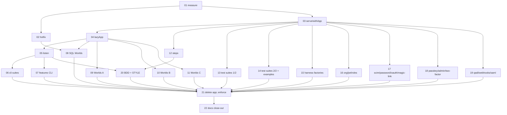

# Plan 34: A test app whose lifetime belongs to a scope, plus a listening mode

| Property | Value |
|---|---|
| Source | Architecture review 2026-11-09, batch 4, candidate 34 ("`TestAuth.app` gets a scoped form, plus a listening mode") |
| Strength | **Strong** (re-verified, §2). One module replaces four disposal idioms, eleven hand-written app cells and two copies of a hand-built socket server. The connection leak is confirmed by reading, not yet measured: ticket 01 measures it |
| Dependency category | In-process (the harness module and its callers) plus local-substitutable (SQL mode: SQLite `:memory:` locally, a Postgres schema under `AWTHAQ_POSTGRES_URL`) |
| Wave / position | Batch 4. Independent of plans 31–33 and 36–40. Orderable either way with plan 35 (both edit World files; the second to land rebases, §8). Wave 0 (tickets 01–02) can land at once |
| Touched packages | `@awthaq/test` (src, tests, README), `@awthaq/cli` (tests only), the tests of 14 plugin packages and 3 examples, `features/` (step definitions, one feature file, vitest config), `docs/plugin-authoring.md`, `spec/behaviors/25-testing-harness.md`, `spec/traceability.md`, `features/traceability.md`, `features/STYLE.md`, one comment in `packages/web/src/UserAgent.ts` |
| Wire change | **No.** Nothing a deployed host serves changes. The interface change is in `@awthaq/test` (`private: true`, dev-only): `TestAuth.serve`, `TestAuth.withApp`, `TestAuth.lazyApp`, `TestAuth.listen` arrive; `TestAuth.app` and `App.dispose` are removed in ticket 21 |
| ADRs | **None new.** ADR-EA-053 stays unused (Q7). No Accepted ADR is amended. The plan withdraws two entries from plan 08's exemption list (`SessionServer`, the cli `TestServer`), which plan 08 recorded in its "Decisions taken", not in an ADR |
| Behaviours | BEH-EA-356 (a served app lives as long as its scope), BEH-EA-357 (one lazy app cell per World), BEH-EA-358 (listening mode). BEH-EA-333 is revised (no `dispose`) |
| Requirements | REQ-EA-1550 (lifetime), REQ-EA-1551 (lazy cell), REQ-EA-1552 (listening mode); 1553–1559 left free |
| Tickets | 22, in `tickets/01-*.md` … `tickets/22-*.md` (§4.3) |
| Verified at | `architecture/deepening-plans-2` @ `04fa3526`, 2026-11-09. Effect `4.1.2` installed (`node_modules/.pnpm/effect@4.1.2`), `@effect/sql-pg` from the catalog, vitest `5.0.2`, `@effect-cucumber/vitest` `^0.10.1`. Uncommitted work in two-factor/roles/qadi `src` is untouched by this plan |

Conventions: everything in [`.planning/README.md` § Shared conventions](../README.md#shared-conventions-apply-to-every-plan) and [`IMPLEMENTING.md`](../IMPLEMENTING.md) applies. No `as` in library source, no return-type annotations on new Effect or Layer consts, replace-don't-layer for tests, a changeset with a `Migration:` line for every package-visible change. Vocabulary: module, interface, implementation, depth, deep, shallow, seam, adapter, leverage, locality.

Hard boundaries: this plan never edits `scripts/test-pg.sh` (plan 37), the `Mailer`/`SmsSender` ports or the mail helpers (`makeCapturingMailer`, `awaitMail`, `mailedToken`, plan 35).

---

## 0. How to read this plan

- §2 is the evidence. Every number has the command that produced it (§2.1).
- §3 is the interface. The executor implements exactly the signatures in §3.2.
- §4.2 is the **migration recipe** (rules M1–M7). Migration tickets 06–19 cite a rule per call site instead of repeating it.
- Tickets are the unit of work. Each carries its own verify commands and gate.

---

## 1. Summary, goals, non-goals

### 1.1 Summary

`TestAuth.app` (`packages/test/src/TestAuth.ts:616-746`) builds its own scope with `Scope.makeUnsafe()` (`:641`). Only the promise method `dispose` (`:734-738`) releases it, and nothing makes a caller call it. Measured at `04fa3526`:

- **21 of the 32 test files** that call `TestAuth.app` leak at least one app. 14 never call `dispose`; 7 dispose fewer apps than they create.
- **In `features/`**, 7 of the 21 files that call `TestAuth.app` never dispose. One more (`RequestContextSteps`) disposes every app but the last. Four Worlds rebuild without releasing the app they replace. The Worlds that do dispose use four idioms: a `close` field, `Option.match` in a finalizer, a bare `addFinalizer`, and inline `await`.
- **Eleven Worlds** keep their own app cell, and their "configure" rules disagree. Some die, some throw, some rebuild silently, some close the old app and rebuild. Three line the step's `TestClock` up with the wall clock by hand.
- Under CI's `pnpm check` (`.github/workflows/check.yml:50,61`), `SessionWorld` builds `records: "sql"` on Postgres for each of its scenarios and never releases it. `PgPool` opens connections lazily and keeps them for `idleTimeout`. `TestSql` sets that to 100,000 days (`TestSql.ts:75`). So every leaked app holds at least one Postgres connection until the vitest worker exits.
- **Two near-verbatim socket servers** (`features/step-definitions/SessionServer.ts`, 180 lines, and `packages/cli/test/support/TestServer.ts`, 148 lines) each hand-build the stores and middleware stack (9 wiring lines each) that `TestAuth.layer` already derives. They exist only because "`TestAuth.app` serves no socket".

This plan makes the test app a **scoped resource**. `TestAuth.serve` returns an app that lives exactly as long as the `Scope` it is acquired in. `TestAuth.withApp` brackets a promise-style test. `TestAuth.lazyApp` is the one app cell a World holds. It builds lazily from options accumulated by Givens and enforces one rule: configure before the first build, or `replace` explicitly. It also lines the step clock up with the wall clock on request. `TestAuth.listen` additionally binds an ephemeral port and records every request line. It deletes `SessionServer.ts` and the hand-built stack in the cli `TestServer`. `TestAuth.app` becomes a thin adapter while callers migrate in batches of at most 5 files, and ticket 21 deletes it. After that, an app that outlives its scope does not compile.

### 1.2 Goals

1. Every test app is released when the scope that acquired it closes: a test's (`it.effect`), a scenario's (the World layer) or a bracket's (`withApp`). Proven by a counter that reads 0 after every feature file (REQ-EA-1550).
2. One app cell for every World that serves an `Auth.make` composition, with one configure rule and one clock rule (REQ-EA-1551).
3. A listening mode over the same composition, used by the CLI's session suites and BDD scenarios. No hand-built middleware stack remains in either (REQ-EA-1552).
4. Ticket 01 measures the suspected Postgres connection leak (§2.5, by reading today).

### 1.3 Non-goals

- The hand-wired `HttpRouter.toWebHandler` stacks that are plan-08 exemptions because the middleware is what they test. These are `AuthenticationWorld`, `CsrfWorld`, `QadiBridgeWorld`, `TenancyWorld`, `PersistenceStratumSteps`, the raw `toWebHandler` sites in `CompositionSteps.ts:229,237,455,477` and `CsrfWorld.ts:172-175`, `HttpErrorWorld.makeRuntimeAndRouted` (`:203-207`) and `UserAgentSteps.ts:164`. They do not call `TestAuth.app`. Their lifetime is a follow-up (Q9).
- `TwoFactorWorld` and `QadiBridgeWorld` configure rules (`TwoFactorWorld.ts:237-247` throws, `QadiBridgeWorld.ts:373-381` throws). Neither holds a `TestAuth.app`. TwoFactor already builds into `world.scope` through `buildContext`. Follow-up (Q9).
- `TestAuth.buildContext` (unchanged: it already takes a `scope`).
- Any change to `scripts/test-pg.sh` (plan 37) or to mail capture (plan 35).
- Changing what a deployed host serves.

### 1.4 Go/no-go gate

**For (GO):**
- F1–F6 (§2.2–§2.4) hold on reading. Each is a lifetime or configure defect that a scoped module removes by construction.
- The listening-mode deletion is real: 9 wiring lines appear twice (§2.6). They are what `TestAuth.layer` derives (BEH-EA-342), and a new mandatory middleware must be added to both copies by hand today.
- The leak is real in kind. A leaked SQL-mode app keeps its pool open (`PgPool.ts:234-242`).

**Against:**
- The Postgres leak has not been measured. CI passes today, so it does not yet exhaust `max_connections`.
- ~135 call sites move.

**Gate:** GO for the deepening (tickets 03–22) whatever ticket 01 measures. The configure-rule and listening-mode payoffs stand on their own. Ticket 01's numbers decide only whether **hotfix ticket 02** ships ahead (Q8). If ticket 01 measures 0 open SQL clients after `07-sessions` and `15-password`, ticket 02 is closed as not needed.

### 1.5 must_haves (whole plan)

```yaml
must_haves:
  truths:
    - "After every feature file of `pnpm test:bdd`, TestAuth.openApps() and TestSql.openClients() read 0 (the leak guard enforces it)"
    - "An app acquired with TestAuth.serve inside it.effect is released when the test ends, success, failure or interruption"
    - "A World's app is built at most once per scenario unless the scenario calls replace; configure after the build is a defect naming the World"
    - "TestAuth.listen answers a real TCP request on 127.0.0.1:<ephemeral> over the same instances as run, and records 'METHOD /path' per request"
    - "packages/cli DeviceLogin and Session suites and features 26-cli run against TestAuth.listen; no hand-built middleware stack remains in either"
    - "TestAuth.app no longer exists; grep finds 0 call sites"
  artifacts:
    - path: packages/test/src/TestAuth.ts
      provides: "serve, withApp, lazyApp, listen, openApps; App without dispose"
    - path: packages/test/src/TestSql.ts
      provides: "openClients counter"
    - path: features/step-definitions/shared/LeakGuard.ts
      provides: "per-file afterAll guard (report mode, then enforce)"
    - path: packages/test/test/TestAuthLifetime.test.ts
    - path: packages/test/test/TestAuthLazy.test.ts
    - path: packages/test/test/TestAuthListen.test.ts
  key_links:
    - from: "World layer scope (per scenario, @effect-cucumber/vitest)"
      to: "TestAuth.lazyApp child scope"
      via: "Effect.scope captured when the World layer builds"
    - from: "TestAuth.listen socket"
      to: "the run/handler instances"
      via: "one MemoMap; HttpRouter.layer memoized by reference"
    - from: "features/vitest.config.ts setupFiles"
      to: "LeakGuard afterAll"
      via: "TestAuth.openApps / TestSql.openClients read in the same module instance as the feature file"
```

---

## 2. Verified current state

### 2.1 Re-measurement commands (run from the repo root)

```bash
# call sites of TestAuth.app (135 = 30 features + 104 packages/examples + 1 src comment)
grep -rn 'TestAuth\.app(' packages examples features --include='*.ts' | grep -v node_modules | grep -v '/lib/' | wc -l
# per-file: dispose count vs app count (package tests)
for f in $(grep -rl 'TestAuth\.app(' packages examples --include='*.ts' | grep -v node_modules | grep -v /lib/); do echo "$(grep -c dispose $f) $(grep -c 'TestAuth\.app(' $f) $f"; done | sort -n
# features: which files call TestAuth.app and how they release
for f in $(grep -l 'TestAuth\.app(' features/step-definitions/*.ts); do echo "$f dispose=$(grep -c dispose $f)"; done
# World app cells
grep -n 'app: yield\* Ref.make\|running: yield\* Ref.make' features/step-definitions/*.ts
# hand clock alignment
grep -rn 'setTime(Date\.now' features/step-definitions --include='*.ts'
# hand-built stack in the two socket servers (9 and 9)
for f in features/step-definitions/SessionServer.ts packages/cli/test/support/TestServer.ts; do grep -v '^\s*//' $f | grep -c 'CsrfProtectionLive\|AuthenticationLive\|RequestContextLive\|AuthHttp\.sessionLifecycle\|Persistence\.memory'; done
```

### 2.2 The interface today

- `App<A, E>` (`TestAuth.ts:553-605`) has `handler`, `run`, `agent`, `signIn`, `request`, `context`, `memoMap`, `runtime`, `advance` and `dispose`.
- `app(composition, options)` (`:616-746`) builds three handles over one memo map: `HttpRouter.toWebHandler` (`:642`), `Layer.buildWithMemoMap` into `Scope.makeUnsafe()` (`:641`, `:644-647`), and `ManagedRuntime.make` (`:652`). All three are lazy. `dispose` (`:734-738`) releases them in that order.
- `testClock: true` merges `TestClock.layer()` (`:637-640`). It starts at the epoch.
- The memo map is reference counted (`effect/src/Layer.ts:246-272`), so two apps that share `memoMap` release shared layers only when both are released.

### 2.3 Findings in `features/` (F1–F4)

**F1: 7 files call `TestAuth.app` and never release it.**

| File | Call | Records | Notes |
|---|---|---|---|
| `SessionWorld.ts` | `:226` in `appHandle` | **sql** (`:118-119`, suite `features_SessionWorld`) | no finalizer in `WorldLive` (`:189-205`) |
| `PasswordWorld.ts` | `:199`, `:211`, `:217` | sql when `storage: "sqlite"` (`:212`) | eager build (`openApp`, `:139-145`) |
| `AdminWorld.ts` | `:161` | memory | |
| `HttpErrorWorld.ts` | `:152` | memory | |
| `PasskeyWorld.ts` | `:226` | memory | rebuilt by every `configureApp` (`:215-230`) |
| `WebhooksWorld.ts` | `:267` | memory | |
| `ContractStratumWorld.ts` | `:169`, `:181` | memory | one per scenario step |

`RequestContextSteps.ts:37-44` keeps the app in a module-level `observed` cell. It releases the previous scenario's app with `void previous.dispose()` (not awaited) and never releases the last one.

**F2: the releasing files use four idioms.**
- a `close` field closed in a finalizer: `OrganizationWorld.ts:143,190`, `JwtWorld.ts:54,97`, `ScimWorld.ts:135,176`, `SamlWorld.ts:227,331`;
- `Option.match` in a finalizer: `DeviceAuthorizationWorld.ts:145-154`, `MagicLinkWorld.ts:183-192`;
- `addFinalizer`/`acquireRelease` directly: `DomainWorld.ts:296`, `NextSsrWorld.ts:97-99`, `ReactWorld.ts:122-126`;
- inline: `BearerLifecycleSteps.ts:54` (`Effect.ensuring`), `CompositionSteps.ts:896`, `TestingHarnessComposeSteps.ts:107,129,167-168,203`, `UserAgentSteps.ts:43,85` (`await`).

**F3: 11 Worlds that serve a `TestAuth.app` keep their own cell, and they follow 5 configure rules.**

| Rule | Worlds | Where |
|---|---|---|
| dies once built | Session, DeviceAuthorization, MagicLink | `SessionWorld.ts:208-216`, `DeviceAuthorizationWorld.ts:160-172`, `MagicLinkWorld.ts:197-212` |
| dies once anyone signed in, else rebuilds without releasing | Organization | `OrganizationWorld.ts:206-234` |
| rebuilds without releasing the replaced app | Password, Jwt, Passkey (`merge`/`replace`) | `PasswordWorld.ts:262-274`, `JwtWorld.ts:120-128`, `PasskeyWorld.ts:215-230` |
| closes the old app, then rebuilds | Scim | `ScimWorld.ts:207-221` |
| no configure (one fixed app) | Admin, Saml, Webhooks | |

`PasskeySteps.ts:1146` calls `configureApp(…, "replace")` inside a step that builds several independent apps in one scenario. A rebuild after use is a real need, and it has to be explicit.

**F4: three Worlds line clocks up by hand** (`grep 'setTime(Date.now'` = 3):
- `DeviceAuthorizationWorld.ts:180` and `MagicLinkWorld.ts:219` set the **step's** `TestClock` to the wall clock before the first build. Their handlers run on the real clock, while `direct` calls run on the step's `TestClock`.
- `SessionWorld.ts:113-115` puts a `TestClock` started at the wall clock **into the composition**, so the handler, `run` and the CSRF `iat` read one simulated clock.

### 2.4 Findings in package tests (F5)

32 test files call `TestAuth.app`. The other 2 grep hits are `TestAuth.ts:204` and `packages/web/src/UserAgent.ts:46`, both comments.

- **14 never dispose:**
  - `organization/test/AuthHttp.test.ts`, `organization/test/AuthorizationMatrix.test.ts`
  - `jwt/test/AuthHttp.test.ts`, `jwt/test/BearerReentry.test.ts`
  - `scim/test/ScimHttp.test.ts`
  - `api-key/test/harness.ts`, `device-authorization/test/support/harness.ts`
  - `roles/test/RolesAdmin.test.ts`
  - `qadi/test/AuthorizedSubject.test.ts`, `qadi/test/SubjectApi.test.ts`
  - `webhooks/test/WebhooksHttp.test.ts`
  - `saml/test/SamlSloHttp.test.ts`
  - `admin/test/AdminAccountsHttp.test.ts`
  - `examples/memory-server/test/smoke.test.ts`
- **7 dispose fewer apps than they create:**
  - `oauth/test/AuthHttp.test.ts` (12 apps, 1 dispose)
  - `password/test/AuthHttp.test.ts` (27, 2)
  - `admin/test/AdminTier.test.ts` (2, 1), `admin/test/AuthHttp.test.ts` (2, 1)
  - `magic-link/test/AuthHttp.test.ts` (module-level `testApp` at `:23` is never released)
  - `saml/test/SamlHttp.test.ts` (2, 1)
  - `two-factor/test/AuthHttp.test.ts` (module-level `testApp` at `:27`)
- **The harness factories return no release.** `api-key/test/harness.ts:84-115` (`makeApp`, called per test from `AuthHttp.test.ts:25`) and `device-authorization/test/support/harness.ts:68-92` (10 callers in `AuthHttp.test.ts`) both build `records: "sql"` when `store: "sql"`. `device-authorization/test/AuthHttp.test.ts` is in `scripts/test-pg.sh`, so its leaked pools are Postgres pools under `pnpm test:pg`.
- Style: most files are `it.effect`. 12 files have `async` tests that would need a promise bracket (`organization/AuthHttp`, `jwt/AuthHttp`, `jwt/BearerReentry`, `TestAuthMiddleware`, `TestAuthApp`, `TestAuthRecords`, `TestAuthRequest`, `RolesAdmin`, `Template`, `sql-server/smoke`, `memory-server/smoke`, `TestAuthServices`).

### 2.5 The suspected Postgres leak (F6), confirmed by reading, not reproduced

- `TestSql.postgres` (`TestSql.ts:60-84`): `PgClient.layer({ maxConnections: 4, idleTimeout: Duration.days(100_000) })`. The schema name is per **suite and vitest worker** (`:63-66`), not per scenario. Each layer build runs `DROP SCHEMA … CASCADE` then `CREATE SCHEMA` (`:76-83`).
- `PgPool` (`@effect/sql-pg/src/PgPool.ts:145-146,234-242`) opens connections **lazily** up to `maxConnections` and keeps them for `timeToLive = idleTimeout`. Closing the scope shuts them. So a leaked app that ran one query holds at least one connection until the worker exits.
- CI runs `pnpm check`, which includes `pnpm test:bdd`, with `AWTHAQ_POSTGRES_URL` set (`.github/workflows/check.yml:50,61`). `features/vitest.config.ts:37` raises the timeout for exactly that case.
- `SessionWorld` builds SQL mode once per scenario. `07-sessions.feature` has 34 `Scenario` lines, 2 of them `@skip`, so up to ~32 pools stay open in one worker. The worker exits at the end of the file, which bounds the leak.
- **"Leaked fibers outlive the next scenario's `DROP SCHEMA`": refuted by reading.** The fibers a `TestAuth.layer` composition forks are:
  - the `AuthEvents` subscription supervisors (`AuthEvents.ts:513`);
  - the memory rate-limit sweep (`ports/src/RateLimiter.ts:346`);
  - the `RedactionGuard` drain (`test/src/RedactionGuard.ts:250`).

  None issues SQL on its own. `RateLimiterStoreSql`'s SQL sweep (`sql/src/RateLimiterStoreSql.ts:155-159`) is not in a `TestAuth.layer` composition. Idle connections outside a transaction hold no lock, so the next `DROP SCHEMA` is not blocked.
- **Measurement (ticket 01).** A process-local counter of open `TestSql` clients is dialect-independent, so it reproduces the shape with SQLite and needs no Postgres. A counter of open apps covers memory mode too. A `features` setup file reports both per feature file. The Postgres connection count is the same client count run under `AWTHAQ_POSTGRES_URL` (CI or a reachable server).

### 2.6 The two socket servers (F7)

- `SessionServer.ts` (180 lines; used only by `CliWorld.ts:294-307`, which keeps its own `Scope.makeUnsafe()` per server) and `TestServer.ts` (148 lines; used by `cli/test/DeviceLogin.test.ts` and `Session.test.ts`, 16 `Effect.provide(NodeHttpServer.layerTest)` sites) both build:
  - `Persistence.memory` core stores;
  - `AuthHttp.sessionLifecycle`, `RequestContextLive`, `AuthenticationLive`, `OptionalAuthenticationLive` and `CsrfProtectionLive`, 9 wiring lines each;
  - `DeviceAuthorization` over memory records.
- The only real differences: `SessionServer` records request lines (used at `CliSteps.ts:1314,1418`), while `TestServer` exposes `revokeAll` (`Session.test.ts:145`) and returns `sessionId` from `issue`.
- `device: false` (`DeviceLogin.test.ts:215`, `CliSteps.ts:1288`) serves core without the device plugin. `Auth.make([])` is refused (`core/test/AuthPlugin.test.ts:679`), so the replacement composes `Auth.make([Password.Password])`. `@awthaq/password` is already a dependency of `@awthaq/cli` and of `features`.

### 2.7 How a World's lifetime works (`@effect-cucumber/vitest`)

- `describeFeature(feature, WorldLive, …)` builds a plain layer **fresh per scenario** and releases it when the scenario ends (`features/node_modules/@effect-cucumber/vitest/README.md:93-99`).
- Each scenario runs as one `it.effect`, so steps and the World layer see that scenario's `Scope.Scope`.
- Steps and the per-scenario tier run under the scenario's own `TestClock` (`README.md:103-105`). A finalizer added in `WorldLive` with `Effect.addFinalizer` therefore runs at scenario end, and `DomainWorld.ts:296` already relies on it.
- An app built from a step fiber must not build on the step's `TestClock`. `context()` exists for that (`TestAuth.ts:579-584`), and `serve` keeps building in its own runtime.

### 2.8 Evidence corrections (candidate vs. code)

| Candidate said | Measured | Effect on the plan |
|---|---|---|
| "about 47 calls" in `features/step-definitions/*` | 47 **mentions** (17 are comments or type uses); **30 calls in 21 files** | ticket batching uses 21 files |
| "8 Worlds never dispose" | **7** files never dispose; an 8th (`RequestContextSteps`) leaks only its last app. Four more leak the app they rebuild over (Password, Passkey, Jwt, Organization) | all 12 are migrated |
| "More than 17 Worlds keep their own lazy app cell" | **15** Worlds hold an app cell (`grep` above); **11** of them hold a `TestAuth.app`. The other 4 (Authentication, Csrf, QadiBridge, TwoFactor) are hand-wired or `buildContext` | 11 migrate; 4 are non-goals (§1.3) |
| "Session (~214), DeviceAuthorization (~165) and QadiBridge (~379) die or throw" | correct; MagicLink (`:203`) and TwoFactor (`:244`) do too | — |
| "16 of 34 package test files never dispose" | 34 grep hits = **32 test files** + 2 comments; **14** never dispose, **7** more under-dispose (21 leak at least one app) | 7 migration tickets |
| "Leaked fibers may outlive DROP SCHEMA" | refuted by reading (§2.5) | not tested beyond the guard |
| "A listening mode would delete both files" | It deletes `SessionServer.ts` and the hand-built stack in `TestServer.ts`. `TestServer.ts` keeps ~40 lines of scenario helpers (`issue` with `sessionId`, `revokeAll`, `decide`) shared by two cli suites | target: `TestServer.ts` ≤ 70 lines, 0 hand-built wiring lines |

### 2.9 Live bugs

| ID | Bug | Status |
|---|---|---|
| L1 | `SessionWorld` leaks one SQL-mode app (one pool, at least one connection on Postgres) per scenario | by reading; **measured by ticket 01** |
| L2 | `PasswordWorld` leaks every app it rebuilds, plus the last one; SQL mode when `storage: "sqlite"` | by reading; measured by ticket 01 |
| L3 | the `api-key` and `device-authorization` harnesses leak one SQL-mode app per SQL test (Postgres under `pnpm test:pg`) | by reading; the ticket 01 package test shows the mechanism |
| L4 | `RequestContextSteps` releases apps without awaiting, so an unhandled rejection is possible, and never releases the last | by reading |

None of these reaches production. They are test-infrastructure resource leaks.

---

## 3. Target design

### 3.1 The seam

The seam is **who owns an app's lifetime**. Today the app owns it, and every caller must remember to call `dispose`. After this plan, the caller's `Scope` owns it, and the app cannot be acquired without one. The implementation stays the same: three lazy handles over one memo map. A small module sits behind the seam and a small interface sits in front of it.

### 3.2 Interface (`packages/test/src/TestAuth.ts`)

```ts
/** How an app runs (today's `app` options; `testClock: "now"` is new). */
export interface ServeOptions {
  readonly baseUrl?: string                       // the origin agents address (default http://localhost)
  readonly testClock?: boolean | "now"            // true: one TestClock from the epoch; "now": from the wall clock
  readonly memoMap?: Layer.MemoMap
  readonly request?: Parameters<typeof withRequest>[0]
}

/** BEH-EA-333/356: today's App without `dispose`; the scope that acquired it releases it. */
export interface App<A, E = never> {
  readonly handler: (request: Request) => Promise<Response>
  readonly run: <X, XE, XR extends A | Api.AuthRequestContext>(effect: Effect.Effect<X, XE, XR>) => Promise<X>
  readonly agent: (options?: AgentOptions) => Promise<UserAgent.UserAgent>
  readonly signIn: (email: string, options?: SignInOptions & AgentOptions) => Promise<SignedInAgent>
  readonly request: (method: string, path: string, init?: RequestInit) => Promise<Response>
  readonly context: () => Promise<Context.Context<A>>
  readonly memoMap: Layer.MemoMap
  readonly runtime: ManagedRuntime.ManagedRuntime<A, E>
  readonly advance: (by: Duration.Input) => Promise<void>
}

/** BEH-EA-356: serves `composition` for as long as the caller's scope is open. Built lazily, on the real clock. */
export const serve: <A, E>(
  composition: Layer.Layer<A | AppNeeds, E>,
  options?: ServeOptions,
) => Effect.Effect<App<A | AppNeeds, E>, never, Scope.Scope>

/** BEH-EA-356: the bracket for a promise-style test; released when `use` settles, either way. */
export const withApp: <A, E, T>(
  composition: Layer.Layer<A | AppNeeds, E>,
  options: ServeOptions | undefined,
  use: (app: App<A | AppNeeds, E>) => Promise<T>,
) => Promise<T>

/** BEH-EA-358: the same app, also bound to 127.0.0.1 on an ephemeral port. */
export interface ListeningApp<A, E = never> extends App<A, E> {
  readonly url: string                            // "http://127.0.0.1:<port>"
  readonly requests: () => ReadonlyArray<string>  // "METHOD /path?query", oldest first, every request the socket answered
}
export const listen: <A, E>(
  composition: Layer.Layer<A | AppNeeds, E>,
  options?: ServeOptions,
) => Effect.Effect<ListeningApp<A | AppNeeds, E>, never, Scope.Scope>

/** BEH-EA-357: a World's one app cell. */
export interface LazyApp<O, R> {
  readonly options: Effect.Effect<O>
  /** Accumulates a Given's choice. A defect once `get` has built ("configure before the first request"). */
  readonly configure: (update: (current: O) => O) => Effect.Effect<void>
  /** Releases what `get` built (if anything) and starts over from `options`: the one explicit rebuild. */
  readonly replace: (options: O) => Effect.Effect<void>
  /** Builds on first use from the accumulated options, into a child of the cell's scope; then the same value. */
  readonly get: Effect.Effect<R>
}
export const lazyApp: <O, R>(
  initial: O,
  build: (options: O) => Effect.Effect<R, never, Scope.Scope>,
  settings?: {
    readonly name?: string                        // named in the configure defect, e.g. "SessionWorld"
    readonly alignStepClock?: boolean             // before the first build, set the caller's TestClock to Date.now()
  },
) => Effect.Effect<LazyApp<O, R>, never, Scope.Scope>

/** Measurement (ticket 01): apps acquired and not yet released in this module instance. */
export const openApps: () => number
// packages/test/src/TestSql.ts
export const openClients: () => number            // SqlClient layers built by TestSql.layer and not yet released
```

Design notes, each fixed for the executor:
- **`serve` = `Effect.acquireRelease(Effect.sync(make), release)`.**
  - `make` is today's body of `app` minus the `Scope.makeUnsafe()`. The handles stay lazy, and the build scope is created inside `make` with `Scope.makeUnsafe()`, released by `release`. That internal scope is the only `Scope.makeUnsafe` left in `TestAuth.ts`, and it is never visible to a caller.
  - `release` runs today's `dispose` steps through `Effect.promise`. Their own `Effect.runPromise` runs on the real clock, so closing a scope under a `TestClock` cannot hang.
  - `openApps` is incremented in `make` and decremented in `release`.
- **`withApp`** is `Effect.runPromise(Effect.scoped(Effect.flatMap(serve(c, o), (app) => Effect.tryPromise({ try: () => use(app), catch: (error) => error }))))`. The app is released first, then `runPromise` rejects with the callback's own error. Ticket 03 asserts the error's identity.
- **`testClock: "now"`** merges `Layer.effectDiscard(TestClock.setTime(Date.now())).pipe(Layer.provideMerge(TestClock.layer()))` instead of `TestClock.layer()`. This is exactly `SessionWorld.ts:113-115`.
- **`listen`:**
  - It builds `HttpRouter.serve(appLayer, { disableLogger: true, disableListenLog: true, middleware })`, provided `NodeHttpServer.layer(() => http.createServer(), { port: 0, host: "127.0.0.1" })` (`@effect/platform-node`, already a peer and dev dependency of `@awthaq/test`).
  - The build uses the app's own memo map and build scope (`Layer.buildWithMemoMap`), so `HttpRouter.layer` (provided inside `TestAuth.layer`, `TestAuth.ts:322-328`) is the same instance for the socket, `handler` and `run`.
  - `middleware` appends `` `${request.method} ${request.url}` `` to an array before running the app. `url` reads `HttpServer.address` (`NetAddress.isInetAddress`, a defect otherwise).
  - Agents stay in-process: `agent()` and `signIn()` still use `handler` and `baseUrl`. The socket is for out-of-process clients (the CLI's generated `HttpApiClient`).
- **`lazyApp`:**
  - It captures `yield* Effect.scope` when created, which is the World layer's per-scenario scope.
  - `get` forks a child scope (`Scope.fork(parent, "sequential")`) and runs `build(options)` with `Scope.provide(child)`. It stores the value and a "built" flag in one `Ref`, so concurrent first `get`s build once (`Ref`/`SynchronizedRef.modifyEffect`).
  - `configure` after the build is `Effect.die(new Error(`${name}: configure after the app was built; configure in a Given before the first request, or call replace`))`.
  - `replace` closes the child scope (if built) and resets.
  - With `alignStepClock`, `get` runs `TestClock.setTime(Date.now())` on the caller's fiber before the first build. That is exactly `DeviceAuthorizationWorld.ts:180`.

### 3.3 Module layout after the change

```
packages/test/src/TestAuth.ts     serve, withApp, listen, lazyApp, openApps, App (no dispose); app removed (ticket 21)
packages/test/src/TestSql.ts      + openClients
packages/test/test/
  TestAuthLifetime.test.ts        new (01, 03): counters, scope release, bracket, real clock, testClock "now"
  TestAuthLazy.test.ts            new (04)
  TestAuthListen.test.ts          new (05)
  TestAuthApp.test.ts             keeps BEH-EA-333 cases on `serve`; its dispose case is deleted (moved, 13)
features/step-definitions/
  shared/LeakGuard.ts             new (01): afterAll per feature file
  SessionServer.ts                deleted (07)
  <World>.ts                      one `app: TestAuth.LazyApp<Options, Handle>` field; no Ref cell, no finalizer, no close field
packages/cli/test/support/TestServer.ts   ≤ 70 lines over TestAuth.listen (06)
```

### 3.4 Alternatives rejected

1. **Keep `TestAuth.app` and add a lint/grep rule that requires `dispose`.** That is a rule about remembering, not a module. It leaves four idioms and eleven cells. Rejected.
2. **`app` registers `onTestFinished(dispose)` itself.** `@awthaq/test` src would import vitest. That does nothing for BDD Worlds, whose lifetime is a scenario, not a vitest test, and it hides the lifetime. Rejected.
3. **A `TestAuth.App` `Context.Service` plus `Layer.scoped` for Worlds.** Worlds need lazy, option-accumulating builds and per-build values (mail capture, gates), and a layer would make them fixed at build time. `lazyApp` with a `build` effect covers both. Rejected.
4. **`listen` as an option of `serve` (`{ listen: true }`) with a conditional return type.** Two functions keep the types plain and the cost visible. Rejected.
5. **`await using` (explicit resource management) for async tests.** It needs runtime and transpiler support that tsgo and vitest's transform do not reliably give on Node 22. `withApp` is three lines. Rejected.
6. **Implicit step-clock alignment in every `lazyApp`.** A World whose steps rely on a step clock at the epoch would silently change. Alignment is opt-in (`alignStepClock`). Rejected.

---

## 4. Phased migration

### 4.1 Waves

```
Wave 0  01 measure ─► 02 hotfix (Session, Password finalizers; only if 01 measures > 0)
Wave 1  03 serve + withApp (+ app as a thin adapter over serve)
Wave 2  04 lazyApp   ║ 12–19 package/step migrations needing only serve/withApp (disjoint files)
Wave 3  05 listen    ║ 08–11 World migrations (need lazyApp)
Wave 4  06 cli suites ║ 07 features CLI ║ 20 BDD scenarios + STYLE
Wave 5  21 delete TestAuth.app; leak guard enforces
Wave 6  22 docs and spec close-out
```

`TestAuth.ts`, `25-testing-harness.md` and `spec/traceability.md` are shared by 03→04→05→20→21→22, so those tickets are sequential.

### 4.2 Migration recipe (rules M1–M7)

Every migration ticket names, per call site, which rule applies. "Delete" means delete in the same commit (replace, don't layer).

- **M1, `it.effect` test.** Replace `const app = TestAuth.app(L, o)` with `const app = yield* TestAuth.serve(L, o)`. Delete every `app.dispose()`, `Effect.ensuring(Effect.promise(app.dispose))` and `try/finally` that only disposed. `it.effect` provides the scope.
- **M2, `async` test.** Wrap the body in `await TestAuth.withApp(L, o, async (app) => { … })` and delete the `try/finally` dispose. Two apps in one test nest two `withApp`s, or the test becomes `it.effect` with two `serve`s (M1). Prefer M1 when the test already runs effects.
- **M3, module-level shared app** (`magic-link :23`, `two-factor :27`, `roles :40`, `memory-server :48`, and the `const app` at the top of a `describe`). Move it into each test (M1/M2). If a test passed only because an earlier test left state, make it arrange that state itself. Never keep a module-level app.
- **M4, harness factory** (`makeApp` in api-key and device-authorization). It becomes an Effect that requires `Scope`, `Effect.map(TestAuth.serve(layer, { baseUrl }), (app) => ({ …today's fields }))`, and callers `yield* makeApp(…)`. Where callers are `async`, use `TestAuth.withApp` inside the factory's promise twin only if a caller cannot become `it.effect`. Default: callers become `it.effect`.
- **M5, World with a cell.**
  - Replace the `app` Ref, the `options` Ref, the `Option`/`undefined` cell, the World finalizer, the `close` field and the configure guard with one `app: TestAuth.LazyApp<Options, Handle>` field, created in `WorldLive` by `yield* TestAuth.lazyApp(initial, build, { name: "<World>" })`.
  - `build(options)` calls `TestAuth.serve` and returns the World's handle. Per-build values (mail capture, gate Deferreds, mock Refs) are created inside `build`.
  - `configureApp(patch)` becomes `world.app.configure((current) => <the World's existing merge>)`, and `appHandle()`/`appOf()` becomes `world.app.get`.
  - A World that rebuilt on purpose after use (`PasskeyWorld` `"replace"`) calls `world.app.replace(options)`.
  - Delete `TestClock.setTime(Date.now())` and pass `alignStepClock: true` (DeviceAuthorization, MagicLink); SessionWorld passes `testClock: "now"` to `serve` instead of its `ClockLive`.
- **M6, an app per step or per scenario without a cell** (ContractStratum, HttpError `makeApp`, CompositionSteps, TestingHarnessComposeSteps, UserAgentSteps, BearerLifecycleSteps, RequestContextSteps). Use `const app = yield* TestAuth.serve(…)` inside the step. The scenario scope releases it. Module-level cells that only carry an app between steps (`RequestContextSteps.observed`) keep carrying the app value but never release it themselves.
- **M7, type references.** `TestAuth.App<X>` and `TestAuth.AppNeeds` keep their names, so references compile unchanged. Delete every `dispose`/`close` member from World handle types (`DeviceAuthorizationWorld.ts:99`, `MagicLinkWorld.ts:141`, the `close` fields of Organization, Jwt, Scim and Saml).

After each migration ticket, this command must print nothing for the ticket's files:

```bash
grep -n 'TestAuth\.app(\|\.dispose()\|close: Effect' <files>
```

### 4.3 Ticket table

| Ticket | Title | Wave | Depends on | Type | Size | Files |
|---|---|---|---|---|---|---|
| 01 | Measure open apps and SQL clients per feature file | 0 | — | tdd | M | `packages/test/src/TestSql.ts`, `packages/test/src/TestAuth.ts`, `packages/test/test/TestAuthLifetime.test.ts`, `features/step-definitions/shared/LeakGuard.ts`, `features/vitest.config.ts` |
| 02 | Hotfix: SessionWorld and PasswordWorld release their apps | 0 | 01 | execute | S | `features/step-definitions/SessionWorld.ts`, `features/step-definitions/PasswordWorld.ts` |
| 03 | `TestAuth.serve` and `TestAuth.withApp`; `app` becomes an adapter | 1 | 01 | tdd | M | `packages/test/src/TestAuth.ts`, `packages/test/test/TestAuthLifetime.test.ts`, `spec/behaviors/25-testing-harness.md`, `spec/traceability.md`, `.changeset/test-scoped-app.md` |
| 04 | `TestAuth.lazyApp`: one World app cell | 2 | 03 | tdd | M | `packages/test/src/TestAuth.ts`, `packages/test/test/TestAuthLazy.test.ts`, `spec/behaviors/25-testing-harness.md`, `spec/traceability.md`, `.changeset/test-scoped-app.md` |
| 05 | `TestAuth.listen`: listening mode | 3 | 04 | tdd | M | `packages/test/src/TestAuth.ts`, `packages/test/test/TestAuthListen.test.ts`, `spec/behaviors/25-testing-harness.md`, `spec/traceability.md`, `.changeset/test-scoped-app.md` |
| 06 | CLI suites over `TestAuth.listen` | 4 | 05 | execute | M | `packages/cli/test/support/TestServer.ts`, `packages/cli/test/DeviceLogin.test.ts`, `packages/cli/test/Session.test.ts` |
| 07 | Features CLI World over `TestAuth.listen`; delete `SessionServer.ts` | 4 | 05 | execute | S | `features/step-definitions/SessionServer.ts` (deleted), `features/step-definitions/CliWorld.ts` |
| 08 | SQL-mode Worlds onto `lazyApp` (Session, Password, Domain) | 3 | 04, 02 | execute | M | `features/step-definitions/SessionWorld.ts`, `features/step-definitions/PasswordWorld.ts`, `features/step-definitions/DomainWorld.ts` |
| 09 | Worlds onto `lazyApp` (DeviceAuthorization, MagicLink, Jwt, Organization, Scim) | 3 | 04 | execute | M | `features/step-definitions/DeviceAuthorizationWorld.ts`, `features/step-definitions/MagicLinkWorld.ts`, `features/step-definitions/JwtWorld.ts`, `features/step-definitions/OrganizationWorld.ts`, `features/step-definitions/ScimWorld.ts` |
| 10 | Worlds onto `lazyApp`/`serve` (Admin, HttpError, Passkey, Webhooks, ContractStratum) | 3 | 04 | execute | M | `features/step-definitions/AdminWorld.ts`, `features/step-definitions/HttpErrorWorld.ts`, `features/step-definitions/PasskeyWorld.ts`, `features/step-definitions/WebhooksWorld.ts`, `features/step-definitions/ContractStratumWorld.ts` |
| 11 | Worlds and steps onto `lazyApp`/`serve` (Saml, NextSsr, React, BearerLifecycle, RequestContext) | 3 | 04 | execute | M | `features/step-definitions/SamlWorld.ts`, `features/step-definitions/NextSsrWorld.ts`, `features/step-definitions/ReactWorld.ts`, `features/step-definitions/BearerLifecycleSteps.ts`, `features/step-definitions/RequestContextSteps.ts` |
| 12 | Steps onto `serve` (Composition, TestingHarnessCompose, UserAgent) | 2 | 03 | execute | S | `features/step-definitions/CompositionSteps.ts`, `features/step-definitions/TestingHarnessComposeSteps.ts`, `features/step-definitions/UserAgentSteps.ts` |
| 13 | `@awthaq/test` suites onto `serve`/`withApp` (1/2) | 2 | 03 | execute | M | `packages/test/test/TestAuthApp.test.ts`, `packages/test/test/TestAuthDecorate.test.ts`, `packages/test/test/TestAuthMiddleware.test.ts`, `packages/test/test/TestAuthRecords.test.ts`, `packages/test/test/TestAuthRequest.test.ts` |
| 14 | `@awthaq/test` suites and examples onto `serve`/`withApp` (2/2) | 2 | 03 | execute | M | `packages/test/test/TestAuthServices.test.ts`, `packages/test/test/TestAuthHost.test.ts`, `examples/plugin-template/test/Template.test.ts`, `examples/sql-server/test/smoke.test.ts`, `examples/memory-server/test/smoke.test.ts` |
| 15 | Harness factories return a scoped app (api-key, device-authorization) | 2 | 03 | execute | M | `packages/api-key/test/harness.ts`, `packages/api-key/test/AuthHttp.test.ts`, `packages/device-authorization/test/support/harness.ts`, `packages/device-authorization/test/AuthHttp.test.ts` |
| 16 | Plugin suites onto `serve` (organization, jwt, roles) | 2 | 03 | execute | M | `packages/organization/test/AuthHttp.test.ts`, `packages/organization/test/AuthorizationMatrix.test.ts`, `packages/jwt/test/AuthHttp.test.ts`, `packages/jwt/test/BearerReentry.test.ts`, `packages/roles/test/RolesAdmin.test.ts` |
| 17 | Plugin suites onto `serve` (scim, password, oauth, magic-link) | 2 | 03 | execute | M | `packages/scim/test/ScimHttp.test.ts`, `packages/scim/test/ScimBddRegressions.test.ts`, `packages/password/test/AuthHttp.test.ts`, `packages/oauth/test/AuthHttp.test.ts`, `packages/magic-link/test/AuthHttp.test.ts` |
| 18 | Plugin suites onto `serve` (passkey, admin, two-factor) | 2 | 03 | execute | M | `packages/passkey/test/AuthHttp.test.ts`, `packages/admin/test/AuthHttp.test.ts`, `packages/admin/test/AdminTier.test.ts`, `packages/admin/test/AdminAccountsHttp.test.ts`, `packages/two-factor/test/AuthHttp.test.ts` |
| 19 | Plugin suites onto `serve` (qadi, webhooks, saml) | 2 | 03 | execute | M | `packages/qadi/test/AuthorizedSubject.test.ts`, `packages/qadi/test/SubjectApi.test.ts`, `packages/webhooks/test/WebhooksHttp.test.ts`, `packages/saml/test/SamlSloHttp.test.ts`, `packages/saml/test/SamlHttp.test.ts` |
| 20 | BDD scenarios REQ-EA-1550..1552 and the World convention | 4 | 05, 12 | tdd | M | `features/features/08-tooling/25-testing-harness.feature`, `features/step-definitions/TestingHarnessComposeSteps.ts`, `features/traceability.md`, `features/STYLE.md`, `spec/traceability.md` |
| 21 | Delete `TestAuth.app`; the leak guard enforces | 5 | 06–20 | execute | S | `packages/test/src/TestAuth.ts`, `packages/test/src/index.ts`, `features/step-definitions/shared/LeakGuard.ts`, `packages/web/src/UserAgent.ts`, `.changeset/test-app-removed.md` |
| 22 | Docs and spec close-out | 6 | 21 | execute | S | `spec/behaviors/25-testing-harness.md`, `spec/traceability.md`, `packages/test/README.md`, `docs/plugin-authoring.md`, `examples/memory-server/README.md` |

Note on ticket 12 and 20: both edit `TestingHarnessComposeSteps.ts`; 20 depends on 12.

### 4.4 Dependency graph



---

## 5. Test plan

### 5.1 Tests at the new interface

| File | Cases |
|---|---|
| `packages/test/test/TestAuthLifetime.test.ts` (01, 03) | (01) `TestSql.openClients` is 1 after one SQL-mode request through `TestAuth.app` and 0 after `dispose`; `openApps` likewise. (03) `serve` in `it.effect`: `openApps` returns to its pre-test value when the test's scope closes, after success, after a failure (`Effect.exit`), and after interruption (`Effect.interrupt` inside `Effect.scoped`); the SQL client is closed. `withApp` releases when `use` resolves and when it rejects, and the rejection reaches the caller unchanged. A composition whose build reads `Clock.currentTimeMillis` builds on the wall clock although the test runs under `it.effect`'s `TestClock`. `testClock: "now"`: `run(Clock.currentTimeMillis)` is within 60 s of `Date.now()`, and `advance` moves it |
| `packages/test/test/TestAuthLazy.test.ts` (04) | `get` twice → one build (a counter in `build`). Two concurrent first `get`s → one build. `configure` before `get` → `build` sees the merged options. `configure` after `get` → defect whose message names `settings.name`. `replace` → `openApps` drops by 1, the next `get` builds from the replaced options. Closing the cell's scope releases the built app. `alignStepClock` → after `get`, the caller's `TestClock` reads within 60 s of `Date.now()`; without it, it still reads 0 |
| `packages/test/test/TestAuthListen.test.ts` (05) | `fetch(url + "/session")` returns 401 over TCP; a session minted through `run` (`signInAs`) authenticates `GET /session` over the socket with `Authorization: Bearer`; `requests()` lists `GET /session` twice, in order; after the scope closes, `fetch(url)` rejects (connection refused) |
| `features/features/08-tooling/25-testing-harness.feature` (20) | REQ-EA-1550 an app served in a scenario's scope is released when the scenario ends; REQ-EA-1551 configuring after the first request fails the step, naming the World; REQ-EA-1552 a client over a real socket reaches the composition the scenario serves |

### 5.2 Tests deleted or replaced (replace, don't layer)

- `TestAuthApp.test.ts`, the "`dispose` runs the composition's finalizers" case (`spec/traceability.md:327` lists it). It moves to `TestAuthLifetime.test.ts` (scope release) in ticket 13 and is deleted there.
- Every `Effect.ensuring(Effect.promise(app.dispose))`, `try { … } finally { await app.dispose() }` and World finalizer that only disposed (§2.3 F2).
- `features/step-definitions/SessionServer.ts` (whole file, ticket 07). The hand-built stack in `packages/cli/test/support/TestServer.ts` (ticket 06).
- The 16 `Effect.provide(NodeHttpServer.layerTest)` wrappers in the cli suites (ticket 06).

### 5.3 Concurrency and Postgres

- `lazyApp`'s concurrent first `get` case (above) covers the one race in the new module.
- Postgres: the leak guard counts clients whatever the dialect. CI's `pnpm check` runs `test:bdd` with `AWTHAQ_POSTGRES_URL`, so the enforcing guard (ticket 21) fails CI if a Postgres pool outlives a feature file. The executor of ticket 01 runs `07-sessions` once with `AWTHAQ_POSTGRES_URL` if a server is reachable, and records `pg_stat_activity` before and after. Otherwise CI's run is the evidence.
- `packages/test/test/TestAuthLifetime.test.ts` is **not** added to `scripts/test-pg.sh` (plan 37 owns it). Its SQL case runs on SQLite, and the guard covers Postgres.

### 5.4 Measurable targets

| Measure | Baseline at `04fa3526` | Target |
|---|---|---|
| `TestAuth.app(` call sites (packages, examples, features) | 134 (+1 src comment) | 0 |
| Leak guard per feature file: `openApps` / `openClients` | ticket 01 records it (≥ 1 expected for `07-sessions`, `15-password`) | 0 / 0, enforced |
| `setTime(Date.now` in `features/step-definitions` | 3 | 0 |
| Hand-built wiring lines (§2.1 command) in `SessionServer.ts` / `TestServer.ts` | 9 / 9 | file deleted / 0 |
| `TestServer.ts` lines | 148 | ≤ 70 |
| `NodeHttpServer.layerTest` in `packages/cli/test/*.ts` | 16 | 0 |
| World app-cell `Ref`s for `TestAuth` apps | 11 | 0 (one `LazyApp` field each) |
| Wall time of `pnpm test:bdd` and of the 7 migrated plugin suites | ticket 01 records | ≤ +20 % (R4) |

---

## 6. Spec, ADR, traceability, BDD, docs, changesets

### 6.1 ADR

No new ADR. The decision ("a test app's lifetime belongs to a scope, and a World holds one lazy app cell") is a test-harness convention. It is fully stated in BEH-EA-356..358 and `features/STYLE.md`. ADR-EA-053 stays unused (Q7). No Accepted ADR is amended. ADR-EA-044 (`AuthHost`) is unchanged: `listen` serves `AuthHost.layer` through `TestAuth.layer` like everything else.

### 6.2 Behaviour entries (`spec/behaviors/25-testing-harness.md`, revision 1.10 at HEAD; 1.11–1.13 across tickets 03/04/05; 1.14 in 22)

**BEH-EA-356: a served app lives exactly as long as its scope** (ticket 03).

```text
REQUIREMENT: `TestAuth.serve(composition, options)` MUST acquire the app in the
             caller's `Scope` and release everything the composition built when
             that scope closes, whether the scope's work succeeded, failed or was
             interrupted. The composition MUST be built on the real clock even
             when the caller runs under a `TestClock`. `TestAuth.withApp`
             MUST release the app when its callback settles, and MUST surface
             the callback's rejection unchanged. With `testClock: "now"` the
             handler, `run` and every agent MUST read one `TestClock` started at
             the wall clock.
```

**BEH-EA-357: a World holds one lazy app cell** (ticket 04).

```text
REQUIREMENT: `TestAuth.lazyApp(initial, build, settings)` MUST build at most
             once per scope from the options accumulated by `configure`, on the
             first `get`, into a child of the scope it was created in. A
             `configure` after that build MUST be a defect naming the cell;
             `replace` MUST release the built app before the next `get` builds
             again. With `alignStepClock` the caller's `TestClock` MUST read the
             wall clock after the first `get`.
```

**BEH-EA-358: the harness can listen on a socket** (ticket 05).

```text
REQUIREMENT: `TestAuth.listen(composition, options)` MUST serve the same
             instances as the app's `handler` and `run` on 127.0.0.1 at an
             ephemeral port reported as `url`, MUST record every request line
             it answers (`requests()`, oldest first), and MUST close the socket
             when the scope closes.
```

**BEH-EA-333 revised** (ticket 22): "`dispose` MUST release everything" becomes "the app is released by the scope that served it (BEH-EA-356)". The example uses `TestAuth.serve`. BEH-EA-193's line "MUST NOT need … a real network listener" stays true: listening is opt-in.

Change-history lines, one per ticket: 1.11 (03) BEH-EA-356; 1.12 (04) BEH-EA-357; 1.13 (05) BEH-EA-358; 1.14 (22) BEH-EA-333 revised, `TestAuth.app` removed. All cite "architecture plan 34".

### 6.3 Traceability

- `spec/traceability.md` §1 row for file 25: add BEH-EA-356..358. §5 rows: `TestAuthLifetime.test.ts`, `TestAuthLazy.test.ts` and `TestAuthListen.test.ts` are new; the `TestAuthApp.test.ts` row (`:327`) drops "`dispose` runs the composition's finalizers". §6 row for file 25 lists REQ-EA-1550..1552. Each ticket adds its own change-history revision (the next free number when it lands; 1.78 is next today).
- `features/traceability.md`: three rows, REQ-EA-1550 → BEH-EA-356, 1551 → 357, 1552 → 358, file `08-tooling/25-testing-harness.feature`.

### 6.4 BDD

Ticket 20 adds three scenarios to `25-testing-harness.feature` under a new `Rule` tagged `@BEH-EA-356 @BEH-EA-357 @BEH-EA-358`. Each scenario carries its own tag: `@REQ-EA-1550`, `@REQ-EA-1551`, `@REQ-EA-1552`. Steps go in `TestingHarnessComposeSteps.ts`.

### 6.5 Docs

- `packages/test/README.md`: the `TestAuth.app` bullet becomes `serve`/`withApp`/`listen`/`lazyApp`.
- `docs/plugin-authoring.md:255-267`: the example uses `TestAuth.serve` inside `it.effect`, or `withApp`.
- `examples/memory-server/README.md:74`.
- `packages/test/src/index.ts` header.
- `features/STYLE.md`: a "World lifetime" paragraph (one `lazyApp` field, configure in Givens, `replace` only for a scenario that builds several apps).

### 6.6 Changesets

- `.changeset/test-scoped-app.md` (created 03, extended 04, 05): `"@awthaq/test": minor`. "`TestAuth.serve`, `TestAuth.withApp`, `TestAuth.lazyApp`, `TestAuth.listen`; `testClock: "now"`." `Migration: none yet; TestAuth.app keeps working until it is removed.`
- `.changeset/test-app-removed.md` (21): `"@awthaq/test": major`. It records that `TestAuth.app` and `App.dispose` are removed, followed by this line: `Migration: inside it.effect, \`const app = yield* TestAuth.serve(layer, options)\` (the test's scope releases it); in an async test, \`await TestAuth.withApp(layer, options, async (app) => …)\`; a World holds \`TestAuth.lazyApp(...)\`; a socket server is \`TestAuth.listen(...)\`.`

---

## 7. Risks, mitigations, rollback

| # | Risk | Likelihood | Mitigation |
|---|---|---|---|
| R1 | `listen` builds a second `HttpRouter` (the routes register on one router, the socket serves another, so the socket answers 404) if the memo map is not shared through `HttpRouter.serve`'s `Layer.CurrentMemoMap.forkOrCreate` (`effect/src/http/HttpRouter.ts:1430-1438`) | medium | Ticket 05's first test is the tracer: a session minted through `run` authenticates over the socket. If it fails, build the context once (`Layer.buildWithMemoMap(appLayer, memoMap, scope)`) and serve `Context.get(context, HttpRouter.HttpRouter).asHttpEffect()` with `HttpServer.serve(handler, middleware)` provided `NodeHttpServer.layer`. That cannot build a second router |
| R2 | A release under the scenario's `TestClock` hangs on a sleep | low | Release runs the handles' own `Effect.runPromise` (real clock). The `it.effect` case in ticket 03 proves the scope closes under `TestClock` |
| R3 | A Password/Organization/Jwt scenario configured after its first request (it worked by silent rebuild) | medium | Ticket 08/09 run the feature files. The defect names the World; the fix is to move the Given or call `replace` with the merged options, recorded in the ticket's Comments |
| R4 | Per-test apps (M3) slow a suite | low | Memory compositions build in milliseconds. Ticket 01 records wall times; tickets 13–19 compare; > +20 % on a file → keep one app per `describe` through `@effect/vitest`'s `layer(...)` with a `Layer.effect` over `serve`, noted in Comments |
| R5 | Plan 35 edits the same World files (mail capture) | high (textual) | §8: either order; the second to land rebases. This plan never edits the mail helpers |
| R6 | Closing a SQL pool at scenario end interrupts a request a scenario started and never awaited (`SessionWorld.inflight`) | low | The World layer's finalizers run after the last step. A scenario that leaves a fiber in flight is already a test bug; the guard makes it visible |
| R7 | The leak guard misreads because vitest re-evaluates modules per file (`isolate: true`) | low | The counters are module state read by a setup file in the same module graph as the feature file. Ticket 01's package test proves the counter on one file |
| R8 | A different plan (31–33, 36–40) adds a new `TestAuth.app(` call while this plan migrates | medium | Ticket 21's gate (`grep` = 0) catches it; the adapter keeps them compiling until 21 |

**Rollback.** Each ticket is one revertable commit. Until ticket 21, `TestAuth.app` remains an adapter over `serve`, so reverting any migration ticket alone leaves the tree green. Ticket 21 is the only one that removes an export, and reverting it restores the adapter.

---

## 8. Interactions with other plans

| Plan | Interaction | Resolution |
|---|---|---|
| 08 (test composition) | Introduced `TestAuth.app` and the exemption list | `SessionServer` and the cli `TestServer` leave the exemption list (ticket 06/07 remove their `(plan 08 exemption)` headers). The remaining exemptions are unchanged |
| 15 (`AuthHost`) | `TestAuth.layer` is `AuthHost.layer` over test ports | `listen` serves that same layer; no change to `AuthHost` |
| 20 (in-process user agent) | `agent()`/`signIn()` on `App` | Unchanged; agents stay in-process in `listen` (Q5) |
| 25 / 37 (`StoreContract`, `RecordsContract`, `scripts/test-pg.sh`) | `TestSql.ts` gains `openClients` | Plan 37 owns `test-pg.sh` and `StoreContract`; this plan edits neither. `TestSql.layer`'s output type is unchanged |
| **35 (test mailbox)** | Both touch `TestAuth`'s base area and the same World files (`makeCapturingMailer` in Session/Password/MagicLink/…) | 34 owns lifetime and listening, 35 owns the Mailer port and the mailbox. Orderable either way. If 35 lands first, `build` in M5 returns 35's mailbox handle instead of `sent`; if 34 lands first, 35 replaces the capture inside each World's `build`. `TestAuth.ts`: 34 edits `app`/`serve` (`:523-746`), 35 the base ports (`:120-200`); disjoint regions |
| 33 (browser return trip) | May add wire tests | New tests use `TestAuth.serve` once ticket 03 lands; until 21 they may use the adapter |
| 36 (config scope) | none | — |
| 31, 32, 38, 39, 40 | May add `TestAuth.app` calls in their own tests | Ticket 21's grep gate; whichever lands after 21 uses `serve` |
| 29 (plugin-owned events), 26 (request context) | `TestAuth.ts` `withRequest`/`request` option | Kept verbatim in `ServeOptions.request` |

---

## 9. Acceptance checklist

- [ ] 01: `TestSql.openClients` and `TestAuth.openApps` exist; the leak guard prints one line per feature file; the baseline table is recorded in ticket 01's Comments.
- [ ] 02: `07-sessions` and `15-password` report 0 open clients (closed as not needed if 01 measured 0).
- [ ] 03: `TestAuth.serve`/`withApp` released on success, failure and interruption; built on the real clock; `testClock: "now"`; BEH-EA-356.
- [ ] 04: `TestAuth.lazyApp` builds once, refuses a late `configure`, `replace` releases, `alignStepClock`; BEH-EA-357.
- [ ] 05: `TestAuth.listen` serves the same instances over TCP and logs requests; BEH-EA-358.
- [ ] 06: cli suites use `TestAuth.listen`; `TestServer.ts` ≤ 70 lines, 0 hand-built wiring lines, 0 `NodeHttpServer.layerTest`.
- [ ] 07: `SessionServer.ts` deleted; `26-cli` passes.
- [ ] 08–11: every World that served a `TestAuth.app` holds one `LazyApp` field or uses `serve` per step; 0 `setTime(Date.now`.
- [ ] 12–19: 0 `TestAuth.app(` in the ticket's files; each suite passes.
- [ ] 20: REQ-EA-1550..1552 scenarios pass; `features/STYLE.md` has the World-lifetime paragraph.
- [ ] 21: `TestAuth.app` removed; 0 call sites; leak guard enforces; `pnpm test:bdd` green.
- [ ] 22: docs and BEH-EA-333 updated; `pnpm spec:verify:strict` and `pnpm check` green.

---

## 10. Open questions

| # | Question | Recommended default | If answered otherwise |
|---|---|---|---|
| Q1 | Delete `TestAuth.app` at the end, or keep it as a deprecated adapter? | **Delete** (ticket 21). `@awthaq/test` is `private: true`, so no external consumer exists; an adapter keeps the "nothing forces release" hole open | Keep: ticket 21 only adds `@deprecated` JSDoc and the guard enforces; the grep gate becomes "0 outside `TestAuth.ts`" |
| Q2 | Offer `withApp` for promise-style tests, or require every test to become `it.effect`? | **Offer `withApp`** (12 files have async tests; three lines of module) | Effect-only: tickets 13–19 convert async tests to `it.effect` (larger diffs); `withApp` is not exported |
| Q3 | Configure after the first build: defect, or silent rebuild? | **Defect** naming the World, plus explicit `replace` | Silent rebuild: `configure` after `get` behaves as `replace(merged)`; the leak is still fixed but a scenario's state loss stays invisible |
| Q4 | Enforce the leak guard in `features/` only, or in every package's vitest config too? | **`features/` only.** After ticket 21, package tests cannot hold an app without a scope (compile-time) | Packages too: ticket 21 adds `setupFiles` to each package `vitest.config.ts` (≈ 20 files, split into ≤ 5-file tickets) |
| Q5 | In `listen`, do agents talk over the socket or in-process? | **In-process** (`handler`), so cookie rules keep the `http://localhost` origin; the socket is for out-of-process clients | Over the socket: `agent()` takes `fetch` against `url`; `__Host-` cookies on `http://127.0.0.1` need the agent's secure-context rule checked first |
| Q6 | `listen` binds `127.0.0.1:0`? | **Yes** | A `host`/`port` option, added only when a caller needs it |
| Q7 | Reserve ADR-EA-053 for "a test app's lifetime belongs to a scope"? | **No ADR**; the behaviours and `STYLE.md` state it | Ticket 03 drafts ADR-EA-053 from §1.1 and §3.1; ticket 22 marks it Accepted |
| Q8 | Ship hotfix 02 ahead of the refactor? | **Yes, if ticket 01 measures ≥ 1 open client** after `07-sessions` or `15-password`; otherwise close 02 | Never: L1/L2 wait for ticket 08 (wave 3) |
| Q9 | Bring `QadiBridgeWorld`, `TwoFactorWorld` and the hand-wired `toWebHandler` Worlds under `lazyApp`/scope rules too? | **Follow-up**, not this plan: they serve no `TestAuth.app` and are plan-08 exemptions for what they test | Add tickets after 21 (one per ≤ 5 files); `lazyApp`'s `build` already accepts any scoped effect |

---

## Decisions taken
