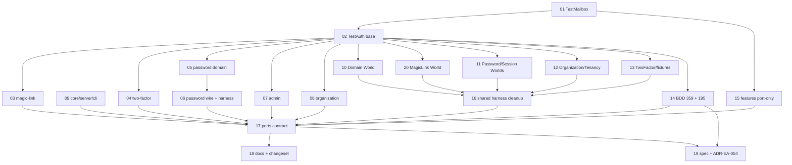

# Plan 35: A test mailbox owns "wait for the forked mail", and `sent` leaves the production ports

| Property | Value |
|---|---|
| Source | Architecture review 2026-11-09, batch 4, candidate 35 ("a test mailbox owns wait-for-the-forked-mail; `sent` leaves the production ports") |
| Strength | Candidate: *Worth exploring*. **Re-assessed: GO, moderate.** The friction is real and measured (§2), the port leak is real, but no production bug was found and the flakiness is latent, not reproduced |
| Dependency category | **in-process.** No I/O seam moves. The mailbox is an in-memory adapter of two ports, provided by the test composition |
| Wave / position | Batch 4. Independent of every other batch-4 plan. Orderable either way with plan 34 (both touch `packages/test/src/TestAuth.ts`, in disjoint regions; §8) |
| Touched packages | `@awthaq/test` (src: new `TestMailbox.ts`; `TestAuth.ts` base ports), `@awthaq/ports` (src: `Mailer.ts`, `SmsSender.ts`), `@awthaq/cli` (one message string), tests of `admin`, `cli`, `core`, `magic-link`, `organization`, `password`, `ports`, `server`, `test`, `two-factor`, and `features/` (Worlds, steps, one `.feature`) |
| Wire change | **None.** No HTTP contract, schema or event changes. The change is a **package-interface break** in `@awthaq/ports` (`MailerShape.sent`, `SmsSenderShape.sent`, `Mailer.layerMemory`, `SmsSender.layerMemory` removed), announced per ADR-EA-034 |
| ADRs | New **ADR-EA-054** (reserved for this plan): a port's interface carries only what a production adapter implements; test observation lives in `@awthaq/test`. Related, unchanged: ADR-EA-010, ADR-EA-034, ADR-EA-044. No Accepted ADR is re-litigated |
| Behaviours | New **BEH-EA-359** (the mailbox). BEH-EA-193 and BEH-EA-195 get *As shipped* notes. BEH-EA-360 and 361 are left unused |
| Requirements | REQ-EA-1560..1562 (the three new BDD scenarios). 1563..1569 unused |
| Tickets | 20, in `tickets/01-*.md` .. `tickets/20-*.md` (ticket 20 was split out of 10 during ticket writing, §2.5) (track as `.scratch/35-test-mailbox/issues/NN-*.md` when work starts) |
| Verified at | `architecture/deepening-plans-2` @ `04fa3526`, 2026-11-09. Effect `4.1.2` installed (`packages/test/node_modules/effect/package.json`). Uncommitted edits in `packages/{qadi,roles,two-factor}/src` belong to someone else; no ticket touches those files |

Conventions: [`.planning/README.md` § Shared conventions](../README.md#shared-conventions-apply-to-every-plan) applies in full (no `as`, no return-type annotations on new Effect/Layer consts, replace-don't-layer, spec + traceability + BDD + changeset per behaviour change). Vocabulary: module, interface, implementation, depth, seam, adapter, leverage, locality. "Port" is the glossary's term (`spec/glossary.md`).

---

## 0. How to read this plan

Three moves, in this order, each green on its own:

1. **Add the deep module** (`TestMailbox`, ticket 01) and put it in `TestAuth`'s base (ticket 02). During the migration its `Mailer` and `SmsSender` still implement `sent`, so nothing breaks.
2. **Move every reader** to the mailbox, package by package and World by World (tickets 03–16 and 20). Each ticket deletes the local copies it replaces. One-member doubles become `Layer.mock`.
3. **Contract the port** (ticket 17): delete `sent` and `layerMemory` from `@awthaq/ports`; then docs, changeset, spec, ADR (tickets 18–19).

Tickets 17–19 must ship in one pull request (the break and its changeset travel together, ADR-EA-034 decision 2).

---

## 1. Summary, goals, non-goals

### 1.1 The problem in one paragraph

`MailerShape` (`packages/ports/src/Mailer.ts:65-81`) is a production port, yet it carries `sent`, a read that only tests use. Every adapter must implement it: `layerNoop` stubs it (`:100`), `README.md:214` tells adopters to write `Mailer.Mailer.of({ send, sent })` for a real provider, and 26 hand-built test mailers implement it only to satisfy the type. `SmsSenderShape` copies the mistake (`SmsSender.ts:57, 79`). Meanwhile the thing tests actually need, *wait until the mail a detached fiber sends has landed*, has no home: it is re-written as 5 fixed-yield `letForkedFibersRun` copies in packages (59 uses), 5 bounded pollers with 4 different budgets, and 6 mailed-token readers. Two harnesses say in their own comments that the fixed-yield wait loses the race on a loaded machine or over Postgres.

### 1.2 Goals

- G1. One test module, `TestMailbox` in `@awthaq/test`, records every mail and SMS, waits for a matching message by subscription (no fixed yields) with a real-clock deadline, refutes a message within a real-time window, and reads a mailed secret.
- G2. `TestAuth.layer`'s base provides it (`Mailer`, `SmsSender`, `TestMailbox.Mailbox` from one recording), so a suite reads the very instance the plugins send through.
- G3. `MailerShape` and `SmsSenderShape` are `send` plus the optional `development` flag. `layerMemory` of both ports is removed; `layerConsole` keeps no messages.
- G4. Every copy the mailbox replaces is deleted: the package `letForkedFibersRun` definitions (5 → 0), the mail pollers, the token readers, the capturing mailers.
- G5. BEH-EA-195 stays honest: a one-member double is `Layer.mock`, and its BDD example moves to a port that still has two members.

### 1.3 Non-goals

- N1. **Fault injection** ("make a core service fail"): the 8 `Sessions.issue` outage decorators stay. They sit on a different seam (`decorate` over a core module), come in 4 shapes (flag `Ref`, flag object, fail-once, always), and two live in packages that cannot import `@awthaq/test` (`core`, which `@awthaq/test` depends on). Q4.
- N2. **Event waits**: `features/step-definitions/shared/Harness.ts` keeps `letForkedFibersRun`, `awaitCondition` and `awaitStable`; their remaining users wait for events (`EventsWorld.ts:250-251`, `OrganizationSteps.ts:936-958`, `ScimSteps.ts:208`), not mail. Q6.
- N3. Core's own `MailDispatch.test.ts` (`:54`, 20 yields) tests the dispatcher, not a composition, and `core` cannot import `@awthaq/test`. It stays.
- N4. No new production adapter, no wire change, no change to how plugins dispatch mail.

### 1.4 Go/no-go gate

**For (each verified, §2):**
1. A test-only member sits on a production port, and adopters are told to implement it (`README.md:214`).
2. 26 `sent:` writer lines in 15 files exist only to satisfy that member.
3. 5 copied `letForkedFibersRun` definitions in packages, 59 uses; 7 mail pollers and settles (5 s/2 ms, 200×10 ms, 500×2 ms, 200×10 ms `Effect.sleep`, 200×5 ms, a fixed 40 ms sleep, and the shared `awaitCondition` path); 6 token readers (§2.5 corrects the earlier count of 5).
4. The fixed-yield wait is documented as racy by its own authors (`magic-link/test/support/harness.ts:68-72`, `two-factor/test/support/harness.ts:90-94`), and plan 08's record says a bounded mail wait was added "for the Postgres-load fix" (`.planning/08-test-composition/PLAN.md:1239`).

**Against:**
1. No production code reads `sent` (§2.3), so there is no runtime bug.
2. The remaining fixed-yield waits pass today: over memory the dispatch fiber does no real async work (`Digest` runs on `node:crypto`), so the race is latent.
3. The diff is wide (51 files carry a gated line, plus docs and spec) for a test-quality gain.

**Decision: GO.** The port leak is a design defect that every provider adapter pays for, and the mailbox removes five copies of a racy helper. Ticket 01 is a TDD tracer that proves the mailbox outwaits a real async delay under `TestClock`, which no fixed-yield copy can. **If ticket 01 cannot make that test pass without fixed yields, stop: NO-GO, keep only the test.**

### 1.5 must_haves (plan level)

```yaml
must_haves:
  truths:
    - "A suite under TestAuth.layer waits for a mail sent on a detached fiber with TestMailbox.Mailbox's waitFor, and no fixed number of scheduler turns"
    - "waitFor fails the test at a deadline measured on the real clock, even under TestClock"
    - "A production Mailer adapter is Mailer.Mailer.of({ send }); a sent member does not compile"
    - "No test, World or step reads a sent member of Mailer or SmsSender"
    - "No package test defines its own fixed-yield mail wait"
    - "awthaq doctor --build still flags a development Mailer (TestMailbox's, layerNoop's, layerConsole's)"
  artifacts:
    - path: "packages/test/src/TestMailbox.ts"
      provides: "Mailbox (Context.Service), layer (Mailer + SmsSender + Mailbox over one recording), secret"
      exports: ["Mailbox", "layer", "secret"]
    - path: "packages/test/test/TestMailbox.test.ts"
      provides: "the mailbox's interface tests (waitFor, refute, secret, development flag, SMS half)"
    - path: "packages/ports/src/Mailer.ts"
      provides: "MailerShape = send + development?; layerNoop, layerConsole"
    - path: "spec/decisions/054-test-observation-off-the-ports.md"
      provides: "ADR-EA-054"
  key_links:
    - from: "packages/test/src/TestAuth.ts (testPorts)"
      to: "packages/test/src/TestMailbox.ts (layer)"
      via: "Layer.mergeAll in testPorts"
      pattern: "TestMailbox\\.layer"
    - from: "features/step-definitions/*World.ts"
      to: "TestMailbox.Mailbox"
      via: "Context.get on app.context(), or app.run"
      pattern: "TestMailbox\\.Mailbox"
    - from: "packages/cli/src/Doctor.ts"
      to: "MailerShape.development"
      via: "mailer-development finding"
      pattern: "development === true"
```

---

## 2. Verified current state

### 2.1 Re-measurement commands (run at the repo root)

| # | What | Command | At `04fa3526` |
|---|---|---|---|
| M1 | `readonly sent` on port interfaces | `git grep -n 'readonly sent' -- packages/ports/src \| wc -l` | **2** (`Mailer.ts:74`, `SmsSender.ts:57`) |
| M2 | `letForkedFibersRun` definitions in packages | `git grep -nE '(const\|function) letForkedFibersRun' -- packages \| wc -l` | **5** (plus 1 in `features/…/shared/Harness.ts:42`, which stays, N2) |
| M3 | `letForkedFibersRun` mentions in packages | `git grep -n 'letForkedFibersRun' -- packages \| wc -l` | **59** (password 44, magic-link 9, two-factor 6) |
| M4 | mail reads/writes/capture outside ports (the plan-wide gate, "GLOBAL") | `git grep -nE '(^\|[^A-Za-z])sent: \|\.sent([^A-Za-z]\|$)\|Mailer\.layerMemory\|makeCapturingMailer' -- packages features \| grep -vE 'webhooks\|Webhooks\|/web/\|agent\.sent\|browser\.sent\|receiver\.sent\|native\.sent\|poster\.sent\|ReactWorld\|NextSsr\|ReactSteps\|SamlSlo' \| wc -l` | **164** lines in **51** files |
| M5 | direct `.sent` reads in tests and features (mail only) | `git grep -n '\.sent\b' -- 'packages/*/test/**' features \| grep -vE 'webhooks\|Webhook\|agent\.sent\|browser\.sent\|receiver\.sent\|native\.sent\|poster\.sent\|UserAgent\|ReactWorld\|NextSsr\|ReactSteps' \| wc -l` | **93** (89 on a `Mailer`, 4 on an `SmsSender`, all in ports' own tests; plus 55 mentions of `sentMail` delegates). Without the `native`/`poster` exclusion the count is 97: those 4 are user-agent request logs in `TestAuthApp.test.ts`, not mail |
| M6 | `sent:` writer lines (hand-built adapters) | `git grep -nE 'sent: (Effect\|Ref)\.' -- packages features \| grep -v Webhooks \| wc -l` | **26** in 15 files |
| M7 | `Mailer.layerMemory` / `SmsSender.layerMemory` mentions | `git grep -nE '(Mailer\|SmsSender)\.layerMemory' -- packages features examples docs README.md spec \| wc -l` | **43** in 28 files |
| M8 | `Sessions.issue` outage decorators | `git grep -ln 'operation: "Sessions.issue"' -- packages features \| wc -l` | **8** (out of scope, N1) |

Per-ticket gates with their own baselines are in each ticket's `<verify>`.

### 2.2 The port (production code)

- `packages/ports/src/Mailer.ts:65-81`: `MailerShape { send; sent; development? }`. `:100` `layerNoop` stubs `sent: Effect.succeed([])`. `:106-116` `layerMemory` records in a `Ref` and reads it back through `sent`. `:129-152` `layerConsole` logs **and** records in a `Ref` it only exposes through `sent`. The header (`:19-24`) records the original choice: reads on the shape "so a test can assert against whichever `Mailer` layer it happened to provide", citing `archive/design/usage-examples-v4.md` §17. That is a design note, not an ADR.
- `packages/ports/src/SmsSender.ts:50-63, 70-126`: the same shape and the same three adapters. **No plugin requires `SmsSender`** (`git grep -n SmsSender -- 'packages/*/src'` hits only `ports`).
- `packages/cli/src/Doctor.ts:196-205` reads `development`, never `sent`; its message names "layerNoop or layerMemory".
- `README.md:214`: "bring your own (`Mailer.Mailer.of({ send, sent })`, any provider); `Mailer.layerMemory` records mail for tests".

### 2.3 Who reads `sent`

- **Production:** nobody. `git grep -n '\.sent\b' -- 'packages/*/src'` hits only `Mailer.ts:21` (a comment), `SamlSlo.ts:227` (`...sent`, a local variable) and `web/src/UserAgent.ts` (the user agent's request log). The only *plugin-shaped* reader is a BDD fixture: `features/step-definitions/PluginFixtures.ts:240` (`NotifierFixture`), whose `notify` result nothing asserts.
- **Tests:** 93 direct mail reads (M5); 55 more through `sentMail` delegates. Breakdown: password 40, magic-link 17, admin 9, ports 8, organization 5, two-factor 3, test 1; features 10 direct.
- **Examples / template:** `examples/memory-server/app.ts:101` and `examples/sql-server/app.ts:113` compose `Mailer.layerConsole` and never read it. `examples/plugin-template` has no `Mailer`.
- **Docs/spec:** `README.md:214`, `docs/plugin-authoring.md:252`, `packages/test/README.md:5`, `packages/ports/README.md:5` (which also repeats the `SmsSender` clause twice, a doc bug fixed in ticket 18), `spec/overview.md:134-135`, `spec/behaviors/25-testing-harness.md:20,25,75`, `spec/behaviors/26-cli.md:44`, `spec/traceability.md:263`, `features/features/08-tooling/25-testing-harness.feature:17,89,91`, `features/traceability.md:565`.

### 2.4 The copied waits and readers

| Helper | Where | Budget / shape |
|---|---|---|
| `letForkedFibersRun` (10 yields) | `password/test/harness.ts:55`, `password/test/AuthHttp.test.ts:85`, `password/test/Password.test.ts:61`, `magic-link/test/support/harness.ts:64`, `two-factor/test/support/harness.ts:86` | fixed |
| `settle` (20 yields) | `admin/test/ImpersonationOwnerNotice.test.ts:28-31` (after `TestClock.adjust(50 ms)`), `password/test/PasswordMail.test.ts:107-109` | fixed |
| `awaitMails(sent, count, 5000)` | `magic-link/test/support/harness.ts:73-89` | real clock, 2 ms ticks, 5 s |
| `awaitMail(template)` | `two-factor/test/support/harness.ts:95-105` | 200 × 10 ms, returns `undefined` at the end |
| `awaitMail(sent, predicate)` → `awaitCondition` | `features/step-definitions/shared/Harness.ts:55-74` | real clock, 2 ms, 5 s, returns `false` |
| `awaitMail(email, template, after)` | `features/step-definitions/DomainSupport.ts:79-95` | 500 × 2 ms, dies |
| `mailedToken(template)` | `password/test/PasswordStoreOutage.test.ts:143-152` | 200 × `Effect.sleep(10 ms)` under `it.live` |
| token readers | `password/test/harness.ts:60`, `two-factor/test/support/harness.ts:108`, `magic-link/test/support/harness.ts:92`, `features/step-definitions/MagicLinkWorld.ts:276`, `features/step-definitions/MailedToken.ts:6`, inline `admin/test/AdminAccounts.test.ts:228-230` | `Redacted.isRedacted ? value : String` |
| `mailOf` / `mailsOf` | `features/step-definitions/MagicLinkWorld.ts:246-273` | 200 × 5 ms poll; a fixed 40 ms real sleep then a read |
| capturing mailers built outside the graph | `features/step-definitions/shared/Harness.ts:102-112` (5 Worlds use it), `password/test/AuthHttp.test.ts:56-73` | `Ref` + `sent` |

### 2.5 Evidence corrections

| Candidate said | Measured | Effect on the plan |
|---|---|---|
| `letForkedFibersRun` defined "about 7 times" | **6**: 5 in packages + `features/…/shared/Harness.ts:42`. The features copy also serves event waits | 5 deleted; the features copy stays (N2) |
| "about 18 inline `yieldNow` loops" | 38 `yieldNow` lines in tests; only **2** are mail settles (`ImpersonationOwnerNotice.test.ts:30`, `PasswordMail.test.ts:108`) and 1 is core's dispatcher test (N3). The rest interleave events, retention or concurrency races | Only the 2 mail settles are replaced |
| "Three mail pollers" | **Seven**: the five of §2.4 plus two in `features/step-definitions/MagicLinkWorld.ts` found while writing ticket 20 (`mailOf`, 200 × 5 ms, `:246-260`; `mailsOf`, a fixed 40 ms real sleep then a read, `:262-273`) | All seven replaced by `waitFor`/`refute` (tickets 03, 04, 05, 10, 11, 16, 20) |
| Mailed-token readers "in about 16 files" | 16 files contain `Redacted.isRedacted`, but **6** are token readers. The rest assert that a mailed value *is* redacted (EOTS-010 checks, kept) or are unrelated (`server/test/AuthHttp.test.ts:1232`, `core/test/VerificationLink.test.ts:474`) | 6 replaced by `TestMailbox.secret`; the assertions stay |
| Outage decorator "in about 8 files" | 8, in 4 shapes | Out of scope (N1, Q4) |
| ~153 reads of `sent` | 93 direct mail reads + 55 through delegates = 148 (the raw grep says 97 direct, 4 of which are user-agent logs) | Confirmed in substance |
| Plan 08 "planned to delete the magic-link harness" | Plan 08 ticket 29 (`.planning/08-test-composition/PLAN.md:816`) says "delete **if under 30 lines remain**". It was 117 then, 95 now. After this plan ≈ 60 lines remain (`buildLayer`, `realLimiter`, the outage decorator) | Not a leftover. The harness shrinks and stays |
| Harness comments at "70-73" and "93-96" | `magic-link/test/support/harness.ts:68-72`, `two-factor/test/support/harness.ts:90-94` | Cosmetic |
| (found while writing tickets) `PasswordMail.test.ts`'s `settle` is a mail settle | Its 3 uses do 3 jobs: one is redundant (`:148`, before a `Fiber.join` on the event), one waits for delivery (`:122`), one lets a failed attempt reach its retry sleep before `TestClock.adjust` (`:120`), which is clock ordering, not mail | Ticket 06 deletes one, replaces one with a subscription, keeps one renamed `letRetryArm` |
| (found while writing tickets) every `letForkedFibersRun` in `Password.test.ts` waits for mail | Two (`:483`, `:490`) wait for an audit row. `requestReset` dispatches nothing for an unknown address (`packages/password/src/Password.ts:866`) and emits `resetRequested` inside the dispatched fiber before the mail (`:876-878`) | Ticket 05 drops the first and waits for the reset mail before the second |
| (found while writing tickets) the Worlds' mail readers are only the 5 Worlds | Also `UsersAccountsSteps.ts:338` (reads the Domain World's `sentMail` with no wait), `TenancySteps.ts:1435` (needs `TestMailbox.Mailbox` in `TenancyWorld.ts`'s `OrganizationServices`, `:167-172`), and `MagicLinkSteps.ts`/`EmailOtpSteps.ts` (6 `mailsOf` counts). `DomainSupport.ts`'s `mailCount` has no caller | Ticket 10 adds `UsersAccountsSteps.ts` and deletes `mailCount`; ticket 12 adds `TenancyWorld.ts`; ticket 20 (new) takes the MagicLink World and its two step files |

### 2.6 Live bugs

No production bug. Two latent defects and one test-design trap, all **by reading**:

1. **Latent race (by reading).** 44 password waits, 2 settles and the features `awaitStable` path depend on the dispatch fiber finishing within N scheduler turns. True today only because the in-memory dispatch has no real async step. `PasswordStoreOutage.test.ts` runs under `pnpm test:pg` (`scripts/test-pg.sh:80`) and its memory half (`registered`, `:51-59`) uses the fixed wait; its SQL half already needed a poller (`:143-152`). Fixed by tickets 05–06.
2. **Retained credentials (by reading).** `Mailer.layerConsole` and `layerMemory` keep every mailed token in an unbounded `Ref` for the life of the process, reachable through `sent` by any code holding `Mailer`. Development-only (doctor flags it), but it is the opposite of EOTS-010's intent. Fixed by ticket 17.
3. **A spec example that silently degrades (by reading).** BEH-EA-195's BDD step (`TestingHarnessSteps.ts:459-470`) proves `Layer.mock` leaves `sent` unimplemented. Once `sent` goes, `Mailer` has one method and the scenario would test nothing. Fixed by ticket 14 (the example moves to `RateLimiter`: `consume` + `check`).

There is no red-test ticket: nothing reproduces at runtime. Ticket 01 is the TDD tracer instead.

---

## 3. Target design

### 3.1 The seam

The seam is the `Mailer` (and `SmsSender`) port. Behind it, in production: a provider adapter that implements `send` only. Behind it in tests: **one** recording adapter, `TestMailbox.layer`, whose observation interface is a separate tag (`TestMailbox.Mailbox`) that only `@awthaq/test` defines. Production code cannot reach the observation interface: `pnpm check:contract-tests` already fails when a library `src` imports `@awthaq/test` (BEH-EA-336).

Depth: the mailbox interface is three members per channel; behind it sit the recording, the subscription, the real-clock deadline (immune to `TestClock`), the n-th match arithmetic, the refutation window, the EOTS-010-safe failure text, and the `Redacted` unwrapping. Today each of those is re-written per suite.

### 3.2 Interface sketches

Types are shown for the reader; the code lets inference type every Effect and Layer const.

```ts
// packages/ports/src/Mailer.ts (after ticket 17)
export interface MailerShape {
  readonly send: (message: MailMessage) => Effect.Effect<void, MailDeliveryFailed>
  readonly development?: true
}
export const layerNoop: Layer.Layer<Mailer>     // dies on send (unchanged)
export const layerConsole: Layer.Layer<Mailer>  // logs; keeps nothing
// layerMemory: removed.  SmsSender.ts: the same three changes.
```

```ts
// packages/test/src/TestMailbox.ts (ticket 01)
import type { Mailer, SmsSender } from "@awthaq/ports"

/** Which recorded messages a wait or a refutation is about: fields to equal, or a predicate. */
export type Match<M> =
  | { readonly to?: string; readonly template?: string }
  | ((message: M) => boolean)

export interface Outbox<M extends { readonly to: string; readonly template: string }> {
  /** Every message recorded so far, in send order. */
  readonly messages: Effect.Effect<ReadonlyArray<M>>
  /** The nth (1-based, default 1) message matching `match`, as soon as it is recorded.
   *  Dies at a real-clock deadline (default 5 s) naming the match and the count, never a recipient or data. */
  readonly waitFor: (
    match: Match<M>,
    options?: { readonly nth?: number; readonly timeout?: Duration.Input },
  ) => Effect.Effect<M>
  /** Dies if more than `beyond` (default 0) matching messages are recorded already or within `window`
   *  real time (default 50 ms). `refute(m)` is "none"; `refute(m, { beyond: 1 })` is "exactly the one I awaited". */
  readonly refute: (
    match: Match<M>,
    options?: { readonly beyond?: number; readonly window?: Duration.Input },
  ) => Effect.Effect<void>
}

export interface MailboxShape {
  readonly mail: Outbox<Mailer.MailMessage>
  readonly sms: Outbox<SmsSender.SmsMessage>
}

export class Mailbox extends Context.Service<Mailbox, MailboxShape>()("awthaq/test/Mailbox") {}

/** Mailer and SmsSender (both `development: true`) recording into one Mailbox. */
export declare const layer: Layer.Layer<Mailbox | Mailer.Mailer | SmsSender.SmsSender>

/** A mailed value (`"token"` by default), Redacted or plain. Throws naming the field and template when absent. */
export declare const secret: (
  message: { readonly template: string; readonly data?: Record<string, unknown> },
  field?: string,
) => string
```

Implementation notes (prose, for ticket 01):
- Each channel is one `SubscriptionRef<ReadonlyArray<M>>` (`effect/SubscriptionRef`, 4.1.2: `make`, `update`, `get`, `changes`; `changes` replays the current value first). `send` appends with `SubscriptionRef.update`.
- `waitFor` = `SubscriptionRef.changes` → map each snapshot to its nth match → first defined value (`Stream.filterMap`/`Stream.runHead`), raced (`Effect.raceFirst`) against a **real** timer: `Effect.callback` over `setTimeout`, cleared on interruption. It must not use `Clock`, `Effect.sleep` or `Effect.timeout`: the suites run under `TestClock` (`it.effect`), where those never fire. `TestClock.withLive` is not usable either: `testClockWith` casts the ambient clock, so it breaks outside `TestClock` (`effect/src/testing/TestClock.ts:593-595`).
- `refute` races the same stream (a snapshot holding more than `beyond` matches dies) against a real `window` timer, which succeeds.
- Layer: one `Layer.effectContext` building both refs and a `Context` holding `Mailer`, `SmsSender` and `Mailbox`. Until ticket 17 the `Mailer`/`SmsSender` values also carry `sent` (reading the ref) because the port shape still requires it; ticket 17 deletes those two lines.
- The deadline message names the match (`template`, and whether `to` was set, not its value) and the number recorded. EOTS-010: never a recipient, never `data`.

### 3.3 How a test reads it

| Before | After |
|---|---|
| `yield* letForkedFibersRun; const m = (yield* mailer.sent).findLast(…)` | `const m = yield* (yield* TestMailbox.Mailbox).mail.waitFor({ to, template })` |
| `awaitMails(sent, before + 1)` | `box.mail.waitFor({}, { nth: before + 1 })` |
| `letForkedFibersRun; assert …length === 0` | `box.mail.refute({ to, template })` |
| `awaitMails(sent, 1); letForkedFibersRun; assert length === 1` | `waitFor(match)` then `refute(match, { beyond: 1 })` |
| `tokenOf(mail)` / `secretOf(mail, "code")` | `TestMailbox.secret(mail)` / `TestMailbox.secret(mail, "code")` |
| failing / never-answering `Mailer.Mailer.of({ send, sent })` | `Layer.mock(Mailer.Mailer)({ send })` (BEH-EA-195) |
| `testApp.run(Effect.flatMap(Mailer.Mailer, (m) => m.sent))` | `testApp.run(Effect.flatMap(TestMailbox.Mailbox, (b) => b.mail.waitFor(…)))` |
| a World's `makeCapturingMailer()` built outside the graph | `Context.get(await app.context(), TestMailbox.Mailbox)`, kept on the World; its members are requirement-free Effects, so a step runs them on its own fiber |

### 3.4 Module layout after the change

```
packages/ports/src/Mailer.ts        MailerShape {send, development?}; layerNoop; layerConsole
packages/ports/src/SmsSender.ts     SmsSenderShape {send, development?}; layerNoop; layerConsole
packages/test/src/TestMailbox.ts    NEW  Mailbox, layer, secret (+ Match, Outbox, MailboxShape types)
packages/test/src/TestAuth.ts       testPorts: TestMailbox.layer replaces Mailer.layerMemory
packages/test/src/index.ts          export * as TestMailbox
packages/*/test/**                  no letForkedFibersRun, no sent, no token-reader copies
features/step-definitions/shared/Harness.ts   awaitMail + makeCapturingMailer gone; event waits stay
```

### 3.5 Alternatives rejected

1. **Keep `sent` on the port.** Every provider adapter implements a test read; a development adapter left in production keeps every token readable. Rejected (ADR-EA-054).
2. **A read tag in `@awthaq/ports`** (`Mailer.Outbox` provided by `layerMemory`). The recording would sit in ports, the waiting in `@awthaq/test`: one concept split over two packages, still a test-only export from a production package. Rejected.
3. **Keep `layerMemory` as a non-recording "accept everything" adapter.** Its name would lie, and `layerNoop`/`layerConsole` already cover "a `Mailer` that sends nothing real". Rejected (Q3).
4. **Poll `sent` with a better budget** (unify the five pollers on one helper). Keeps the port leak and still burns real time per check; a subscription wakes exactly when the message lands. Rejected.
5. **Fault injection in the mailbox** (`failNext`). The 6 failing mailers are one-member doubles; `Layer.mock` already expresses them and BEH-EA-195 requires it. Rejected (Q4).

---

## 4. Phased migration

### 4.1 Waves

| Wave | Tickets | Gate to leave the wave |
|---|---|---|
| 1 | 01, 09 | `TestMailbox.test.ts` green; core/server/cli no longer use `Mailer.layerMemory` |
| 2 | 02, 15 | `TestAuth`'s base provides the mailbox; features' port-only users moved |
| 3 | 03, 04, 05, 07, 08, 10, 11, 12, 13, 14, 20 | every package suite but password's wire half, and every World, reads the mailbox |
| 4 | 06, 16 | password wire suites and the shared features harness migrated; **M4 (GLOBAL) at 0 outside `packages/ports` and `packages/test/src/TestMailbox.ts`** |
| 5 | 17 | the port contract: `sent` and `layerMemory` deleted |
| 6 | 18, 19 | docs, changeset, spec, ADR-EA-054; `pnpm check` |

Tickets in one wave touch disjoint files (checked: no file appears in two tickets).

### 4.2 Ticket table

| Ticket | Title | Wave | Depends on | Type | Size | Files |
|---|---|---|---|---|---|---|
| [01](tickets/01-test-mailbox-module.md) | `TestMailbox`: record, wait, refute, read a secret | 1 | – | tdd | M | `packages/test/src/TestMailbox.ts` (new), `packages/test/src/index.ts`, `packages/test/test/TestMailbox.test.ts` (new) |
| [02](tickets/02-testauth-base-mailbox.md) | `TestAuth`'s base provides the mailbox | 2 | 01 | tdd | M | `packages/test/src/TestAuth.ts`, `packages/test/test/TestAuthApp.test.ts`, `packages/test/test/TestAuthServices.test.ts`, `packages/test/test/TestAuthHost.test.ts`, `packages/test/README.md` |
| [03](tickets/03-magic-link-suites.md) | magic-link suites read the mailbox | 3 | 02 | auto | M | `packages/magic-link/test/support/harness.ts`, `…/MagicLink.test.ts`, `…/EmailOtp.test.ts`, `…/AuthHttp.test.ts` |
| [04](tickets/04-two-factor-suites.md) | two-factor suites read the mailbox | 3 | 02 | auto | S | `packages/two-factor/test/support/harness.ts`, `…/AuthHttp.test.ts`, `…/TwoFactor.test.ts` |
| [05](tickets/05-password-domain-suites.md) | password domain suites read the mailbox | 3 | 02 | auto | L | `packages/password/test/Password.test.ts`, `…/PasswordRecovery.test.ts`, `…/PasswordStoreOutage.test.ts`, `…/PasswordRateLimitBehaviour.test.ts`, `…/PasswordHooksBeforeCredentialReset.test.ts` |
| [06](tickets/06-password-wire-suites.md) | password wire suites and the password harness | 4 | 05 | auto | L | `packages/password/test/AuthHttp.test.ts`, `…/PasswordChangeEmail.test.ts`, `…/PasswordMail.test.ts`, `…/harness.ts` |
| [07](tickets/07-admin-suites.md) | admin suites read the mailbox | 3 | 02 | auto | S | `packages/admin/test/AdminAccounts.test.ts`, `…/AdminAccountsHttp.test.ts`, `…/AdminGate.test.ts`, `…/ImpersonationOwnerNotice.test.ts` |
| [08](tickets/08-organization-suites.md) | organization suites read the mailbox | 3 | 02 | auto | S | `packages/organization/test/Organization.test.ts`, `…/OrganizationInvitations.test.ts`, `…/OrganizationConnections.test.ts` |
| [09](tickets/09-core-server-cli-port-users.md) | core, server and cli stop composing `Mailer.layerMemory` | 1 | – | auto | S | `packages/core/test/AuthPlugin.test.ts`, `packages/server/test/support/HostPorts.ts`, `packages/cli/src/Doctor.ts`, `packages/cli/test/Doctor.test.ts` |
| [10](tickets/10-features-domain-world.md) | Domain World reads the mailbox | 3 | 02 | auto | M | `features/step-definitions/DomainWorld.ts`, `…/DomainSupport.ts`, `…/MailedToken.ts`, `…/UsersAccountsSteps.ts` |
| [11](tickets/11-features-password-session-worlds.md) | Password and Session Worlds read the mailbox | 3 | 02 | auto | M | `features/step-definitions/PasswordWorld.ts`, `…/PasswordSteps.ts`, `…/SessionWorld.ts` |
| [12](tickets/12-features-organization-tenancy.md) | Organization World and Tenancy steps read the mailbox | 3 | 02 | auto | S | `features/step-definitions/OrganizationWorld.ts`, `…/OrganizationSteps.ts`, `…/TenancySteps.ts`, `…/TenancyWorld.ts` |
| [13](tickets/13-features-two-factor-fixtures.md) | TwoFactor World and the notifier fixture | 3 | 02 | auto | S | `features/step-definitions/TwoFactorWorld.ts`, `…/TwoFactorResetSteps.ts`, `…/PluginFixtures.ts` |
| [14](tickets/14-features-testing-harness-bdd.md) | BDD: BEH-EA-359 scenarios, BEH-EA-195 on a two-member port | 3 | 02 | tdd | M | `features/step-definitions/TestingHarnessSteps.ts`, `features/features/08-tooling/25-testing-harness.feature`, `features/traceability.md` |
| [15](tickets/15-features-port-only-users.md) | features compositions that only need a `Mailer` | 2 | 01 | auto | S | `features/step-definitions/CliSteps.ts`, `…/CompileTimeGates.ts`, `…/CompositionSteps.ts`, `…/RegistriesSteps.ts`, `…/TestingHarnessComposeSteps.ts` |
| [16](tickets/16-features-shared-harness-cleanup.md) | delete the shared mail helpers | 4 | 10, 11, 12, 13, 20 | auto | S | `features/step-definitions/shared/Harness.ts`, `features/step-definitions/HooksSteps.ts` |
| [17](tickets/17-ports-contract.md) | `sent` and `layerMemory` leave `@awthaq/ports` | 5 | 03–16, 20 | tdd | M | `packages/ports/src/Mailer.ts`, `packages/ports/src/SmsSender.ts`, `packages/ports/test/Mailer.test.ts`, `packages/ports/test/SmsSender.test.ts`, `packages/test/src/TestMailbox.ts` |
| [18](tickets/18-docs-changeset.md) | docs and the changeset | 6 | 17 | auto | S | `README.md`, `packages/ports/README.md`, `docs/plugin-authoring.md`, `spec/overview.md`, `.changeset/test-mailbox.md` (new) |
| [19](tickets/19-spec-adr-traceability.md) | ADR-EA-054, BEH-EA-359, traceability | 6 | 14, 17 | auto | M | `spec/decisions/054-test-observation-off-the-ports.md` (new), `spec/decisions/index.yaml`, `spec/behaviors/25-testing-harness.md`, `spec/behaviors/26-cli.md`, `spec/traceability.md` |
| [20](tickets/20-features-magic-link-world.md) | MagicLink World reads the mailbox | 3 | 02 | auto | S | `features/step-definitions/MagicLinkWorld.ts`, `…/MagicLinkSteps.ts`, `…/EmailOtpSteps.ts` |

### 4.3 Dependency graph



### 4.4 Rollback points

Every ticket before 17 is test-only and reverts alone. Ticket 17 is the one break; reverting 17–19 restores `sent` and `layerMemory`, and the migrated tests keep passing because the mailbox never depended on `sent`.

---

## 5. Test plan

### 5.1 Tests at the new interface (ticket 01, `packages/test/test/TestMailbox.test.ts`)

1. `waitFor` returns a mail that a **detached** fiber sends after a real 20 ms delay, under `it.effect` (`TestClock`): no fixed yields, no clock adjustment.
2. `waitFor({ template }, { nth: 2 })` returns the second matching mail and ignores non-matching ones in between; a predicate match works the same.
3. `waitFor` dies at its real deadline (`timeout: "40 millis"`) under `TestClock`; the defect text names the template and the recorded count and does **not** contain the recipient address.
4. `refute` succeeds when nothing matching arrives within the window; dies when a match is already recorded; dies when a match arrives inside the window; with `beyond: 1` it succeeds on one recorded match and dies when a second arrives inside the window.
5. `secret` unwraps a `Redacted` value and returns a plain string as is; throws naming the field and the template when the field is absent.
6. The layer's `Mailer` and `SmsSender` set `development: true`; an SMS sent through `SmsSender` is visible through `sms.waitFor`, not `mail`.
7. Concurrency: 8 fibers send at once; `messages` holds 8 and `waitFor({}, { nth: 8 })` resolves.

Ticket 02 adds, in `TestAuthApp.test.ts`: `TestAuth.layer(Auth.make([Password]))` signs a user up through the HTTP handler and the test reads the verification mail through `app.run(… Mailbox.mail.waitFor …)`: the base mailbox is the instance the plugin sent through, read from a different runtime fiber than the sender.

### 5.2 Tests deleted or rewritten (replace, don't layer)

- Deleted helpers: `letForkedFibersRun` ×5 (packages), `awaitMails`, `secretOf` (magic-link harness), `awaitMail`, `tokenOf` (two-factor harness), `tokenOf` (password harness), `capturingMailer` (password `AuthHttp.test.ts:56-73`), `mailedToken` ×2 (`PasswordRecovery.test.ts:22`, `PasswordStoreOutage.test.ts:143`), `settle` ×2 (the `PasswordMail.test.ts` one partly, §2.5), features shared `awaitMail`, `mailCount`, `makeCapturingMailer`, `MagicLinkWorld`'s `mailsOf` and its `mailOf` poll. `DomainSupport.awaitMail` keeps its name and signature (14 callers in `VerificationSteps.ts`) and stops polling.
- `packages/ports/test/Mailer.test.ts`: the `describe("Mailer.layerMemory")` block (`:12-32`) is deleted (its behaviour is `TestMailbox.test.ts` case 1–2); the `layerConsole` test stops asserting a read-back. `SmsSender.test.ts`: the same (`:11-25`).
- `features/…/TestingHarnessSteps.ts:459-470`: the BEH-EA-195 step moves from `Mailer` (`send`/`sent`) to `RateLimiter` (`consume`/`check`).

### 5.3 Concurrency and Postgres

- The suites that cross real I/O: `PasswordStoreOutage.test.ts` (listed in `scripts/test-pg.sh:80`), `two-factor` `buildDurableAuditLayer` (SQLite), the BDD `DomainWorld`/`SessionWorld`/`PasswordWorld` SQL compositions (Postgres when `AWTHAQ_POSTGRES_URL` is set). Run `pnpm test:pg` once in ticket 17 (no SQL adapter changes, but the mailbox's claim is that it outwaits socket I/O). If Postgres cannot start, say so in "Decisions taken".
- The mailbox's own concurrency case is §5.1 #7.

### 5.4 Measurable targets

| Gate | Baseline | Target |
|---|---|---|
| M1 `readonly sent` in ports src | 2 | 0 (ticket 17) |
| M2 `letForkedFibersRun` definitions in packages | 5 | 0 (tickets 03–06) |
| M3 `letForkedFibersRun` mentions in packages | 59 | 0 |
| M4 GLOBAL (reads, writers, `Mailer.layerMemory`, `makeCapturingMailer`) | 164 / 51 files | 0 after ticket 17 |
| M6 `sent:` writers | 26 | 0 |
| M7 `layerMemory` of Mailer/SmsSender (code + docs + spec) | 43 | 0 after ticket 19 |
| Mail pollers and mail settles (§2.4, §2.5) | 7 pollers + 3 settles | 0, except one `TestClock` ordering loop kept and renamed in `PasswordMail.test.ts` (ticket 06) |
| New fixed-yield loops added | – | 0 |

---

## 6. Spec, ADR, traceability, BDD, docs, changesets

### 6.1 ADR-EA-054 (new, drafted; ticket 19 writes the file)

> # ADR-EA-054: A Port's Interface Carries Only What a Production Adapter Implements; Test Observation Lives in `@awthaq/test`
>
> Document Control: EFAUTH-ADR-054, revision 1.0, status *Accepted — implemented*, change history "1.0: Initial release (architecture plan 35)".
>
> **Context.** `MailerShape` and `SmsSenderShape` carried `sent`, a read of recorded messages, so a test could assert against whichever adapter it had. Every adapter paid for it: `layerNoop` stubbed it, the README told adopters to implement it for a real provider, and 26 test doubles implemented it only to type-check. What tests needed instead, waiting for mail a detached fiber sends (BEH-EA-064, BEH-EA-113), was copied per suite as fixed scheduler turns or bounded polls.
>
> **Decision.**
> 1. A port's interface holds only what a production adapter implements and production code calls. `MailerShape` and `SmsSenderShape` are `send` plus the optional `development` flag that `awthaq doctor --build` reads (BEH-EA-201).
> 2. Observing what was sent is test tooling. It lives in `@awthaq/test` as `TestMailbox`: one module provides `Mailer`, `SmsSender` and `TestMailbox.Mailbox` over one recording. `TestAuth.layer`'s base provides it (BEH-EA-359). The `Mailbox` key is not under `awthaq/ports/`: it is not a port.
> 3. `@awthaq/ports` keeps the adapters an application composes: `layerNoop` (dies on send) and `layerConsole` (logs, keeps nothing). `layerMemory` of both ports is removed.
> 4. Waiting for a forked send is the mailbox's job: by subscription, with a deadline on the real clock so a suite under `TestClock` still fails instead of hanging.
> 5. A double that overrides one member of a port is `Layer.mock` (BEH-EA-195).
>
> **Alternatives considered.** Keep `sent` (every provider implements a test read; a development adapter left in production keeps every token). A read tag in ports (splits one concept over two packages). A non-recording `layerMemory` (a name that lies).
>
> **Consequences.** Positive: a provider adapter is `Mailer.Mailer.of({ send })`; no development adapter retains credentials; one tested wait replaces five copies. Negative: a breaking change to `@awthaq/ports` (ADR-EA-034, migration note); a test outside `@awthaq/test`'s reach (`core`, `server`) composes `layerNoop` and cannot read mail; a "nothing was sent" assertion is a real-time window, not a proof.
>
> **Related.** ADR-EA-010 (the mailbox is provided where the application provides ports, never by a plugin), ADR-EA-034, ADR-EA-044 (`TestAuth.layer` is `AuthHost.layer` over the test ports).

### 6.2 Behaviour entries (`spec/behaviors/25-testing-harness.md`, revision 1.11)

- **BEH-EA-359 (new): `TestAuth`'s base records mail and SMS in a mailbox a test awaits.**
  Example: `const box = yield* TestMailbox.Mailbox` · `const mail = yield* box.mail.waitFor({ to: email, template: "verify-email" })` · `TestMailbox.secret(mail)` · `yield* box.mail.refute({ to: "nobody@example.com" })`.
  REQUIREMENT: `TestAuth.layer` MUST provide `Mailer` and `SmsSender` through one `TestMailbox.layer`, and its output MUST hold `TestMailbox.Mailbox` over the recording the plugins send into. `waitFor` MUST resolve as soon as a matching message is recorded, without a fixed number of scheduler turns, and MUST fail at a deadline measured on the real clock. `refute` MUST fail when a matching message is recorded already or within its window. A failure message MUST NOT contain a recipient or message data (EOTS-010). *Implementation*: `packages/test/src/TestMailbox.ts`; tests `packages/test/test/TestMailbox.test.ts`, `TestAuthApp.test.ts`; BDD REQ-EA-1560..1562.
- **BEH-EA-193**: the code comment and REQUIREMENT text say `TestMailbox.layer` instead of `Mailer.layerMemory`; an *As shipped (plan 35)* note: the output also holds `SmsSender` and `TestMailbox.Mailbox`.
- **BEH-EA-195**: the example becomes `Layer.mock(RateLimiter.RateLimiter)({ consume })`; the prose says `Mailer` has one member since ADR-EA-054, so a `Mailer` double is a full `Layer.mock`, and the "lighter-weight alternative" sentence names `TestMailbox` instead of `Mailer.layerMemory`.
- `spec/behaviors/26-cli.md:44`: "a `Mailer.layerMemory` left in production" → "a development `Mailer` (`layerNoop`, `layerConsole`, a test mailbox) left in production" (revision bump).
- `spec/overview.md:134-135`: `Mailer` and `SmsSender` rows list `layerNoop`, `layerConsole`.

### 6.3 Traceability

`spec/traceability.md` (revision 1.78): §1 row for file 25 adds BEH-EA-359; §4 ADR-EA-054 row (tests: `TestMailbox.test.ts`, `ports/test/Mailer.test.ts`, `SmsSender.test.ts`); §5 replaces the `Mailer.test.ts` row text at `:263` (no read-back; `layerNoop` dies; `layerConsole` logs) and adds a `TestMailbox.test.ts` row; §6 row for file 25 lists REQ-EA-1560..1562. `features/traceability.md`: three rows, REQ-EA-552's title loses `Mailer.layerMemory`, and the header's "highest issued" stays REQ-EA-1513 unless a later plan raised it (re-read before editing).

### 6.4 BDD (`features/features/08-tooling/25-testing-harness.feature`)

- `@REQ-EA-545`: "…uses memory repositories, a test mailbox, a permissive RateLimiter…" (step text and step definition change together).
- `@REQ-EA-551`/`552`: the port becomes `"RateLimiter"` and the method `"consume"`; 552's title: "Layer.mock is chosen over the test mailbox when a test needs no recording or inspection behavior".
- New rule `@BEH-EA-359` with `@REQ-EA-1560` (a mail sent on a detached fiber is awaited, not yielded for), `@REQ-EA-1561` (an expected mail that never comes fails at a real deadline), `@REQ-EA-1562` (a refutation fails when a matching mail arrives within its window). *Changed while writing ticket 14:* the earlier draft for 1562, "a provider `Mailer` implements `send` alone", cannot type-check before ticket 17 (wave 5) while ticket 14 runs in wave 3; that property is proven instead by ticket 17 task 1 (`Mailer.Mailer.of({ send })` in `ports/test/Mailer.test.ts` and `SmsSender.test.ts`).

### 6.5 Docs

`README.md:214`, `packages/ports/README.md:5` (also drops the duplicated `SmsSender` clause), `docs/plugin-authoring.md:252,265`, `packages/test/README.md:5`, the `Mailer.ts`/`SmsSender.ts` headers and `layerNoop` defect text ("or `TestMailbox.layer` from `@awthaq/test` for tests").

### 6.6 Changeset (`.changeset/test-mailbox.md`, ticket 18)

```md
---
"@awthaq/ports": minor
"@awthaq/test": minor
"@awthaq/cli": patch
---

Test observation leaves the production ports (ADR-EA-054, BEH-EA-359).

- `@awthaq/ports`: `MailerShape` and `SmsSenderShape` are `send` plus the optional `development` flag; `sent` is removed. `Mailer.layerMemory` and `SmsSender.layerMemory` are removed. `layerConsole` logs each message and no longer keeps it.
- `@awthaq/test`: `TestMailbox` (`layer`, `Mailbox`, `secret`) records every mail and SMS; `Mailbox.mail.waitFor` waits for a matching message by subscription with a real-clock deadline, `refute` fails if one arrives within a window. `TestAuth.layer` provides it in place of `Mailer.layerMemory`; its output now also holds `SmsSender` and `TestMailbox.Mailbox`.
- `@awthaq/cli`: the `mailer-development` finding names `layerNoop`, `layerConsole` or a test mailbox.

Migration: a provider adapter drops `sent` (`Mailer.Mailer.of({ send })`; the same for `SmsSender`). A test that composed `Mailer.layerMemory` composes `TestMailbox.layer` from `@awthaq/test` (or `Mailer.layerNoop` when nothing is sent) and reads `TestMailbox.Mailbox` instead of `mailer.sent`: `waitFor({ to, template })` replaces a read after cooperative yields, `refute` replaces a "nothing was sent" read, `TestMailbox.secret(mail)` replaces unwrapping `data.token`. A double that only fails or never answers is `Layer.mock(Mailer.Mailer)({ send })`. ADR-EA-054, BEH-EA-359, BEH-EA-193, BEH-EA-195.
```

---

## 7. Risks, mitigations, rollback

| # | Risk | Likelihood | Mitigation |
|---|---|---|---|
| R1 | A wait on the step's fiber does not wake when the app's runtime records the mail (cross-runtime subscription) | low | `SubscriptionRef`'s `PubSub` resumes waiters on publish regardless of runtime; ticket 02 proves it with a send through `app.handler` and a wait through `app.run`; ticket 10 proves it from a World's own fiber |
| R2 | A deadline that uses `Clock` never fires under `TestClock` and a suite hangs to Vitest's timeout | med if done wrong | Ticket 01 case 3 runs under `it.effect` with a 40 ms deadline; the action forbids `Clock`/`Effect.sleep`/`Effect.timeout`/`TestClock.withLive` |
| R3 | `refute`'s window is weaker than the old "yield then count" for a mail that would arrive late | low | Same direction as before (a negative check can only false-pass); the 50 ms default is 5× the old 10-yield settle on a loaded machine; Q5 |
| R4 | `TestAuthHost.test.ts` asserts the harness's keys equal the host's plus the guard's; the base gains `SmsSender` and `Mailbox` | certain | Ticket 02 provides `TestMailbox.layer` to the host side of that test too, so both sides carry the same port keys |
| R5 | BEH-EA-195's example silently stops testing anything | certain | Ticket 14 moves it to `RateLimiter` before ticket 17 lands |
| R6 | Wide diff conflicts with other in-flight branches touching the same suites | med | Package-sized tickets; no `src` file outside ports/test/cli is touched; the `two-factor`/`roles`/`qadi` `src` edits in the working tree are not touched |
| R7 | knip flags an exported type of `TestMailbox` (`Match`, `Outbox`, `MailboxShape`) as unused | low | They appear in the public signatures; if knip still reports one, keep it unexported rather than add an ignore |
| R8 | An external adopter's test harness breaks on upgrade | certain (pre-1.0) | Changeset `Migration:` names every replacement (ADR-EA-034 decision 2) |

Rollback: §4.4.

---

## 8. Interactions with other plans

| Plan | Interaction | Resolution |
|---|---|---|
| **34** (scoped test app, batch 4) | Owns `TestAuth.app`'s lifetime and listening mode; edits `packages/test/src/TestAuth.ts` | **Disjoint regions, either order.** This plan edits only `testPorts` (`TestAuth.ts:149-169`, its body and doc comment) and the doc comment of `layer` (`:362`). It does not touch `app`, `App`, `run`, `context`, `dispose`. Features Worlds read the mailbox through `app.context()` or `app.run`; if 34 lands first and renames or scopes those, tickets 10–13 use 34's accessor (one line per World). If 35 lands first, 34 rebases nothing of ours |
| 37 (store contract runner) | Owns `StoreContract` and `scripts/test-pg.sh` | No overlap. `PasswordStoreOutage.test.ts` stays listed in the script; this plan does not edit the script |
| 31, 32, 33, 36, 38, 39, 40 | – | No shared files |
| 08 (test composition, done) | Ticket 29's conditional deletion of the magic-link harness | Condition stays unmet (≈60 lines remain); recorded in §2.5 |
| 26 (request context, done) | `TestAuth.withRequest`/`app.run`'s request option | Unaffected; mailbox reads need no request context |
| 27 (password credential, done) | The password suites at HEAD already reflect it | Tickets 05–06 edit those suites as they are now |
| 29 (plugin-owned events, done) | `TestAuth` sets `UndeclaredEventPolicy` to `"die"`; features event waits | Unaffected; event waits stay (N2) |
| ADR-EA-010 | Ports are provided by the application, never by a plugin | `TestMailbox.layer` is provided by `TestAuth`'s base (the application role). Its `Mailbox` key is `awthaq/test/Mailbox`, so JH-008's `awthaq/ports/*` check is not involved. No amendment |

---

## 9. Acceptance checklist

- [ ] `TestMailbox.test.ts` passes, including the detached-fiber wait under `TestClock` and the real-clock deadline (01)
- [ ] `TestAuth.layer`'s output holds `TestMailbox.Mailbox`, `Mailer` and `SmsSender` from one recording; `TestAuthHost.test.ts` still proves host/harness key parity (02)
- [ ] magic-link, two-factor, password, admin, organization suites read the mailbox; M2 = 0 and M3 = 0 (03–08)
- [ ] core, server and cli tests compose no `Mailer.layerMemory`; doctor's message updated (09)
- [ ] Every World reads the mailbox through the app's context; `makeCapturingMailer` and the shared `awaitMail` are gone, `DomainSupport.awaitMail` and `mailOf` wait by subscription (10–13, 16, 20)
- [ ] REQ-EA-1560..1562 scenarios pass under `pnpm test:bdd`; BEH-EA-195's scenario runs on `RateLimiter` (14)
- [ ] features port-only compositions use `TestMailbox.layer`, `Mailer.layerNoop` or `Mailer.layerConsole` (15)
- [ ] M1 = 0, M4 = 0, M6 = 0; `Mailer.layerMemory`/`SmsSender.layerMemory` do not exist; `pnpm test:pg` run or its absence recorded (17)
- [ ] Changeset with `Migration:`; README, ports README, plugin-authoring, overview updated; M7 = 0 outside spec (18)
- [ ] ADR-EA-054 Accepted and indexed; BEH-EA-359 written; BEH-EA-193/195 and 26-cli revised; traceability rows; `pnpm spec:verify:strict` green (19)
- [ ] `pnpm check` green at the end of wave 6

---

## 10. Open questions

| # | Question | Recommended default | If the answer differs |
|---|---|---|---|
| Q1 | Record the rule as a new ADR-EA-054, or as a revision of ADR-EA-010? | **New ADR-EA-054.** ADR-EA-010 is about who provides a port; this is about what a port's interface may hold | Ticket 19 writes ADR-EA-010 revision 1.5 with §6.1's decisions as a new section and no new file; index unchanged |
| Q2 | Should `TestAuth`'s base provide `SmsSender` (the mailbox's SMS half)? No plugin requires it today | **Yes.** `SmsSender.layerMemory` is the only SMS recorder and ticket 17 deletes it; an SMS plugin's suite then needs nothing new | Drop `sms` from `MailboxShape` and `SmsSender` from `TestMailbox.layer` (ticket 01); ticket 17 still deletes `SmsSender.layerMemory`, leaving no SMS recorder |
| Q3 | Delete `layerMemory` from both ports, or keep it as a non-recording adapter? | **Delete.** Without a read it records for no one; `layerNoop`/`layerConsole` cover the other uses | Ticket 17 keeps `layerMemory` as `send: () => Effect.void` with `development: true` and renames nothing; docs say "accepts and discards"; ticket 09/15 changes shrink |
| Q4 | Add fault injection beside the mailbox (`failNext` on the mail half, a `Sessions.issue` outage helper)? | **No.** Failing mailers are `Layer.mock` (BEH-EA-195); the outage decorators are 4 shapes on a different seam, and `core` cannot import `@awthaq/test` | A follow-up plan for `TestAuth` decorate helpers; nothing in this plan changes |
| Q5 | Is a 50 ms real-time window acceptable for "nothing was sent"? | **Yes**, with per-call `window` for slower paths (SQL) | Raise the default (each refutation costs its window in wall time) |
| Q6 | Plan an event-side equivalent (wait for an `AuthEvents` publication) for the features event waits? | **No, out of scope.** Different module (`RedactionGuard`'s events inspector / `AuthEvents`) | A follow-up candidate; N2 stays |
| Q7 | Changeset bump levels | `@awthaq/ports` minor, `@awthaq/test` minor, `@awthaq/cli` patch (the repo marks removed exports `minor` pre-1.0, e.g. `.changeset/admin-config-private.md`) | Adjust the frontmatter only |

No question blocks wave 1. Q2 must be settled before ticket 01's SMS half is written (default: yes). Q1 and Q3 must be settled before wave 5.

---

## Decisions taken
