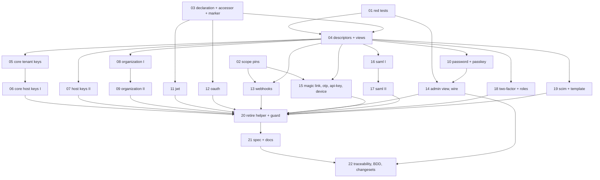

# Plan 36: Each configuration key declares its scope, and one accessor resolves it

| Property | Value |
|---|---|
| Source | Architecture review 2026-11-09, batch 4, candidate 36 ("each plugin declares its config scope, and one accessor resolves it") |
| Strength | Brief: **Worth exploring**. After re-verification: **Worth exploring, GO** (§1.1). No security bug. One confirmed operator-visible inconsistency (`GET /admin/config` under a tenant), one latent one (`EffectiveConfig.snapshot`), and an unenforced prose list that is already wrong (it names 18 of the 29 configuration keys). The fix is type-first and was probed against the pinned compiler (§3.6) |
| Dependency category | **in-process**. No I/O seam moves; no SQL adapter, migration or table changes |
| Wave / position | Wave 0 (tickets 01–02, tests only) can land at once. Wave 1 (03–04) is the seam. Wave 2 (05–19) migrates each package and is parallel by package. Wave 3 (20–22) retires the old helper and lands spec, docs, BDD and changesets. Plan 31 lands its SAML gate read independently, with today's `configInForce` (§8) |
| Touched packages | `@awthaq/ports` (`Tenant`, `RateLimiter`), `@awthaq/core` (`ConfigDescriptor`, `EffectiveConfig`, `Tenant`, `Sessions`, `Accounts`, `RateLimits`, `SessionCookie`, `MailDispatch`, `AuditChain`, `Erasure`, `Retention`, `SecuritySignals`), `@awthaq/sql` (`SealedColumn`), `@awthaq/server` (`BodyLimit`), `@awthaq/qadi` (`SubjectApi`), `@awthaq/admin`, `@awthaq/organization`, `@awthaq/password`, `@awthaq/passkey`, `@awthaq/jwt`, `@awthaq/oauth`, `@awthaq/webhooks`, `@awthaq/magic-link`, `@awthaq/api-key`, `@awthaq/device-authorization`, `@awthaq/saml`, `@awthaq/scim`, `@awthaq/two-factor`, `@awthaq/roles`, `examples/plugin-template`, `docs/`, `spec/`, `features/` |
| Wire change | **Yes, additive.** `GET /admin/config` items gain `scope: "tenant" \| "deployment"`, and `source` may be `"tenant"`. Under a tenant, a tenant-scoped item now shows the tenant's value (it showed the build value). No other endpoint changes. **TypeScript interface changes (breaking for plugin authors):** `Tenant.configInForce` is removed; `ConfigDescriptor.make` takes a scope declaration; a deployment-scoped `config(...)` now returns `Layer<Tenant.DeploymentConfigApplied>` instead of `Layer<never>` |
| ADRs | Amends [ADR-EA-018](../../spec/decisions/018-tenancy-is-an-organization.md) decision 8 (revision 1.7) and [ADR-EA-006](../../spec/decisions/006-runtime-config-separate-from-installation.md) (revision 1.4). The decision itself (which plugins are per tenant) is unchanged. ADR-EA-055 is reserved and **not used** unless Q4 says otherwise |
| Behaviours | New BEH-EA-362 (`28-tenancy.md`) and BEH-EA-363 (`26-cli.md`); BEH-EA-236 and BEH-EA-229 reworded. BEH-EA-364 unused |
| Requirements | REQ-EA-1570–1571 are BDD scenarios. REQ-EA-1572–1577 are plan requirement labels used only in ticket frontmatter (never written into `features/` or `spec/traceability.md`). 1578–1579 unused |
| Tickets | 22, in `tickets/NN-*.md` (§4.3) |
| Verified at | `architecture/deepening-plans-2` @ `04fa3526`, 2026-11-09. The working tree carries someone else's uncommitted edits in `packages/two-factor/src/{TwoFactor,TwoFactorStore}.ts`, `packages/roles/src/{Roles,RoleAssignments}.ts` and `packages/qadi/src/UserClaims.ts`. Line numbers in those files may move; ticket 18 asserts they are committed first. Effect `4.1.2` installed (catalog `^4.1.2`), TypeScript `7.0.2+effect-tsgo` |

Conventions: everything in [`.planning/README.md` § Shared conventions](../README.md#shared-conventions-apply-to-every-plan) and `.planning/IMPLEMENTING.md` applies. In particular:

- No `as` in library source, and no return-type annotations on new Effect or Layer consts.
- Type-system first.
- Replace, don't layer.
- Spec, traceability and BDD updates, and a changeset with a `Migration:` line.
- Per ticket: `pnpm typecheck && pnpm test && pnpm lint && pnpm knip && pnpm circular` (knip passes when every reported unused file is under `.reports/`). Per plan: `pnpm check`. No SQL adapter changes, so no `pnpm test:pg`.
- Plugin packages test against the built `lib`: after a `ports` or `core` ticket, run `pnpm build` before `pnpm test` (`docs/plugin-authoring.md`, "House rules").

Vocabulary: **module, interface, implementation, depth, deep, shallow, seam, adapter, leverage, locality**. "Configuration key" means a `Context.Reference` or `Context.Service` a `config(...)`-style constructor provides. "Tenant-scoped" and "deployment-scoped" are the two scopes of ADR-EA-018 decision 8. A **boot field** is a field of a tenant-scoped key that is read only from the build-time value (ADR-EA-018 D8's "derived once at boot").

---

## 0. How to read this plan

§2 is the evidence. Read §2.3 (the inventory) before any migration ticket: it is the table each ticket works from. §3 is the design, and §3.6 records the two compiler probes it rests on. The tickets carry everything an executor needs; this file carries the why.

---

## 1. Summary, goals, non-goals

### 1.1 Go/no-go gate

**Evidence for building it** (each confirmed at `04fa3526`):

1. **Three answers to "what configuration is in force", and two of them are wrong somewhere.**
   - The operations of a tenant-scoped plugin read the calling fiber's value, then the build value (`Tenant.configInForce`, `packages/ports/src/Tenant.ts:82-85`, 22 call sites).
   - `GET /admin/config` reads only the context `Admin`'s layer was built in (`packages/admin/src/Admin.ts:696`, `:721-723`). Under a tenant whose `TenantConfig` sets `Password.config({ minLength: 40 })`, the operations enforce 40 (pinned by `packages/password/test/PasswordTenantConfig.test.ts:75`) and the view says the build value. **F1, reproduced by ticket 01.**
   - `EffectiveConfig.snapshot` reads only the calling fiber (`packages/core/src/EffectiveConfig.ts:127-128`). Its header says a tenant's override "shows up for that tenant" (`:11-13`). It also reports a build-only override as `default`, and it would report a deployment-scoped tenant override that no operation reads. It has no production caller; only `packages/core/test/EffectiveConfig.test.ts:124` calls it. **F2, latent, reproduced by ticket 01.**
2. **The scope is a prose list that is already wrong.** BEH-EA-236 (`spec/behaviors/28-tenancy.md:128`) and ADR-EA-018 D8 name 18 keys. The tree has **29** (§2.3). The 11 unnamed keys have no stated scope, and 3 of them are read per request from the ambient fiber, so they behave as tenant-overridable today (F5).
3. **A misplaced setting is silently ignored.** A `MagicLink.config({ allowSignUp: false })` in a `TenantConfig` lookup compiles, is provided per request, and is never read (`packages/magic-link/src/MagicLink.ts:198`, `:230`). This is correct by the spec, but nothing says so. The same holds for all 8 deployment-scoped plugin keys (F3).

**Evidence against:**

- No security bug. A `TenantConfig` lookup is application-authored, not attacker input. A tightening that is silently ignored (a tenant's stricter `TwoFactor.config`) is the worst case, and it is a configuration mistake the compiler can now catch.
- `configInForce` is one line. Replacing it with another one-line accessor buys little by itself. The leverage is in the declaration: the compiler refusal (§3.3) and the views reading the same rule (§3.4).

**Recommended default: GO.** If ticket 01's red tests do not reproduce F1 and F2, stop after Wave 0: keep tickets 01 (as plain regression tests that pass) and 02, and close the rest. There is no wave-0 hotfix for F1: the view cannot know which keys a tenant may override without the declaration this plan adds.

### 1.2 Summary

A configuration key gets a **scope declaration** next to its reference: `Tenant.perTenant(PasswordConfig, { boot: [...] })` or `Tenant.perDeployment(MagicLinkConfig)`. The declaration is the single source for three consumers:

1. **The accessor.** `yield* Tenant.inForce(declared)` in a module's build gives a per-operation `Effect<A>`. For a tenant-scoped key it is the calling fiber's value (with boot fields taken from the build value), else the build value. For a deployment-scoped key it is the build value. It replaces `Tenant.configInForce` and the hand-written `const built = yield* X; const now = configInForce(X, built)` pair at 22 sites.
2. **The `config(...)` constructor.** `declared.layer(value)` is what every `config(...)` returns. For a deployment-scoped key it also provides a marker service, `Tenant.DeploymentConfigApplied`. A `TenantConfig` lookup is typed `LayerMap<string, TenantConfigApplied, never>`, and `LayerMap`'s output is invariant, so a lookup that merges a deployment-scoped `config(...)` **does not compile** at `Organization.tenantMiddlewareWithConfig(TenantConfig)`. The prose list becomes a compile error.
3. **The views.** `ConfigDescriptor.make(declared, ...)` copies the scope and boot fields. `EffectiveConfig.read(built, descriptors, calling)` renders each value through the same resolution rule the accessor uses. `GET /admin/config` calls `EffectiveConfig.snapshot(built, catalog)`, so under a tenant it reports exactly what that tenant's operations read.

ADR-EA-018 decision 8 is unchanged in substance: the same 10 keys are tenant-scoped (§2.3), and every unlisted key is declared deployment-scoped, which is how 26 of its 29 read paths behave today (the exception is F5, open question Q2).

### 1.3 Goals

- **G1.** Each of the 29 configuration keys (and the template's) has exactly one scope declaration, and every `config(...)` constructor is built from it.
- **G2.** A `TenantConfig` lookup that merges a deployment-scoped `config(...)` does not type-check (type test).
- **G3.** Every per-operation configuration read goes through `Tenant.inForce`. `configInForce` is gone (23 call sites → 0, including the template). Each plugin-owned key's build reads go through `inForce` too (Q3). The two documented exceptions are listed in §3.5.
- **G4.** `GET /admin/config` and `EffectiveConfig.snapshot` report, for each key, the value an operation in the same fiber reads, with its scope. F1 and F2 are fixed.
- **G5.** Every plugin-owned `Context.Reference` key has a descriptor (5 missing today: MagicLink, EmailOtp, Scim, Sso, and the template's Notes), and core's two tenant-scoped keys without one (`AccountsPolicy`, `RateLimitOverrides`) get one, so the views cover every key a tenant can override.
- **G6.** Today's per-scope behaviour is pinned before anything moves: deployment-scoped plugins ignore a calling-fiber override, and Webhooks honours one (ticket 02).

### 1.4 Non-goals

- **Changing which plugins are tenant-scoped.** The 10 keys BEH-EA-236 names as per-tenant stay per-tenant, and the 8 it names as deployment-scoped stay deployment-scoped.
- **Making SAML's gate per tenant.** That is plan 31's change. Ticket 16 declares whatever state SAML is in when it runs (§8).
- **Descriptors for `Context.Service` keys** (`JwtConfig`, `OAuthConfig`, `SamlConfig`). BEH-EA-229 deliberately leaves them out of the views: they have no default and hold provider secrets. They get a scope declaration and the accessor, not a view (Q5).
- **Descriptors for host-level keys that lack one** (`ErasureConfig`, `RetentionConfig`, `SecuritySignalsConfig`, `RateLimiterConfig`, `SealedColumnConfig`, `SubjectApiConfig`). They are declared, not listed (Q10).
- **A runtime audit** of a lookup built with a raw `Layer.succeed(DeploymentKey, ...)` instead of the plugin's `config(...)`. That bypass compiles and is silently ignored, as today (§7, R3).
- **Per-request reads of host-level keys from the ambient fiber** (`SessionCookieConfig` in six free functions and middlewares, `SubjectApiConfig`, `Retention.sweep`). They keep reading the ambient fiber; only their constructor is marked (Q2).
- **Splitting Webhooks' `allowPrivateTargets`**, which is read per tenant at endpoint creation and from the build value at delivery (Q6).

### 1.5 must_haves (whole plan)

```yaml
must_haves:
  truths:
    - "A TenantConfig lookup that merges a deployment-scoped config(...) layer does not type-check at Organization.tenantMiddlewareWithConfig"
    - "Under a tenant whose TenantConfig sets Password.config({ minLength: 40 }), GET /admin/config reports minLength 40 with scope tenant and source tenant"
    - "With no tenant, GET /admin/config reports the build-time value, as before"
    - "EffectiveConfig.snapshot(built, descriptors) reports what Tenant.inForce resolves in the same fiber, for every descriptor"
    - "A deployment-scoped plugin ignores a configuration provided in the calling fiber (MagicLink, EmailOtp pinned)"
    - "Every tenant-scoped plugin honours a calling-fiber configuration (Webhooks newly pinned; the others already are)"
    - "No source file names the old per-operation helper"
  artifacts:
    - path: "packages/ports/src/Tenant.ts"
      provides: "ConfigScope, PerTenant, PerDeployment, perTenant, perDeployment, resolveConfig, inForce, DeploymentConfigApplied"
      contains: "export const inForce"
    - path: "packages/core/src/ConfigDescriptor.ts"
      provides: "descriptors carry scope and boot; view(built, calling)"
    - path: "packages/core/src/EffectiveConfig.ts"
      provides: "read(built, descriptors, calling) and snapshot(built, descriptors)"
    - path: "packages/ports/test/TenantConfigScope.test.ts"
      provides: "the resolution rule, both scopes, boot fields"
    - path: "packages/organization/test/TenantConfigScope.types.test.ts"
      provides: "the compile-time refusal"
  key_links:
    - from: "every plugin's config(...)"
      to: "Tenant.perTenant / Tenant.perDeployment"
      via: "declared.layer(value)"
      pattern: "Scoped\\.layer\\("
    - from: "packages/admin/src/Admin.ts effectiveConfig"
      to: "EffectiveConfig.snapshot"
      via: "snapshot(builtIn, catalog) in the request fiber"
      pattern: "EffectiveConfig\\.snapshot\\(builtIn"
    - from: "ConfigDescriptor view"
      to: "Tenant.resolveConfig"
      via: "the one resolution rule shared with inForce"
      pattern: "resolveConfig\\("
```

---

## 2. Verified current state

### 2.1 Re-measurement commands

Run from the repository root (bash). Each line's expected output at `04fa3526` is in the comment.

```bash
# The helper and its callers
grep -rn 'configInForce(' packages/*/src examples/*/src --include='*.ts' | grep -v '/lib/\|ports/src/Tenant.ts' | wc -l   # 23 (22 shipped + the template)
grep -rn 'configInForce' packages/*/src examples/*/src --include='*.ts' | grep -v /lib/ | wc -l                       # 26 (+ definition, core re-export, AdminGate header comment)
# Descriptors
grep -rn 'ConfigDescriptor.make(' packages/*/src examples/*/src --include='*.ts' | grep -v /lib/ | wc -l              # 14
# Every config(...) constructor (26 shipped + the template)
grep -rnE '(export const|static readonly) config\b' packages/*/src examples/*/src --include='*.ts' | grep -v /lib/ | wc -l   # 27
# The seam does not exist yet
grep -n 'DeploymentConfigApplied\|export const inForce' packages/ports/src/Tenant.ts | wc -l                          # 0
# The admin view reads the build context only
grep -n 'builtIn' packages/admin/src/Admin.ts                                                                        # :696 :698 :723
# snapshot's only caller
grep -rn 'EffectiveConfig.snapshot(' packages examples features --include='*.ts' | grep -v '/lib/\|node_modules'     # core/test/EffectiveConfig.test.ts:124
# The wire literal
grep -n 'source: Schema.Literals' packages/admin/src/AdminApi.ts                                                     # :238 ["default","override"]
```

Per-package raw read counts (each migration ticket's gate) are in §5.4.

### 2.2 The seam today

- `Tenant.configInForce(key, built)` (`packages/ports/src/Tenant.ts:82-85`): `Context.getOrUndefined(calling, key) ?? built`. It takes any `Context.Key`, so it already works for the three `Context.Service` keys (`JwtConfig`, `OAuthConfig`, `SamlConfig`). Re-exported by `packages/core/src/Tenant.ts:14`.
- `ConfigDescriptor.make(reference, { sensitive, audit, project })` (`packages/core/src/ConfigDescriptor.ts:138-168`) takes only a `Context.Reference` (it needs `defaultValue`). `view(context)` reads one context; `source` is `override` when that context holds the key (`:162`).
- `EffectiveConfig.read(context, descriptors)` (`:104-108`), `snapshot(descriptors)` (`:127-128`, the ambient context only), `core` (`:86-101`: Sessions, SessionCookie, MailDispatch), `Catalog` and `layer(manifest)` (`:136-153`).
- `AuthPlugin.Service({ config })` (`packages/core/src/AuthPlugin.ts:486-487`) lists descriptors; `Auth.make` exposes them as `manifest.config` (`packages/core/src/Auth.ts:1031`).
- The tenant middleware provides a tenant's layers per request with `Effect.provide(configs.get(id))` (`packages/organization/src/TenantMiddleware.ts:160`, `:187`). Its parameter is `TenantConfigTag<Self> = Context.Service<Self, LayerMap<string, Tenant.TenantConfigApplied, never>>` (`:48-51`).

### 2.3 Inventory: every configuration key, its reads, and its scope

Patterns: **H** = per-operation hybrid (`configInForce`), **B** = read once where the module is built, **F** = read at build and re-provided to a background fiber, **A** = plain read from the ambient fiber at operation time, **f** = a function body fed by an **F** owner.

"BEH-EA-236" is the class the prose list gives (`28-tenancy.md:128`). "Declared" is this plan's declaration, unchanged in effect except where Q2 applies.

| # | Key (definition) | Kind | Descriptor today | BEH-EA-236 | Reads (pattern) | Declared | Boot candidates (verify, §3.5 rule 3) |
|---|---|---|---|---|---|---|---|
| 1 | `AdminConfig` (`admin/src/internal/AdminGate.ts:148`) | Ref | yes (`AdminGate.ts:162`, listed `Admin.ts:669`) | tenant | H `AdminGate.ts:247` | tenant | none |
| 2 | `OrganizationConfig` (`organization/src/OrganizationConfig.ts:125`) | Ref | yes (`Organization.ts:118`) | tenant | H `OrganizationInvitations.ts:196-197`, `OrganizationMembers.ts:147-148`, `OrganizationRoles.ts:106-107`, `OrganizationDirectory.ts:166-167`, `OrganizationTeams.ts:267-268`, `OrganizationAuthority.ts:141-142`, `internal/access.ts:91`; F `OrganizationPersonalData.ts:117` | tenant | `invitationRetention` |
| 3 | `PasswordConfig` (`password/src/PasswordConfig.ts:116`) | Ref | yes (`Password.ts:546`) | tenant | H `Password.ts:427-428`, `:613-614`, `PasswordCredential.ts:202-203` | tenant | `identifierDigestKey`, `rateLimitEmailKey` (`signInTimingFloor` is also read per operation at `PasswordCredential.ts:243`: **not** boot) |
| 4 | `SessionConfig` (`core/src/Sessions.ts:109`) | Ref | yes (`EffectiveConfig.ts:87`) | tenant | H `Sessions.ts:675-676` | tenant | none |
| 5 | `AccountsPolicy` (`core/src/Accounts.ts:82`) | Ref | **no** | tenant | H `Accounts.ts:232` | tenant | none |
| 6 | `RateLimitOverrides` (`core/src/RateLimits.ts:270`) | Ref | **no** | tenant | H `RateLimits.ts:378-379` | tenant | none |
| 7 | `OAuthConfig` (`oauth/src/OAuthConfig.ts:148`) | Service | n/a | tenant | H `OAuth.ts:437`, `:686-687`, `OAuthTokenAccess.ts:157-158`; B `OAuthProviders.ts:61` | tenant | `baseUrl`, `nativeRedirectURLs`, `providers`, `retry`, `httpTimeouts` |
| 8 | `JwtConfig` (`jwt/src/JwtConfig.ts:99`) | Service | n/a | tenant | H `Jwt.ts:258-259`, `:346-347`, `:601-602`; B `Jwt.ts:430`, `KeyRing.ts:165`, `:240`, `:287`, `:320`, `:347`, `:403` | tenant | `algorithm`, `rsaModulusLength`, `keyRotationInterval`, `keyGracePeriod`, `keyCacheMaxAge`, `keyMinRefreshInterval`, `jwksMaxAge`, `acceptAsBearer` |
| 9 | `PasskeyConfig` (`passkey/src/PasskeyConfig.ts:146`) | Ref | yes (`Passkey.ts:741`) | tenant | H `Passkey.ts:783-784` (build-value reads at `:796`, `:806`, `:816`, `:829`) | tenant | `ceremonyTimeout`, `enumerationSecret` (`relatedOrigins`, `attestationPolicy` also reach `PasskeyCeremony.ts:178`, `:207`, `:311` per operation: verify) |
| 10 | `WebhooksConfig` (`webhooks/src/WebhooksConfig.ts:92`) | Ref | yes (`Webhooks.ts:406`) | tenant | H `Webhooks.ts:516-517`; F `Webhooks.ts:334-338`, `WebhookDelivery.ts:137-145`; B `WebhookDelivery.ts:368`; f `WebhookDelivery.ts:83`, `:190`, `:334`, `:352` | tenant | the worker's fields: `maxAttempts`, `retryBase`, `retryFactor`, `retryMax`, `requestTimeout`, `batchSize`, `concurrency`, `pollInterval`, `lease`, `disableAfterConsecutiveDead`, `deliveryRetention`, `includeClientContext`, `platformEndpointsHearAllTenants`, `deliveryRate`, `userAgent` (not `allowPrivateTargets`, Q6) |
| 11 | `TwoFactorConfig` (`two-factor/src/TwoFactorConfig.ts:57`) | Ref | yes (`TwoFactor.ts:444`) | deployment | B `TwoFactor.ts:189`, `:471`, `SecondFactor.ts:199` | deployment | |
| 12 | `MagicLinkConfig` (`magic-link/src/MagicLink.ts:77`) | Ref | **no** | deployment | B `MagicLink.ts:198` | deployment | |
| 13 | `EmailOtpConfig` (`magic-link/src/EmailOtp.ts:83`) | Ref | **no** | deployment | B `EmailOtp.ts:192` | deployment | |
| 14 | `ApiKeyConfig` (`api-key/src/ApiKey.ts:132`) | Ref | yes (`ApiKey.ts:766`) | deployment | B `ApiKey.ts:600`, `:792` | deployment | |
| 15 | `DeviceAuthorizationConfig` (`device-authorization/src/DeviceAuthorization.ts:134`) | Ref | yes (`:716`) | deployment | B `:515`, `:745` | deployment | |
| 16 | `SamlConfig` (`saml/src/SamlConfig.ts:80`) | Service | n/a | deployment ("saml") | B `Saml.ts:443`, `:558`, `:768`, `:817`, `SamlAdmin.ts:132`, `SamlConnections.ts:217`, `SamlSpKeys.ts:92`, `SamlMetadataFetcher.ts:45`, `Sso.ts:177` | deployment, or tenant with boot = every field but the gate's if plan 31 landed (ticket 16) | |
| 17 | `SsoConfig` (`saml/src/Sso.ts:97`) | Ref | **no** | not named ("saml") | B `Sso.ts:178` | deployment | |
| 18 | `ScimConfig` (`scim/src/Scim.ts:90`) | Ref | **no** | deployment | B `Scim.ts:525`, `:632` | deployment | |
| 19 | `RolesConfig` (`roles/src/Roles.ts:114`) | Ref | yes (`Roles.ts:287`) | deployment | B `Roles.ts:130`, `:193`, `RolesAdmin.ts:95` | deployment | |
| 20 | `SessionCookieConfig` (`core/src/SessionCookie.ts:77`) | Ref | yes (`EffectiveConfig.ts:99`) | **not named** | A `SessionCookie.ts:171`, `server/src/Credentials.ts:306`, `server/src/Csrf.ts:247`, `server/src/internal/SessionCookie.ts:50`, `oauth/src/OAuth.ts:513`, `migrate-better-auth/src/AliasLegacyCookieMiddleware.ts:34` (and `test/src/TestAuth.ts:673`) | deployment (Q2) | |
| 21 | `MailDispatchConfig` (`core/src/MailDispatch.ts:51`) | Ref | yes (`EffectiveConfig.ts:100`) | not named | B `MailDispatch.ts:90` | deployment | |
| 22 | `ErasureConfig` (`core/src/Erasure.ts:82`) | Ref | no | not named | B `Erasure.ts:148` | deployment | |
| 23 | `RetentionConfig` (`core/src/Retention.ts:74`) | Ref | no | not named | A `Retention.ts:135` (`sweep`, run by a job); B `:201` | deployment | |
| 24 | `AuditChainConfig` (`core/src/AuditChain.ts:41`) | Ref | yes (`admin/src/Admin.ts:670`) | not named | B `AuditChain.ts:88` | deployment | |
| 25 | `SecuritySignalsConfig` (`core/src/SecuritySignals.ts:172`) | Ref | no | not named | B `SecuritySignals.ts:211` | deployment | |
| 26 | `RateLimiterConfig` (`ports/src/RateLimiter.ts:144`) | Ref | no | not named | B `RateLimiter.ts:167` | deployment | |
| 27 | `BodyLimitConfig` (`server/src/BodyLimit.ts:45`) | Ref | yes (`:57`, CLI list only) | not named | B `BodyLimit.ts:82` | deployment | |
| 28 | `SealedColumnConfig` (`sql/src/SealedColumn.ts:100`) | Ref | no | not named | B `SealedColumn.ts:186` (no `config(...)`: hosts use `Layer.succeed`) | deployment | |
| 29 | `SubjectApiConfig` (`qadi/src/SubjectApi.ts:74`) | Ref | no | not named | A `SubjectApi.ts:108` (a handler) | deployment (Q2) | |
| T | `NotesConfig` (`examples/plugin-template/src/Template.ts:50`) | Ref | no | n/a | H `Template.ts:410` | tenant | none |

Totals: **29 keys** (26 `Context.Reference`, 3 `Context.Service`) in 19 packages, plus the template. **10 tenant-scoped, 19 deployment-scoped.** Read sites: 22 H (41 lines, each a build read plus a `configInForce`), 3 F owners, 4 f bodies, 9 A sites, and the rest B. Not counted as configuration: references that no `config(...)` constructor provides and that are adapters, annotations or fiber state (`TenantContext`, `EffectiveConfig.Catalog`, `LegacySessionBridge`, `LegacyPasswordVerifiers`, `PostAuthResponseHook`, `Api.BackChannel`, `UnitOfWork`, `ReadRouting.*`, `InRlsScope`, `RemoteSigner`, `OAuthConnectionResolver`, `UserFieldRegistry`, `EventRegistry`, `cli` `Pacing`), and two core policy references with no constructor (`AuthEvents.AuditWritePolicy`, `AuthEvents.UndeclaredEventPolicy`), which are left as they are.

### 2.4 The three answers, side by side

| Reader | Reads | Under a tenant overriding a tenant-scoped key | Build-only override | A deployment-scoped key in the tenant's lookup |
|---|---|---|---|---|
| An operation (`configInForce`) | calling fiber, else build value | tenant value | build value | not read (build value) |
| `GET /admin/config` (`Admin.ts:696`, `:723`) | build context only | **build value (F1)** | build value | build value |
| `EffectiveConfig.snapshot` (`EffectiveConfig.ts:127-128`) | calling fiber only | tenant value | **default (F2)** | **tenant value, never read (F2)** |

### 2.5 Tests that pin today's scope behaviour

Tenant-scoped, calling fiber honoured: Sessions (`core/test/Sessions.test.ts:617`, `:654`), Accounts (`core/test/Accounts.test.ts:125`), rate-limit overrides (`core/test/RateLimitBudget.test.ts:633`), Jwt (`jwt/test/JwtTenantConfig.test.ts:40`, `:57`), OAuth (`oauth/test/OAuthTenantConfig.test.ts:85`, `:96`, `:103`), Password (`password/test/PasswordTenantConfig.test.ts:40`, `:54`, `:75`, `:85`), Passkey (`passkey/test/PasskeyTenantConfig.test.ts:49`, `:60`), Admin (`admin/test/AdminGate.test.ts:557`, `:801`), Organization (`organization/test/TenantMiddleware.test.ts:157`, BDD REQ-EA-848..851). **Webhooks has none**: `webhooks/test/WebhooksTenant.test.ts:155` tests `maxEndpoints` with a build-time value only (F7).

Deployment-scoped, calling fiber ignored: **no test, for any of the 8 plugin keys** (F3).

Views: `core/test/EffectiveConfig.test.ts:124` (snapshot of an ambient override), `admin/test/AdminConfig.test.ts` (two cases, no tenant). Guard: `admin/test/AdminGate.boundary.test.ts:31-33` asserts the old helper's name appears only in `internal/AdminGate.ts`.

### 2.6 Evidence corrections (against the candidate)

| Candidate said | Measured |
|---|---|
| "About 16 configured modules" | **29 configuration keys** in 19 packages (§2.3), plus the template. The BEH-EA-236 list names 18 of them; "saml" covers two keys (`SamlConfig`, `SsoConfig`) |
| "Three reading patterns" | **Four.** The fourth is a plain read from the ambient fiber at operation time (pattern A): `SessionCookieConfig` at 6 source sites (one in an OAuth handler, `OAuth.ts:513`), `SubjectApiConfig` (`SubjectApi.ts:108`), `Retention.sweep` (`Retention.ts:135`). Plan 13 §2.4 said no such read existed; it looked at plugin configurations only. These keys are host-provided at the root, so the read works, and a `TenantConfig` lookup that sets them would change their value per tenant today (F5) |
| "`Password.ts:427-428`, `Webhooks.ts:516-517`: the per-operation hybrid" | Correct, and it is the same pattern at all 22 adopter sites, not two |
| "`TwoFactor.ts:189`" | Correct at HEAD, in a file with uncommitted edits (ticket 18's precondition) |
| "`MagicLink.ts:230`: silently ignored" | Correct; the read is the build value captured at `:198` |
| "`EffectiveConfig.snapshot` says a tenant's override shows up" | Correct (`:11-13`, `:120-128`). It has **no production caller**, so F2 is latent |
| "`GET /admin/config` reads only the build context (`Admin.ts:696-723`)" | Correct: captured at `:696`, rendered at `:723` |
| "Which plugins are per tenant lives only as a prose list" | Correct, and the list is incomplete (11 keys unnamed) and covers per-field exceptions (boot fields) only in ADR prose. Webhooks' worker fields are boot-scoped but appear in no list |
| Implied: plugin config is always a `Context.Reference` | `JwtConfig`, `OAuthConfig`, `SamlConfig` are `Context.Service`s with required fields; `ConfigDescriptor.make` cannot take them |

### 2.7 Findings

| ID | Finding | Status |
|---|---|---|
| F1 | `GET /admin/config` under a tenant reports the build value of a tenant-scoped key the tenant overrides | Reproduced by ticket 01 (`it.effect.fails`), fixed by ticket 14 |
| F2 | `EffectiveConfig.snapshot` reports a build-only override as `default` (and would report a deployment-scoped tenant override nothing reads) | Reproduced by ticket 01, fixed by ticket 04. No production caller |
| F3 | A deployment-scoped `config(...)` in a `TenantConfig` lookup compiles and is ignored | By reading; behaviour pinned by ticket 02, made a compile error by tickets 03 and 15–19 |
| F4 | BEH-EA-236 names 18 of 29 keys | By reading; ticket 21 replaces the list with the declarations |
| F5 | Three host-level keys read from the ambient fiber are tenant-overridable by accident | By reading; Q2 |
| F6 | 7 keys a tenant can affect or a view should list have no descriptor (MagicLink, EmailOtp, Scim, Sso, Notes; `AccountsPolicy`, `RateLimitOverrides`) | By reading; tickets 05, 15, 16, 19 |
| F7 | No test pins that a calling-fiber `Webhooks.config(...)` governs an operation | By reading; ticket 02 |
| F8 | A view under a tenant would show the tenant's value for a boot field no operation reads | By reading; the `boot` declaration (tickets 08–14) |

---

## 3. Target design

### 3.1 Where the seam sits

The seam is the **scope declaration** in `@awthaq/ports` `Tenant` (the module that already holds `TenantContext`, `TenantConfigApplied` and the old helper; it sits below `sql` and `core`, so every key in §2.3 can use it). Behind it: the resolution rule, the accessor, the `config(...)` constructor and the marker. In front of it: each key's module, the descriptor in core, the views, and the tenant middleware's type.

Depth: the interface is two constructors, one accessor and one layer method. The implementation holds the rule that ADR-EA-018 D8 states in prose (calling fiber, then build value, boot fields from build), the compile-time refusal and the view resolution. Today each of 22 sites restates the rule, and the views restate a different one.

### 3.2 The interface (sketches)

```ts
// packages/ports/src/Tenant.ts  (additions; configInForce is removed in ticket 20)
export type ConfigScope = "tenant" | "deployment";

/** Provided by every deployment-scoped `config(...)`: a `TenantConfig` lookup that merges one does not type-check. */
export class DeploymentConfigApplied extends Context.Service<
  DeploymentConfigApplied,
  { readonly key: string }
>()("awthaq/ports/DeploymentConfigApplied") {}

export interface PerTenant<I, A> {
  readonly scope: "tenant";
  readonly reference: Context.Key<I, A>;
  /** Fields read only from the build value; a tenant's value for them is never read. */
  readonly boot: ReadonlyArray<Extract<keyof A, string>>;
  readonly layer: (value: A) => Layer.Layer<never>;
}

export interface PerDeployment<I, A> {
  readonly scope: "deployment";
  readonly reference: Context.Key<I, A>;
  readonly layer: (value: A) => Layer.Layer<DeploymentConfigApplied>;
}

export type Declared<I, A> = PerTenant<I, A> | PerDeployment<I, A>;

export const perTenant: <I, A>(
  reference: Context.Key<I, A>,
  options?: { readonly boot?: ReadonlyArray<Extract<keyof A, string>> },
) => PerTenant<I, A>;

export const perDeployment: <I, A>(reference: Context.Key<I, A>) => PerDeployment<I, A>;

/** The one rule (ADR-EA-018 D8), pure: shared by the accessor and the views. */
export const resolveConfig: <I, A>(declared: Declared<I, A>, built: A, calling: Context.Context<never>) => A;

/** The one accessor: yield it once where the module is built; yield the result per operation. */
export const inForce: <I, A>(declared: Declared<I, A>) => Effect.Effect<Effect.Effect<A>, never, I>;
```

```ts
// packages/core/src/ConfigDescriptor.ts  (changed)
export interface View {
  readonly key: string;
  readonly scope: Tenant.ConfigScope;
  /** "tenant": the calling fiber's value, for a tenant-scoped key. */
  readonly source: "default" | "override" | "tenant";
  readonly entries: ReadonlyArray<Entry>;
}

export interface ConfigDescriptor {
  readonly key: string;
  readonly scope: Tenant.ConfigScope;
  readonly boot: ReadonlyArray<string>;
  readonly sensitive: ReadonlyArray<string>;
  /** `calling` defaults to the empty context: a static read (CLI) sees the build value. */
  readonly view: (built: Context.Context<never>, calling?: Context.Context<never>) => View;
  readonly audit: (context: Context.Context<never>, environment: Environment) => ReadonlyArray<Finding>;
}

export const make: <A>(
  declared: Tenant.Declared<never, A> & { readonly reference: Context.Reference<A> },
  options?: { sensitive?; audit?; project? }, // unchanged
) => ConfigDescriptor;
```

```ts
// packages/core/src/EffectiveConfig.ts  (changed)
export const read: (
  built: Context.Context<never>,
  descriptors: ReadonlyArray<Owned>,
  calling?: Context.Context<never>,
) => ReadonlyArray<Item>;

/** In a running application: `built` is what the caller's layer was built in, the calling fiber is the ambient one. */
export const snapshot: (built: Context.Context<never>, descriptors: ReadonlyArray<Owned>) => Effect.Effect<ReadonlyArray<Item>>;
```

```ts
// A key's module after the change (password, as the worked case)
export const PasswordConfig: Context.Reference<PasswordConfigShape> = Context.Reference(/* unchanged */);
export const PasswordConfigScoped = Tenant.perTenant(PasswordConfig, { boot: ["identifierDigestKey", "rateLimitEmailKey"] });
export const config = (partial: Partial<PasswordConfigShape>) => PasswordConfigScoped.layer({ ...defaultPasswordConfig, ...partial });
// in a module's build:            const configNow = yield* Tenant.inForce(PasswordConfigScoped);
// per operation:                  const settings = yield* configNow;
// in the plugin class:            config: [ConfigDescriptor.make(PasswordConfigScoped, { sensitive, audit })]
```

The marker also gives a deployment-scoped value an output: `Layer.Layer<DeploymentConfigApplied>` is assignable to `Layer.Layer<never>` (a `Layer`'s output is contravariant, `effect/Layer.ts:56`), so every existing `Layer.provide(X.config(...))`, `TestAuth.layer({ services })` and `Map<string, Layer.Layer<never>>` keeps compiling.

### 3.3 The compile-time refusal

`TenantConfigTag<Self>` (`organization/src/TenantMiddleware.ts:48-51`) is unchanged: `Context.Service<Self, LayerMap<string, TenantConfigApplied, never>>`. `LayerMap<in out K, in out I, in out E>` is invariant in `I`. A lookup that merges a deployment-scoped `config(...)` has `I = TenantConfigApplied | DeploymentConfigApplied`, so passing its class to `tenantMiddlewareWithConfig` fails with TS2379 ("`Context<Applied>` is not assignable to `Context<Applied | DeploymentOnly>`"). Probed in §3.6.

This is a type error at the composition, not an `Auth.make` link error: `Auth.make` never sees a tenant's layers (they are built lazily per tenant by the application's `LayerMap`). It is earlier and cheaper than a link error, and it needs no catalog at run time.

### 3.4 The views

`ConfigDescriptor.view(built, calling)` reads the build value from `built` (a default when absent), resolves it with `Tenant.resolveConfig(declared, builtValue, calling)`, renders the result, and sets `source`:

- `tenant` when the key is tenant-scoped and `calling` holds it;
- otherwise `override` when `built` holds it, else `default` (today's rule).

`EffectiveConfig.snapshot(built, descriptors)` is `Effect.contextWith((calling) => read(built, descriptors, calling))`. `Admin.effectiveConfig` calls it with `builtIn` (`Admin.ts:696`) inside the request fiber, which is the fiber the tenant middleware provided the tenant's layers to. The CLI keeps calling `read(context, descriptors)` with no calling context, so `config list` and `doctor` are unchanged. Redaction is unchanged: the same `flatten` renders the resolved value.

### 3.5 Rules the migration follows

1. **Every per-operation read goes through `Tenant.inForce`.** No other per-operation read of a configuration key, except the ambient reads of §1.4 (host-level keys read in free functions and middlewares with no build of their own).
2. **Every build read of a plugin-owned key goes through `Tenant.inForce` too** (Q3), so a scope change in the declaration moves every read with it. The exception is a function that runs in a background fiber and reads the value its owner re-provides (pattern f: `WebhookDelivery.ts:83`, `:190`, `:334`, `:352`). Its owner's build read goes through `inForce`.
3. **A field is boot only if no per-operation read of it exists.** Verify with `grep -n "<field>" <package>/src/*.ts` and read each hit: a read from the `inForce` value, or from a value an operation passes down, is per-operation. A predicate (`can*`) is never boot.
4. **Every `config(...)` returns `declared.layer(value)`.** Raw `Layer.succeed(Key, ...)` stays only where no constructor exists (`SessionConfig`, `SealedColumnConfig`) and in tests.
5. **Every plugin-owned `Context.Reference` key has a descriptor in its plugin's `config:` list**, made from the declaration.

### 3.6 Probes (run while planning, not committed)

Both compiled with `npx tsc` (7.0.2) against `packages/ports/node_modules/effect` (4.1.2), strict and `exactOptionalPropertyTypes`, from scratch files outside the repository:

- **Refusal:** a `LayerMap.Service` whose lookup merges a `Layer.succeed(DeploymentOnly, ...)` with `Layer.succeed(Applied, ...)` is rejected where a `Context.Service<Self, LayerMap<string, Applied, never>>` is expected (TS2379); the same lookup without the marker is accepted.
- **Sketch:** §3.2's `perTenant`, `perDeployment`, `resolveConfig` (boot fields copied with an object spread over the generic shape, no assertion) and `inForce` type-check; `perTenant(ref, { boot: ["nope"] })` is rejected. `Effect.contextWith` needs an `Effect` back, so `inForce` wraps the resolved value in `Effect.succeed`, exactly as `configInForce` does today.

### 3.7 Module layout after the change

| Module | Change |
|---|---|
| `ports/src/Tenant.ts` | + `ConfigScope`, `PerTenant`, `PerDeployment`, `Declared`, `perTenant`, `perDeployment`, `resolveConfig`, `inForce`, `DeploymentConfigApplied`; − `configInForce` (ticket 20) |
| `core/src/Tenant.ts` | re-exports the new names; drops the old one |
| `core/src/ConfigDescriptor.ts` | `make` takes a declaration; `View.scope`; `source: "tenant"`; `view(built, calling)` |
| `core/src/EffectiveConfig.ts` | `read(built, descriptors, calling)`, `snapshot(built, descriptors)`; `core` adds `AccountsPolicy`, `RateLimitOverrides` |
| each key's module (§2.3) | `<Key>Scoped` declaration; `config(...)` via `.layer`; reads via `inForce` |
| `admin/src/Admin.ts`, `AdminApi.ts` | `effectiveConfig` uses `snapshot`; `ConfigItemDto.scope`, `source` adds `"tenant"` |
| `organization/src/TenantMiddleware.ts` | unchanged (its type already refuses); doc comment names the refusal |

### 3.8 Alternatives rejected

- **A link error in `Auth.make`.** `Auth.make` never sees tenant layers; the application's `LayerMap` builds them lazily. Impossible without making `TenantConfig` part of the composition.
- **A runtime check in the tenant middleware** (build the tenant's context with `configs.contextEffect(id)` and refuse a request when it holds a deployment key). It needs the composition's catalog at run time (`EffectiveConfig.Catalog` is optional, so the check would be silently weak), fails a live request instead of the build, and costs a context scan per tenant. The compile-time marker does the same job earlier with no run-time cost.
- **An audit warning from the accessor** (a deployment-scoped `inForce` logs when the calling fiber holds a different value). Noisy (once per operation), and it only reports after deploy.
- **Scope on the descriptor only.** The three `Context.Service` keys cannot have a descriptor (no default; provider secrets), and the descriptor is not what the plugin reads. The declaration has to sit on the key; the descriptor copies it.
- **A per-module scope with no boot fields.** Six tenant-scoped keys have fields that operations never read from the tenant's value. Without `boot`, a view under a tenant reports a value no operation uses (F8), which is the inconsistency this plan exists to remove.
- **A phantom brand on tenant-scoped layers instead of a marker on deployment-scoped ones.** `Layer<never>` cannot carry a brand without an output, and requiring a tenant marker would break every existing `TenantConfig` lookup.
- **Keeping `configInForce` beside `inForce`.** Two helpers for one rule is the drift this plan removes; ticket 20 deletes it (replace, don't layer).

---

## 4. Phased migration

### 4.1 Waves

- **Wave 0 (tests only, mergeable now):** 01 (red tests for F1 and F2, as `it.effect.fails`) and 02 (pins of today's per-scope behaviour). No source change.
- **Wave 1 (the seam):** 03 (ports: declaration, rule, accessor, marker, type test), then 04 (core: descriptors and views; flips 01's core test). During Waves 1–2, `ConfigDescriptor.make` also accepts a bare `Context.Reference`, declared deployment-scoped. That renders a not-yet-migrated key from the build value only, which is what every view did before this plan. Ticket 20 removes that overload.
- **Wave 2 (per package, parallel; disjoint files):** 05–19. Each ticket declares its keys, routes reads through `inForce`, builds `config(...)` from the declaration, and adds a missing descriptor. Ticket 14 (admin) flips 01's admin test and changes the wire.
- **Wave 3 (retire and record):** 20 (remove `configInForce` and the transitional overload; the repository guard), 21 (spec, ADRs, docs, template text), 22 (traceability, BDD, changesets).

### 4.2 Phases inside Wave 2

Order within Wave 2 does not matter, except: 09 after 08 (same package), 17 after 16 (same package), 06 after 05 (`EffectiveConfig.ts`), 14 after 10 (its flipped test reads Password as tenant-scoped).

### 4.3 Ticket table

| Ticket | Title | Wave | Depends on | Type | Size | Files |
|---|---|---|---|---|---|---|
| [01](tickets/01-red-tests.md) | Red tests: the admin view and `snapshot` disagree with the operations | 0 | — | tdd | S | `admin/test/AdminConfig.test.ts`, `core/test/EffectiveConfig.test.ts` |
| [02](tickets/02-scope-pins.md) | Pin today's per-scope behaviour | 0 | — | tdd | S | `magic-link/test/MagicLink.test.ts`, `magic-link/test/EmailOtp.test.ts`, `webhooks/test/WebhooksTenant.test.ts` |
| [03](tickets/03-scope-declaration.md) | The scope declaration, the rule, the accessor and the marker | 1 | — | tdd | M | `ports/src/Tenant.ts`, `core/src/Tenant.ts`, `ports/test/TenantConfigScope.test.ts`, `organization/test/TenantConfigScope.types.test.ts` |
| [04](tickets/04-descriptor-views.md) | Descriptors carry the scope; the views resolve through the rule | 1 | 03, 01 | tdd | M | `core/src/ConfigDescriptor.ts`, `core/src/EffectiveConfig.ts`, `core/test/EffectiveConfig.test.ts` |
| [05](tickets/05-core-tenant-keys.md) | Core's tenant-scoped keys: Sessions, Accounts, rate-limit overrides | 2 | 04 | execute | S | `core/src/Sessions.ts`, `core/src/Accounts.ts`, `core/src/RateLimits.ts`, `core/src/EffectiveConfig.ts` |
| [06](tickets/06-core-host-keys.md) | Core's host-level keys I | 2 | 05 | execute | S | `core/src/SessionCookie.ts`, `core/src/MailDispatch.ts`, `core/src/AuditChain.ts`, `core/src/Erasure.ts`, `core/src/Retention.ts` |
| [07](tickets/07-host-keys-ii.md) | Host-level keys II: signals, limiter, body limit, sealed columns, subject | 2 | 04 | execute | S | `core/src/SecuritySignals.ts`, `ports/src/RateLimiter.ts`, `server/src/BodyLimit.ts`, `sql/src/SealedColumn.ts`, `qadi/src/SubjectApi.ts` |
| [08](tickets/08-organization-i.md) | Organization I: declaration, descriptor, retention, access, authority | 2 | 04 | execute | S | `organization/src/OrganizationConfig.ts`, `Organization.ts`, `OrganizationPersonalData.ts`, `internal/access.ts`, `OrganizationAuthority.ts` |
| [09](tickets/09-organization-ii.md) | Organization II: the five system modules | 2 | 08 | execute | S | `organization/src/Organization{Invitations,Members,Roles,Directory,Teams}.ts` |
| [10](tickets/10-password-passkey.md) | Password and Passkey | 2 | 04 | execute | M | `password/src/{PasswordConfig,Password,PasswordCredential}.ts`, `passkey/src/{PasskeyConfig,Passkey}.ts` |
| [11](tickets/11-jwt.md) | Jwt | 2 | 03 | execute | S | `jwt/src/{JwtConfig,Jwt,KeyRing}.ts` |
| [12](tickets/12-oauth.md) | OAuth | 2 | 03 | execute | S | `oauth/src/{OAuthConfig,OAuth,OAuthTokenAccess,OAuthProviders}.ts` |
| [13](tickets/13-webhooks.md) | Webhooks | 2 | 04, 02 | execute | S | `webhooks/src/{WebhooksConfig,Webhooks,WebhookDelivery}.ts` |
| [14](tickets/14-admin-view.md) | Admin: the gate's declaration and the per-tenant view (wire) | 2 | 04, 10, 01 | tdd | M | `admin/src/internal/AdminGate.ts`, `admin/src/Admin.ts`, `admin/src/AdminApi.ts`, `admin/test/AdminConfig.test.ts`, `admin/test/AdminGate.boundary.test.ts` |
| [15](tickets/15-deployment-plugins.md) | Magic link, email OTP, api-key, device authorization | 2 | 04, 02 | execute | S | `magic-link/src/{MagicLink,EmailOtp}.ts`, `api-key/src/ApiKey.ts`, `device-authorization/src/DeviceAuthorization.ts` |
| [16](tickets/16-saml-i.md) | SAML I: declarations, SSO, the admin gate read | 2 | 04 | execute | S | `saml/src/{SamlConfig,Sso,SamlAdmin}.ts` |
| [17](tickets/17-saml-ii.md) | SAML II: the remaining build reads | 2 | 16 | execute | S | `saml/src/{Saml,SamlConnections,SamlSpKeys,SamlMetadataFetcher}.ts` |
| [18](tickets/18-two-factor-roles.md) | Two-factor and roles | 2 | 04 | execute | S | `two-factor/src/{TwoFactorConfig,TwoFactor,SecondFactor}.ts`, `roles/src/{Roles,RolesAdmin}.ts` |
| [19](tickets/19-scim-template.md) | SCIM and the plugin template | 2 | 04 | execute | S | `scim/src/Scim.ts`, `examples/plugin-template/src/Template.ts`, `examples/plugin-template/test/Template.test.ts` |
| [20](tickets/20-retire-helper.md) | Retire the old helper and the transitional overload; repository guard | 3 | 05–19 | tdd | S | `ports/src/Tenant.ts`, `core/src/Tenant.ts`, `core/src/ConfigDescriptor.ts`, `core/test/ConfigScope.guard.test.ts` |
| [21](tickets/21-spec-docs.md) | Spec, ADRs and plugin-authoring docs | 3 | 20 | execute | M | `spec/behaviors/28-tenancy.md`, `spec/behaviors/26-cli.md`, `spec/decisions/018-…md`, `spec/decisions/006-…md`, `docs/plugin-authoring.md` |
| [22](tickets/22-traceability-bdd-changesets.md) | Traceability, BDD and changesets | 3 | 21, 14 | execute | M | `spec/traceability.md`, `features/features/12-multi-tenancy/28-tenancy.feature`, `features/step-definitions/{TenancySteps,TenancyWorld}.ts`, `.changeset/config-scope.md` |

### 4.4 Dependency graph



---

## 5. Test plan

### 5.1 New tests at the new interface

- `packages/ports/test/TenantConfigScope.test.ts` (ticket 03): for a tenant-scoped declaration, a calling-fiber value wins, boot fields come from the build value, no calling value gives the build value; for a deployment-scoped declaration, the calling fiber is ignored; `inForce` evaluated twice in two fibers returns each fiber's value from one build; `.layer` of a deployment-scoped declaration provides `DeploymentConfigApplied` with the key; `resolveConfig` equals what `inForce` yields in the same fiber.
- `packages/organization/test/TenantConfigScope.types.test.ts` (ticket 03): a `LayerMap.Service` lookup merging a deployment-scoped `.layer(...)` and `Tenant.configApplied` is refused by `TenantMiddleware.layerWithConfig` (`@ts-expect-error`); the same lookup with a tenant-scoped `.layer(...)` is accepted; `perTenant(ref, { boot: ["notAField"] })` is refused. Checked by `tsc -p tsconfig.test.json`. Ticket 15 adds the real case: `MagicLink.config({...})` in a lookup is refused.
- `packages/core/test/EffectiveConfig.test.ts` (tickets 01, 04): `snapshot(built, …)` under a build-only override reports `override` (F2 flipped); under a tenant-scoped calling value reports `tenant` and the calling value; a deployment-scoped calling value is not reported; a boot field shows the build value under a tenant; redaction holds for a calling-fiber `Redacted`.
- `packages/admin/test/AdminConfig.test.ts` (tickets 01, 14): under a calling-fiber `Password.config({ minLength: 40 })`, the `awthaq/password/Config` item reports `minLength` 40 with `scope: "tenant"`, `source: "tenant"` (F1 flipped); with none, the build value; the audit-chain canary is still absent under a tenant.
- `packages/core/test/ConfigScope.guard.test.ts` (ticket 20): scans `packages/*/src` and `examples/*/src` and fails if (1) any file names the old helper, (2) a file defines a configuration reference of §2.3 without a `Tenant.perTenant(` or `Tenant.perDeployment(` declaration beside it, or (3) a `ConfigDescriptor.make(` call's first argument is not a declaration (an identifier ending in `Scoped`). Proven to bite by planting each regression once.
- `packages/saml/test/SamlTenantScope.types.test.ts` (ticket 16): the refusal on a shipped constructor: a lookup merging `Sso.config(...)` does not type-check at `TenantMiddleware.layerWithConfig` (saml already depends on organization; magic-link does not, so ticket 15 pins only the marker on `MagicLink.config`).

### 5.2 Regression pins (ticket 02, unchanged by the migration)

- `magic-link/test/MagicLink.test.ts`: built with `allowSignUp: true`; a calling-fiber `MagicLink.config({ allowSignUp: false })` around `requestLink` for an unknown address still mails a link. Same shape for `EmailOtp.test.ts`.
- `webhooks/test/WebhooksTenant.test.ts`: built with the default `maxEndpoints`; a calling-fiber `Webhooks.config({ maxEndpoints: 1 })` makes the second `createEndpoint` in that fiber fail with `WebhookEndpointLimitReached`, and a fiber without it is not limited.

### 5.3 Tests deleted or rewritten (replace, don't layer)

- `admin/test/AdminGate.boundary.test.ts:31-33`: its assertion that the old helper's name appears only in `internal/AdminGate.ts` is rewritten to assert that `AdminConfig` and `Tenant.inForce` appear only there (ticket 14). The repository-wide guard of ticket 20 covers the old name.
- `core/test/EffectiveConfig.test.ts:122-137` ("snapshot reads the ambient context"): rewritten to the new signature in ticket 04 (the ambient-only reading it pins is F2).
- No per-plugin tenant test is deleted: each pins a behaviour of its own plugin (a tenant's issuer, rpId, trusted origins), not the shared rule. The rule itself is tested once, in `ports/test/TenantConfigScope.test.ts`.

### 5.4 Measurable targets (baselines at `04fa3526`)

| Gate | Baseline | Target | Ticket |
|---|---|---|---|
| `grep -rn 'configInForce' packages/*/src examples/*/src --include='*.ts' \| grep -v /lib/ \| wc -l` | 26 | 0 | 20 |
| `grep -rn 'ConfigDescriptor.make(' packages/*/src examples/*/src --include='*.ts' \| grep -v /lib/ \| wc -l` | 14 | 21 (+MagicLink, EmailOtp, Scim, Sso, Notes, AccountsPolicy, RateLimitOverrides) | 05, 15, 16, 19 |
| `grep -rnE 'Tenant\.(perTenant\|perDeployment)\(' packages/*/src examples/*/src --include='*.ts' \| grep -v /lib/ \| wc -l` | 0 | 30 (29 keys + Notes) | 05–19 |
| `grep -rnE 'yield\* *(OrganizationConfig\.)?OrganizationConfig\b' packages/organization/src \| wc -l` | 8 | 0 | 08, 09 |
| `grep -rnE 'yield\* *PasswordConfig\b' packages/password/src \| wc -l` | 3 | 0 | 10 |
| `grep -rnE 'yield\* *PasskeyConfig\b' packages/passkey/src \| wc -l` | 1 | 0 | 10 |
| `grep -rnE 'yield\* *JwtConfig\b' packages/jwt/src \| wc -l` | 10 | 5 (the KeyRing maintenance bodies `:165`, `:240`, `:287`, `:347`, `:403`, §3.5 rule 2 exception) | 11 |
| `grep -rnE 'yield\* *(OAuthConfig\.)?OAuthConfig\b' packages/oauth/src \| wc -l` | 4 | 0 | 12 |
| `grep -rnE 'yield\* *WebhooksConfig\.WebhooksConfig\b' packages/webhooks/src \| wc -l` | 8 | 4 (the f bodies) | 13 |
| `grep -rnE 'yield\* *(MagicLinkConfig\|EmailOtpConfig)\b' packages/magic-link/src \| wc -l` | 2 | 0 | 15 |
| `grep -rnE 'yield\* *ApiKeyConfig\b' packages/api-key/src \| wc -l` | 2 | 0 | 15 |
| `grep -rnE 'yield\* *DeviceAuthorizationConfig\b' packages/device-authorization/src \| wc -l` | 2 | 0 | 15 |
| `grep -rnE 'yield\* *(SamlConfig\.SamlConfig\|SsoConfig)\b' packages/saml/src \| wc -l` | 10 | 0 | 16, 17 |
| `grep -rnE 'yield\* *ScimConfig\b' packages/scim/src \| wc -l` | 2 | 0 | 19 |
| `grep -rnE 'yield\* *TwoFactorConfig\b' packages/two-factor/src \| wc -l` | 3 | 0 | 18 |
| `grep -rnE 'yield\* *(Roles\.)?RolesConfig\b' packages/roles/src \| wc -l` | 3 | 0 | 18 |
| `grep -rnE 'yield\* *(SessionConfig\|AccountsPolicy\|RateLimitOverrides)\b' packages/core/src \| wc -l` | 3 | 0 | 05 |
| `grep -rnE 'yield\* AdminConfig\b' packages/admin/src \| wc -l` | 1 | 0 | 14 |

No concurrency or Postgres coverage is needed: no store, statement or transaction changes. `pnpm test:pg` is not run.

---

## 6. Spec, ADR, traceability, BDD, docs, changesets

### 6.1 ADR-EA-018, decision 8 (revision 1.7)

Replace the sentence "`Tenant.configInForce(reference, built)` in `@awthaq/ports` is the one-line helper every plugin uses." and the adopter enumeration with:

> *(Revision 1.7, plan 36.)* Each configuration key declares its scope next to its reference: `Tenant.perTenant(reference, { boot })` or `Tenant.perDeployment(reference)`. The declaration is the list: the per-tenant keys are `AdminConfig`, `OrganizationConfig`, `PasswordConfig`, `SessionConfig`, `AccountsPolicy`, `RateLimitOverrides`, `OAuthConfig`, `JwtConfig`, `PasskeyConfig` and `WebhooksConfig`; every other key is per deployment. A module reads a key through `Tenant.inForce(declared)`, which applies this decision's rule for a per-tenant key (the calling fiber's value, then the build value; a declared boot field always from the build value) and returns the build value for a per-deployment key. Every `config(...)` is the declaration's `layer`; a per-deployment one also provides `Tenant.DeploymentConfigApplied`, so a `TenantConfig` lookup that carries one does not type-check. Which keys are per tenant is unchanged by this revision.

Change history row: `1.7 (2026-11-xx): Decision 8: the per-tenant list is the keys' scope declarations; Tenant.inForce replaces configInForce; a TenantConfig lookup carrying a per-deployment key does not compile (plan 36)`.

### 6.2 ADR-EA-006 (revision 1.4)

Add to its revision 1.2 paragraph: "A descriptor is made from the key's scope declaration (ADR-EA-018 decision 8) and carries its scope and boot fields; `EffectiveConfig.snapshot(built, descriptors)` renders, per key, the value an operation in the same fiber reads (revision 1.4, plan 36)."

### 6.3 Behaviours

- **New BEH-EA-362** (`spec/behaviors/28-tenancy.md`, after BEH-EA-237):

  ```text
  REQUIREMENT: Every configuration key MUST declare its scope, per tenant or per
               deployment, next to its reference, and every per-operation read of
               it MUST resolve through that declaration: a per-tenant key reads
               the calling fiber's value, then the build value, and a declared
               boot field always the build value; a per-deployment key reads the
               build value. A per-deployment key's `config(...)` MUST NOT be
               accepted in a `TenantConfig` lookup (a type error at
               `tenantMiddlewareWithConfig`).
  ```

- **New BEH-EA-363** (`spec/behaviors/26-cli.md`, after BEH-EA-229):

  ```text
  REQUIREMENT: The running application's effective-configuration views
               (`EffectiveConfig.snapshot`, `GET /admin/config`) MUST report, for
               each descriptor, the value an operation in the same fiber reads
               (BEH-EA-362's resolution), its scope, and whether it comes from the
               default, the build-time override or the tenant; a sensitive value
               stays `<redacted>`.
  ```

- **BEH-EA-236**: the paragraph at `28-tenancy.md:128` drops its enumeration and the helper's name and points to BEH-EA-362 for the declaration (the 10 per-tenant keys are listed there once, from §2.3).
- **BEH-EA-229**: its *Implementation* note says `GET /admin/config` reports the configuration in force for the request's tenant (BEH-EA-363), not the build value; descriptors now exist for MagicLink, EmailOtp, Scim, Sso, `AccountsPolicy`, `RateLimitOverrides`.
- Document Control: `28-tenancy.md` 1.12 → 1.13, `26-cli.md` 1.6 → 1.7, with change-history rows naming plan 36.

### 6.4 Traceability and BDD

- `spec/traceability.md`: rows for BEH-EA-362 (tests: `ports/test/TenantConfigScope.test.ts`, `organization/test/TenantConfigScope.types.test.ts`, `core/test/ConfigScope.guard.test.ts`, ticket 02's pins) and BEH-EA-363 (`core/test/EffectiveConfig.test.ts`, `admin/test/AdminConfig.test.ts`); the ADR-EA-018 and ADR-EA-006 rows add them; §6 file 12 lists REQ-EA-1570..1571; Document Control revision 1.78.
- `features/features/12-multi-tenancy/28-tenancy.feature`, under `@BEH-EA-236`'s rule, tagged `@BEH-EA-363`:
  - `@REQ-EA-1570` "A tenant's administrator sees the configuration in force for that tenant": acme's lookup sets `Password.config({ minLength: 40 })`; the effective configuration read in a request naming acme lists the Password `minLength` as 40, per tenant, from the tenant.
  - `@REQ-EA-1571` "With no tenant the view shows the build-time configuration": the same read with no tenant lists the build value, per tenant, from the default or the override.
  - The `AdminAccountsTenantConfig` world (`features/step-definitions/TenancyWorld.ts:213-226`) adds `canManageUsers: () => Effect.succeed(true)` to acme's `Admin.config`, which the view's gate needs; scenarios REQ-EA-1307/1308 are unaffected (they exercise deletion and credentials).

### 6.5 Docs

- `docs/plugin-authoring.md:14` (the Config row) and `:155-157` ("Per-tenant configuration"): declare the scope, build `config(...)` from it, read through `Tenant.inForce`, declare boot fields, and know that a per-deployment `config(...)` cannot go in a `TenantConfig` lookup. Checklist item 3 (`:283`) says "with its scope declaration".
- `examples/plugin-template/src/Template.ts`: the template is the worked case (ticket 19), and adds a descriptor.

### 6.6 Changesets

One file, `.changeset/config-scope.md` (ticket 22), listing every touched package (`minor` for `@awthaq/ports`, `@awthaq/core`, `@awthaq/admin`; `patch` for the rest), with:

> Migration: a plugin's `Tenant.configInForce(Ref, built)` becomes a declaration `const RefScoped = Tenant.perTenant(Ref)` (or `Tenant.perDeployment(Ref)`) and `const now = yield* Tenant.inForce(RefScoped)`; its `config(...)` returns `RefScoped.layer(value)`, and `ConfigDescriptor.make(RefScoped, …)` replaces `ConfigDescriptor.make(Ref, …)`. A `TenantConfig` lookup that merged a per-deployment `config(...)` (two-factor, magic link, email OTP, api-key, device authorization, SAML, SSO, SCIM, roles, or a host-level key such as `SessionCookie.config`) no longer compiles: that setting was never applied per tenant; move it to the deployment's composition. `GET /admin/config` items carry `scope`, `source` may be `"tenant"`, and under a tenant the items show that tenant's values. `EffectiveConfig.snapshot` takes the build context as its first argument.

---

## 7. Risks, mitigations, rollback

| # | Risk | Mitigation | Rollback |
|---|---|---|---|
| R1 | A field wrongly declared boot makes a tenant's override of it ignored (a silent loosening if the field is a predicate) | §3.5 rule 3 (per-operation reads disqualify; predicates never boot), checked by each ticket's verification grep; the per-plugin tenant pins of §2.5 keep running; threat T-36-03 | Remove the field from `boot` (one line) |
| R2 | An application that placed a deployment-scoped or host-level `config(...)` in a `TenantConfig` lookup stops compiling | Intended (F3, F5). The changeset's Migration line says where to move it. No in-repo lookup does this (`grep -rln LayerMap.Service` finds 14 files; none merges one) | Q2's alternative for host-level keys: declare them per tenant |
| R3 | A lookup built with a raw `Layer.succeed(DeploymentKey, …)` bypasses the marker | Documented in `docs/plugin-authoring.md`; `config(...)` is the supported constructor. Accepted (T-36-02 residual) | n/a |
| R4 | The transitional `ConfigDescriptor.make(reference)` overload lingers | Ticket 20 removes it, gated by `pnpm typecheck` | n/a |
| R5 | The marker changes a deployment `config(...)`'s type and breaks a typed site | `Layer` is contravariant in its output (§3.2); every `Layer<never>` annotation still accepts it. Each Wave-2 ticket runs `pnpm typecheck` | Annotate the constructor `Layer.Layer<never>` again (loses the refusal for that key) |
| R6 | The admin view under a tenant now discloses tenant values to an administrator of that tenant | Same gate (`canManageUsers`, per tenant, fail-closed), same redaction; the ticket 14 test keeps the canary assertion under a tenant (T-36-01) | Revert ticket 14 |
| R7 | Plan 31 and ticket 16 edit `SamlAdmin.ts` concurrently | Ticket 16 handles both states (§8); the second to land rebases | n/a |

Rollback of the whole plan: revert Wave 3 then Wave 2 per package; the Wave-1 seam is additive until ticket 20.

---

## 8. Interactions with other plans

| Plan | Interaction | Resolution |
|---|---|---|
| **31** admin-tier gate | 31 makes SAML's gate read per operation with today's `configInForce` (`SamlAdmin.ts:132`, `:139`) and owns that read | 31 does not wait for 36. Ticket 16 reads the tree: if `SamlAdmin.ts` already calls the old helper, `SamlConfig` is declared `perTenant` with `boot` = every field except the gate's (`canManageSaml` and whatever else 31 made per operation), and the read becomes `inForce`; otherwise `perDeployment`. Ticket 20's guard then catches any leftover. If 31 lands after 36, 31 uses `Tenant.inForce` and changes the declaration (one line), and its ticket says so |
| **40** residue | Owns `CurrentUser` and the domain caller | No overlap |
| **13** admin gate (done) | Its gate-privacy test (`AdminGate.boundary.test.ts`) pins the old helper's name in `AdminGate.ts` | Ticket 14 rewrites that assertion (§5.3) |
| **30 A** organization access (done) | `internal/access.ts:91` is an adopter | Ticket 08 migrates it |
| **27** password credential (done) | `PasswordCredential.ts:202-203` is an adopter | Ticket 10 |
| **34** scoped test app | Touches `TestAuth`'s base | A deployment `config(...)` passed as `services` now adds `DeploymentConfigApplied` to the output; `TestAuthHost.test.ts` compares key sets of `TestAuth.layer` and `AuthHost.layer` over the same services, so both carry it. Either order |
| **35** test mailbox | May change how `magic-link` tests observe mail | Ticket 02's pins use the suite's current mailbox (`awaitMails(mailer.sent, …)`); the second to land rebases |
| **32** SCIM engine, **33** browser return trip, **38** JWS verifier, **39** hashed credential | Edit `Scim.ts`, `OAuth.ts`, `jwt/src/*`, `ApiKey.ts` | Tickets 19, 12, 11, 15 change a few lines in each; the second to land rebases. 38 must not reintroduce a per-operation `JwtConfig` read outside `inForce` |
| **37** store contract runner | none | — |
| Uncommitted WIP in two-factor, roles, qadi | Tickets 18 (two-factor, roles) and 07 (`qadi/src/SubjectApi.ts`, not a WIP file) | Ticket 18's precondition: `git status --porcelain packages/two-factor packages/roles` prints nothing |

---

## 9. Acceptance checklist

- [ ] F1 and F2 reproduce as `it.effect.fails` at HEAD (ticket 01)
- [ ] Deployment-scoped pins (MagicLink, EmailOtp) and the Webhooks calling-fiber pin pass at HEAD and after every ticket (02)
- [ ] `Tenant.perTenant`, `perDeployment`, `resolveConfig`, `inForce`, `DeploymentConfigApplied` exist with tests; the refusal type test passes (03)
- [ ] Descriptors carry scope and boot; `snapshot(built, …)` and `read(built, …, calling)` resolve through `resolveConfig`; F2's test flipped (04)
- [ ] Core's 3 tenant-scoped keys declared and read through `inForce`; `AccountsPolicy` and `RateLimitOverrides` have descriptors (05)
- [ ] Core host-level keys I declared deployment-scoped, constructors marked (06)
- [ ] Host-level keys II declared, constructors marked (07)
- [ ] Organization: 8 raw reads → 0 (08, 09)
- [ ] Password, Passkey: raw reads → 0, boot fields verified per §3.5 rule 3 (10)
- [ ] Jwt: 10 raw reads → 5, the five left being KeyRing maintenance bodies, each commented (11)
- [ ] OAuth: 4 raw reads → 0 (12)
- [ ] Webhooks: 8 → 4, the Webhooks pin still passes (13)
- [ ] `GET /admin/config` reports the tenant's in-force values with `scope`; F1's test flipped; the gate-privacy test rewritten (14)
- [ ] Magic link, email OTP, api-key, device authorization declared; MagicLink and EmailOtp descriptors; `MagicLink.config` carries the marker, pinned by a typed test (15)
- [ ] SAML and SSO declared per §8; 10 raw reads → 0; a TenantConfig lookup merging `Sso.config` is refused (`saml/test/SamlTenantScope.types.test.ts`) (16, 17)
- [ ] Two-factor and roles declared, raw reads → 0, WIP precondition met (18)
- [ ] SCIM and the template declared with descriptors (19)
- [ ] Old helper and the transitional overload gone; guard test passes and fails when a forbidden token is planted (20)
- [ ] BEH-EA-362/363, BEH-EA-236/229 reworded, ADR-EA-018 rev 1.7, ADR-EA-006 rev 1.4, docs updated (21)
- [ ] Traceability rows, REQ-EA-1570/1571 scenarios green, one changeset with a Migration line (22)
- [ ] `pnpm check` passes on the branch after ticket 22

---

## 10. Open questions

| # | Question | Recommended default | If answered differently |
|---|---|---|---|
| Q1 | Refuse a deployment-scoped key in a tenant lookup at compile time (marker), at run time (middleware check), or only audit it? **Blocks Wave 1.** | **Compile time** (§3.3, probed). | Run time: ticket 03 drops the marker and `layerWithConfig` scans `configs.contextEffect(id)` against `EffectiveConfig.Catalog`, refusing the request with a 500 and a logged key; ticket 03's type test becomes a middleware test. Audit only: as run time, but logs once per tenant and serves the request |
| Q2 | Declare the host-level keys read from the ambient fiber (`SessionCookieConfig`, `SubjectApiConfig`, `RetentionConfig`) per deployment? It turns today's accidental per-tenant override into a compile error. **Blocks tickets 06, 07.** | **Per deployment.** Cookie attributes are a browser contract of the host, and the credential is read before a handler, so a per-tenant cookie was never designed | Per tenant: declare them `perTenant`, no marker; BEH-EA-362 lists them as per-tenant keys (an ADR-EA-018 D8 list change the maintainer must approve) |
| Q3 | Route every build read of a plugin-owned key through `inForce` (uniform, grep-gated), or only per-operation reads? | **Every read** (§3.5 rule 2): a scope change then moves every read with it, and the gate in §5.4 is enforceable | Only per-operation reads: Wave-2 tickets for deployment-scoped plugins (15–19) shrink to the constructor and the descriptor; the §5.4 rows for them are dropped |
| Q4 | A new ADR-EA-055, or an amendment of ADR-EA-018 D8 and ADR-EA-006? | **Amend** (§6.1–6.2): the decision (which keys are per tenant) is unchanged; the plan changes its mechanism | Ticket 21 writes ADR-EA-055 "Configuration scope is declared with the key" with §6.1's text, and ADR-EA-018 rev 1.7 links to it |
| Q5 | Give the three `Context.Service` keys a view? | **No.** BEH-EA-229 keeps them out (no default; `OAuthConfig.providers` hold secrets behind `Config`) | `ConfigDescriptor.make` accepts a `Context.Key`; an absent key renders `source: "default"` with no entries; each needs an audit of its secrets first |
| Q6 | Webhooks' `allowPrivateTargets` is read per tenant at endpoint creation and from the build value by the worker. Split it? | **No.** The worker's build value is the stricter guard at delivery, so a tenant cannot reach a private target the deployment forbids; the view shows the tenant's value, scope tenant | Add `allowPrivateTargets` to `boot` (a tenant can no longer change it at creation): a behaviour change needing its own BEH entry |
| Q7 | Keep `EffectiveConfig.snapshot` (no production caller today)? | **Keep**, with the new signature; `Admin.effectiveConfig` becomes its caller | Delete it; Admin calls `read(builtIn, catalog, yield* Effect.context())` |
| Q8 | Wire: add `scope` and `source: "tenant"` to `ConfigItemDto`? **Blocks ticket 14.** | **Yes**, additive | Keep the DTO; only the values change under a tenant. Ticket 14 drops the `AdminApi.ts` edit, and BEH-EA-363 drops "its scope" |
| Q9 | Plan 31 not landed when ticket 16 runs: declare `SamlConfig` per deployment? | **Yes** (§8) | Wait for 31; ticket 16 becomes `Blocked by: 31#<gate ticket>` |
| Q10 | Descriptors for the 6 host-level keys that lack one (§1.4)? | **No**, not this plan: none can be overridden per tenant after Q2, so the views are consistent without them | Ticket 06 and 07 each add descriptors to `EffectiveConfig.core` (with `sensitive` for `AuditChainConfig`-like secrets) |

---

## Decisions taken
