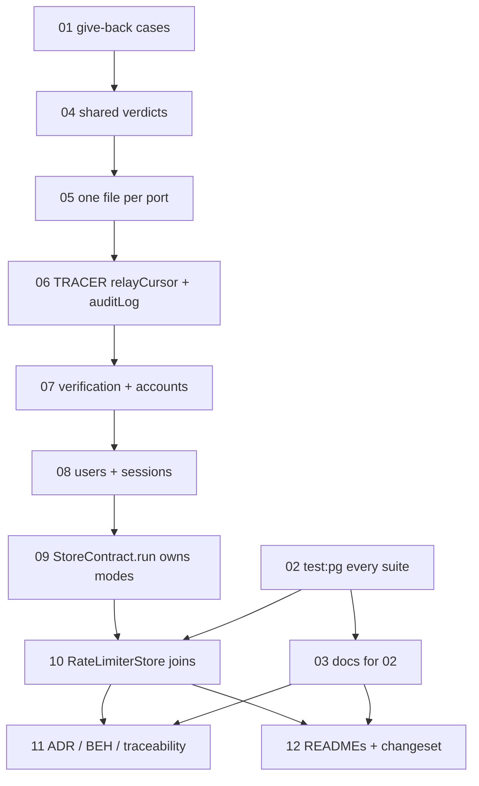

# Plan 37: `StoreContract` takes `RecordsContract`'s shape and owns its runner; `RateLimiterStore` joins it

| Property | Value |
|---|---|
| Source | Architecture review 2026-11-09, batch 4, candidate 37 ("StoreContract gets RecordsContract's shape and an exported runner, and RateLimiterStore joins it") |
| Strength | Brief: **Worth exploring (re-assess)**. After re-verification: **GO, moderate.** No production bug; three proven contract gaps (a no-op give-back passes `StoreContract.verification`; `RateLimiterStore` has two adapters and no contract; the Postgres list in `scripts/test-pg.sh` misses at least 9 files that reach Postgres). The verdict conversion is mostly future-proofing: every atomic operation already has a race case (§2.3) |
| Dependency category | **Local-substitutable** (SQLite `:memory:`, a WAL file, libSQL, Postgres through `TestSql`) **plus ports & adapters** (the seven core store ports, each with a `Ref` adapter in `@awthaq/ports` and a SQL adapter in `@awthaq/sql`) |
| Wave / position | Batch 4. Wave 0 (tickets 01, 02) lands alone and needs nothing. The deepening (04–10) depends on no other plan. Owns `scripts/test-pg.sh` in this batch (plan 34 must not touch it) |
| Touched packages | `@awthaq/test` (src and tests), `@awthaq/ports` (tests only), `@awthaq/sql` (two test files deleted), `scripts/`, `features/` (BDD), `spec/`, `docs/` |
| Wire change | **None.** No production source changes. The `@awthaq/test` exports `StoreContract.<port>` change shape (an array of cases becomes a suite) and `StoreContract.run` changes signature; `@awthaq/test` is `private: true`, so the only callers are in this repo |
| ADRs | Amends [ADR-EA-041](../../spec/decisions/041-domain-store-ports.md) **decision 6** (revision 1.6): the core contract takes decision 9's shape (a verdict per operation, an exported runner that owns its modes) and `RateLimiterStore` joins it. **No new ADR**: ADR-EA-056 stays unused |
| Numbers used | BEH-EA-365 (25-testing-harness). REQ-EA-1580/1581 (BDD, replacing retired REQ-EA-1500/1501); REQ-EA-1582–1586 (plan requirements, no scenario). BEH-EA-366/367, REQ-EA-1587–1589 and ADR-EA-056 left free |
| Tickets | 12, in `tickets/01-…md` to `tickets/12-…md` (track as `.scratch/37-store-contract-runner/issues/NN-*.md` when work starts) |
| Verified at | `architecture/deepening-plans-2` @ `04fa3526`, 2026-11-09. Uncommitted edits in two-factor, roles and qadi are someone else's and untouched by this plan. Effect `4.1.2` installed (`packages/test/node_modules/effect` → `effect@4.1.2`) |

Conventions: everything in [`.planning/README.md` § Shared conventions](../README.md#shared-conventions-apply-to-every-plan) and [`.planning/IMPLEMENTING.md`](../IMPLEMENTING.md) applies (no `as`, no return-type annotations on new Effect or Layer consts, type-system first, replace-don't-layer, spec and traceability with every behaviour change, a changeset with a `Migration:` line). Vocabulary: **module, interface, implementation, depth, deep, shallow, seam, adapter, leverage, locality**.

---

## 0. How to read this plan

Three independent strands, one plan because they share `@awthaq/test`'s contract module and `scripts/test-pg.sh`:

| Strand | Tickets | Lands alone? |
|---|---|---|
| **A. The give-back gap.** `StoreContract.verification` gains the `settle(…, "returned")` cases, so a store whose give-back does nothing fails | 01 | Yes, wave 0 |
| **B. `pnpm test:pg` runs what CI runs.** The 63-entry hand list is deleted; the check refuses a list | 02, 03 | Yes, wave 0/1 |
| **C. The deepening.** Shared verdict machinery; each port a verdict-keyed suite in its own file; an exported `StoreContract.run(framework, mode)` that owns memory, SQL and sealed; `RateLimiterStore` as the seventh suite | 04–12 | Needs 01 (and 02 for ticket 10) |

The tracer is ticket 06: the first two ports go through the new suite shape and `runSuite` (with its `TestClock`) on all five adapters before any other port is converted. Ticket 09 is the second risk point (the runner moves into `src`); it only moves code that runs today.

---

## 1. Summary, goals, non-goals

### 1.1 Summary

`RecordsContract` (plan 25) is the deep module for plugin record stores: one suite per store, keyed by the store's operations, each operation carrying a compile-checked verdict, and a runner that reads the adapters from the bundle and owns its modes. Its core twin, `StoreContract`, is shallow: six flat `ReadonlyArray<Case>` lists (86 cases) and a 12-line exported `run` (`packages/test/src/StoreContract.ts:66-77`) that only loops over cases. Everything that makes the contract runnable on SQL (choosing the client, core migrations, the fixed-key `Encryption`, the user-field `ALTER TABLE`s, the sealed bundle) lives in an unexported test-support file (`packages/test/test/support/storeContract.ts`, 201 lines). The gaps this shape lets through are real: `settle(…, "returned")` has no contract case, so a store whose give-back is a no-op passes; `RateLimiterStore` has two adapters and no contract at all (Postgres runs 1 of its 8 SQL cases; memory never races it); and `scripts/test-pg.sh`'s hand-kept list of 63 files has drifted.

This plan gives `StoreContract` `RecordsContract`'s shape (one shared verdict machinery, not two), moves the runner into `src` as `StoreContract.run(framework, mode)`, adds `RateLimiterStore` as a seventh suite, and makes `pnpm test:pg` run every suite, which is what CI already does.

### 1.2 Go/no-go gate

**Evidence for** (each checked at `04fa3526`; §2 has the commands):

1. **A contract gap with a mutant that proves it.** `StoreContract.verification` has one `settle` case, and it is `"kept"` (`StoreContract.ts:556-565`). The `"returned"` half is tested on the `Ref` adapter only (`packages/ports/test/VerificationStore.test.ts:29-135`, 4 tests). A memory `VerificationStore` whose `settle` ignores `"returned"` passes all 17 verification cases today. Ticket 01 writes that mutant as a red test.
2. **A port with two adapters and no contract.** `RateLimiterStore` (`packages/ports/src/RateLimiter.ts:114-125`) has a `Ref` adapter (`:294`) and a SQL adapter (`packages/sql/src/RateLimiterStoreSql.ts`). Its SQL tests hand-wire SQLite (`RateLimiterStoreSql.test.ts:14`, 8 cases) and Postgres (`RateLimiterStoreSql.postgres.test.ts`, 1 case, on the connection's default schema with `DROP TABLE`, outside `TestSql`). The memory adapter has no concurrency test (`packages/ports/test/RateLimiter.test.ts`: no `Effect.all`, no "concurren"). Plan 02 called this port "the precedent this plan follows" (`.planning/02-domain-store-seam/PLAN.md:1255`) and then left it out of the contract.
3. **The runner is shallow and its depth is unexported.** `run` is 12 lines; the 201-line support file holds the modes. `ADR-EA-041` decision 6 and `StoreContract.ts:5-7` promise that "a third party's KV `SessionStore`" can prove itself; today it can only for adapters that need no migration, no `Encryption` and no user-field columns.
4. **A hand-kept list that drifted.** `scripts/test-pg.sh` names 63 files. At least 9 test files that build a database through `TestSql` under `AWTHAQ_POSTGRES_URL` are missing, and one listed file never touches SQL (§2.4).

**Evidence against:**

1. `@awthaq/test` is `"private": true` (`packages/test/package.json:4`). No third party can install it, so the "third-party adapter" promise is in-repo only. The runner's value is locality and leverage inside this repo.
2. Every operation the port interfaces call atomic already has a race case (§2.3). The verdict audit finds one real gap (`settle`) and one shared race case (`UserStore.delete`/`writeFields`). The rest of the conversion is insurance: a new operation will not compile without a verdict.
3. **CI already runs every suite on Postgres.** `.github/workflows/check.yml:49-50` sets `AWTHAQ_POSTGRES_URL` for the whole job, and `pnpm check` runs `pnpm coverage` (`vitest run --coverage`, every project) and `pnpm test:bdd` (`package.json:35`). The hand list only limits *local* `pnpm test:pg`; nothing escapes CI. (Plan 25's "Decisions taken" says "CI runs `pnpm test:pg`"; it does not, it runs a superset.)

**Decision: GO**, on a narrower shape than the candidate:

- Strands A and B are cheap, independent and land first.
- Strand C proceeds because a port added without a verdict, or an atomic operation without a race case, is otherwise invisible. `RateLimiterStore` needs a contract regardless.
- **If the reviewer prefers NO-GO on strand C**, keep tickets 01–03 and ticket 10 rewritten as flat cases (`StoreContract.rateLimiterStore` as a `ReadonlyArray<Case>` run by the support file). That keeps every red test and drops the verdict conversion.

### 1.3 Goals

- G1. `StoreContract.verification` proves the give-back on every adapter (`Ref`, SQLite, WAL, libSQL, Postgres). The mutant is caught.
- G2. Every operation of every core store port carries a verdict (`read`, `write`, `atomic` with a `race` case, or `exempt` with a reason). An operation without one does not compile. The machinery is the one `RecordsContract` uses, not a copy.
- G3. `StoreContract.run(framework, mode)` is exported and owns the modes: `memory` (`Persistence.memory` and `RateLimiter.layerStoreMemory`), `sql` (`CoreStoresSql.layer()` and `RateLimiterStoreSql.layerStoreSql` over a given client, migrated, with the test `Encryption` and the user-field columns) and `sealed` (`CoreStoresSql.layer({ encryptPii: true })`). Each runner test file is one call.
- G4. `RateLimiterStore` has a suite (`increment` atomic with a race case, `peek` read, two SQL-only cases) run in every mode. A non-atomic mutant is caught. Postgres runs every case, not 1.
- G5. `pnpm test:pg` runs the same suites as CI. No hand list. `pnpm check:contract-tests` refuses a list if one comes back.

### 1.4 Non-goals

- No production source change. No port interface, adapter or migration changes.
- No tenant-isolation suites for core tables (plan 05's `TenantConformance` stays plugin-only).
- No type-level key coverage for `Suites` (as `RecordsContract.Suites<P>` has). Core ports have no `/records/` key type to map over; a runtime check against the real `Persistence.memory` bundle covers it (§3.6).
- No publishing of `@awthaq/test`.
- Not changing `scripts/test-pg.sh`'s container start (docker vs podman: plan 25 Q6 stays open).
- Not touching the per-adapter SQL tests (`packages/sql/test/*StoreSql.test.ts`): they test failure mapping, which the contract does not.

### 1.5 Requirements (reserved block REQ-EA-1580–1589)

| Id | Kind | Requirement | Tickets |
|---|---|---|---|
| REQ-EA-1580 | BDD scenario (replaces retired REQ-EA-1500) | `pnpm check:contract-tests` fails when `scripts/test-pg.sh` names a test file, naming it | 02 |
| REQ-EA-1581 | BDD scenario (replaces retired REQ-EA-1501) | It passes once the script names none | 02 |
| REQ-EA-1582 | Plan requirement | Every `VerificationStore` adapter gives a held claim back after its caller's transaction failed; a newer `upsertLive` or a `deleteByUser` in between wins | 01 |
| REQ-EA-1583 | Plan requirement | Every operation of every core store port carries a verdict; one without does not compile; one machinery serves `StoreContract` and `RecordsContract` | 04, 05, 06, 07, 08 |
| REQ-EA-1584 | Plan requirement | `StoreContract.run(framework, mode)` owns memory, SQL and sealed; every port the memory bundle provides has a suite | 09 |
| REQ-EA-1585 | Plan requirement | `RateLimiterStore` passes its suite on every adapter, race included, Postgres included | 10 |
| REQ-EA-1586 | Plan requirement | ADR-EA-041 rev 1.6, BEH-EA-365, BEH-EA-336 rev, docs and changesets describe the above | 03, 11, 12 |

REQ-EA-1582–1586 are plan-internal: no Gherkin scenario is tagged with them. Only 1580/1581 enter `features/traceability.md`.

### 1.6 must_haves (whole plan)

```yaml
must_haves:
  truths:
    - "A VerificationStore whose settle ignores \"returned\" fails StoreContract.verification, naming the give-back case"
    - "A RateLimiterStore whose increment reads then writes fails the rateLimiterStore race case"
    - "Adding an operation to any core store port interface without a verdict in its suite is a compile error"
    - "StoreContract.run(framework, { mode }) registers every suite's cases on the shipped adapters of that mode, a fresh adapter per case"
    - "Every core store the Persistence.memory bundle provides has a StoreContract suite (checked at runtime)"
    - "Under AWTHAQ_POSTGRES_URL, every rateLimiterStore case runs on Postgres in a TestSql schema"
    - "pnpm test:pg runs every vitest project and the BDD suite; scripts/test-pg.sh names no test file"
  artifacts:
    - path: "packages/test/src/internal/contract.ts"
      provides: "Case, race, CONCURRENCY, Verdict, Operations, Entry, classify: the verdict machinery both contracts share"
    - path: "packages/test/src/StoreContract.ts"
      provides: "suite, Suite, Suites, suites, runSuite, run (the mode runner); re-exports the seven port suites"
      exports: ["suite", "runSuite", "run", "suites", "CONCURRENCY", "race"]
    - path: "packages/test/src/internal/storeContract/rateLimiterStore.ts"
      provides: "the RateLimiterStore suite"
    - path: "packages/test/test/StoreContract.types.test.ts"
      provides: "compile-time proof that an unclassified operation and a suite under the wrong key are errors"
    - path: "scripts/test-pg.sh"
      provides: "the local Postgres run, identical in scope to CI"
  key_links:
    - from: "packages/test/src/RecordsContract.ts"
      to: "packages/test/src/internal/contract.ts"
      via: "suite() classifies operations through classify(); Verdict/Operations/Entry re-exported under their old names"
      pattern: "classify\\("
    - from: "packages/test/test/StoreContract.sql.test.ts"
      to: "packages/test/src/StoreContract.ts"
      via: "StoreContract.run(framework, { mode: \"sql\", label, client: TestSql.layer(...) })"
      pattern: "StoreContract\\.run\\("
    - from: "packages/test/src/StoreContract.ts"
      to: "packages/sql/src/RateLimiterStoreSql.ts"
      via: "the SQL base runs RateLimiterStoreSql.migrate and provides layerStoreSql"
      pattern: "RateLimiterStoreSql\\.(migrate|layerStoreSql)"
    - from: "scripts/check-contract-tests.mjs"
      to: "scripts/test-pg.sh"
      via: "rule 3: the script names no *.test.ts"
      pattern: "test-pg.sh"
```

---

## 2. Verified current state

### 2.1 Re-measurement commands (run from the repo root)

| What | Command | Result at `04fa3526` |
|---|---|---|
| Contract size | `wc -l packages/test/src/StoreContract.ts packages/test/test/support/storeContract.ts` | 2085, 201 |
| Cases per port | `pnpm exec vitest run packages/test/test/StoreContract.memory.test.ts --reporter=verbose \| grep '✓' \| sed -E 's/.*StoreContract: ([A-Za-z]+) .*/\1/' \| sort \| uniq -c` | AccountStore 12, AuditLogStore 13, RelayCursorStore 6, SessionStore 22, UserStore 16, VerificationStore 17 (**86**) |
| `settle` cases in the contract | `grep -c '"returned"' packages/test/src/StoreContract.ts` | **0** |
| Ref-only give-back tests | `grep -c 'settle(tokenId("t1"), "returned")' packages/ports/test/VerificationStore.test.ts` | 4 |
| RateLimiterStore SQL cases | `grep -c 'it.effect' packages/sql/test/RateLimiterStoreSql.test.ts packages/sql/test/RateLimiterStoreSql.postgres.test.ts` | 8, 1 |
| RateLimiterStore in the contract | `grep -c 'RateLimiter' packages/test/src/StoreContract.ts` | 0 |
| Hand list | `grep -c '\.test\.ts$' scripts/test-pg.sh` | **63** |
| Runner callers in tests | `grep -rlE 'runOnMemory\|runOnSql\|runSealedOnSql' packages/test/test \| wc -l` | 6 (5 runner files + the support file) |
| Runner logic in support | `grep -c 'ALTER TABLE users ADD COLUMN' packages/test/test/support/storeContract.ts packages/test/src/StoreContract.ts` | 3, 0 |
| CI env | `sed -n 49,50p .github/workflows/check.yml` | `AWTHAQ_POSTGRES_URL: postgres://…` at job level |

### 2.2 Findings

| # | Finding | Where |
|---|---|---|
| F1 | `StoreContract` is six flat lists: `auditLog` (`:115`), `verification` (`:419`), `accounts` (`:696`), `users` (`:1013`), `sessions` (`:1558`), `relayCursor` (`:2018`). No verdicts; nothing ties a case to an operation | `packages/test/src/StoreContract.ts` |
| F2 | The exported `run` (`:66-77`) builds `config.layer` per case and calls `it`. Shallow: the caller supplies everything | same |
| F3 | The real runner is the test-only support file: `EncryptionLive` (`:40-54`, a copy of `TestEncryption.layer`), `addUserFieldColumns` (`:57-70`), `sqlStores` (`:73-90`, core migrations + user fields + `CoreStoresSql.layer(options)`), WAL and libSQL clients (`:93-117`), `runOnMemory` (`:120-151`, hand-built per-port layers rather than `Persistence.memory`), `runOnSql` (`:154-185`), `runSealedOnSql` (`:191-201`) | `packages/test/test/support/storeContract.ts` |
| F4 | The five runner files are 4–7 lines each and call the support file | `packages/test/test/StoreContract.{memory,sql,file,libsql,sealed}.test.ts` |
| F5 | `RecordsContract` has the machinery this plan wants: `Verdict<R>` (`:53`), `Operations<Shape>` (`:67`), `Entry` (`:78`), `suite` (`:115-185`, the verdict loop at `:140-160`), `Suite<in out Id>` (invariant, `:104`). It imports `Case`, `race`, `CONCURRENCY` from `StoreContract` (`:34`, `:40-42`), so `StoreContract` cannot import `RecordsContract` without a module cycle | `packages/test/src/RecordsContract.ts` |
| F6 | `VerificationStore.settle` contract: `"returned"` gives the row back unless a newer `upsertLive` replaced it or `deleteByUser` swept it; on SQL both values are no-ops because the caller's transaction rolled the claim back | `packages/ports/src/VerificationStore.ts:86-95`, `packages/sql/src/VerificationStoreSql.ts:18,285` |
| F7 | The only contract `settle` case holds **outside** `transaction` (`StoreContract.ts:556-565`), which the port says not to do ("Set it only inside `transaction`", `VerificationStore.ts:74-75`) | same |
| F8 | `RateLimiterStore` reads the ambient clock (`DateTime.now`) in both adapters (`RateLimiter.ts:320,337`; `RateLimiterStoreSql.ts` `increment`/`peek`). Its cases need a `TestClock`; the core cases read no clock (`grep -n 'DateTime.now\|Clock' packages/test/src/StoreContract.ts` and the six core adapters: no match) | — |
| F9 | `RateLimiterStoreSql` has its own migration with its own ledger table (`migrate`, `migrationsTable = "awthaq_rate_limiter_migrations"`), kept out of `coreMigrations` | `packages/sql/src/RateLimiterStoreSql.ts:37-78` |
| F10 | The SQLite client is one serialised connection with a 5 s busy timeout, so a race case on SQLite is a smoke test; Postgres (READ COMMITTED) is where it bites | `@effect/sql-sqlite-node/dist/SqliteClient.js:55-57,222` |
| F11 | `RecordsContract` runs every case under `TestClock.layer()` (`internal/foundation.ts:60-63`), on SQL and Postgres too, so `TestClock` with `TestSql` is proven | `packages/test/src/internal/foundation.ts` |
| F12 | `@awthaq/test` already depends on `@awthaq/core` and `@awthaq/sql` (`package.json:26-33`); `RecordsContract.ts` imports `CoreMigrations` from `@awthaq/sql`. Moving the runner into `src` adds no package edge | `packages/test/package.json` |

### 2.3 Verdict audit (draft; tickets 06–08 and 10 confirm it)

Operations per port, measured from the `…StoreShape` interfaces: AuditLogStore 5, SessionStore 9, UserStore 11, AccountStore 10, VerificationStore 7, RelayCursorStore 2, RateLimiterStore 2 (**46**). Every operation is exercised by at least one case today (grep per operation in each list's range).

| Port | `atomic` + `race` (race case at HEAD) | `read` | `write` | Gap |
|---|---|---|---|---|
| AuditLogStore | `append` (`:128`) | `select`, `pageAfter` | `rewriteReferencing` (its all-or-nothing case `:294` is failure-atomicity, not a race), `deleteBefore` | none |
| VerificationStore | `upsertLive` (`:445`), `present` (`:518`, `:547`), `reserve` (`:602`) | — | `settle`, `transaction`, `deleteByUser`, `purgeExpired` | **`settle "returned"`: no case** (ticket 01) |
| AccountStore | `insertIfAbsent` (`:795`), `deleteUnlessLast` (`:930`) | `getByKey`, `get`, `listByUser`, `readCredentialHash`, `readProviderTokens` | `writeCredentialHash`, `writeProviderTokens`, `deleteByUser` | none |
| UserStore | `insertOrHolder` (`:1058`), `casIdentity` (`:1185`), `delete` and `writeFields` (both by one case, `:1425`) | `get`, `getByEmail`, `getByPhone`, `listPage`, `readFields` | `updateProfile`, `setStatus` | one race case serves two operations; ticket 08 splits it |
| SessionStore | `insert` (`:1646`, `:1703`), `rotate` (`:1762`), `flagReuse` (`:1808`), `remove` (`:1837`), `reauthenticate` (`:1945`) | `get`, `listLive` | `removeForUser`, `purgeExpired` | none |
| RelayCursorStore | `advance` (`:2073`) | `get` | — | none |
| RateLimiterStore | `increment` (no contract) | `peek` | — | **no suite** (ticket 10) |

### 2.4 The Postgres list, measured

A test file reaches Postgres under `AWTHAQ_POSTGRES_URL` when its import closure calls `TestSql.layer(`, uses `TestAuth.layer` with `records: "sql"` (`TestAuth.ts:337-338`), calls `runPluginContractTests(` (its schema-parity case builds `TestSql.layer` only when the URL is set, `TestAuth.ts:1398-1414`), or calls `RecordsContract.run(`. A closure scan (scratch script, not committed) over `packages/*/test` and `examples/*/test` found 83 such files. Compared with the 63 listed:

**Missing from the list, confirmed by reading** (each reaches `TestSql`):

| File | How it reaches Postgres |
|---|---|
| `packages/organization/test/DecisionReads.test.ts` | `TestSql.layer(…)` at `:24-25` |
| `packages/organization/test/OrganizationDeletion.test.ts` | `TestAuth.layer(built, { records: "sql", … })` at `:95-99` |
| `packages/api-key/test/ServiceToken.test.ts` | `suite("sql")` at `:323` through `harness.ts:77` |
| `packages/api-key/test/AuthHttp.test.ts` | `suite("sql")` at `:386` through `harness.ts:77` |
| `packages/two-factor/test/TwoFactor.test.ts` | `buildDurableAuditLayer` (`support/harness.ts:82-83`, `records: "sql"`) |
| `packages/magic-link/test/Contract.test.ts` | `runPluginContractTests` schema parity |
| `packages/oauth/test/Contract.test.ts` | same |
| `packages/password/test/Contract.test.ts` | same |
| `packages/test/test/runPluginContractTests.test.ts` | same |

**Unverified**: `packages/device-authorization/test/Plugin.test.ts` (its harness has a `records: "sql"` branch at `support/harness.ts:59`; whether `Plugin.test.ts` takes it was not traced).

**Listed but never on Postgres**: `packages/core/test/Users.test.ts` (memory-only by its own header, `:6-7`).

**Not misses** (the scan's false positives): `packages/server/test/AuthHost.test.ts` (hard-codes SQLite, `:103-107`), `examples/sql-server/test/smoke.test.ts` (own client), `packages/sql/test/Models.test.ts` (the URL only in a comment), `StoreContract.file/libsql.test.ts` (WAL and libSQL clients), and the `.types.test.ts` files (compile-only).

### 2.5 Evidence corrections

| Candidate said | Measured |
|---|---|
| "about 91 cases" | **86** (12+13+6+22+16+17) |
| "`run` is about 10 lines (66-77)" | 12 lines, `:66-77`. Correct |
| "The real runner … handles choosing the client" | Partly: the support file builds the WAL and libSQL clients, but each runner file passes the client (`TestSql.layer("store_contract")` in `StoreContract.sql.test.ts:6`) |
| "`settle(…, "returned")` tested only on memory" | Correct (4 tests). But on SQL `settle` is a deliberate no-op: the transaction's rollback does the give-back. **There is no SQL bug.** The gap is that the contract does not state the protocol, so a third adapter could get it wrong and pass. A cross-adapter case must run the held `present` inside `transaction` (F6/F7) |
| "Postgres runs 1 of 8 cases" | Correct: 1 Postgres case, 8 SQLite cases (`RateLimiterStoreSql.postgres.test.ts`, `RateLimiterStoreSql.test.ts`). The Postgres file drops `rate_limit_buckets` and the ledger in the connection's default schema (`:21-23`) |
| "Memory never runs the concurrency case" | Correct. Memory is a `Ref.modify` (`RateLimiter.ts:318-334`), so a race case will pass; it pins the reference semantics |
| "`test-pg.sh` hard-codes about 63 files" | **63** exactly |
| "`DecisionReads.test.ts` missing, plus about 4 files that use `Rendezvous` or mention Postgres" | `DecisionReads` confirmed. The `Rendezvous` files (`OAuth.test.ts`, `Saml.test.ts`, `WebhooksAdmin.test.ts`) are memory races and do not reach Postgres. The real misses are the **9 files** in §2.4, plus one stale entry |
| "Only `Contract.test.ts` membership is checked" | Correct, and only for a `Contract.test.ts` that passes `records:` (`check-contract-tests.mjs:94-99`); the three `Contract.test.ts` files without stores are not checked |
| (implied) the list decides what runs on Postgres in CI | **Wrong.** CI runs every project with the URL set (§1.2 against-3). The list scopes the local run only |
| "`@awthaq/sql` tests cannot import `@awthaq/test`" | Correct (`@awthaq/test` depends on `@awthaq/sql`; a dev edge back closes a workspace dependency cycle). `pnpm circular` would not notice: it scans `packages/*/src` file imports only (`scripts/circular.mjs:17`). This plan needs no such edge: the `RateLimiterStore` suite runs from `packages/test/test`, which already runs the SQL adapters |

### 2.6 Live bugs

None in production code (by reading). Two contract gaps are reproduced as red tests:

- The give-back gap: **reproduced by ticket 01** (a no-op `settle` mutant passes the 17 verification cases at HEAD).
- The rate-limiter gap: **reproduced by ticket 10** (a read-then-write `increment` mutant passes everything at HEAD, because there is no suite).

---

## 3. Target design

### 3.1 The seam

The seam is unchanged: each core store port is an interface in `@awthaq/ports` with a `Ref` adapter beside it and a SQL adapter in `@awthaq/sql`. What changes is the module that states and checks the contract at that seam. It goes from a list of cases plus a caller-assembled runner (shallow) to a module whose interface is "a suite per port, keyed by its operations, and one call per mode" (deep), with the mode knowledge behind it.

### 3.2 Shared verdict machinery (`packages/test/src/internal/contract.ts`)

Moved out of `RecordsContract.ts` and `StoreContract.ts`, unchanged in meaning:

```ts
export interface Case<R> { readonly name: string; readonly run: Effect.Effect<void, unknown, R> }
export const CONCURRENCY = 8
export const race: <A, E, R>(effect: Effect.Effect<A, E, R>) => Effect.Effect<Array<A>, E, R>
export type Verdict<R> =
  | { readonly read: NonEmpty<Case<R>> }
  | { readonly write: NonEmpty<Case<R>> }
  | { readonly atomic: NonEmpty<Case<R>>; readonly race: NonEmpty<Case<R>> }
  | { readonly exempt: string }
export type Operations<Shape> = { /* functions and Effect-valued members of Shape, as today */ }
export interface Entry { readonly operation: string; readonly verdict: "read" | "write" | "atomic" | "race"; readonly case: Case<unknown> }
/** The verdict loop RecordsContract.suite runs today (`RecordsContract.ts:140-160`). */
export const classify: <R>(operations: Readonly<Record<string, Verdict<R>>>) => {
  readonly entries: ReadonlyArray<Entry>
  readonly exempt: ReadonlyArray<{ readonly operation: string; readonly reason: string }>
}
```

`RecordsContract.ts` keeps every public name (`Case`, `race`, `CONCURRENCY`, `Verdict`, `Operations`, `Entry`, `suite`, `Suite`, `Suites`, `run`, `recordsBase`, `recordsFoundation`) by re-exporting; its `suite` calls `classify` and adds `sql` and `tenancy` as today.

### 3.3 `StoreContract` interface after the change

```ts
// packages/test/src/StoreContract.ts
export { CONCURRENCY, race, type Case, type Verdict, type Operations } from "./internal/contract.ts"

/** A core store port's suite. Invariant in `Id`, as RecordsContract.Suite is. */
export interface Suite<in out Id> {
  readonly store: Context.Key<Id, unknown>
  readonly entries: ReadonlyArray<Entry>
  readonly exempt: ReadonlyArray<{ readonly operation: string; readonly reason: string }>
  /** Adapter-level cases that read rows or the schema directly. SQL and sealed modes only. */
  readonly sql: ReadonlyArray<Case<unknown>>
}

/** `operations` is keyed by the port's operations; one without a verdict does not compile. `R` is what a case needs besides the port (SqlTransaction for accounts and users). */
export const suite: <Id, Shape, R = never>(
  store: Context.Key<Id, Shape>,
  definition: {
    readonly operations: { readonly [K in keyof Operations<NoInfer<Shape>>]: Verdict<Id | R> }
    readonly sql?: ReadonlyArray<Case<Id | R | SqlClient.SqlClient>>
  },
) => Suite<Id>

export const auditLog: Suite<AuditLogStore.AuditLogStore>          // re-exported from internal/storeContract/auditLog.ts
export const verification: Suite<VerificationStore.VerificationStore>
export const accounts: Suite<AccountStore.AccountStore>
export const users: Suite<UserStore.UserStore>
export const sessions: Suite<SessionStore.SessionStore>
export const relayCursor: Suite<RelayCursorStore.RelayCursorStore>
export const rateLimiterStore: Suite<RateLimiter.RateLimiterStore>
export const userFieldColumns: ReadonlyArray<UserStore.UserFieldColumn>

export interface Suites {
  readonly auditLog: Suite<AuditLogStore.AuditLogStore>
  readonly verification: Suite<VerificationStore.VerificationStore>
  readonly accounts: Suite<AccountStore.AccountStore>
  readonly users: Suite<UserStore.UserStore>
  readonly sessions: Suite<SessionStore.SessionStore>
  readonly relayCursor: Suite<RelayCursorStore.RelayCursorStore>
  readonly rateLimiterStore: Suite<RateLimiter.RateLimiterStore>
}
export const suites: Suites   // written `{ … } satisfies Suites`

/** Any adapter of one port (a third party's KV SessionStore): the suite's entries, a fresh `layer` and a TestClock per case. Not its `sql` cases. */
export const runSuite: <Id>(framework: TestFramework, config: {
  readonly adapter: string
  readonly suite: Suite<Id>
  readonly layer: Layer.Layer<never, unknown, unknown>   // provides the port and whatever the cases need
}) => void

export type Mode =
  | { readonly mode: "memory" }
  | { readonly mode: "sql" | "sealed"; readonly label: string; readonly client: Layer.Layer<SqlClient.SqlClient, unknown> }

/** Every suite on the shipped adapters of `mode`, a fresh adapter and a TestClock per case. */
export const run: (framework: TestFramework, mode: Mode) => void
```

Behind `run`:

| Mode | Adapters (built per case) | Suites run | Extra |
|---|---|---|---|
| `memory` | `Layer.mergeAll(Persistence.memory, RateLimiter.layerStoreMemory)` | all seven | one `it`: the context keys of a built `Persistence.memory` (minus `SqlTransaction`) and `RateLimiter.layerStoreMemory` (minus `RateLimiterMemoryStats`) equal the suites' `store.key`s |
| `sql` | `Layer.mergeAll(CoreStoresSql.layer(), RateLimiterStoreSql.layerStoreSql)` over `client`, after `coreMigrations`, `RateLimiterStoreSql.migrate` and the three user-field `ALTER TABLE`s; `TestEncryption.layer` beneath | all seven, plus each suite's `sql` cases | — |
| `sealed` | `CoreStoresSql.layer({ encryptPii: true })` over the same base | `users`, `sessions` (the ports `encryptPii` changes, `CoreStoresSql.ts:58-62`) | — |

Every case also gets `TestClock.layer()` (F8, F11). Exemptions register a passing `it` named `<port>.<operation> is exempt: <reason>`, as `RecordsContract` does.

### 3.4 Module layout after the change

```
packages/test/src/
  internal/contract.ts                  NEW  verdict machinery (from RecordsContract.ts and StoreContract.ts)
  internal/storeContract/fixtures.ts    NEW  helpers shared by more than one port file (at, ids, …)
  internal/storeContract/auditLog.ts    NEW  the AuditLogStore suite (cases moved from StoreContract.ts:78-376)
  internal/storeContract/verification.ts NEW
  internal/storeContract/accounts.ts    NEW
  internal/storeContract/users.ts       NEW  (+ userFieldColumns)
  internal/storeContract/sessions.ts    NEW
  internal/storeContract/relayCursor.ts NEW
  internal/storeContract/rateLimiterStore.ts NEW
  StoreContract.ts                      header, suite, Suite(s), suites, runSuite, run; re-exports  (~250 lines, was 2085)
  RecordsContract.ts                    imports internal/contract.ts; public names unchanged
packages/test/test/
  support/storeContract.ts              framework, walFileClient, libsqlFileClient only  (~60 lines, was 201)
  StoreContract.{memory,sql,file,libsql,sealed}.test.ts   one StoreContract.run call each
  StoreContract.test.ts                 the runner's self-test, plus the two mutants
  StoreContract.types.test.ts           NEW
packages/sql/test/RateLimiterStoreSql.test.ts            DELETED
packages/sql/test/RateLimiterStoreSql.postgres.test.ts   DELETED
scripts/test-pg.sh                      no list
```

Import graph inside `packages/test/src` (no cycle; `pnpm circular` checks it): `internal/contract.ts` ← `internal/storeContract/*.ts` ← `StoreContract.ts` ← `RecordsContract.ts` (which also imports `internal/contract.ts`).

### 3.5 `scripts/test-pg.sh` after the change

Starts the container as today (unchanged), then: with arguments, `pnpm exec vitest run --testTimeout=60000 "$@"` (a developer narrows the run to a path); without, `pnpm exec vitest run --testTimeout=60000` followed by `pnpm test:bdd`. That is the set CI's `pnpm check` runs with the URL set. `check-contract-tests.mjs` rule 3 becomes "`scripts/test-pg.sh` names no `*.test.ts`".

### 3.6 Alternatives rejected

| Alternative | Why not |
|---|---|
| `StoreContract` imports `RecordsContract.suite` directly | Module cycle: `RecordsContract` imports `StoreContract` (F5) |
| Two copies of the verdict machinery | Two copies drift; the point of the plan is one bar |
| Keep one 2085-line file | Converting six lists in one file serialises every ticket on it and costs the executor most of its context reading it. Per-port files give locality: a port's interface and its suite are read together |
| `@awthaq/sql` runs the contract (sql devDepends on test) | Workspace dependency cycle (§2.5). The suite runs from `packages/test/test`, which already runs every SQL adapter |
| Type-level `Suites` keyed by the bundle's ports (as `RecordsContract.Suites<P>`) | Core port keys are not literal types to map over. A runtime check against the built `Persistence.memory` sees the real bundle, which is what can drift |
| `run` takes a caller-built layer per port (today's shape) | That is the shallowness being removed: the caller would keep knowing migrations, encryption and user fields |
| Derive the Postgres list (grep for `TestSql`, `records: "sql"`, …) | The scan in §2.4 needed import closures and still had 6 false positives. CI runs everything; running everything locally is simpler and exact |
| Police the hand list (check every `TestSql`-reaching file is listed) | Same detection problem as deriving it, and the list still has to be edited by hand |
| A new ADR (ADR-EA-056) | No new decision: decision 9 already states the shape; this extends it to the ports decision 6 covers |
| Keep `RateLimiterStoreSql.test.ts`'s two limiter-over-SQL cases (`consume` end to end, escalation) | They re-test `RateLimiter.layer`, which `packages/ports/test/RateLimiter.test.ts` covers on memory. The suite proves the SQL store answers `increment` and `peek` as memory does, which is all `RateLimiter.layer` reads |

---

## 4. Phased migration

### 4.1 Waves

```
Wave 0  01 give-back cases (tdd)            02 test:pg runs every suite
Wave 1  04 shared verdict machinery (tdd)   03 docs/spec for 02
Wave 2  05 one file per port (move only)
Wave 3  06 TRACER: relayCursor + auditLog as suites on all five adapters
Wave 4  07 verification + accounts
Wave 5  08 users + sessions
Wave 6  09 StoreContract.run owns the modes (tdd)
Wave 7  10 RateLimiterStore joins (tdd)
Wave 8  11 ADR-EA-041 1.6, BEH-EA-365, traceability   12 READMEs + changeset
```

Waves 3–5 are sequential because each edits `packages/test/test/support/storeContract.ts` (its port's `run` lines become `runSuite`). The repo executes one agent at a time anyway (`.planning/IMPLEMENTING.md`).

### 4.2 Ticket table

| Ticket | Title | Wave | Depends on | Type | Size | Files |
|---|---|---|---|---|---|---|
| [01](tickets/01-give-back-cases.md) | The contract states the give-back: `settle("returned")` on every adapter | 0 | — | tdd | S | `packages/test/src/StoreContract.ts`, `packages/test/test/StoreContract.test.ts`, `packages/ports/test/VerificationStore.test.ts`, `.changeset/store-contract-give-back.md` |
| [02](tickets/02-test-pg-every-suite.md) | `pnpm test:pg` runs every suite, as CI does | 0 | — | execute | S | `scripts/test-pg.sh`, `scripts/check-contract-tests.mjs`, `features/features/08-tooling/25-testing-harness.feature`, `features/step-definitions/TestingHarnessComposeSteps.ts`, `features/traceability.md` |
| [03](tickets/03-test-pg-docs.md) | BEH-EA-336 revision and docs for ticket 02 | 1 | 02 | execute | S | `spec/behaviors/25-testing-harness.md`, `spec/traceability.md`, `docs/plugin-authoring.md`, `packages/test/README.md`, `.changeset/test-pg-every-suite.md` |
| [04](tickets/04-shared-verdicts.md) | One verdict machinery: `StoreContract.suite` and `runSuite`, `RecordsContract` on top | 1 | 01 | tdd | M | `packages/test/src/internal/contract.ts`, `packages/test/src/RecordsContract.ts`, `packages/test/src/StoreContract.ts`, `packages/test/test/StoreContract.test.ts`, `packages/test/test/StoreContract.types.test.ts` |
| [05](tickets/05-one-file-per-port.md) | One file per port (move only) | 2 | 04 | execute | S | `packages/test/src/StoreContract.ts`, `packages/test/src/internal/storeContract/{fixtures,auditLog,verification,accounts,users,sessions,relayCursor}.ts` |
| [06](tickets/06-tracer-relay-audit.md) | TRACER: `relayCursor` and `auditLog` as verdict suites on all five adapters | 3 | 05 | tdd | M | `packages/test/src/internal/storeContract/relayCursor.ts`, `packages/test/src/internal/storeContract/auditLog.ts`, `packages/test/test/support/storeContract.ts` |
| [07](tickets/07-verification-accounts.md) | `verification` and `accounts` as verdict suites | 4 | 06 | execute | M | `packages/test/src/internal/storeContract/verification.ts`, `packages/test/src/internal/storeContract/accounts.ts`, `packages/test/test/support/storeContract.ts`, `packages/test/test/StoreContract.test.ts` |
| [08](tickets/08-users-sessions.md) | `users` and `sessions` as verdict suites | 5 | 07 | execute | M | `packages/test/src/internal/storeContract/users.ts`, `packages/test/src/internal/storeContract/sessions.ts`, `packages/test/test/support/storeContract.ts` |
| [09](tickets/09-exported-runner.md) | `StoreContract.run(framework, mode)` owns memory, SQL and sealed | 6 | 08 | tdd | M | `packages/test/src/StoreContract.ts`, `packages/test/test/support/storeContract.ts`, `packages/test/test/StoreContract.{memory,sql,file,libsql,sealed}.test.ts`, `packages/test/test/StoreContract.test.ts`, `packages/test/test/StoreContract.types.test.ts` |
| [10](tickets/10-rate-limiter-store.md) | `RateLimiterStore` joins the contract | 7 | 09, 02 | tdd | M | `packages/test/src/internal/storeContract/rateLimiterStore.ts`, `packages/test/src/StoreContract.ts`, `packages/test/test/StoreContract.test.ts`, `packages/sql/test/RateLimiterStoreSql.test.ts` (delete), `packages/sql/test/RateLimiterStoreSql.postgres.test.ts` (delete) |
| [11](tickets/11-adr-beh-traceability.md) | ADR-EA-041 rev 1.6, BEH-EA-365, rate-limiting pointers, traceability | 8 | 10, 03 | execute | S | `spec/decisions/041-domain-store-ports.md`, `spec/behaviors/25-testing-harness.md`, `spec/behaviors/14-rate-limiting.md`, `spec/traceability.md` |
| [12](tickets/12-readmes-changeset.md) | READMEs and the shape-change changeset | 8 | 10, 03 | execute | S | `packages/test/README.md`, `packages/sql/README.md`, `.changeset/test-store-contract-suites.md` |

Two tickets go over five files on purpose: **05** is a pure move into seven new files (no logic); **09** touches five runner files that each become one line. Splitting either leaves the tree with an unused module or a half-wired runner between commits.

### 4.3 Dependency graph



---

## 5. Test plan

### 5.1 Tests at the new interface

| Test | Where | Ticket |
|---|---|---|
| Three give-back cases (inside a failed `transaction`; newer `upsertLive` wins; `deleteByUser` wins) and the "kept" case moved inside `transaction` | `StoreContract.verification`, on every adapter | 01 |
| Mutant: a `VerificationStore` whose `settle` ignores `"returned"` fails, naming the give-back case | `StoreContract.test.ts` | 01 |
| `runSuite`: a fresh layer per case; a failing case reported; names are `<operation> [<verdict>]: <case>`; an exemption registers a passing test | `StoreContract.test.ts` | 04 |
| An operation without a verdict, and a suite built for another port, are compile errors | `StoreContract.types.test.ts` | 04, 09 |
| `run`: under a recording framework, memory mode registers every suite's entries plus the coverage `it`, and all pass; SQL mode over `:memory:` SQLite also runs the `sql` cases; sealed mode registers only users and sessions | `StoreContract.test.ts` | 09 |
| `rateLimiterStore` suite: first increment, independent keys, rollover, 8-way race (counts 1..8), `peek` live/absent/expired, SQL sweeper, SQL missing table | `StoreContract.rateLimiterStore`, every mode | 10 |
| Mutant: a read-then-write `increment` fails the race case | `StoreContract.test.ts` | 10 |
| `check-contract-tests.mjs` refuses a `test-pg.sh` that names a test file | BDD REQ-EA-1580/1581 | 02 |

### 5.2 Tests deleted (replace, don't layer)

| Deleted | Replaced by | Ticket |
|---|---|---|
| `packages/ports/test/VerificationStore.test.ts`: "a held claim given back is live again…", "a newer upsertLive wins over a give-back", "deleteByUser sweeps a held claim…" | the three contract cases. **Kept**: "purgeExpired never removes a held claim" (on SQL a purge between failure and give-back deletes the rolled-back expired row, so the outcome legitimately differs) and the pruning test | 01 |
| `packages/test/test/StoreContract.test.ts`: the two `StoreContract.run` cases over `{ adapter, layer, cases }` | the `runSuite` cases (same assertions over a suite) | 04 |
| `packages/sql/test/RateLimiterStoreSql.test.ts` (8 cases) | `rateLimiterStore` suite: 5 cases become entries, sweeper and missing table become `sql` cases; the two limiter-over-SQL cases are dropped (§3.6) | 10 |
| `packages/sql/test/RateLimiterStoreSql.postgres.test.ts` (1 case) | the race case on Postgres through `StoreContract.sql.test.ts` | 10 |
| BDD REQ-EA-1500/1501 (retired, never reused) | REQ-EA-1580/1581 | 02 |

### 5.3 Concurrency and Postgres

Race cases race `CONCURRENCY` (8) callers and assert exact counts. On memory they pin the reference semantics; on SQLite (one serialised connection, F10) they are a smoke test; on Postgres they are the point. Every suite runs on Postgres through `StoreContract.sql.test.ts` (`TestSql.layer("store_contract")`) and `StoreContract.sealed.test.ts` under `pnpm test:pg` and in CI. **This planning run did not start Postgres** (the brief forbids it); the executor of tickets 01, 09 and 10 runs `pnpm test:pg packages/test/test/StoreContract.sql.test.ts packages/test/test/StoreContract.sealed.test.ts` (ticket 02 makes that argument form work) or says it could not.

### 5.4 Measurable targets

| Metric | Baseline (`04fa3526`) | Target |
|---|---|---|
| Contract cases (memory run, `✓` lines) | 86 | ≥ 89 after 01; ≥ 95 after 10 (7 rate-limiter entries; exempt tests add rows) |
| `"returned"` in the contract | 0 | ≥ 3 |
| Core port operations with a verdict | 0 of 46 | 46 of 46 |
| `RateLimiterStore` cases on Postgres | 1 | every entry and `sql` case (≥ 7) |
| `RateLimiterStore` race cases on memory | 0 | 1 |
| Lines ending `.test.ts` in `scripts/test-pg.sh` | 63 | 0 |
| Files reaching Postgres that local `pnpm test:pg` skips | ≥ 9 | 0 |
| `packages/test/test/support/storeContract.ts` lines | 201 | ≤ 70 |
| Runner callers (`runOnMemory\|runOnSql\|runSealedOnSql`) | 6 files | 0 |

---

## 6. Spec, ADR, traceability, BDD, docs, changesets

### 6.1 ADR-EA-041 revision 1.6 (ticket 11): decision 6 replaced by

> **6. The contract suite is the adapter bar, in decision 9's shape.** `@awthaq/test`'s `StoreContract` holds one suite per core store port (`auditLog`, `verification`, `accounts`, `users`, `sessions`, `relayCursor`, `rateLimiterStore`), keyed by the port's operations: every operation carries a verdict (`read`, `write`, `atomic` with at least one `race` case, `exempt` with a reason), and one without does not compile. The verdict machinery is `RecordsContract`'s. `StoreContract.run(framework, mode)` owns the modes: the `Ref` adapters of `Persistence.memory` and `RateLimiter.layerStoreMemory`; the SQL adapters of `CoreStoresSql.layer` and `RateLimiterStoreSql.layerStoreSql` over a given client (SQLite `:memory:`, a WAL file, libSQL, a Postgres schema under `pnpm test:pg`), migrated, with the test `Encryption` and the declared user-field columns; and the sealed bundle (`encryptPii`) for the ports it changes. Each case gets a fresh adapter and a `TestClock`. `StoreContract.runSuite` runs one suite on any other adapter of its port, such as a KV `SessionStore`, which is acceptable when it passes. Domain tests run once, on the `Ref` adapters.

Change-history line: `1.6 (2026-11-xx): decision 6: the core contract takes decision 9's shape (verdicts per operation, one machinery with RecordsContract), StoreContract.run owns its modes, and RateLimiterStore joins it (architecture plan 37)`. Decision 3's mention of `RateLimiterStore` as the precedent stays true.

### 6.2 Behaviours

| Entry | Change | Ticket |
|---|---|---|
| **BEH-EA-365** (new, `spec/behaviors/25-testing-harness.md`, after BEH-EA-342) | "Every core store port passes its `StoreContract` suite on every adapter". REQUIREMENT: every operation of a core store port MUST carry a verdict in its suite, and one without MUST fail to compile; `StoreContract.run` MUST run every suite on the `Ref` adapters, on the SQL adapters over SQLite and (under `pnpm test:pg`) Postgres, and the users and sessions suites on the sealed bundle, building a fresh adapter per case; a store the memory bundle provides without a suite MUST fail the run. Nav: BEH-EA-342's "Next" → 365, 365's "Next" → BEH-EA-201 | 11 |
| BEH-EA-336 (revise) | Replace the sentence "`pnpm check:contract-tests` fails when a `Contract.test.ts` that passes `records` is missing from `scripts/test-pg.sh`" with: `pnpm test:pg` runs every vitest project and the BDD suite against `AWTHAQ_POSTGRES_URL`, the set CI's `pnpm check` runs; `pnpm check:contract-tests` fails when `scripts/test-pg.sh` names a test file | 03 |
| BEH-EA-109 (note) | "*As shipped (plan 37):* both stores pass `StoreContract.rateLimiterStore` (memory, SQLite, WAL, libSQL, Postgres), the race case included" | 11 |
| `14-rate-limiting.md` implementation pointer (`:15`) | `packages/sql/test/RateLimiterStoreSql.test.ts` → `@awthaq/test`'s `StoreContract.rateLimiterStore` | 11 |
| BEH-EA-062/063 (08-verification-tokens) | **No change**: the give-back cases state what ADR-EA-039 already says | — |

Document Control: `25-testing-harness.md` 1.10 → 1.11 (03) → 1.12 (11); `14-rate-limiting.md` 1.5 → 1.6; `spec/traceability.md` 1.77 → 1.78 (03) → 1.79 (11).

### 6.3 Traceability (`spec/traceability.md`)

- §1 row for file 25 lists BEH-EA-365 (11).
- §4 ADR-EA-041 row: decision 6 names `StoreContract.types.test.ts`, the seven suites under `packages/test/src/internal/storeContract/`, `StoreContract.run`; drops `packages/sql/test/RateLimiterStoreSql*.test.ts` if named (it is not today) (11).
- §5 rows: `StoreContract.test.ts` (the runner and both mutants), `StoreContract.types.test.ts`, `packages/ports/test/VerificationStore.test.ts` (now the purge and pruning cases only); the `StoreContract.libsql.test.ts` row (`:246`) still true (11).
- §6: the crosswalk row for `08-tooling/25-testing-harness.feature` (`:430`) adds 1580–1581 to its REQ-EA cell (it never listed 1500/1501) (03).

### 6.4 BDD

Ticket 02: in `features/features/08-tooling/25-testing-harness.feature`, the two BEH-EA-336 scenarios tagged `@REQ-EA-1500`/`@REQ-EA-1501` are replaced by `@REQ-EA-1580` "A scripts/test-pg.sh that names a test file fails pnpm check" and `@REQ-EA-1581` "The same repository passes once scripts/test-pg.sh names no test file". `python3 features/scripts/allocate-req-ea.py` regenerates `features/traceability.md` (the tags are written by hand first so the allocator keeps them). No BDD scenario for BEH-EA-365 (§10 Q6).

### 6.5 Docs

- `docs/plugin-authoring.md:271` and `:286`: "list the `Contract.test.ts` in `scripts/test-pg.sh`" → "`pnpm test:pg` runs every suite against Postgres, as CI does; there is no list to add it to" (03).
- `packages/test/README.md:8`: the same sentence (03); a `StoreContract` entry describing suites, `run` and `runSuite` (12).
- `packages/sql/README.md:229`: "`StoreContract` holds each port's cases" → "one suite per port, `RateLimiterStore` included" (12).

### 6.6 Changesets

| File | Packages | Ticket |
|---|---|---|
| `.changeset/store-contract-give-back.md` | `"@awthaq/test": patch`. `StoreContract.verification` gains the give-back cases. No migration | 01 |
| `.changeset/test-pg-every-suite.md` | empty front matter (`---\n---`, as `adr-041-decision-9.md`): scripts, spec and docs only | 03 |
| `.changeset/test-store-contract-suites.md` | `"@awthaq/test": minor`. `Migration:` `StoreContract.<port>` is a `Suite`, not an array; `StoreContract.run(framework, { adapter, layer, cases })` is now `StoreContract.runSuite(framework, { adapter, layer, suite })`, and `StoreContract.run(framework, mode)` runs every suite on the shipped adapters of a mode | 12 |

---

## 7. Risks, mitigations, rollback

| Risk | Likelihood | Mitigation | Rollback |
|---|---|---|---|
| A core case reads the clock and breaks under `TestClock` (it enters with `runSuite`, so at the tracer, ticket 06) | Low (F8: no core case or core adapter reads it) | Tickets 06–09 run all five runner files; if a case breaks, `runSuite`/`run` add no clock and the `rateLimiterStore` cases provide `TestClock.layer()` themselves (§10 Q5; record in Decisions taken) | Revert the ticket |
| A transient-retry `Schedule` in `SqlStore.write` sleeps on a frozen `TestClock` and a failing case hangs to the 60 s timeout instead of failing fast | Low (only on a real outage) | Same as `RecordsContract` today; the timeout still fails the case | — |
| `RateLimiterStoreSql` race on the WAL file or libSQL hits `SQLITE_BUSY` | Low (one serialised connection, F10) | Ticket 10 runs both files; a busy failure becomes `RateLimiterStoreUnavailable` and fails the case visibly | Exempt the race case from those two clients via `Decisions taken` (not a code switch) |
| Local `pnpm test:pg` takes much longer (every project, plus BDD) | Medium | `pnpm test:pg <paths>` narrows the run; CI already pays this | Revert ticket 02; the list returns |
| Running every suite widens what `DROP SCHEMA` touches on a mistaken URL | Low | Only `TestSql` schemas (`t_<suite>_w<n>`) are dropped; ticket 10 removes the one suite that dropped tables in the default schema. Header keeps "point the URL at a scratch database" | — |
| A case is lost while re-grouping by operation (06–08) | Medium | Each ticket compares the case-name set before and after (§ticket verify) | Revert the ticket |
| Plan 32 (SCIM) or another batch-4 plan edits `RecordsContract.ts` at the same time as ticket 04 | Low | Ticket 04 keeps every `RecordsContract` export name; the second to land rebases | — |

---

## 8. Interactions with other plans

| Plan | Interaction | Decision |
|---|---|---|
| 02 domain store seam | Created `StoreContract` and ADR-EA-041 decision 6; named `RateLimiterStore` "the precedent" | This plan completes decision 6 and adds the precedent to it |
| 06 rate-limit budget | Owns `RateLimits`; the `RateLimiterStore` port is unchanged | No change to plan 06's code |
| 16 / 28 SQL store adapters | 28 added the sealed run (`StoreContract.sealed.test.ts`) | `run`'s `sealed` mode keeps it (users, sessions) |
| 23 relay cursor | `relayCursor` suite | Converted in ticket 06 |
| 24 memory records over SQLite (Track A spike) | Plugin-side only | None |
| 25 record-store contract | Source of the machinery; its "Decisions taken" says CI runs `pnpm test:pg` | Ticket 04 moves the machinery without renaming anything; §2.5 corrects the CI statement (CI runs a superset) |
| 07 / 18 verification redeem and link | ADR-EA-039 states the hold/settle protocol | Ticket 01's cases state it as a contract; no behaviour change |
| 34 scoped test app (batch 4) | Must not change `scripts/test-pg.sh` | After ticket 02 there is no list: a test 34 adds that reaches `TestSql` runs on Postgres with no edit. Either order |
| 35 test mailbox, 36 config scope, 31 admin gate, 33 return trip, 38 JWS verifier, 40 residue | No shared file | None |
| 32 SCIM resource engine | May add or edit `RecordsContract` suites | Public names unchanged by ticket 04; second to land rebases `RecordsContract.ts` |
| 39 hashed credential | May change `AccountStore`'s credential-hash operations | After ticket 07, a new or renamed `AccountStore` operation will not compile without a verdict in `internal/storeContract/accounts.ts`; whichever lands second adds it |

---

## 9. Acceptance checklist

- [ ] `StoreContract.verification` has the three give-back cases and the "kept" case holds inside `transaction`; the no-op `settle` mutant fails, naming the give-back case (01)
- [ ] `packages/ports/test/VerificationStore.test.ts` keeps only the purge and pruning cases (01)
- [ ] `scripts/test-pg.sh` names no test file; `pnpm test:pg <path>` narrows; no-argument runs every project then `pnpm test:bdd` (02)
- [ ] `check-contract-tests.mjs` rule 3 refuses a listed test file; REQ-EA-1580/1581 pass; 1500/1501 retired (02)
- [ ] BEH-EA-336, `docs/plugin-authoring.md`, `packages/test/README.md` say the same; traceability §6 rows updated (03)
- [ ] `internal/contract.ts` holds the machinery; `RecordsContract`'s public names unchanged; `RecordsContract.test.ts` and `.types.test.ts` pass untouched (04)
- [ ] `StoreContract.suite`, `runSuite` exist; `StoreContract.types.test.ts` proves an unclassified operation is an error (04)
- [ ] Seven per-port files under `internal/storeContract/`; `StoreContract.ts` ≤ ~250 lines after 09 (05, 09)
- [ ] All 46 operations carry a verdict; every `atomic` has a `race`; the `UserStore.delete`/`writeFields` race is two cases (06, 07, 08, 10)
- [ ] `StoreContract.run(framework, mode)` is the only runner; five runner files are one call each; support file ≤ 70 lines; the coverage `it` passes (09)
- [ ] `rateLimiterStore` suite passes in every mode; the read-then-write mutant fails its race case; both `RateLimiterStoreSql*.test.ts` deleted (10)
- [ ] ADR-EA-041 1.6, BEH-EA-365, BEH-EA-109 note, `14-rate-limiting.md` pointer, traceability 1.79 (11)
- [ ] `packages/test/README.md` and `packages/sql/README.md` describe the suites; `.changeset/test-store-contract-suites.md` has a `Migration:` line (12)
- [ ] `pnpm check` passes; `pnpm test:pg packages/test/test/StoreContract.sql.test.ts packages/test/test/StoreContract.sealed.test.ts` passes or the report says Postgres was unavailable (plan gate)

---

## 10. Open questions

| # | Question | Recommended default | If answered differently |
|---|---|---|---|
| Q1 | How does `pnpm test:pg` know what to run: (A) everything, as CI; (B) a list derived at run time; (C) the hand list, policed by a check? | **A** (§3.5). Blocks ticket 02 only | B: ticket 02 writes a closure scan like §2.4's in `scripts/` and `test-pg.sh` calls it; budget a third task for its false positives. C: ticket 02 keeps the list, adds the 9 files of §2.4, drops `core/test/Users.test.ts`, and rule 3 checks every file whose source or one-hop helper names `TestSql.layer(` or `records: "sql"`. Ticket 10 then also removes `RateLimiterStoreSql.postgres.test.ts` from the list |
| Q2 | Split `StoreContract.ts` into one file per port? | **Yes** (§3.6) | No: tickets 05–08 edit one file; drop ticket 05; 06–08 unchanged otherwise |
| Q3 | Keep the two limiter-over-SQL integration cases? | **Delete** (§3.6) | Keep: move them into the `rateLimiterStore` suite's `sql` cases (each builds `RateLimiter.layer` over the ambient store inside the case) |
| Q4 | New ADR or amend ADR-EA-041? | **Amend decision 6** (rev 1.6) | New ADR-EA-056 "core store contract", Status Accepted, ADR-EA-041 decision 6 points at it |
| Q5 | `TestClock` on every case, or only the rate-limiter suite's? | **Every case** (as `RecordsContract`, F11) | Only rate limiter: the suite's cases provide `TestClock.layer()` themselves; `run` adds none |
| Q6 | A BDD scenario for BEH-EA-365? | **No**: the runner self-tests and the types test are the proof; BDD for a test harness's internals adds a step file for nothing a user sees | Yes: ticket 12 adds `@REQ-EA-1582` "a store whose give-back does nothing fails the verification suite" with a step running `runSuite` on the mutant under a recording framework |
| Q7 | Does `runSuite` run a suite's `sql` cases? | **No** (they read rows of the shipped schema; a third-party adapter has another schema) | Yes: `runSuite` takes `sql: true` and the caller provides `SqlClient` |
| Q8 | Derive `sealed` mode's ports from `CoreSealedColumns`? | **No**: a two-name list in `run`, next to the `encryptPii` call it mirrors | Yes: map `CoreSealedColumns.deployed({ encryptPii: true })` tables to ports; more code for two names |
| Q9 | Retire REQ-EA-1500/1501 or rewrite them in place? | **Retire**, new 1580/1581 (ids are permanent, `allocate-req-ea.py:295`) | Rewrite in place: keep the tags, change the scenario text; 1580/1581 stay free |
| Q10 | Go on strand C at all? | **GO** (§1.2) | NO-GO: keep 01–03; ticket 10 adds `rateLimiterStore` as a flat `ReadonlyArray<Case>` run by the support file on memory and SQL; drop 04–09, 11's ADR text, 12's migration line |

---

## Decisions taken
