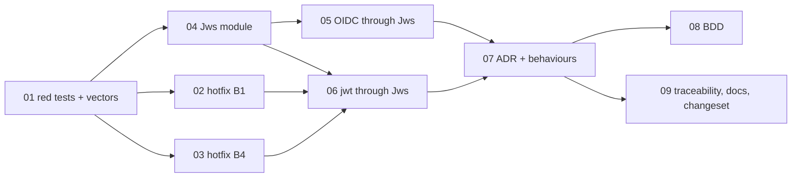

# Plan 38: One JWS verifier for the OIDC `id_token`, the jwt plugin and the lite verifier

| Property | Value |
|---|---|
| Source | Architecture review 2026-11-09, batch 4, candidate 38 ("one JWS verifier shared by OAuth `id_token` and the JWT lite verifier") |
| Strength | Candidate: **Worth exploring**. After re-verification: **GO, Strong (narrow)**. Four live bugs sit in the duplicated code, two of them confirmed by running the code (§2.4). The module is small (one `verify`, one `timeProblem`), and it has three callers, not two |
| Dependency category | **In-process.** The JWKS fetch stays with each caller over the `HttpClient` they already use. No new port: there is one adapter, and the fetch's error classification is caller policy (§3.6) |
| Wave / position | Independent of batch 4. Wave 0 (red tests and two hotfixes) can ship at once, as their own PR. Waves 1–3 follow in one PR |
| Touched packages | `@awthaq/ports` (new module `Jws`), `@awthaq/jwt` (`JwtCodec`, `verify`, `Jwt`), `@awthaq/oauth` (`IdToken`, `OAuthProvider`; `Jwt.ts` deleted), `spec/`, `features/` |
| Wire change | **Yes, three bug fixes, no error-tag change.** (1) A token with a non-base64url segment answers `POST /jwt/introspect` `{"active":false}` and a bearer request 401 instead of a 500 defect, and `verifySessionJwt` resolves `undefined` instead of rejecting. (2) `GET /jwt/jwks` names `kid` and `alg` for a key registered through `KeyRing.registerRemoteKey`. (3) A token with a `crit` header is refused by every verifier, an `id_token` signed by a key whose `key_ops` excludes `verify` is refused, and the lite verifier accepts a JWKS key that has no `alg`. `JwtInvalidError`, `OAuthCallbackFailed` and `ProviderUnavailable` keep their tags (`pnpm check:error-tags`) |
| ADRs | New **ADR-EA-057** (one JWS module in `@awthaq/ports`, with the RFC 7515/7517 key-selection rules). **ADR-EA-017** goes to revision 1.1: a note on decision 6 for a foreign key that names no `alg`. Decision 6 itself is unchanged |
| Tickets | 9, in `tickets/01-…09-*.md` (§4.3) |
| Verified at | `04fa3526` (branch `architecture/deepening-plans-2`), 2026-11-09. The uncommitted work in two-factor, roles and qadi touches none of the files cited here. Effect `4.1.2` installed, Node `v26.13.0` |

Requirements reserved for this plan: REQ-EA-1590–1599. Used: 1590–1596 (§1.4). ADR-EA-057 is used. **BEH-EA-368–370 are deliberately left unused** (§6.1, Q8).

---

## 0. How to read this plan

- §2 is the evidence. Every difference between the copies is in the table in §2.3, and every bug is in §2.4 with how it was confirmed.
- §3 is the design. The interface is two functions and one type (§3.2). Everything else in the module is the implementation.
- §4.3 is the ticket table. Each row is one file under `tickets/`, and the files are the executable spec.
- The vector table in ticket 01 is the backbone. One list of tokens and JWK sets is run through the OIDC caller and the jwt caller **before** the merge (with known drift marked as expected failures), through `Jws` itself in ticket 04, and through both callers again after the merge, where the drift list must be empty.

Vocabulary: module, interface, implementation, depth, deep, shallow, seam, adapter, leverage, locality. "Caller" means a module that calls `Jws.verify`: the OIDC caller (`oauth/src/IdToken.ts`), the jwt codec (`jwt/src/JwtCodec.ts`), and through it the lite verifier (`jwt/src/verify.ts`) and the plugin's own verify (`jwt/src/Jwt.ts`).

---

## 1. Summary, goals, non-goals

### 1.1 Summary

Compact-JWS verification exists twice. `packages/oauth/src/Jwt.ts` (305 lines) with `IdToken.ts` serves the OIDC `id_token`. `packages/jwt/src/JwtCodec.ts` (the verify half, about 200 lines) with `verify.ts` serves the plugin and the edge-safe lite verifier. Both copies hold the same five-algorithm WebCrypto table, a compact-JWS splitter, key selection, a JWKS refetch on an unknown `kid`, and exp/nbf/iat judgement. They have drifted, and the drift produced bugs: one copy dies on input the other rejects, one refuses keys the other accepts, and neither knows the `crit` header (§2.4).

This plan moves the JWS rules into one module, `Jws` in `@awthaq/ports`. It owns:

- strict compact decoding (it never dies);
- `crit` refusal;
- the algorithm table;
- key selection under RFC 7517 (`use`, `key_ops`, `alg`, `kty`/`crv`, `kid`);
- signature verification over WebCrypto, importing public members only;
- the refetch-once-on-unknown-`kid` step over a `KeySource`;
- exp/nbf/iat judgement with a leeway.

The callers keep only their claim policy. OIDC keeps `iss`, `sub`, `aud`/`azp`, `nonce`, `maxIdTokenAge`, an optional `kid`, and its own JWKS fetch and cache. The jwt codec keeps `typ` class, a required `kid`, `iss`/`aud`, integer NumericDates (GC-002), `sub`, and its key sources.

### 1.2 Go / no-go gate

**Evidence for (each item is enough on its own):**

1. **B1 (confirmed by running the code).** `JwtCodec.verify` dies (`Cause` `Die`) on a token whose header or signature segment is not base64url. The `atob` throw inside `Effect.gen` is a defect, and `mapError` cannot catch it. That reaches `POST /jwt/introspect` (`Effect.result` at `Jwt.ts:836` does not catch defects, so the answer is 500), an opted-in bearer request (500), and `verifySessionJwt`, which is documented as "never throws" but rejects (`next/src/edge.ts:73-78`). The OIDC copy wraps the same step in `Effect.try` (`oauth/src/Jwt.ts:143-162`) and is safe.
2. **B2 (confirmed by running the code for jwt; by reading for OIDC).** Neither copy reads `crit`. `grep -rn '\bcrit\b' packages/*/src` prints nothing, both header schemas drop unknown members, and a correctly signed token with `crit: ["x-unknown"]` verifies. RFC 7515 §4.1.11 says such a JWS MUST be rejected.
3. **B3 (by reading; reproduced by ticket 01).** The lite verifier drops every JWKS entry without `alg` (`verify.ts:101`). RFC 7517 §4.4 makes `alg` OPTIONAL, and the OIDC copy accepts it (`oauth/src/Jwt.ts:296`). So an issuer whose JWKS omits `alg` never verifies through `Verify.makeVerifier`: every token is "unknown kid" and forces a refetch every 30 seconds.
4. **Three callers, not two.** The plugin's own `Jwt.verify` (`Jwt.ts:737-768`) repeats the refetch dance, matching the error by the string `"unknown kid"` (`Jwt.ts:765`, `verify.ts:149`).

**Evidence against:**

- The duplicated code is small: about 150 lines per copy. The refetch itself is already shared through `RefreshingCache` (`@awthaq/ports`).
- B1 and B4 are fixable in place (tickets 02–03 do that) without the module.

**Verdict: GO.** The hotfixes do not depend on the gate. The gate decides tickets 04–09, and it passes on B2 and B3 alone. Those two bugs are the same rule (RFC 7515/7517 key and header handling) written differently in two places, and only one module fixes them once.

### 1.3 Goals

- G1. One module verifies every compact JWS in the repo. Gate: `grep -rn 'subtle\.verify(' packages/*/src` lists only `packages/ports/src/Jws.ts` (baseline at HEAD: 2 lines, `jwt/src/JwtCodec.ts:357` and `oauth/src/Jwt.ts:263`).
- G2. The same token and key set get the same verdict from every caller, except where caller policy differs (documented in the vector table). Gate: both drift lists in the differential runners are empty.
- G3. Malformed input never dies. Every verifier answers it with its typed failure.
- G4. Key selection follows RFC 7517 everywhere: `use` absent or `sig`; `key_ops` absent or including `verify`; `alg` absent or equal to the header `alg`; `kty`/`crv` fit the header `alg`; an exact `kid` match when the token names one.
- G5. `@awthaq/jwt/verify` stays free of `@awthaq/core`, `@awthaq/server`, `@awthaq/sql`, `@awthaq/api`, `./Jwt.ts` and `./KeyRing.ts` (`packages/next/test/EdgeImports.test.ts` stays green).
- G6. No new npm dependency. No wire error-tag change.

### 1.4 Requirements (REQ-EA, reserved block 1590–1599)

| REQ | Requirement | Where it is proven |
|---|---|---|
| REQ-EA-1590 | A token whose segments are not base64url is refused like any other bad token (introspection inactive, bearer 401, lite verifier typed failure). It is never a defect. BDD scenario | tickets 01, 02, 08 |
| REQ-EA-1591 | A token whose header carries `crit` is refused by every verifier (RFC 7515 §4.1.11). BDD scenario | tickets 01, 04, 05, 06, 08 |
| REQ-EA-1592 | `GET /jwt/jwks` names `kid` and `alg` for every key, a remote-signed key included (BEH-EA-292 as written) | tickets 01, 03 |
| REQ-EA-1593 | A JWKS key with no `alg` is usable for an allowlisted header `alg` that its `kty`/`crv` fits (RFC 7517 §4.4) | tickets 01, 04, 06 |
| REQ-EA-1594 | A JWKS key whose `use` is not `sig`, or whose `key_ops` lacks `verify`, is never selected, and a signing key that shares its `kid` still is (RFC 7517 §4.2, §4.3) | tickets 01, 04, 05, 06 |
| REQ-EA-1595 | The differential vectors give the same verdict through the OIDC caller and the jwt caller, policy rows excepted | tickets 01, 05, 06 |
| REQ-EA-1596 | One module holds the algorithm table and the only WebCrypto `verify` call | tickets 04, 05, 06 |

### 1.5 Non-goals

- No change to claim policy. Examples: GC-002 keeps integer NumericDates in jwt (RFC 7519 §2 allows fractions, see Q4); OIDC keeps `maxIdTokenAge`; jwt keeps `typ` explicit typing.
- No change to cache lifetimes or refetch intervals (ADR-EA-017 decision 4: `cacheTtl` 10 min, `minRefetchInterval` 30 s; OIDC TTL 15 min; plugin `keyCacheMaxAge` 5 min).
- No JWS signing changes. `JwtCodec.sign`, `localSigner`, `RemoteSigner` and `generateKeyJwks` stay in jwt. They read the shared table's WebCrypto parameters.
- No JWE, no `x5c`/`x5t` chain handling, no `b64: false` (RFC 7797). That last one is refused through `crit`.
- No touching `packages/core/src/SecretHash.ts` (plan 39 owns it).

### 1.6 must_haves (whole plan)

```yaml
must_haves:
  truths:
    - "The same JWS vector gets the same verdict through IdToken.verify and through Verify.makeVerifier, except the policy rows (kid-less, typ-less)"
    - "A token with a non-base64url segment yields a typed failure in every verifier; POST /jwt/introspect answers 200 {active:false}"
    - "A token whose header carries crit is refused by every verifier"
    - "A JWKS key without alg verifies through the lite verifier when its kty/crv fits an allowlisted header alg"
    - "A key with use != sig or key_ops without verify is never selected, and a signing key sharing its kid still is"
    - "GET /jwt/jwks lists kid and alg for a remote-registered key"
    - "A peer-minted key of a new algorithm verifies in-process after one forced key refresh (no regression)"
  artifacts:
    - path: packages/ports/src/Jws.ts
      provides: "verify, timeProblem, KeySource, JwkSet, Algorithm table, JwsRejected"
    - path: packages/ports/test/jwsVectors.ts
      provides: "one vector table shared by the ports, jwt and oauth tests"
    - path: packages/ports/test/Jws.test.ts
      provides: "tests at the module interface (replaces oauth/test/Jwt.test.ts and 11 JwtCodec tests)"
    - path: packages/jwt/test/JwsDifferential.test.ts
      provides: "vectors through the lite verifier"
    - path: packages/oauth/test/JwsDifferential.test.ts
      provides: "vectors through IdToken.verify"
    - path: spec/decisions/057-one-jws-verifier.md
      provides: "ADR-EA-057"
  key_links:
    - from: packages/oauth/src/IdToken.ts
      to: packages/ports/src/Jws.ts
      via: "Jws.verify with the per-provider RefreshingCache as KeySource; Jws.timeProblem inside claimProblem"
    - from: packages/jwt/src/JwtCodec.ts
      to: packages/ports/src/Jws.ts
      via: "JwtCodec.verify delegates header/key/signature to Jws.verify and time to Jws.timeProblem"
    - from: packages/jwt/src/verify.ts
      to: packages/jwt/src/JwtCodec.ts
      via: "refetch passed as JwtCodec.verify's refetch input, no string-matched retry"
    - from: packages/jwt/src/Jwt.ts
      to: packages/jwt/src/JwtCodec.ts
      via: "refetch = keyRefresh.refreshOnMiss then verifiableKeys; algorithms = Jws.algorithms"
```

---

## 2. Verified current state

### 2.1 Re-measurement commands (run at `04fa3526`)

| Command | Result at HEAD |
|---|---|
| `wc -l packages/oauth/src/Jwt.ts packages/oauth/src/IdToken.ts packages/jwt/src/JwtCodec.ts packages/jwt/src/verify.ts` | 305, 247, 446, 157 |
| `grep -rn 'subtle\.verify(' packages/*/src \| wc -l` | 2 (`JwtCodec.ts:357`, `oauth/src/Jwt.ts:263`) |
| `grep -rln 'RSASSA-PKCS1-v1_5' packages/*/src \| wc -l` | 2 files |
| `grep -rn 'const JwksDocumentSchema' packages/*/src \| wc -l` | 2 (`verify.ts:90`, `oauth/src/Jwt.ts:41`) |
| `grep -rn 'reason === "unknown kid"' packages/*/src \| wc -l` | 2 (`Jwt.ts:765`, `verify.ts:149`) |
| `grep -rn 'JwtVerificationError' packages/*/src \| wc -l` | 13 (all in `oauth/src/Jwt.ts` and `IdToken.ts`) |
| `grep -rn '\bcrit\b' packages/*/src \| wc -l` | 0 |
| `grep -E '^import' packages/jwt/src/verify.ts \| grep -cE '@awthaq/(core\|server\|sql\|api)\|\./(Jwt\|KeyRing)\.ts'` | 0 (G5 holds today) |
| `grep -c 'Jws' packages/ports/src/index.ts` / `grep -c '^Jws$' spec/overview.md` | 0 / 0 |
| `npx vitest run packages/jwt/test/JwtCodec.test.ts` | 25 tests |
| `npx vitest run packages/oauth/test/Jwt.test.ts` | 20 tests |
| `npx vitest run packages/jwt/test/verify.test.ts packages/jwt/test/verifyForeignIssuer.test.ts packages/jwt/test/verifyCache.test.ts` | 7 + 2 + 3 tests |

### 2.2 Who verifies what today

| Caller | Entry | Keys from | Refetch on unknown `kid` | Error |
|---|---|---|---|---|
| OIDC `id_token` | `IdToken.verify` (`oauth/src/IdToken.ts:167-247`) → `Jwt.decode`/`findKey`/`verifySignature` | provider JWKS over the retrying `HttpClient`, one `RefreshingCache` per (provider, `jwks_uri`), TTL 15 min, min refetch 30 s (`IdToken.ts:35-75`) | `Effect.catch` on any `findKey` failure → `cache.refreshOnMiss` (`IdToken.ts:209-221`) | internal `JwtVerificationError` → `OAuthCallbackFailed` with a logged reason, or `ProviderUnavailable` |
| Lite verifier | `Verify.makeVerifier` (`jwt/src/verify.ts:115-157`) → `JwtCodec.verify` | JWKS over `HttpClient`, `RefreshingCache` TTL `cacheTtl` (10 min), `minRefetchInterval` (30 s), `fetchTimeout` (5 s) | `catchIf(reason === "unknown kid")` → `keys.refreshOnMiss` (`verify.ts:147-153`) | `JwtInvalidError` |
| jwt plugin | `Jwt.verify`/`verifyJWT`/`introspect` → `verifyWith` (`Jwt.ts:737-768`) → `JwtCodec.verify` | `KeyRing` snapshot (`verifiableKeys`), forced re-read through a `RefreshingCache` over `KeyRing.refresh` (`keyCacheMaxAge` 5 min, `keyMinRefreshInterval` 30 s) | `catchIf(_tag === "JwtInvalidError" && reason === "unknown kid")` → `keyRefresh.refreshOnMiss` then retry (`Jwt.ts:763-767`) | `JwtInvalidError` |

### 2.3 Every behavioural difference between the copies

| Aspect | OIDC copy (`oauth/src/Jwt.ts`, `IdToken.ts`) | jwt copy (`JwtCodec.ts`, `verify.ts`) | After this plan |
|---|---|---|---|
| Algorithms | RS256, PS256, ES256, ES384, EdDSA (`Jwt.ts:83-92`); WebCrypto params `:204-240` | Same five (`JwtCodec.ts:56`, `:147-178`), plus key-generation params | One table in `Jws`; jwt keeps only `generateParams` |
| Allowlist | `provider.idTokenSigningAlgs`, checked before the JWKS fetch (`IdToken.ts:188-191`) | lite: `options.algorithms`; plugin: the distinct algs of the ring's keys (`Jwt.ts:756`) | `Jws.verify` checks the caller's allowlist before touching keys (lazy `KeySource`), so OIDC keeps "no JWKS fetch for a refused alg". Plugin passes `Jws.algorithms` (§3.5, Q6) |
| Key `alg` | absent or equal to header (`Jwt.ts:296`) | required: entries without `alg` are dropped (`verify.ts:101`); matched key's `alg` must equal header (`JwtCodec.ts:410`) | absent or equal (RFC 7517 §4.4); **B3 fixed** |
| `kty`/`crv` | checked against the alg (`usableFor`, `Jwt.ts:177-189`) | not checked; WebCrypto `importKey` fails later as "signature verification threw" | checked before import |
| `use` | absent or `sig` (`Jwt.ts:295`) | not read; a `use: "enc"` key that also names a JWS `alg` is selected, then WebCrypto refuses the import (DataError, probed). The result is fail-closed, but a `sig` key sharing its `kid` is never tried | absent or `sig`, filtered before `kid` matching |
| `key_ops` | **not read; a key with `key_ops: ["encrypt"]` is used** (B5) | not read; WebCrypto refuses the import (DataError, probed) → fail-closed | absent or includes `verify` |
| Structural JWK check | `RsaJwkSchema`/`EcJwkSchema`/`OkpJwkSchema` (ACS-004, `Jwt.ts:51-77`); only public members reach WebCrypto (`:192-201`) | raw JWK record passed to `importKey` (`JwtCodec.ts:350-356`) | structural decode; public members only |
| `kid` in token | optional; a `kid`-less token takes the first candidate (`Jwt.ts:301`) | required, non-empty (`JwtCodec.ts:387-390`) | caller policy: `requireKid` input (OIDC `false`, jwt `true`) |
| Unknown `kid` → refetch | on any `findKey` failure (`IdToken.ts:213`) | on reason string `"unknown kid"` only | on `unknown-kid` only (no candidate has the token's `kid`, or, `kid`-less, no candidate at all), at most once per call, rate-limited by the caller's cache |
| `typ` | ignored | required, case-insensitive equal to the expected class (`JwtCodec.ts:399-405`) | caller policy. jwt checks it with `peekTyp` before `Jws.verify`, so a wrong-class token costs no crypto and no refetch |
| `crit` | ignored (**B2**) | ignored (**B2**) | any `crit` → `crit` rejection |
| Segment decoding | `Effect.try` around `atob` + `JSON.parse`; typed failure (`Jwt.ts:141-174`) | `atob` inside `Effect.gen`; **dies** on a non-base64url header or signature segment (**B1**, `JwtCodec.ts:189-193`, `:304-339`) | `effect/encoding/Base64Url.decode` (strict, returns `Result`), never dies |
| Payload shape | any JSON object (`Schema.Record`) | `RegisteredClaims` (integer `exp` required, `iss` string, `aud` string or non-empty array, `sub` non-empty when present) | `Jws` returns the JSON object; jwt decodes it through `RegisteredClaims` (GC-002 stays) |
| Clock skew | `OAuthConfig.clockSkew`, default 60 s (`OAuthConfig.ts:144`) | `clockSkew`, default 0 (`JwtCodec.ts:428`) | caller passes `skewMs`; defaults unchanged |
| exp/nbf/iat | `exp` required finite number, expired when `now >= exp*1000 + skew`; `nbf`/`iat` when present must be finite, refused when beyond `now + skew` (`IdToken.ts:125-144`) | same comparisons (`JwtCodec.ts:427-441`); non-integers already refused by the schema | `Jws.timeProblem`, identical comparisons; OIDC keeps `maxIdTokenAge` after it |
| JWKS document | `JwksDocumentSchema` (`Jwt.ts:41-44`) | identical `JwksDocumentSchema` (`verify.ts:90-92`) | `Jws.JwkSet` |
| JWKS fetch failure | 5xx/transport/timeout → `ProviderUnavailable`; malformed → `OAuthCallbackFailed("jwks")` (EEM-004) | any → `JwtInvalidError("jwks fetch failed")` | unchanged, caller-owned |
| Cache TTL / min refetch | 15 min / 30 s (constants) | lite 10 min / 30 s (options); plugin 5 min / 30 s (config) | unchanged |
| Error type and tag | `JwtVerificationError` (internal, never escapes `IdToken.ts`) → wire `OAuthCallbackFailed` / `ProviderUnavailable` | `JwtInvalidError` (public type in `Verifier`, `JwtShape`); wire: introspect `{active:false}`, bearer 401 | `Jws/Rejected` (internal `Data.TaggedError`), mapped by each caller to its existing error. `JwtVerificationError` is deleted. No wire tag changes |
| Internal reasons | logged `CallbackFailureReason`: `jwt-malformed`, `alg`, `kid`, `signature`, `exp`, `nbf`, `iat`, … | `JwtInvalidError.reason` strings; tests assert `"algorithm not allowed"`, `"typ mismatch"`, `"jwks fetch failed"` | preserved; mapping tables in §3.4 |

### 2.4 Live bugs

| # | Bug | Severity | Confirmed |
|---|---|---|---|
| B1 | `JwtCodec.verify` dies on a non-base64url header or signature segment. Reaches `POST /jwt/introspect` (500), an opted-in bearer request whose header peeks as `at+jwt` (500), and `verifySessionJwt` (the returned promise rejects). | medium (unauthenticated 500 through the edge proxy) | **By running the code:** a probe through `JwtCodec.verify` printed `Die` for both segments. Reproduced by ticket 01 |
| B2 | `crit` is ignored by both copies (RFC 7515 §4.1.11 MUST reject). | medium (spec violation; harmless only while no issuer uses an extension that changes the signing input, such as `b64`) | **By running the code** for jwt: a correctly signed token with `crit: ["x-unknown"]` returned `SUCCESS`. OIDC by reading (`JwtHeaderSchema` drops `crit`). Reproduced by ticket 01 |
| B3 | The lite verifier refuses every JWKS key without `alg` (`verify.ts:101`). A foreign issuer that omits it (allowed by RFC 7517 §4.4) never verifies, and each token forces a rate-limited refetch. | medium (FAMS-005 says the lite verifier serves foreign issuers) | By reading. Reproduced by ticket 01 |
| B4 | `GET /jwt/jwks` serves `key.publicKeyJwk` as stored (`Jwt.ts:829-831`), and `KeyRing.registerRemoteKey` stores the caller's JWK unchanged (`KeyRing.ts:258`). `importKey` (`:305`) and minting (`:136`) merge `kid`/`alg`; `registerRemoteKey` does not. A KMS public JWK has neither, so the served entry has no `kid` and no `alg`. BEH-EA-292 requires both, and every downstream lite verifier refuses tokens signed by that key. | medium (remote signing plus downstream verification is broken) | By reading (`RemoteSigning.test.ts:28` registers exactly such a JWK and checks only in-process verification). Reproduced by ticket 01 |
| B5 | The OIDC copy ignores `key_ops` and selects a key restricted to `encrypt` (RFC 7517 §4.3). | low (the JWKS is the provider's own) | By reading. Reproduced by ticket 01 |

#### Evidence corrections

- **"The lite verifier does not filter out `use: "enc"`" is true but overstated.** A `use: "enc"` key reaches selection only if it also names one of the five JWS algorithms, because `verify.ts:101` drops every other `alg`. Then WebCrypto refuses the import (`DataError`: probed with Node 26 for `use: "enc"`, for `key_ops: ["encrypt"]`, for a conflicting `alg`, and for a P-384 key imported as P-256). So the lite verifier never *accepts* through such a key. The real defect is narrower: a `sig` key that shares the `kid` and comes after the `enc` key is never tried. Vector `enc-key-shares-kid` covers that case.
- **There are three callers, not two.** The plugin's `Jwt.verify` (`Jwt.ts:737-768`) is a third copy of the refetch step.
- **The JWKS cache that refetches on an unknown `kid` is already shared.** It is `RefreshingCache` (`@awthaq/ports`) in all three callers. What is duplicated is the *decision* to refetch (by string match in jwt, by any failure in OIDC) and the retry around it.
- **`JwtCodec.ts` line ranges:** `specs` is `:147-178` (the candidate said 140–178; `rsaGenerate` is `:140-145`), and `verify` is `:374-446`. Both are as stated.
- **Spec drift found while reading:** the ESS-003/ACS-004 paragraph of BEH-EA-127 (`spec/behaviors/16-oauth.md:164`) still says "only RSA entries … `alg` absent or `RS256`" (stale since AOMS-005), and `packages/oauth/README.md:93` says ES256/EdDSA `id_token`s are unsupported, which contradicts its own line 56. Fixed in tickets 07 and 09.

### 2.5 The edge-safety constraint, verified

- `packages/jwt/package.json` exports `.` and `./verify`. `./verify` is the edge entry, and `@awthaq/next/edge` imports it (`next/src/edge.ts:20`).
- `verify.ts:1-14` promises no import of core/server/`Jwt.ts`/`KeyRing.ts`. `JwtCodec.ts:1-9` promises the same for itself. Its imports are `node:crypto` (type only) and `effect/*`.
- `packages/next/test/EdgeImports.test.ts` walks the runtime import graph from `next/src/edge.ts`. It follows `@awthaq/jwt/verify` and relative imports, and records every other bare specifier as a package. It forbids `@awthaq/core`, `@awthaq/server`, `@awthaq/client`, `@awthaq/react`, and files named `Jwt.ts` or `KeyRing.ts`.
- `verify.ts:40` already imports `{ RefreshingCache } from "@awthaq/ports"`, and `@awthaq/ports` is `sideEffects: false`. So a `Jws` export from `@awthaq/ports` adds no new package to the edge graph and no forbidden file name. The module is named `Jws.ts`, not `Jwt.ts`, which matters for that walker.
- Dependency direction: `@awthaq/ports` depends on `@awthaq/api` only (plus two npm packages). Both `@awthaq/jwt` and `@awthaq/oauth` already depend on `@awthaq/ports`. `ports` imports neither, so `pnpm circular` cannot gain a cycle.

---

## 3. Target design

### 3.1 The seam

The seam is `Jws.verify`. Behind it sits everything RFC 7515/7517/8725 says about a compact JWS and a JWK set. In front of it is caller policy, which differs on purpose. A test passes tokens and key sets in, and gets back the verified header and payload or one typed reason. No `HttpClient`, store or config is involved.

Depth: the interface is two functions (`verify`, `timeProblem`), one input type (`KeySource`) and one error. The implementation holds the algorithm table, structural JWK decoding, `use`/`key_ops`/`alg`/`kty`/`crv`/`kid` selection, public-member import, signature verification, `crit` refusal, strict base64url, and the single refetch. Leverage: three callers, plus the edge entry through the jwt codec. Locality: the next RFC fix lands in one file.

### 3.2 Interface sketch (`packages/ports/src/Jws.ts`)

```ts
// The five asymmetric JWS algorithms WebCrypto implements; HS* and "none" are unrepresentable.
export const Algorithm: Schema.Literals<readonly ["RS256", "PS256", "ES256", "ES384", "EdDSA"]>
export type Algorithm = typeof Algorithm.Type
export const algorithms: ReadonlyArray<Algorithm>
export const isAlgorithm: (value: unknown) => value is Algorithm
export const keyType: (alg: Algorithm) => "RSA" | "EC" | "OKP"
/** WebCrypto import and sign/verify parameters for `alg` (the jwt signer reads these). */
export const webCryptoParams: (alg: Algorithm) => {
  readonly importParams: webcrypto.AlgorithmIdentifier | webcrypto.RsaHashedImportParams | webcrypto.EcKeyImportParams
  readonly signParams: webcrypto.AlgorithmIdentifier | webcrypto.RsaPssParams | webcrypto.EcdsaParams
}

/** A JWK Set document (RFC 7517 §5); each entry stays a record so one foreign key cannot void the set. */
export const JwkSet: Schema.Struct<{ keys: Schema.Array$<Schema.Record$<Schema.String, Schema.Unknown>> }>
export type JwkSet = typeof JwkSet.Type

/** Where the keys come from; a `RefreshingCache<JwkSet, E>` satisfies it structurally. */
export interface KeySource<E> {
  readonly get: Effect.Effect<JwkSet, E>
  readonly refreshOnMiss: Effect.Effect<JwkSet, E>
}

export type Reason = "malformed" | "crit" | "alg" | "missing-kid" | "unknown-kid" | "key-mismatch" | "signature"
export class JwsRejected extends Data.TaggedError("Jws/Rejected")<{ readonly reason: Reason }> {}

export interface Verified {
  readonly header: { readonly alg: Algorithm; readonly kid: string | undefined; readonly typ: string | undefined }
  readonly payload: Record<string, unknown>
}

export const verify: <E>(input: {
  readonly token: string
  readonly keys: KeySource<E>
  readonly algorithms: ReadonlyArray<Algorithm>   // the caller's allowlist; never the header's say-so
  readonly requireKid: boolean
}) => Effect.Effect<Verified, JwsRejected | E>

export type TimeProblem = "exp" | "nbf" | "iat"
/** RFC 7519 §4.1.4/4.1.5/4.1.6 with a leeway; `exp` required. Pure, so a caller places it in its own check order. */
export const timeProblem: (
  payload: Record<string, unknown>,
  at: { readonly nowMs: number; readonly skewMs: number },
) => TimeProblem | undefined
```

`verify`'s order (each step names the reason it fails with):

1. Split into exactly three segments. Decode each with `Base64Url.decode` (strict; a `Failure` → `malformed`). Header and payload are JSON objects decoded with `Schema` (otherwise `malformed`). The header holds `alg: string`, optional `kid: string`, optional `typ: string`, and `crit` is read as present or absent.
2. `crit` present (any value) → `crit`. This module understands no extension, so every listed extension is not understood (RFC 7515 §4.1.11).
3. Header `alg` not one of the five, or not in `algorithms` → `alg`. No key is fetched yet.
4. `kid` absent and `requireKid` → `missing-kid`.
5. `keys.get`, then select (§3.3). If the result is `unknown-kid`, call `keys.refreshOnMiss` once and select again. A second `unknown-kid` fails.
6. Import the selected key's public members only (`kty`,`n`,`e` / `kty`,`crv`,`x`,`y` / `kty`,`crv`,`x`) with the table's import params, and verify with its sign params. `false`, or a WebCrypto throw → `signature`.

### 3.3 Key selection (ADR-EA-057 decision 2)

1. **Candidates** are the set's entries that decode structurally as RSA (`n`,`e`), EC (`crv`,`x`,`y`) or OKP (`crv`,`x`) (ACS-004), whose `use` is absent or `"sig"` (RFC 7517 §4.2), and whose `key_ops` is absent or includes `"verify"` (§4.3). Other entries are invisible: they can neither match a `kid` nor shadow a key that can.
2. **By `kid`:** if the token names a `kid`, the same-`kid` candidates (exact string match, §4.5). If none exist → `unknown-kid`. If the token names no `kid` (only when `requireKid` is false): all candidates. If there are none → `unknown-kid`.
3. **Usable:** among those, the first whose `alg` is absent or equal to the header `alg` (RFC 7517 §4.4; JJS-003), and whose `kty`/`crv` fit the header `alg`: RS256/PS256 → RSA; ES256 → EC `P-256`; ES384 → EC `P-384`; EdDSA → OKP `Ed25519`. If none fit → `key-mismatch`, with **no refetch**: the `kid` is known and its key is the wrong one.

Every key in the jwt ring carries its own `alg` (minted `KeyRing.ts:136`, imported `:305`, and after ticket 03 served with it). So ADR-EA-017 decision 6 ("verification is per-key-algorithm under an allowlist") holds unchanged for ring keys. A foreign key without `alg` is limited by the caller's allowlist and its `kty`/`crv`. Q1 records the stricter reading of RFC 8725 §3.1 and why it is not the default.

### 3.4 Callers after the change

**OIDC (`oauth/src/IdToken.ts`).** `verify` keeps its signature and its fetch: retrying client, `ProviderHttp.decodeBody(Jws.JwkSet)`, deadline, `CallbackFailure.providerFailure("jwks", …)`, and the per-provider `RefreshingCache` from `makeJwksCaches`. It calls `Jws.verify({ token: idToken, keys: cache, algorithms: provider.idTokenSigningAlgs, requireKid: false })` and maps `JwsRejected` to its logged reason: `malformed`/`crit` → `jwt-malformed`; `alg` → `alg`; `unknown-kid`/`key-mismatch` → `kid`; `signature` → `signature` (`missing-kid` cannot occur). The JWKS failure types pass through unchanged. `claimProblem` keeps its order (iss, sub, aud/azp, then time, then nonce) and calls `Jws.timeProblem(claims, { nowMs, skewMs })` where it checked exp/nbf/iat by hand. The `maxIdTokenAge` branch stays after it. `oauth/src/Jwt.ts` is deleted, and `OAuthProvider.ts` types `idTokenSigningAlgs` as `ReadonlyArray<Jws.Algorithm>`, using `Jws.algorithms` where it used `Jwt.SIGNING_ALGS`. `Jws.algorithms` keeps the order RS256, PS256, ES256, ES384, EdDSA, so the boot defect message is unchanged.

**jwt codec (`jwt/src/JwtCodec.ts`).** `verify` keeps its object input and gains one optional member, `refetch?: Effect.Effect<ReadonlyArray<VerificationKey>, E>`. `VerificationKey.alg` becomes optional. Order:

1. `peekTyp(token)` must be one of `expectedTyp` (case-insensitive). Otherwise `"typ mismatch"`, before any crypto.
2. `Jws.verify({ token, keys: { get: succeed(set(keys)), refreshOnMiss: refetch ? map(refetch, set) : succeed(set(keys)) }, algorithms, requireKid: true })`, where `set` builds `{ keys: keys.map(k => ({ ...k.publicKeyJwk, kid: k.kid, ...(k.alg ? { alg: k.alg } : {}) })) }`.
3. Decode the payload through `RegisteredClaims` (`"malformed token"`).
4. `iss`/`aud` (`"iss/aud mismatch"`).
5. `Jws.timeProblem` (`exp` → `"expired"`, `nbf`/`iat` → `"not yet valid"`).
6. `requireSubject` (`"missing sub"`).

`JwsRejected` maps to the existing `JwtInvalidError` reasons: `malformed` → `"malformed token"`; `crit` → `"critical header not understood"` (new); `alg` and `key-mismatch` → `"algorithm not allowed"` (what `JwtCodec.ts:397`/`:411` say today); `missing-kid` → `"missing kid"`; `unknown-kid` → `"unknown kid"`; `signature` → `"bad signature"`. The algorithm table moves out. `Algorithm`, `isAlgorithm`, `AlgorithmLiterals` and `keyTypeFor` stay as one-line aliases of `Jws.Algorithm`/`Jws.isAlgorithm`/`Jws.Algorithm`/`Jws.keyType`, because `JwtConfig.ts:23`, `SigningKeyRecords.ts:65-66` and `KeyRing.ts:288` import them by those names. `localSigner` and `generateKeyJwks` read `Jws.webCryptoParams` and keep a local `generateParams` table.

**Lite verifier (`jwt/src/verify.ts`).** `toVerificationKeys` keeps entries with a string `kid` and keeps `alg` only when `JwtCodec.isAlgorithm` holds; it no longer drops `alg`-less keys (B3). `verify` becomes `JwtCodec.verify({ …, keys: yield* keys.get, refetch: keys.refreshOnMiss })`. The `catchIf` on `"unknown kid"` is deleted. `VerifierOptions`, `Verifier` and the `JwtInvalidError` failure type are unchanged, and so is `@awthaq/next/edge`.

**jwt plugin (`jwt/src/Jwt.ts`).** `verifyWith` passes `refetch: keyRefresh.refreshOnMiss.pipe(Effect.andThen(verifiableKeys), Effect.map(toVerificationKeys))` and `algorithms: Jws.algorithms`. The `catchIf` at `:763-767` is deleted. Why all five algorithms: the allowlist was computed from the keys held *before* the refetch, so a peer's freshly minted key of a new `JwtConfig.algorithm` would fail `alg` before the refetch could find it. Every ring key declares its `alg` and selection requires equality, so the accepted set is exactly the algorithms of the keys present (Q6; the regression is pinned by a characterization test in ticket 01). The `jwks` effect (`:829-831`) serves `{ ...publicKeyJwk, kid, alg }` (ticket 03).

### 3.5 Module layout after the change

```
packages/ports/src/Jws.ts            new: table, JwkSet, KeySource, verify, timeProblem, JwsRejected
packages/ports/src/index.ts          + export * as Jws
packages/ports/test/jwsVectors.ts    new (ticket 01): the shared vector table
packages/ports/test/Jws.test.ts      new: tests at the interface
packages/jwt/src/JwtCodec.ts         sign side + claim policy; verify delegates to Jws (≈ -150 lines)
packages/jwt/src/verify.ts           lite verifier: options → JwtCodec.verify with refetch
packages/jwt/src/Jwt.ts              verifyWith with refetch; jwks merges kid/alg
packages/oauth/src/IdToken.ts        fetch + cache + OIDC claim policy over Jws
packages/oauth/src/Jwt.ts            deleted
packages/oauth/test/Jwt.test.ts      deleted (20 tests move to ports/test/Jws.test.ts)
```

### 3.6 Alternatives rejected

- **A core-free subpath of `@awthaq/jwt` (`@awthaq/jwt/jws`) that `@awthaq/oauth` imports.** Rejected. It makes one plugin depend on another plugin's package, and `@awthaq/jwt`'s root entry depends on `core`, `server`, `sql` and `api`. Both packages already depend on `@awthaq/ports`, and `ports` already holds the comparable `XmlSignature` and `RefreshingCache` modules.
- **A new package (`@awthaq/jose`).** Rejected for about 250 lines. A new package needs a README, a `package:smoke` entry, changesets and an edge-graph rule, and buys nothing over a `ports` module.
- **A `JwksFetcher` port with an `HttpClient` adapter.** Rejected: one adapter is a hypothetical seam. Both callers already test through a fake `HttpClient` layer (`oauth/test/FakeProvider.ts`, `jwt/test/verify.test.ts`). The fetch's error classification is policy: OIDC splits 503 from 400 (EEM-004), and the lite verifier collapses everything (BEH-EA-293). A shared fetch would need both behaviours as options.
- **Making `Jws` own the `RefreshingCache`.** Rejected. The plugin's keys come from a store, not a URL, and the cache lifetimes are caller decisions bound by ADR-EA-017 decision 4. `KeySource` takes any `get`/`refreshOnMiss` pair, and a `RefreshingCache` already is one.
- **Keeping `JwtCodec.verify`'s key list and adding a typed `unknown kid` reason, so callers retry.** Rejected: the retry would stay written three times. The optional `refetch` input keeps every existing `JwtCodec.verify` call site (`AuthHttp.test.ts:100,274`, `KeyRing.test.ts:263`, `RemoteSigning.test.ts:70`, `JwtCodec.test.ts:62`) unchanged.
- **Putting `typ` and `iss`/`aud` checks into `Jws`.** Rejected. OIDC does not use `typ`, and `aud` semantics differ (`azp`). Those checks are caller policy.

---

## 4. Phased migration

### 4.1 Waves

```
Wave 0  (hotfix PR, ships alone)
  01 red tests + differential vectors ──┬─► 02 hotfix B1: malformed segments fail typed
                                        └─► 03 hotfix B4: served JWKS names kid/alg
Wave 1
  01 ─► 04 Jws module in @awthaq/ports        (parallel with 02/03: no shared file)
Wave 2
  04 ─► 05 OIDC id_token through Jws
  02,03,04 ─► 06 jwt codec, lite verifier, plugin through Jws
Wave 3
  05,06 ─► 07 ADR-EA-057, ADR-EA-017 1.1, behaviours
  07 ─► 08 BDD scenarios (REQ-EA-1590/1591)
  07 ─► 09 traceability, READMEs, changeset
```

### 4.2 Phases

- **Phase 0 (wave 0, tickets 01–03).** Reproduce B1–B5 and the drift as expected-failure tests (`it.effect.fails`), so the tree stays green. Fix B1 and B4 in place. Gate: per-ticket gate. These can merge to `main` before anything else.
- **Phase 1 (wave 1, ticket 04).** Build `Jws` test-first against the vector table. No caller changes yet. `Jws` is reachable from `@awthaq/ports`' package entry, which knip treats as public, so ticket 04 is green on its own. Even so, land waves 1–3 as one PR, so no release ships a second, unused verifier.
- **Phase 2 (wave 2, tickets 05–06).** Move each caller onto `Jws` and empty its drift list. 05 and 06 share no file.
- **Phase 3 (wave 3, tickets 07–09).** Spec, ADR, BDD, traceability, docs, changeset. Plan gate: `pnpm check`.

### 4.3 Ticket table

| Ticket | Title | Wave | Depends on | Type | Size | Files |
|---|---|---|---|---|---|---|
| [01](tickets/01-red-tests-and-vectors.md) | Red tests for B1–B5 and the differential vector table | 0 | — | tdd | M | `packages/ports/test/jwsVectors.ts`, `packages/jwt/test/JwsDifferential.test.ts`, `packages/oauth/test/JwsDifferential.test.ts`, `packages/jwt/test/AuthHttp.test.ts`, `packages/jwt/test/Jwt.test.ts` |
| [02](tickets/02-hotfix-malformed-segments.md) | Hotfix B1: a malformed segment fails typed, never dies | 0 | 01 | tdd | S | `packages/jwt/src/JwtCodec.ts`, `packages/jwt/test/AuthHttp.test.ts`, `packages/jwt/test/JwsDifferential.test.ts`, `.changeset/jwt-malformed-segment.md` |
| [03](tickets/03-hotfix-jwks-kid-alg.md) | Hotfix B4: the served JWKS names every key's `kid` and `alg` | 0 | 01 | tdd | S | `packages/jwt/src/Jwt.ts`, `packages/jwt/test/Jwt.test.ts`, `.changeset/jwt-jwks-remote-key.md` |
| [04](tickets/04-jws-module.md) | `Jws` in `@awthaq/ports` | 1 | 01 | tdd | L | `packages/ports/src/Jws.ts`, `packages/ports/src/index.ts`, `packages/ports/test/Jws.test.ts`, `spec/overview.md` |
| [05](tickets/05-oidc-through-jws.md) | OIDC `id_token` verifies through `Jws` | 2 | 04 | execute | M | `packages/oauth/src/IdToken.ts`, `packages/oauth/src/OAuthProvider.ts`, `packages/oauth/src/Jwt.ts` (deleted), `packages/oauth/test/Jwt.test.ts` (deleted), `packages/oauth/test/JwsDifferential.test.ts` |
| [06](tickets/06-jwt-through-jws.md) | jwt codec, lite verifier and plugin verify through `Jws` | 2 | 02, 03, 04 | execute | M | `packages/jwt/src/JwtCodec.ts`, `packages/jwt/src/verify.ts`, `packages/jwt/src/Jwt.ts`, `packages/jwt/test/JwtCodec.test.ts`, `packages/jwt/test/JwsDifferential.test.ts` |
| [07](tickets/07-adr-and-behaviours.md) | ADR-EA-057, ADR-EA-017 rev 1.1, BEH-EA-293/298/127 | 3 | 05, 06 | execute | S | `spec/decisions/057-one-jws-verifier.md`, `spec/decisions/017-jwt-signing-key-rotation.md`, `spec/decisions/index.yaml`, `spec/behaviors/36-jwt.md`, `spec/behaviors/16-oauth.md` |
| [08](tickets/08-bdd.md) | BDD: malformed segments and `crit` (REQ-EA-1590/1591) | 3 | 07 | execute | S | `features/features/11-jwt/36-jwt.feature`, `features/step-definitions/JwtWorld.ts`, `features/traceability.md` |
| [09](tickets/09-traceability-docs-changeset.md) | Traceability, READMEs, changeset | 3 | 07 | execute | S | `spec/traceability.md`, `packages/jwt/README.md`, `packages/oauth/README.md`, `packages/oauth/src/index.ts`, `.changeset/jws-verifier.md` |

Same-wave file overlap: none. Wave 0 runs 02 and 03 in parallel after 01. Wave 1's 04 touches only ports and `spec/overview.md`. Wave 2's 05 touches oauth and 06 touches jwt. Wave 3's 08 and 09 share no file.

### 4.4 Dependency graph



---

## 5. Test plan

### 5.1 Tests at the new interface (`packages/ports/test/Jws.test.ts`)

- Every vector of `jwsVectors.ts` through `Jws.verify` with a static `KeySource`. The test asserts the `Reason`, or acceptance, and for accepted tokens `Jws.timeProblem` at the vector's `nowMs` with a 60 s leeway.
- The refetch contract, with a counting `KeySource`:
  - an `unknown-kid` calls `refreshOnMiss` exactly once, and the refetched set can succeed;
  - a `key-mismatch`, an `alg` refusal, a `crit` refusal and a `malformed` token never call `get` or `refreshOnMiss`, except `key-mismatch`, which calls `get` once;
  - a `get` failure propagates as `E`.
- Moved from `oauth/test/Jwt.test.ts` (20 tests, file deleted):
  - structural candidates (`kty`-less entry, RSA without `n`, `use: "enc"`, `alg` other than the header's, a `kid`-less token picking the lone usable key);
  - decoding (well-formed; JSON `null` header and payload; array header; fewer than three segments; unknown header members ignored except `crit`);
  - per algorithm with **`node:crypto` signatures** (independent of WebCrypto signing) for all five;
  - wrong type or curve; only five algorithms recognised.
- Moved from `jwt/test/JwtCodec.test.ts` (11 tests deleted there):
  - RS256 header against an ES256-only key;
  - `nbf` future; `iat` future with leeway forgiveness;
  - two algorithms side by side; header `alg` ≠ matched key `alg`; a key whose `alg` is outside the allowlist;
  - header `alg` missing; HS256 with the public key bytes as HMAC secret; ES256 header against an EdDSA allowlist; a `kid` matching no key; a valid signature from another key in the `kid`'s slot.

### 5.2 Caller-level tests

- `packages/jwt/test/JwsDifferential.test.ts` and `packages/oauth/test/JwsDifferential.test.ts` run every vector through `Verify.makeVerifier` (fake JWKS `HttpClient`, `expectedTyp: "JWT"`, `clockSkew: "60 seconds"`) and through `IdToken.verify` (fake provider, `clockSkew` 60 s). They assert the caller-level verdict: `vector.policy[caller] ?? vector.expected`. Vectors listed in the file's drift list run as `it.effect.fails`. The lists start at jwt 6 / oauth 2 (ticket 01) and end at 0 / 0 (tickets 02, 05, 06).
- Kept unchanged (they prove caller policy and must stay green without edits):
  - `jwt/test/verify.test.ts` (7), `verifyForeignIssuer.test.ts` (2), `verifyCache.test.ts` (3);
  - the 14 remaining `JwtCodec.test.ts` tests (5-algorithm sign/verify round trips, `generateKeyJwks`, GC-002 claims ×4, `typ` ×2, subject);
  - `next/test/Edge.test.ts` (6), `next/test/EdgeImports.test.ts`;
  - every `id_token` test in `oauth/test/OAuth.test.ts` (OIT-003/004/006/009, AOMS-005, EEM-004, MA-002).
- New caller tests from ticket 01:
  - `AuthHttp.test.ts`: `POST /jwt/introspect` with a non-base64url token answers 200 `{"active":false}`;
  - `Jwt.test.ts`: a remote-registered key appears in `jwt.jwks` with `kid`/`alg`, and the characterization test for a peer-minted key of a new algorithm.

### 5.3 Tests deleted (replace, don't layer)

- `packages/oauth/test/Jwt.test.ts`: the whole file (20 tests). It tests `oauth/src/Jwt.ts`, which is deleted, and every case moves to `ports/test/Jws.test.ts`.
- `packages/jwt/test/JwtCodec.test.ts`: the 11 tests listed in §5.1. They exercise key selection, the algorithm pin and time judgement, which now live in `Jws`. 25 → 14.

### 5.4 Concurrency and Postgres

No SQL changes. `pnpm test:pg` is not needed. The refetch's single-flight and rate limit belong to `RefreshingCache`, unchanged and covered by `ports/test/RefreshingCache.test.ts` and `jwt/test/verifyCache.test.ts` (N concurrent cold verifications → 1 fetch).

### 5.5 Measurable targets

| Gate | Baseline at HEAD | Target |
|---|---|---|
| `grep -rn 'subtle\.verify(' packages/*/src` | 2 lines | 1 line, in `packages/ports/src/Jws.ts` |
| `grep -rln 'RSASSA-PKCS1-v1_5' packages/*/src` | 2 files | 1 file (`packages/ports/src/Jws.ts`) |
| `grep -rn 'const JwksDocumentSchema' packages/*/src \| wc -l` | 2 | 0 |
| `grep -rn 'reason === "unknown kid"' packages/*/src \| wc -l` | 2 | 0 |
| `grep -rn 'JwtVerificationError' packages/*/src \| wc -l` | 13 | 0 |
| `test -e packages/oauth/src/Jwt.ts` | exists | absent |
| Drift-list entries (`sed -n '/^const driftList/,/^\]/p' <runner> \| grep -c '^  "'`) | file absent; 6 (jwt) / 2 (oauth) after 01 | 0 / 0 |
| `grep -E '^import' packages/jwt/src/verify.ts packages/jwt/src/JwtCodec.ts \| grep -cE '@awthaq/(core\|server\|sql\|api)\|\./(Jwt\|KeyRing)\.ts'` | 0 | 0 |
| `npx vitest run packages/jwt/test/JwtCodec.test.ts` | 25 tests | 14 tests |

---

## 6. Spec, ADR, traceability, BDD, docs, changesets

### 6.1 Behaviour entries (amended; no new BEH)

`spec/scripts/verify-traceability.sh` check 8 requires BEH-EA ids to be contiguous from 001. The highest today is BEH-EA-346, and batch 4 reserves 347–376 across ten plans. A BEH-EA-368 landing before 347–367 exist fails `pnpm spec:verify:strict`. Plan 38 therefore amends existing entries and leaves BEH-EA-368–370 unused (Q8).

- **BEH-EA-293** (`spec/behaviors/36-jwt.md`): add that a header `crit` is refused, that a token that is not three base64url segments of JSON is refused like any other failure, and the key-selection rules (with a `use`/`key_ops`/`alg`/`kty` clause). Revision 1.2 → 1.3.
- **BEH-EA-298**: the lite verifier applies the same `Jws` rules, so a JWKS key without `alg` is usable within the allowlist.
- **BEH-EA-292**: unchanged text (it already requires `kid` and `alg`). The change history records the B4 conformance fix.
- **BEH-EA-127** (`spec/behaviors/16-oauth.md`): rewrite the stale ESS-003/ACS-004 sentence: five algorithms, `use`/`key_ops`/`alg`/`kty`/`crv` selection, `crit` refused, a pointer to ADR-EA-057. Revision 1.6 → 1.7.

### 6.2 ADR-EA-057 (new), draft text

> **ADR-EA-057: A Compact JWS Is Verified by One Module of `@awthaq/ports`, Under RFC 7515/7517 Key Selection**
>
> *Context.* Two copies of JWS verification (OIDC `id_token` in `@awthaq/oauth`; the jwt codec behind the plugin and the edge-safe lite verifier in `@awthaq/jwt`) drifted. One died on malformed segments, one refused `alg`-less JWKS keys, one used `key_ops`-restricted keys, and neither refused `crit`.
>
> *Decision.*
> 1. `Jws` in `@awthaq/ports` owns compact-JWS decoding (strict base64url, never a defect), `crit` refusal, the five-algorithm table (RS256, PS256, ES256, ES384, EdDSA; `none` and HS* unrepresentable), key selection, signature verification over WebCrypto with public members only, one refetch on an unknown `kid` through a caller-supplied `KeySource`, and exp/nbf/iat judgement with a caller-supplied leeway.
> 2. Key selection: candidates are structurally valid RSA/EC/OKP keys with `use` absent or `sig` and `key_ops` absent or including `verify`. When the token names a `kid`, only exact matches. A usable key has `alg` absent or equal to the header `alg`, and a `kty`/`crv` that fits it. The header `alg` must be in the caller's allowlist. A known `kid` with no usable key is refused without a refetch.
> 3. Callers own claim policy and key sources. The jwt codec requires `kid` and the expected `typ`, and keeps integer NumericDates (GC-002). OIDC keeps `kid` optional and checks `iss`, `aud`/`azp`, `nonce`, `sub` and `maxIdTokenAge`. Each caller fetches and caches its keys and classifies fetch failures itself. No JWKS-fetch port is introduced.
> 4. `@awthaq/jwt/verify` remains free of `@awthaq/core`/`server`/`sql`/`api`. `Jws` imports only `effect` and `node:crypto` types.
> 5. No wire error tag changes. `Jws/Rejected` is internal, and each caller maps it to its existing error.
>
> *Consequences.* One file holds every RFC 7515/7517 verification rule. ADR-EA-017 decision 6 is unchanged for ring keys, which always declare `alg`. A foreign key without `alg` is limited by the allowlist and its key type.
>
> *Alternatives.* A subpath of `@awthaq/jwt`, a new package, and a JWKS-fetch port (see plan 38 §3.6).

ADR-EA-017 revision 1.1: append to decision 6: "A key that declares no `alg` (only a foreign JWKS key can) is usable for a header `alg` in the verifier's allowlist that its `kty`/`crv` fits (ADR-EA-057 decision 2). Every key this plugin mints, imports or registers declares its `alg`, and the JWKS serves it." Also add a change history row.

### 6.3 Traceability, BDD, docs

- `spec/traceability.md`:
  - a new ADR-EA-057 row (`packages/ports/test/Jws.test.ts`, both `JwsDifferential.test.ts`);
  - the ADR-EA-017 row gains `packages/jwt/test/Jwt.test.ts`;
  - the OAuth row (`:280`) says "`@awthaq/ports`'s `Jws`" instead of "`Jwt.ts`'s own verifier";
  - the `packages/jwt/test/*` row (`:373`) mentions the differential vectors.
- BDD (`features/features/11-jwt/36-jwt.feature`, rule BEH-EA-293):
  - **REQ-EA-1590**: "Text whose segments are not base64url gets the same answer". It uses the existing step `"alice" introspects the text "!!.e30.e30"`.
  - **REQ-EA-1591**: "A token with a critical header the verifier does not understand is not accepted". It uses the existing defect step with a new defect `"with an unknown critical header"` in `JwtWorld.ts`.
  - Pre-tag both by hand before running `python3 features/scripts/allocate-req-ea.py`. The allocator would otherwise assign 1514+, which belongs to nobody's reserved block.
- READMEs:
  - `packages/jwt/README.md` (lite verifier: `alg`-less keys, `crit`);
  - `packages/oauth/README.md` (`:56` adds `key_ops`/`crit`; delete the stale `:93` claim);
  - `packages/oauth/src/index.ts:11` header comment ("RS256-only").
- `spec/overview.md`: `Jws` in the `<!-- surface:ports -->` block (drift check 13), in the ports row (`:47`) and in the helpers row (`:156`). Ticket 04 does this, because the drift check fails as soon as the export exists.

### 6.4 Changesets

- `.changeset/jwt-malformed-segment.md` (ticket 02): `@awthaq/jwt` patch. "Migration: none."
- `.changeset/jwt-jwks-remote-key.md` (ticket 03): `@awthaq/jwt` patch. "Migration: none; downstream verifiers that cached a JWKS without the remote key's `kid` pick it up within `cacheTtl`."
- `.changeset/jws-verifier.md` (ticket 09): `@awthaq/ports` minor (new `Jws`), `@awthaq/jwt` minor (`JwtCodec.verify` gains `refetch`; `VerificationKey.alg` optional; `crit` refused; `alg`-less JWKS keys accepted), `@awthaq/oauth` patch (`key_ops` and `crit` honoured; internal `Jwt` module removed). "Migration: an issuer that sets `crit` on its tokens is now refused (RFC 7515 §4.1.11). No code changes for callers."

---

## 7. Risks, mitigations, rollback

| Risk | Mitigation | Rollback |
|---|---|---|
| A real provider's `id_token`s carry `crit`, so OIDC sign-in stops working | No mainstream OIDC provider sets `crit` on `id_token`s. The refusal is logged as `jwt-malformed` with the detail `crit`, so it is diagnosable. The changeset's Migration line names it | Revert ticket 05 alone (OIDC then goes back to `oauth/src/Jwt.ts`) |
| Plugin allowlist widened to `Jws.algorithms` | Equivalent, because every ring key declares `alg` and selection requires equality. The ticket 01 characterization test (peer-minted key of a new algorithm) plus `JwtCodec.test.ts`'s per-key tests (moved to `Jws.test.ts`) pin it | Revert ticket 06 |
| Edge bundle grows | `Jws` is about 250 lines and `@awthaq/ports` is `sideEffects: false`. `EdgeImports.test.ts` stays green. Q3 holds the subpath fallback | Q3's subpath |
| An `alg`-less RSA key is used for both RS256 and PS256 when both are allowlisted | This is today's OIDC behaviour. No known forgery crosses PKCS#1 v1.5 and PSS on one key. Q1 holds the strict RFC 8725 §3.1 reading | Q1 → strict |
| A reason-string change breaks a test or a log consumer | §3.4 maps every reason to the string tests assert today (`"algorithm not allowed"`, `"typ mismatch"`, `"jwks fetch failed"`). OIDC log reasons are unchanged | — |
| The `.fails` drift tests pass for the wrong reason (for example, a defect instead of a rejection) | After each fix the test runs as a plain `it.effect`, so the real assertion takes over. The B1 vectors assert a typed `JwtInvalidError` failure, not just "did not succeed" | — |
| Wave 0 shipping alone leaves `crit`/`alg`-less unfixed | They are listed as known and are fixed in waves 1–2 of the same plan | — |

Rollback order: 09 → 08 → 07 → 06 → 05 → 04. Tickets 02 and 03 stand alone and are not rolled back with the deepening.

---

## 8. Interactions with other plans

- **Batch 1–3 (01–30).** No plan edits `IdToken.ts`, `oauth/src/Jwt.ts`, `JwtCodec.ts` or `verify.ts` (`grep -rln 'IdToken\|JwtCodec\|jwt/src/verify\|oauth/src/Jwt' .planning` → only `17-core-sealed-columns`, which names the sealed `accounts.idToken` column, a different thing).
  - Plan 26 rewrites `oauth/src/OAuth.ts` handlers, not `IdToken.verify`'s signature. Whichever lands second rebases trivially.
  - Plan 29 moved oauth events and does not touch verification.
  - Batch-2 plans 24/25 made "a `kid` names one key forever" (BEH-EA-296 rev 1.2). `SigningKeyRecords.isSameKey` compares the *stored* public JWK. Ticket 03 deliberately changes what is *served*, not what is stored, so re-registering a remote key at boot still matches the stored row (merging at registration would make every existing deployment fail `KidTaken` at boot).
  - Batch-2 plan 21 Q6 (JWT session-mirror cookie on sign-out) is unrelated.
- **Batch 4.**
  - **39** owns `SecretHash`; this plan does not touch it.
  - **31–37, 40** touch no file here.
  - **All batch-4 plans:** BEH contiguity (§6.1). Whichever plan adds the first new BEH must use 347, so plans should land their BEH entries in reserved-block order or amend existing entries, as this one does.
  - REQ-EA allocation: every plan should pre-tag its reserved ids (§6.3).
  - `spec/overview.md`'s ports surface block is also edited by any plan that adds a ports module (34/35 may add a test mailbox port). Merge order decides; the block is one name per line, so conflicts are trivial.

---

## 9. Acceptance checklist

- [ ] 01: the vector table exists; the jwt runner drift list holds exactly 6 names and the oauth runner exactly 2; the B1 introspection test and the B4 JWKS test run as `it.effect.fails` and pass; the peer-algorithm characterization test passes as a plain test at HEAD.
- [ ] 02: `sig-not-base64url` and `header-not-base64url` are off the jwt drift list; introspection of `!!.e30.e30` answers 200 `{"active":false}`; no `atob(` in `packages/jwt/src`.
- [ ] 03: a remote-registered key is served with `kid` and `alg`; `KeyRing.test.ts`'s "same public key again is a no-op" test passes unchanged.
- [ ] 04: `Jws` is exported from `@awthaq/ports`; `ports/test/Jws.test.ts` runs every vector; `spec/overview.md` lists `Jws`; `pnpm spec:verify:strict` is green on the ports-inventory check.
- [ ] 05: `oauth/src/Jwt.ts` and `oauth/test/Jwt.test.ts` are deleted; the oauth drift list is empty; every `id_token` test in `OAuth.test.ts` passes unchanged.
- [ ] 06: the jwt drift list is empty; `reason === "unknown kid"` appears nowhere in `packages/*/src`; `JwtCodec.test.ts` has 14 tests; `EdgeImports.test.ts` and `Edge.test.ts` pass; `subtle.verify(` appears only in `ports/src/Jws.ts`.
- [ ] 07: ADR-EA-057 exists and is indexed; ADR-EA-017 is at 1.1; BEH-EA-293/298/127 are amended with change history rows.
- [ ] 08: REQ-EA-1590 and REQ-EA-1591 scenarios pass in `pnpm test:bdd`; `python3 features/scripts/allocate-req-ea.py --check` passes.
- [ ] 09: traceability rows and READMEs are updated; `.changeset/jws-verifier.md` has a `Migration:` line; `pnpm check` is green (knip: only `.reports/` noise, per `.planning/IMPLEMENTING.md`).

---

## 10. Open questions

| # | Question | Recommended default | If answered otherwise |
|---|---|---|---|
| Q1 | An RSA key with no `alg`, and an allowlist containing both RS256 and PS256: may the key verify either? (RFC 8725 §3.1 says "each key MUST be used with exactly one algorithm".) | **Yes, either.** That is today's OIDC behaviour, no practical cross-algorithm forgery exists for RSA, and the allowlist is the pin. EC and OKP keys are unambiguous anyway | Ticket 04 adds a rule: an `alg`-less key is usable only if exactly one allowlisted algorithm fits its `kty`/`crv`, and adds a vector. OIDC providers that advertise both and omit `alg` (rare) then fail sign-in. Ticket 07's ADR text changes |
| Q2 | A `kid`-less token (OIDC only): first usable candidate, or try each? | **First usable** (today's behaviour; bounded crypto per token) | Ticket 04 loops over candidates. That costs one WebCrypto verify per key on forged tokens |
| Q3 | Export `Jws` from the `@awthaq/ports` root, or from a subpath `@awthaq/ports/jws`? | **Root**, like `RefreshingCache`, which `verify.ts` already imports for the edge | Ticket 04 adds an `exports` entry and `package:smoke` coverage, and ticket 06 imports `@awthaq/ports/jws` |
| Q4 | Should the lite verifier accept fractional NumericDates from foreign issuers (RFC 7519 §2)? | **No.** GC-002 keeps one claims schema for signing and verifying. Out of scope here | A separate plan relaxes `RegisteredClaims` for verification only |
| Q5 | Internal reason string for `crit` in jwt | `"critical header not understood"` | Cosmetic |
| Q6 | The plugin passes `Jws.algorithms` (all five) as its allowlist | **Yes**, because keeping the pre-refetch key algorithms would regress peer rotation to a new algorithm (§3.4) | Ticket 06 recomputes the allowlist inside the `refetch` input and passes it through a closure. More code, same behaviour |
| Q7 | `JwtCodec.VerificationKey.alg` becomes optional (public type, private package) | **Optional** | Lite would need a separate key type. More surface for no caller |
| Q8 | New BEH-EA-368 ("one JWS rule set") vs amending 293/298/127 | **Amend** (BEH contiguity, §6.1) | 368 can be added only after 347–367 exist; then ticket 07 also edits `spec/behaviors/03-ports-slots-hooks-registries.md` |

None of these blocks a wave: every default lets its ticket proceed. Q1 is the one that changes behaviour for users, so take the decision before ticket 04 if anyone objects.

## Decisions taken
