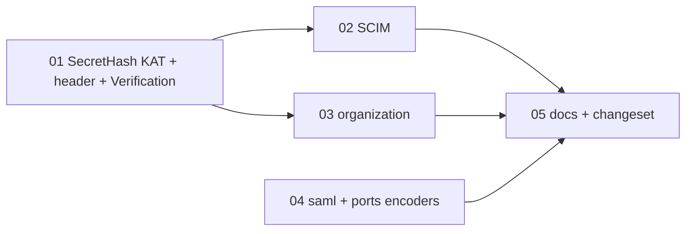

# Plan 39: Hashed credentials: the five-step module is NO-GO; one recipe, one hex encoder, one never-matching hash

| Property | Value |
|---|---|
| Source | Architecture review 2026-11-09, batch 4, candidate 39 ("deepen `SecretHash` into a module that owns hashed credentials") |
| Strength | Candidate: **Speculative**. After re-verification: **NO-GO** for the deepening (§1.2). What remains is a **residue** plan: four mechanical tickets and one docs ticket, none of which changes behaviour |
| Dependency category | **in-process**. Every copy is a pure function or an Effect over `Digest`; no I/O seam moves |
| Wave / position | Independent of every other plan. No wave 0 (no live bug). Wave 1: tickets 01 and 04. Wave 2: tickets 02 and 03. Wave 3: ticket 05. Can land at any point of batch 4 |
| Touched packages | `@awthaq/core` (`SecretHash.ts`, `Verification.ts`, a new test), `@awthaq/scim`, `@awthaq/organization`, `@awthaq/saml`, `@awthaq/ports` (`PasswordHasher.ts`), `docs/plugin-authoring.md`, `spec/traceability.md`, one changeset |
| Wire change | **No.** No interface, no HTTP answer and no at-rest format changes. The stored hashes stay byte-identical (SHA-256, lower-case hex); tickets 01–03 pin that with a Node `createHash` oracle before the substitution |
| ADRs | **None new.** ADR-EA-058 (reserved) is released unused. ADR-EA-022 is not amended: decision 2 already states the two-slot timing rule this plan leaves where it is (§3.4). ADR-EA-019 (sealing) is not touched; §3.5 says why hash and seal differ |
| Tickets | 5, in `tickets/01-…05-*.md` (§4.2) |
| Verified at | `architecture/deepening-plans-2` @ `04fa3526`, 2026-11-09. Uncommitted work in two-factor, roles and qadi is not touched by this plan. `npx vitest run packages/core/test/SessionVerdict.test.ts`: 39 passed |

Conventions: [`.planning/README.md` § Shared conventions](../README.md#shared-conventions-apply-to-every-plan) apply. No `as` in library source, no return-type annotations on new Effect consts, replace-don't-layer tests, a changeset with a `Migration:` line. Per-ticket gate: `pnpm typecheck && pnpm test && pnpm lint && pnpm knip && pnpm circular`. Per-plan gate: `pnpm check`. No SQL adapter changes, so no `pnpm test:pg`.

Vocabulary: **module, interface, implementation, depth, deep, shallow, seam, adapter, leverage, locality**. "Hashed credential" means a secret the server mints, shows once, stores only as `SHA-256` hex and recognises when presented back. "Sealed value" means plan 17's `SealedColumn`: encrypted, and opened again.

---

## 0. How to read this plan

The candidate said five callers each re-implement a five-step protocol (mint, parse, look up, compare against a fallback, check standing), so one module should own the sequence. §2 measures it. Only step 4 (the constant-time compare against a fallback) is shared, and only by four of the ten hash-at-rest sites. Steps 1, 2, 3 and 5 differ in every caller. §1.2 is the gate: the module's interface would be as wide as what it replaces, so the answer is NO-GO.

The residue is the part of the candidate that is true and cheap:
- the SHA-256-hex recipe is written out by hand three more times (SCIM, organization, and twice in core `Verification.ts`);
- the hex encoder is copied five times;
- organization re-declares the never-matching hash.

Tickets 01–04 replace those copies with the ones that already exist. Ticket 05 writes the protocol down where a plugin author will read it. That is the real replacement for the module: the protocol is short, and its risk is a new plugin that forgets it. The fix for that is documentation at the point of authoring, not a strategy-shaped interface.

Tracer-first does not apply: no new path is built. Every ticket is a substitution guarded by a characterization test that passes before and after.

---

## 1. Summary, goals, non-goals

### 1.1 Summary

`packages/core/src/SecretHash.ts` (31 lines) exports `digest`, `equals` and `NEVER_MATCHES`. It is shallow on purpose: its value is that it names the one recipe and the one fallback. The candidate's claim that "callers re-implement the rest of the protocol" is half right:

- **True:** SCIM and organization re-implement `digest` and the hex encoder. Organization re-declares `NEVER_MATCHES`. The api-key plugin and core `Sessions` place "compare before branching" by hand: four sites in all (§2.2).
- **Wrong:** there is no common "rest of the protocol". Parsing has four shapes. Lookup is by public id at four sites and by the hash itself at four others. The checks after the compare are different at every site (§2.3).

No bug was found. Every copy compares before it branches on record state, or needs no compare because the hash is the lookup key (§2.4).

### 1.2 Go/no-go gate

The candidate's own gate: "If the deletion test shows that the per-plugin variance (prefix formats, grace slots) makes the shared interface nearly as wide as the five copies, recommend NO-GO."

| Criterion | Needed for GO | Measured | Verdict |
|---|---|---|---|
| G1. Steps shared by every compare site | ≥ 3 of 5 | **1 of 5** (step 4). Steps 1, 2, 3 and 5 differ at every site (§2.3) | fail |
| G2. Interface width of a full `HashedCredential.verify` | ≤ 2 caller-supplied functions | **4** (`parse`, `lookup`, `slotsOf`, `standing`) plus a result union (§3.3 sketch A) | fail |
| G3. Lines removed by the smallest viable deepening (`SecretHash.match`, step 4 plus the grace check) | ≥ 40 net | **≈ 16 net**: 61 lines of hand-placed compare at four sites (§2.2) become ≈ 25 in `SecretHash` plus ≈ 20 at the callers | fail |
| G4. Does the deepening make PIL-007 structural? | yes | **No** for `match`: callers still hold the record before the proof. **Only** an effectful `prove` that owns the lookup would. That one must take `parse`, `lookup` and `slotsOf` (G2), and it would undo plan 19's pure `SessionVerdict.classify` | fail |
| G5. A live timing leak that one module would have prevented | ≥ 1 | **0** (§2.4) | fail |

**Decision: NO-GO.** Evidence for GO, for the record: four sites restate the PIL-007 rule in comments (`sessionVerdict.ts:113-116, 144`, `ApiKey.ts:979, 1085-1086`, `OrganizationInvitations.ts:218-222`). Two of them carry a second "previous" slot with its own expiry (`sessionVerdict.ts:118-134`, `ApiKey.ts:1087-1106`). A fifth credential could forget the rule. That risk is real, and it is what ticket 05 addresses.

The gate re-opens only if a **fifth id-plus-secret credential** with a grace slot is added (for example an OAuth provider's client secret). Then `SecretHash.match` (sketch B) would have three two-slot callers, and G3 would pass. Record that in "Decisions taken" if it happens.

### 1.3 Goals (residue)

1. One SHA-256-hex recipe for minted secrets: `SecretHash.digest`, used by SCIM, organization and core `Verification` as well (tickets 01–03).
2. One hex encoder: `Hmac.toHex`. The five copies go (tickets 02–04).
3. One never-matching hash: `SecretHash.NEVER_MATCHES`. Organization's own constant and `internal/tokens.ts` go (ticket 03).
4. `SecretHash`'s header states its real contract and its real callers, including the 34.6-bit device user code and OTP-format verification values (ticket 01).
5. The at-rest format is pinned by known-answer tests, so a future change to the recipe cannot silently strand every stored credential (tickets 01–03).
6. The protocol is written down for plugin authors in `docs/plugin-authoring.md`, including hash versus seal (ticket 05).

### 1.4 Non-goals

- No `HashedCredential` module, no `SecretHash.match`, no `SecretHash.mint` (§3.3).
- Sessions, api-key keys and api-key clients keep their compare code unchanged.
- SCIM keeps its redundant constant-time compare after the lookup by hash (`ScimConnections.ts:145-146`). It is harmless defence against a store that matches loosely, and removing security code is not this plan's job.
- Verification's store-side compare (plans 07/18, ADR-EA-039), the jwt `jti` denylist, and two-factor recovery codes (argon2id via `PasswordHasher`) follow different protocols and are not touched.
- No change to `@awthaq/two-factor`, `@awthaq/roles` or `@awthaq/qadi` (uncommitted work in progress).

### 1.5 must_haves (whole plan)

```yaml
must_haves:
  truths:
    - "Every stored SCIM token hash, invitation token hash and verification value hash is byte-identical before and after this plan (SHA-256, lower-case hex)"
    - "Every existing credential (session, API key, client secret, SCIM token, invitation, device code, verification token) still authenticates, and every uniform-answer test still passes unchanged"
    - "Only one hex encoder exists in packages/*/src: Hmac.toHex"
    - "Only one never-matching hash exists in packages/*/src: SecretHash.NEVER_MATCHES (AuditChain's GENESIS_HASH is a different concept and stays)"
    - "A plugin author can read, in docs/plugin-authoring.md, which of the two lookup shapes to use, where the compare goes, and when to hash rather than seal"
  artifacts:
    - "packages/core/test/SecretHash.test.ts (new): known-answer and fallback tests"
    - "packages/core/src/SecretHash.ts: header names the real contract and callers"
    - "packages/organization/src/internal/tokens.ts: deleted"
    - "docs/plugin-authoring.md: a '## Hashed credentials' section"
    - ".changeset/hashed-credential-residue.md"
  key_links:
    - "packages/scim/src/ScimConnections.ts -> SecretHash.digest (from @awthaq/core) and Hmac.toHex (from @awthaq/ports)"
    - "packages/organization/src/OrganizationInvitations.ts -> SecretHash.digest, SecretHash.NEVER_MATCHES, Hmac.toHex"
    - "packages/core/src/Verification.ts -> SecretHash.digest (both hashing sites)"
    - "packages/saml/src/Saml.ts, packages/saml/src/SamlSlo.ts, packages/ports/src/PasswordHasher.ts -> Hmac.toHex"
```

---

## 2. Verified current state

### 2.1 Re-measurement commands (run at `04fa3526`)

```sh
# Every SecretHash use, every local constant-time compare, every local copy
grep -rn "SecretHash\|NEVER_MATCHES\|constantTimeEqual\|NO_INVITATION_TOKEN_HASH\|hexOf\|hashToken" packages/*/src
# Hex-encoder copies besides Hmac.toHex                                   -> 5
grep -rn 'toString(16).padStart(2' packages/*/src | grep -v 'packages/ports/src/Hmac.ts' | wc -l
# All-zero 64-char hashes besides AuditChain's genesis                     -> 2
grep -rn '"0".repeat(64)' packages/*/src | grep -v AuditChain | wc -l
# Hand-written SHA-256 hex in scim + organization                          -> 2
grep -rn 'Digest.sha256, new TextEncoder().encode' packages/scim/src packages/organization/src | wc -l
# Hand-written SHA-256 in core Verification                                -> 2
grep -c 'Digest.sha256' packages/core/src/Verification.ts
# Hash-at-rest columns (one row per dialect)
grep -rhoE '"?[a-zA-Z]+Hash"? (TEXT|VARCHAR)' packages/*/src | sort | uniq -c
# Lines of hand-placed compare protocol (non-blank)                        -> 22, 7, 20, 12
sed -n 112,134p packages/core/src/internal/sessionVerdict.ts | grep -c .
sed -n 978,984p packages/api-key/src/ApiKey.ts | grep -c .
sed -n 1087,1106p packages/api-key/src/ApiKey.ts | grep -c .
sed -n 224,235p packages/organization/src/OrganizationInvitations.ts | grep -c .
```

### 2.2 The four sites that compare against a fallback (step 4)

| Site | Lines | Slots | On a miss |
|---|---|---|---|
| Sessions: `Sessions.ts:861-883` runs `SessionVerdict.classify` (`internal/sessionVerdict.ts:118-134` `matched`, `:141-146` the unknown branch) | 22 + 3 | current + previous, with `previousSecretExpiresAt` (RRS-005) | 1 compare against `NEVER_MATCHES`. A hit does 2 (§2.4 note) |
| API key: `ApiKey.ts:971-984` (`resolve`) | 7 | 1. Rotation makes a successor row (ADR-EA-022 decision 1), not a slot | 1 compare against `NEVER_MATCHES` |
| API-key client: `ApiKey.ts:1080-1110` (`issueServiceToken`) | 20 | current + previous, with `previousExpiresAt` (ADR-EA-022 decision 2) | 2 compares, both against `NEVER_MATCHES` |
| Organization invitation: `OrganizationInvitations.ts:223-235` (`requireInvitationToken`) | 12 | 1, optional (an invitation from before the `tokenHash` column has none) | 1 compare against `NO_INVITATION_TOKEN_HASH` (`internal/tokens.ts:13`), equal in value to `NEVER_MATCHES` |

### 2.3 Variance across all hash-at-rest sites (the deletion test)

| Credential | 1 Mint | 2 Presented as | 3 Lookup | 4 Compare | 5 After the compare |
|---|---|---|---|---|---|
| Session | uuidv7 id + `toHex(32 bytes)` (`Sessions.ts:686-688`) | `<id>.<secret>`; no id → `Opaque` → legacy bridge (`sessionVerdict.ts:31-41`) | by id (`store.get`) | 2 slots | tombstone (replay only on the *current* slot), absolute/idle expiry, `actingAs`, touch, compare-and-swap rotate |
| API key | `{prefix}{uuidv7}.{hex32}`, hash of the secret half only (`ApiKey.ts:848-859`) | prefix + length check, `id.secret` (`ApiKey.ts:269-278`) | by id | 1 slot | revoked, `expiresAt`, owner standing, `lastUsedAt` touch |
| API-key client | `cs_<hex32>`, hash of the whole (`ApiKey.ts:1006`) | `clientId` and secret arrive separately (RFC 6749 §2.3.1) | by `clientId` | 2 slots | revoked, owner standing, scope intersection |
| Invitation (accept/reject) | `hex32`, no prefix (`OrganizationInvitations.ts:213-216`) | `invitationId` and token arrive separately | by id | 1 optional slot | organization active (BEH-EA-237), `pending` |
| Invitation (by token) | same | token alone | **by hash** (`:288-291`, `internal/access.ts:314`) | none needed | organization active, caller is the invitee |
| SCIM connection | `scim_<hex32>`, hash of the whole (`ScimConnections.ts:99-107`) | prefix check (`:140`) | **by hash** (`:142`) | redundant, after the miss return (`:145-146`) | revoked, organization active |
| Device code | `base64url(32 bytes)` (`UserCode.ts:62-63`) | as is | **by hash** (`DeviceAuthorization.ts:1049-1051`) | none needed | `clientId` match, poll interval, status |
| Device user code | 8 of 20 symbols, 34.6 bits (`UserCode.ts:33-45`) | normalised, shape check (`DeviceAuthorization.ts:907-908`) | **by hash** (`:909`) | none needed | expiry, claim |
| Verification value | `toHex(32 bytes)` or an OTP format (`Verification.ts:259`) | `identifier` + value (`VerificationLink`: `<identifier>.<secret>`) | by identifier, **compared inside the store**, atomically with the attempt budget (`VerificationStore.ts:190-215`; SQL `WHERE "valueHash" =`, `VerificationStoreSql.ts:146-165`) | store-owned | single use, TTL, attempts (SOS-004), redeem transaction (ADR-EA-039) |
| jwt revocation | none | `jti` | by `jti` (`RevocationStore.ts`) | none: a `jti` is not a secret | denylist entry until `exp` |
| 2FA recovery code | 10 chars, argon2id (`SecondFactor.ts:309`) | code | by user | `PasswordHasher.verify` on every unused hash (`SecondFactor.ts:395-398`) | spent |

Reading the table: step 1 has six formats, step 2 four shapes, step 3 two kinds of key, and step 5 a different rule set on every row. Only step 4 repeats, and only on the four id-lookup rows. If `SecretHash` were deleted, callers would get back two one-liners and a constant. If a five-step module were deleted, callers would get back their own `parse`, `lookup` and `standing` code, which they would have had to pass in anyway. The module fails the deletion test.

### 2.4 Timing review: an early return before the compare?

Checked by reading at every site. **No live timing leak.**

| Site | Early return before a compare? | Verdict |
|---|---|---|
| Sessions `verify` | `Opaque` (no `.`) returns before hashing (`Sessions.ts:865`). That is the token's shape, not record state | ok |
| `SessionVerdict.classify` | none. Unknown: 1 compare. Known: 2 compares, then state | ok. **Nit:** 1 compare on a miss versus 2 on a hit. That is one 64-byte loop, far below the store read the two paths already differ by, and every answer is the uniform `SessionNotFound`. Not a bug, and not worth a ticket |
| api-key `resolve` | `parseKey` `None` returns before hashing (`ApiKey.ts:974`). That is shape only | ok |
| api-key `issueServiceToken` | none. Both slots are compared, then `found` is branched on (`ApiKey.ts:1099-1101`) | ok |
| organization `requireInvitationToken` | none. The lookup comes first, then the hash, then the compare, then the branch | ok |
| organization `holdsToken` (`:317-324`) | skips the compare when the invitation has no stored hash. The caller already holds the invitation record, and the answer is `false` either way | ok |
| SCIM bearer | returns on `None` before the compare (`ScimConnections.ts:143`). The lookup key *is* the hash, so a found row has already matched exactly | ok |
| device codes | lookup by hash, no compare | ok |
| `VerificationStore` memory `present` | returns `miss` for no or expired row before the compare (`VerificationStore.ts:192`). Different protocol, owned by plans 07/18. The answer is the same `miss`, a budgeted row's miss path does *more* work by design (SOS-004), and SQL uses one conditional `UPDATE` | ok, out of scope |

So no red ticket and no wave 0.

### 2.5 Copies of the recipe and the encoder

| Copy | Where | Replaced by | Ticket |
|---|---|---|---|
| SHA-256 hex of a token | `ScimConnections.ts:87-89` (`hashToken`) | `SecretHash.digest` | 02 |
| SHA-256 hex of a token | `OrganizationInvitations.ts:209-211` (`hashToken`) | `SecretHash.digest` | 03 |
| SHA-256 hex of a value | `Verification.ts:322-325` (`hashOf`), `:407-408` (`hash`) | `SecretHash.digest` | 01 |
| hex encoder | `ScimConnections.ts:40-41` | `Hmac.toHex` | 02 |
| hex encoder | `organization/src/internal/tokens.ts:5-6` | `Hmac.toHex` | 03 |
| hex encoder | `saml/src/Saml.ts:361-362`, `saml/src/SamlSlo.ts:89-90` | `Hmac.toHex` | 04 |
| hex encoder | `ports/src/PasswordHasher.ts:258-259` (`toHex`; the file already imports `./Hmac.ts` at `:117`) | `Hmac.toHex` | 04 |
| never-matching hash | `organization/src/internal/tokens.ts:13` | `SecretHash.NEVER_MATCHES` | 03 |

Every package concerned already depends on the package that owns the replacement: scim and organization depend on `@awthaq/core` and `@awthaq/ports`, saml on `@awthaq/ports`. No `package.json` changes.

### 2.6 Evidence corrections

1. **"Five copies of the protocol."** There are four compare sites, not five, and one the candidate did not list is the biggest: core's `SessionVerdict` (`sessionVerdict.ts:118-146`), with the same two-slot shape as api-key clients. SCIM is not a copy: it looks up *by the hash* and needs no fallback.
2. **"SCIM re-implements the digest with its own `hashToken` and `hexOf`."** True (`ScimConnections.ts:40-41, 87-89`). The cited `:140-147` is the bearer check, which is correct as written.
3. **"Organization re-declares `NEVER_MATCHES`."** True (`internal/tokens.ts:13`). It also re-implements the digest (`OrganizationInvitations.ts:210-211`) and the hex encoder (`internal/tokens.ts:5-6`). The candidate did not mention either.
4. **"api-key places compare-before-branching by hand twice."** True: `ApiKey.ts:976-984` and `:1080-1106`. The cited `:1069` is `rotateClientSecret`'s digest, not a compare.
5. **There are five hex encoders, not one:** scim, organization, saml ×2 and ports `PasswordHasher`.
6. **The recipe is copied twice more, inside core:** `Verification.ts:322-325, 407-408`.
7. **`SecretHash`'s header understates its callers and overstates its contract.** It says "these secrets are 256 random bits" and names only sessions and api-key. But `device-authorization` hashes a 34.6-bit user code with it (`UserCode.ts:57-59`). That is correct use: RFC 8628 §6.1 relies on TTL and rate limits (DAG-004), not entropy. The header should state the real rule: a secret the server mints, never one a person chooses, whose guessing is bounded by its entropy or by its lifetime and attempt budget.
8. **Device codes, magic-link and verification tokens, the jwt revocation list.** The candidate asked whether these follow the same protocol. They do not (§2.3). Device codes are looked up by hash. Verification compares in the store, atomically with its budget (ADR-EA-016, ADR-EA-039). The jwt denylist holds no secret.

### 2.7 Live bugs

None. Nothing is "reproduced by ticket 01". §2.4 is by reading.

---

## 3. Target design

### 3.1 The seam

None is added. `SecretHash` stays the shallow, three-export recipe module in `@awthaq/core`. Its depth was never meant to come from owning the sequence. Its leverage is that every hash-at-rest credential spells SHA-256 hex and the fallback one way. After this plan, every site does.

### 3.2 Interface after the change (unchanged)

```ts
// packages/core/src/SecretHash.ts: same three exports, header rewritten (ticket 01)
export const digest: (hasher: Digest.Digest["Service"], secret: string) => Effect.Effect<string>
export const equals: (presentedHash: string, storedHash: string) => boolean
export const NEVER_MATCHES: string

// packages/ports/src/Hmac.ts: unchanged, now the only hex encoder
export const toHex: (bytes: Uint8Array) => string
```

### 3.3 Alternatives rejected

**A. One module owning all five steps (the candidate).** Its interface would have to be:

```ts
export interface HashedCredentialSpec<Presented, Rec, Refusal> {
  readonly parse: (raw: string) => Option.Option<Presented>                 // 4 shapes today
  readonly lookup: (presented: Presented, hash: string) =>
    Effect.Effect<Option.Option<Rec>, Api.StoreUnavailable>                 // by id, or by the hash
  readonly slotsOf: (record: Rec) => Option.Option<Slots>                   // 0, 1 or 2 slots
  readonly standing: (record: Rec, slot: "current" | "previous", now: DateTime.Utc) =>
    Result.Result<Rec, Refusal>                                             // a different rule set per credential
}
export declare const verify: <P, Rec, Refusal>(spec: HashedCredentialSpec<P, Rec, Refusal>, raw: string) =>
  Effect.Effect<Option.Option<{ readonly record: Rec; readonly slot: "current" | "previous" }>, Refusal | Api.StoreUnavailable>
```

Rejected by G1, G2 and G4. Every caller would pass in the code it has today. Sessions would also lose its pure verdict, because `classify` is pure only because the row is read outside it (plan 19). Sessions needs `Unknown` (try the legacy bridge) apart from `Refused`, which adds a third result case only one caller uses.

**B. `SecretHash.match`: step 4 plus the grace check only.**

```ts
export interface Slots {
  readonly current: string
  readonly previous: Option.Option<{ readonly hash: string; readonly validUntil: DateTime.Utc }>
}
export declare const match: (presentedHash: string, slots: Option.Option<Slots>, now: DateTime.Utc) =>
  "current" | "previous" | "none"
```

This was the strongest alternative. It would make the miss path do two compares on Sessions too, and ADR-EA-022 decision 2 and RRS-005 would share one tested function. It is rejected on G3 (≈ 16 net lines across four sites) and G4: the record is still in the caller's hands before the proof, so the rule stays a convention. §1.2 says when it re-opens.

**C. `SecretHash.mint`.** Mint formats differ in prefix and in what is hashed (the api-key hashes only the secret half). It would save two lines at each of five sites, so the interface is as large as the saving. Rejected.

**D. Move `SecretHash` to `@awthaq/ports`.** Every caller already depends on `@awthaq/core`. `SecretHash` is a policy (SHA-256 is deliberately not a password KDF, and the secret must be minted), and ports holds port interfaces and infrastructure primitives (`Hmac`). Moving it would turn core's public `SecretHash` export into a re-export, which is churn plus a changeset, with no caller gained. **Decision: it stays in core.**

### 3.4 Relation to ADR-EA-022

ADR-EA-022 decision 2 ("A client keeps at most two valid secrets … Both stored hashes are compared on every token request, found or not") is the client half of the two-slot rule. RRS-005 (`spec/behaviors/07-sessions.md`) is the session half. Under NO-GO, both keep their own implementation: `ApiKey.ts:1087-1106` and `sessionVerdict.ts:118-134`. ADR-EA-022 is **not** amended. Ticket 05's docs cite both as the worked examples of a grace slot. Decision 1 (keys rotate by successor row, not a slot) is why api-key keys have one slot.

### 3.5 Hash versus seal (plan 17's `SealedColumn`)

They answer different questions. They must not be merged.

| | Hashed credential (`SecretHash`) | Sealed value (`SealedColumn`, ADR-EA-019, plan 17) |
|---|---|---|
| The server needs the plaintext again? | **No.** It only recognises the value when it is presented back | **Yes.** It must use it: sign a webhook, call a provider with an OAuth token, compute a TOTP, show an IP address |
| At rest | `SHA-256` hex, one-way | AEAD envelope under a rotating key, AAD `<table>:<rowKey>:<column>` |
| A leaked table gives | nothing replayable (for 256-bit secrets) | nothing without the key |
| Key rotation | none: there is no key. The *credential* rotates (ADR-EA-022, RRS-005) | re-seal on read plus an operator sweep |
| Lookup | by the hash, or by a public id and then a constant-time compare | by row key only. A sealed value is never a lookup key (fresh nonce per seal) |
| Failure mode | a mismatch is an ordinary "unknown credential" | `Unreadable` is typed and handled per call site |

Rule for plugin authors (ticket 05): **if the server only ever needs to recognise it, hash it. If the server must read it again, seal it.** Never both, and never seal a bearer credential "to be safe": a sealed bearer token in a leaked table plus a leaked key is a working credential, while a hashed one is not.

### 3.6 Module layout after the change

```
packages/core/src/SecretHash.ts              header rewritten; same three exports
packages/core/src/Verification.ts            hashOf / hash → SecretHash.digest
packages/core/test/SecretHash.test.ts        NEW: known answers, fallback, constant-time equality
packages/scim/src/ScimConnections.ts         local encoder and hashToken removed
packages/organization/src/OrganizationInvitations.ts   local hashToken removed; NEVER_MATCHES, Hmac.toHex
packages/organization/src/internal/tokens.ts DELETED
packages/saml/src/Saml.ts, SamlSlo.ts        local encoder removed → Hmac.toHex
packages/ports/src/PasswordHasher.ts         local toHex removed → Hmac.toHex
docs/plugin-authoring.md                     "## Hashed credentials"
```

---

## 4. Phased migration

### 4.1 Waves

- **Wave 0:** none (no live bug).
- **Wave 1:** 01 (core: KAT, header, `Verification`) and 04 (saml + ports encoders). Their files do not overlap.
- **Wave 2:** 02 (SCIM) and 03 (organization). Both depend on 01, because 01's KAT pins the recipe they move onto and 01's header names them as callers. Their files do not overlap.
- **Wave 3:** 05 (docs and changeset). It depends on 02, 03 and 04, so the changeset's package list and the docs' "worked examples" match the tree.

### 4.2 Ticket table

| Ticket | Title | Wave | Depends on | Type | Size | Files |
|---|---|---|---|---|---|---|
| [01](tickets/01-secret-hash-known-answers.md) | `SecretHash` known-answer tests, its real contract, and `Verification` on the one recipe | 1 | — | execute (tdd tasks) | S | `packages/core/src/SecretHash.ts`, `packages/core/test/SecretHash.test.ts` (new), `packages/core/src/Verification.ts`, `spec/traceability.md` |
| [02](tickets/02-scim-token-recipe.md) | SCIM tokens hashed and encoded through `SecretHash` and `Hmac.toHex` | 2 | 01 | execute (tdd tasks) | S | `packages/scim/src/ScimConnections.ts`, `packages/scim/test/ScimHttp.test.ts` |
| [03](tickets/03-organization-invitation-recipe.md) | Invitation tokens through `SecretHash`; `internal/tokens.ts` deleted | 2 | 01 | execute (tdd tasks) | S | `packages/organization/src/OrganizationInvitations.ts`, `packages/organization/src/internal/tokens.ts` (deleted), `packages/organization/test/OrganizationInvitations.test.ts` |
| [04](tickets/04-one-hex-encoder.md) | The remaining hex encoders onto `Hmac.toHex` | 1 | — | execute | S | `packages/saml/src/Saml.ts`, `packages/saml/src/SamlSlo.ts`, `packages/ports/src/PasswordHasher.ts` |
| [05](tickets/05-hashed-credentials-docs.md) | The hashed-credential protocol for plugin authors, and the changeset | 3 | 02, 03, 04 | execute | S | `docs/plugin-authoring.md`, `.changeset/hashed-credential-residue.md` (new) |

### 4.3 Dependency graph



---

## 5. Test plan

### 5.1 Tests at the interface

- **New** `packages/core/test/SecretHash.test.ts` (ticket 01):
  - `digest` equals Node's `createHash("sha256").update(s, "utf8").digest("hex")` for a 64-hex secret, an empty string, a multi-byte UTF-8 string, and the device user-code form;
  - `digest("abc")` equals the FIPS 180-2 vector `ba7816bf8f01cfea414140de5dae2223b00361a396177a9cb410ff61f20015ad`;
  - `NEVER_MATCHES` is 64 characters, so it has the same length as any digest;
  - `equals(d, NEVER_MATCHES)` is false for every digest in the set;
  - `equals` is reflexive and false on a one-character difference.
- **New assertions, pinning the at-rest format, written before each substitution:**
  - SCIM (ticket 02): a created connection's stored `tokenHash` equals the Node oracle hash of the returned token.
  - Organization (ticket 03): an invitation's `tokenHash` equals the Node oracle hash of the mailed token.

### 5.2 Existing tests that must pass unchanged (the safety net)

- `packages/core/test/SessionVerdict.test.ts` (39 tests: PIL-007, RRS-003, RRS-005), `Sessions.test.ts`;
- `packages/core/test/Verification.test.ts`, `VerificationLink.test.ts`;
- `packages/api-key/test/ApiKey.test.ts:133` ("right keyId with the wrong secret, an unknown id and garbage all resolve None") and `ServiceToken.test.ts:128` ("wrong secret, unknown client and revoked client are all invalid_client");
- `packages/scim/test/ScimHttp.test.ts:75, 114`;
- `packages/organization/test/Organization.test.ts:1042-1088` (stranger, plain and unknown invitation all answer `InvitationNotFound`), `OrganizationInvitations.test.ts:107-126`;
- `packages/ports/test/PasswordHasher.test.ts` (scrypt vectors), `packages/saml/test/Saml.test.ts`, `SamlSlo.test.ts` (assertion-id replay).

### 5.3 Tests deleted (replace, don't layer)

None. No behaviour moves, so no per-caller test re-tests moved behaviour.

### 5.4 Concurrency and Postgres

Not applicable. No store, statement or transaction changes.

### 5.5 Measurable targets (grep gates; baselines at `04fa3526`)

| Gate | Baseline | Target | Ticket |
|---|---|---|---|
| `grep -rn 'toString(16).padStart(2' packages/*/src \| grep -v 'packages/ports/src/Hmac.ts' \| wc -l` | 5 | 0 | 02, 03, 04 |
| `grep -rn '"0".repeat(64)' packages/*/src \| grep -v AuditChain \| wc -l` | 2 | 1 | 03 |
| `grep -rn 'Digest.sha256, new TextEncoder().encode' packages/scim/src packages/organization/src \| wc -l` | 2 | 0 | 02, 03 |
| `grep -c 'Digest.sha256' packages/core/src/Verification.ts` | 2 | 0 | 01 |
| `test -e packages/organization/src/internal/tokens.ts` | exists | absent | 03 |
| `test -e packages/core/test/SecretHash.test.ts` | absent | exists | 01 |
| `grep -c '^## Hashed credentials' docs/plugin-authoring.md` | 0 | 1 | 05 |

---

## 6. Spec, ADR, traceability, BDD, docs, changesets

- **Behaviours:** no `spec/behaviors/*.md` entry changes, because no behaviour changes. BEH-EA-371–373 are released unused.
- **ADR:** none new. ADR-EA-058 is released unused. ADR-EA-022 and ADR-EA-019 are cited, not amended (§3.4, §3.5).
- **Traceability** (ticket 01): `spec/traceability.md` §5 gets one row: `packages/core/test/SecretHash.test.ts` → BEH-EA-050 / INV-EA-007, "the one at-rest recipe: SHA-256 lower-case hex against a Node oracle and the FIPS 180-2 vector; the never-matching fallback". Document Control: revision 1.77 → next free revision at landing, plus a Change History entry.
- **BDD:** none. No scenario changes, so no REQ-EA rows in `features/traceability.md`.
- **Requirement ids (plan-local, not registered as BDD rows):**
  - REQ-EA-1600: every hash-at-rest credential uses `SecretHash.digest`, and its at-rest form is pinned by a known-answer test (tickets 01–03).
  - REQ-EA-1601: one hex encoder, `Hmac.toHex` (tickets 02–04).
  - REQ-EA-1602: one never-matching hash, `SecretHash.NEVER_MATCHES` (ticket 03).
  - REQ-EA-1603: the hashed-credential protocol is documented for plugin authors (ticket 05).
  - REQ-EA-1604–1609 are released unused.
- **Docs** (ticket 05): `docs/plugin-authoring.md` gets a new `## Hashed credentials` section right after `## Contributing a credential type`, plus one checklist line.
- **Changeset** (ticket 05): `.changeset/hashed-credential-residue.md`, `patch` for `@awthaq/core`, `@awthaq/scim`, `@awthaq/organization`, `@awthaq/saml`, `@awthaq/ports`, ending `Migration: none.`

---

## 7. Risks, mitigations, rollback

| Risk | Likelihood | Impact | Mitigation | Rollback |
|---|---|---|---|---|
| R1. The substituted recipe differs in one byte (upper-case hex, a different UTF-8 path), so every stored SCIM token, invitation and verification value stops matching | very low: same `Digest.sha256` and an identical encoder body | high (every directory sync is 401; every pending invitation is dead) | Oracle tests written **before** each swap (tickets 01–03, task 1) must pass before and after | revert the ticket's commit; no data was written in a new form |
| R2. A substitution reorders "hash → lookup → compare → branch" in organization and breaks the uniform answer | low | medium (an invitation-id probe) | Ticket 03 forbids reordering. `Organization.test.ts:1042-1088` must pass unchanged | revert |
| R3. `PasswordHasher`'s scrypt verify or SAML's replay key drifts | very low | high (imported scrypt passwords fail; a replay window opens during deploy) | `PasswordHasher.test.ts` vectors; SAML replay tests | revert ticket 04 |
| R4. A later plan re-proposes the five-step module | medium | wasted planning | §1.2 records the gate and the condition that re-opens it; ticket 05's docs make the protocol findable | — |
| R5. knip flags an unused import after a local helper is removed | low | gate failure | the per-ticket gate runs `pnpm knip` | fix the import |

---

## 8. Interactions with other plans

- **Plan 19 (session verdict, landed):** `classify` stays pure and keeps its own `matched`. §3.3 A was rejected partly to keep it that way.
- **Plans 07 and 18 (`Verification.redeem`, `VerificationLink`, landed):** ticket 01 changes only how `Verification.ts` spells the hash (byte-identical), never the claim, redeem or store protocol.
- **Plan 04 (organization system modules, landed):** created `internal/tokens.ts` when it split the module. Ticket 03 deletes it.
- **Plan 17 / plan 30 B (sealed columns, landed):** §3.5 says why hash and seal stay apart. No file shared.
- **Plan 25 (record-store contract, landed):** no record store changes.
- **Plan 27 (password credential):** touches `@awthaq/password`, not `ports/src/PasswordHasher.ts`'s encoder. If 27's draft PR #59 edits `PasswordHasher.ts`, the second to land rebases one line.
- **Plan 29 (plugin-owned events, draft PR #62):** edits `OrganizationInvitations.ts` (events). The second to land rebases. Ticket 03 touches only `:209-235`, `:288-324` and the imports.
- **Batch 4:**
  - **38 (jws-verifier):** must not touch `SecretHash` (brief). No overlap.
  - **32 (scim-resource-engine):** may edit SCIM resource handlers. Ticket 02 touches only `ScimConnections.ts` and one test in `ScimHttp.test.ts`, so the second to land rebases.
  - **40 (residue):** must not duplicate the hex-encoder or never-matching consolidation. **39 owns all five encoder copies and both zero-hash constants.**
  - 31, 33–37: no shared files.

---

## 9. Acceptance checklist

- [ ] §1.2 gate recorded as NO-GO in "Decisions taken", with the re-open condition (plan owner)
- [ ] `packages/core/test/SecretHash.test.ts` exists and passes; the FIPS vector and the Node oracle agree with `SecretHash.digest` (01)
- [ ] `SecretHash.ts` header names the real contract and every caller kind (01)
- [ ] `Verification.ts` has no `Digest.sha256` of its own (01)
- [ ] `spec/traceability.md` has the `SecretHash.test.ts` row and a new revision (01)
- [ ] SCIM stored `tokenHash` pinned by an oracle test; SCIM's local encoder and hash helper gone (02)
- [ ] Invitation `tokenHash` pinned by an oracle test; `internal/tokens.ts` deleted; `Organization.test.ts:1042-1088` unchanged and green (03)
- [ ] Zero hex-encoder copies outside `Hmac.ts`; PasswordHasher and SAML tests green (04)
- [ ] `## Hashed credentials` in `docs/plugin-authoring.md`, plus a checklist line (05)
- [ ] `.changeset/hashed-credential-residue.md` with `Migration: none.` (05)
- [ ] `pnpm check` green on the plan's last commit (05)

---

## 10. Open questions

1. **Q1. Accept NO-GO for the five-step module and for `SecretHash.match`?** *Recommended default: yes.* If the answer is "build `match` anyway", add a ticket after 01: `SecretHash.match` plus `Slots` (sketch B), the four sites in §2.2 moved onto it, and `SessionVerdict.test.ts`, `ServiceToken.test.ts` and the organization tests kept as the behaviour net (they test behaviour at their own interfaces, so none is deleted). Size M. It blocks nothing in waves 1–3.
2. **Q2. Should `Verification.ts` use `SecretHash.digest` (ticket 01, task 3), given that it hashes OTP-format values too?** *Recommended default: yes.* The bytes are identical, and ticket 01's header rewrite states the real contract (minted, bounded by entropy or by lifetime and attempts), which already covers the device user code. If no, drop ticket 01 task 3, and the `Verification.ts` gate in §5.5 keeps baseline 2.
3. **Q3. Keep SCIM's redundant constant-time compare after the lookup by hash?** *Recommended default: keep.* If removed, ticket 02 deletes `ScimConnections.ts:145-146`'s compare, and the docs in ticket 05 say "lookup by hash needs no compare" without the SCIM caveat.
4. **Q4. Ship the changeset as `patch` for five packages, although nothing is package-visible?** *Recommended default: yes*, matching `.changeset/plugin-ddl-locality.md` (internal moves with `Migration: none.`). If no, ticket 05 drops the changeset and the acceptance item.

None of these blocks a wave; each default lets the tickets run as written.

## Decisions taken

- Q1 NO-GO on `SecretHash.match`; Q2 Verification uses `SecretHash.digest`; Q3 SCIM compare kept; Q4 patch changeset for five packages. ADR-EA-058 unused.
