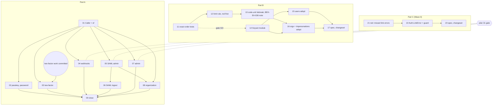

# Plan 40: Residue: (A) finish `CurrentUser`, a domain caller for the admin tier · (B) a keyset page module · (C) the CLI's link-error mirror

| Property | Value |
|---|---|
| Source | Architecture review 2026-11-09, batch 4, candidate 10 (three residual candidates bundled as one plan, in the style of plan 30) |
| Strength | **A: Worth exploring** (no bug; a stated rule, GC-003, bypassed at 17 handler sites and 43 admin-tier sites). **B: Speculative** (no wire-visible bug; two in-process defects by reading; module behind a gate whose default is NO-GO). **C: Strong** (live spec violation of BEH-EA-201 by reading, tiny fix) |
| Dependency category | A: **in-process** (TypeScript interfaces only; no I/O seam moves). B: **local-substitutable** (memory and SQL adapters, SQLite and Postgres). C: **in-process** (`@awthaq/core` and `@awthaq/cli`) |
| Wave / position | C: Wave 0, any time, ships alone. B: tickets 11–13 Wave 0; 14–17 only if B's gate opens. A: Wave 1 onwards, independent of every batch-4 plan except plan 31 (mutual rebase, §8) and the uncommitted two-factor work (ticket 03 only) |
| Touched packages | A: `core`, `passkey`, `password`, `two-factor`, `webhooks`, `saml`, `admin`, `organization`, `server` (one test moves), `scim` (test helper), `docs/`, `spec/`. B: `admin`, `organization` (+ `ports`, `sql`, `core` if the gate opens). C: `core`, `api`, `cli`, `spec/` |
| Wire change | **A: none on HTTP.** In-process interfaces change (breaking for a host that calls a domain method directly; changeset with `Migration:`). **B: none.** Cursor bytes are unchanged; an in-process `limit` outside 1..200 is normalised (ticket 12). **C: CLI output only.** `awthaq doctor` reports three (four with Q8) more link errors as `link-<code>` findings (exit 3) instead of failing `ConfigUnavailable` (exit 9); every other command fails `LinkProblem` instead of `ConfigUnavailable` (same exit 9, different `--json` tag) |
| ADRs | A amends [ADR-EA-042](../../spec/decisions/042-credential-resolution-module.md) decision 9 (revision 1.2). B: none (BEH-EA-036 *As shipped* note). C: none (BEH-EA-201 *Implementation* note). ADR-EA-059 and BEH-EA-374–376 are **not used** (no new decision outside ADR-EA-042, no new behaviour) |
| Tickets | `tickets/NN-*.md`: A is 01–09, B is 11–17, C is 21–23 (19 tickets) |
| Verified at | `architecture/deepening-plans-2` @ `04fa3526`, 2026-11-09. The working tree carries someone else's uncommitted edits in `packages/two-factor/src/{TwoFactor,TwoFactorStore}.ts`, `packages/roles/src/{Roles,RoleAssignments}.ts`, `packages/qadi/src/UserClaims.ts` and `.changeset/plugin-ddl-locality.md` (the "plugin DDL locality" work). Every `file:line` below is from that tree; the two-factor diff touches only imports and the `migrations:` field (`TwoFactor.ts:35`, `:59`, `:427-437`), not the handler lines this plan cites. Effect `^4.1.2` (catalog) |

Conventions: everything in [`.planning/README.md` § Shared conventions](../README.md#shared-conventions-apply-to-every-plan) and [`.planning/IMPLEMENTING.md`](../IMPLEMENTING.md) applies. No `as` in library source (`satisfies` is allowed), no return-type annotations on new Effect or Layer consts, type-system first, replace-don't-layer, spec + traceability + BDD + changeset with `Migration:` for every package-visible change. Vocabulary: module, interface, implementation, depth, deep, shallow, seam, adapter, leverage, locality.

---

## 0. How to read this plan

The three parts share a plan because each is the residue of an earlier plan (A of plan 11 and plan 04 Q7, B of the admin listings of plans 13 and 25, C of plan 29 F4). They share no file and no ticket, and each has its own gate:

| | Part A | Part B | Part C |
|---|---|---|---|
| Problem | `CurrentUser.current` re-brands the caller once (GC-003), but 17 handlers re-brand `principal` again by hand, and four admin-tier modules take the wire `Api.UserPrincipal` and re-brand it 43 times inside | One keyset recipe (cursor, base64url JSON wire schema, `limit + 1`, in-memory "follows" predicate, SQL tuple predicate) copied across three listings and six adapter bodies | `packages/cli/src/Config.ts:109-122` mirrors `Auth.make`'s link-error tags by hand and misses three (four) of them |
| Deepened module | `CurrentUser` gains `Caller` and `of`: the one place a principal becomes a domain caller | `Keyset` in `@awthaq/ports` (only if the gate opens) | `Auth.LinkError` + `Auth.isLinkError` in core; the CLI keeps no list |
| Gate default | **GO** (§1.A.1) | **NO-GO for the module**; tickets 11–13 land either way (§1.B.1) | **GO** (§1.C.1) |
| Lands even if NO-GO | ticket 01 (the `Caller` type is useful alone) | tickets 11 (order-asserting tests), 12 (limit rule), 13 (tiebreak, spec note) | — |

Sections 1–10 split into A/B/C wherever the parts differ.

---

## 1. Summary, goals, non-goals

### 1.A Part A: finish `CurrentUser`; admin-tier modules take a domain caller

#### 1.A.1 Go/no-go gate

**Evidence for** (all measured, §2.A):
1. GC-003 (`packages/core/src/CurrentUser.ts:3-6`) says the principal is re-branded in one place. 17 user-tier handlers destructure `principal` from `CurrentUser.current` and call `Users.UserId(principal.ref.id)` again: passkey 9 (`Passkey.ts:300-432`), password 3 (`Password.ts:491-526`, also re-branding `Sessions.SessionId(principal.sessionId)` 3 times), two-factor 5 (`TwoFactor.ts:334-377`). The domain interfaces then take `sessionId: string` and re-brand it a third time (`Passkey.ts:853`, `:1232`, `TwoFactor.ts:490`).
2. Four modules take the wire type `Api.UserPrincipal` (110 `caller: Api.UserPrincipal` parameters) and read `caller.ref.id` 43 times: admin 28 (10 `Admin.ts`, 13 `internal/AdminGate.ts`, 5 `AdminAccounts.ts`), saml 4, webhooks 5, organization 6.
3. The re-brand is a nominal brand with no runtime check, so each hand copy is a place where a wrong field (`ref.id` of `actingAs`, say) type-checks.

**Evidence against:** no live bug; every hand copy reads the right field today. The value is locality (one re-brand) and an interface that cannot be handed a wire principal, not a fix.

**Default: GO.** NO-GO if ticket 01's `Caller` cannot carry what admin needs (`actingAs`) without the wire principal: then ship ticket 01 alone and close the rest.

#### 1.A.2 What plan 04 Q7 resolved, and what the domain caller is

Plan 04 "Decisions taken" Q7 (`.planning/04-organization-system-modules/PLAN.md:1550`, phase 9 note `:1571`): **`Actor` lives in `@awthaq/organization` (`OrganizationActor.ts`); a core `Actor` and its unification with `ErasureInitiator` were not done, "no caller needs it".** Plan 30 kept it (`.planning/30-speculative-followups/PLAN.md:255`, `:1033`).

The domain caller is therefore **not** that `Actor`, and it is narrower than it:

| | `OrganizationActor.Actor` | `CurrentUser.Caller` (this plan) |
|---|---|---|
| Answers | who performed a system operation (audit, hook taps) | who is asking, as a verified signed-in user |
| Used for authorization | never (`OrganizationActor.ts:3-6`) | yes: it is what a gate reads |
| Cases | `User`, `Directory`, `IdentityProvider`, `PlatformAdmin`, `Application` | one: a user with a session |
| Lives in | organization (Q7) | core, beside `CurrentUser.current` |
| Relation | `access.ts` mints `Actor.User` *from* a `Caller` (`actorOf`) | — |

Making the caller the `Actor` would re-open Q7 and would let a `Directory` or `Application` actor reach a gate that only knows users. Recommended in §10 Q1; recorded in ADR-EA-042 decision 9 (revision 1.2).

#### 1.A.3 Goals

1. `CurrentUser.Caller` (`userId: Users.UserId`, `sessionId: Sessions.SessionId`, `actingAs: Option<Sessions.ActingAs>`) and `CurrentUser.of(principal)`: the only `Users.UserId(principal.ref.id)` in user-tier code.
2. Every user-tier handler reads `userId`/`sessionId` from `CurrentUser.current`; passkey and two-factor take `Sessions.SessionId`, not `string`.
3. The admin-tier modules (`Admin`, `AdminAccounts`, `AdminTenants`, the admin gate, `SamlAdmin`, `Saml.logout`, `Webhooks` admin) and `Organization`'s authorized interface take `CurrentUser.Caller`.
4. `CurrentUser.current` stops handing out the wire principal (ticket 09).

#### 1.A.4 Non-goals

- The gate's own logic, config read or consolidation across admin, SAML and webhooks: **plan 31 owns it.** This plan changes only the type of the gate's caller parameter and `caller.ref.id` → `caller.userId`.
- Principal-any readers that are not user-tier handlers: `device-authorization` (`DeviceAuthorization.ts:478-486`, optional tier), qadi's reauth obligation (`Resolvers.ts:260-270`), roles' subject resolver (`Roles.ts:210`, uncommitted WIP), qadi `SubjectResolver.ts:100`, `jwt`. §10 Q2.
- A core `Actor` (Q7 stands).
- Path params that carry a session id (`Admin.ts:819`, `:825`, `:972`): wire input, re-branded at the trust edge on purpose.

### 1.B Part B: a keyset page module

#### 1.B.1 Go/no-go gate

**Evidence for a module:**
1. Three listings, one recipe: users (ascending `createdAt, id`), organizations (ascending), impersonation episodes (descending `startedAt, id`). Six adapter bodies + one domain page assembly + three wire cursor schemas (§2.B.1). The copies differ only in column, direction and extra filters (tenant, `active`): not "too different".
2. Two in-process defects by reading (§2.B.3): `ImpersonationRecords.list` and `AdminTenants.listOrganizations` do not validate `limit` (`Users.list` does), so a fractional limit makes the SQL adapter fail while memory answers, and `limit: 0` answers an empty page with no cursor on both; the organization memory adapter sorts its tiebreak with `localeCompare` but filters with `>`.
3. The existing order tests compare as sets for two of three listings (§2.B.2), so a descending drift like plan 24's `members?sortDirection=desc` would pass them.

**Evidence against:**
1. No wire-visible bug: the wire `LimitSchema` (`AdminApi.ts:161-163`) bounds `limit` to 1..200, ids are lowercase UUIDv7 so `localeCompare` and `>` agree, and the tie cases already run on memory, SQLite and Postgres (`StoreContract.ts:1456-1477`, `ImpersonationRecords.ts` contract `:469-495`, `OrganizationRecords.ts` contract `:281-305`).
2. Each copy is ~10 lines. The module would touch five packages for ~70 lines of deduplication, and no fourth keyset listing is planned (plan 32's SCIM lists page by `startIndex`/`count`, RFC 7644 §3.4.2.4, not by keyset).

**Default: NO-GO for the module (tickets 14–17); tickets 11–13 land either way.** Ticket 11 *is* the gate: if any of its order-asserting cases goes red on an adapter, the module is GO, because then the copies have demonstrably drifted. §10 Q4.

#### 1.B.2 Goals

1. Every keyset listing is tested for its *exact* order across every page size, on memory, SQLite and Postgres (ticket 11).
2. Every keyset listing normalises `limit` the way `Users.list` does (ticket 12); the organization memory adapter compares ids by code unit (ticket 13).
3. If GO: one `Keyset` module holds the order, the follows predicate, the SQL fragment, the page assembly, the limit rule and the cursor codec (tickets 14–17).

#### 1.B.3 Non-goals

- Offset-paged listings (`MembershipRecords.list`, plan 24 R1/R2) and SCIM paging.
- `SessionStoreSql.listLive`'s internal page loop (`SessionStoreSql.ts:555-575`): it has no wire cursor and BEH-EA-036 pins its own bound.
- Changing cursor bytes on the wire.
- Postgres collation: memory/SQLite compare ids by code unit, Postgres by the column collation. With UUIDv7 ids they agree; each adapter is self-consistent in any case (§2.B.4).

### 1.C Part C: the CLI's link-error mirror

#### 1.C.1 Go/no-go gate

**Evidence for:** BEH-EA-201 requires `doctor` to "report every plugin-graph linking problem". `linkErrorCodes` (`Config.ts:109-122`) holds 11 tags; the composition path can raise 14 tagged errors plus one untagged (§2.C.1). The three misses come out as `ConfigUnavailable`: `doctor` exits 9 with "could not load the configuration module" instead of exiting 3 with a `link-<code>` finding. Plan 29 F4 fixed five such misses; the list drifts because nothing ties it to core.

**Evidence against:** none found. **Default: GO.**

#### 1.C.2 Goals

1. Core exports `Auth.LinkError` (a union) and `Auth.isLinkError` (a guard over a tag set the compiler checks against the union).
2. The CLI keeps no list: `asLoadFailure` uses `Auth.isLinkError`.
3. A test fails when a new link error is added without the tag set knowing (type-level trigger table + source scan).

#### 1.C.3 Non-goals

- Turning authoring-time plain `Error`s outside the composition path into link errors (`qadi` `reauth()`, `Resolvers.ts:190`; `TenantScope.ts:90`, which only runs at DDL emission after `checkTenancy` has validated the same identifiers).

### 1.D Plan-wide `must_haves`

```yaml
must_haves:
  truths:
    - "Outside packages/core/src/CurrentUser.ts, no user-tier handler or admin-tier module re-brands a principal: `Users.UserId(principal.ref.id)` and `caller.ref.id` appear nowhere in passkey, password, two-factor, admin, saml, webhooks or organization src"
    - "Admin, AdminAccounts, AdminTenants, SamlAdmin, Saml.logout, the Webhooks admin operations and Organization's authorized interface take CurrentUser.Caller, never Api.UserPrincipal"
    - "Impersonating, stopping an impersonation and the self-ban/self-impersonation refusals behave exactly as before (BEH-EA-209..218 tests unchanged and green)"
    - "Every keyset listing (users, organizations, impersonations) returns its exact declared order for every page size on memory, SQLite and Postgres"
    - "An in-process limit outside 1..200, fractional or non-finite, is normalised identically by every keyset listing and both adapters"
    - "awthaq doctor reports UserFields/InvalidDeclaration, ConflictingDependsOn and SealedColumn/InvalidDeclaration as link-<code> findings with exit 3"
    - "Adding a TaggedError to the composition path without adding it to Auth.LinkError fails `pnpm typecheck` or `npx vitest run packages/core/test/LinkErrors.test.ts`"
  artifacts:
    - path: packages/core/src/CurrentUser.ts
      provides: "Caller, of, current"
      contains: "export interface Caller"
    - path: packages/core/test/CurrentUser.test.ts
      provides: "GC-003 at the module's own interface (moved from server/test/AuthHttp.test.ts)"
    - path: packages/core/src/Auth.ts
      provides: "LinkError union, isLinkError guard"
      contains: "export const isLinkError"
    - path: packages/core/test/LinkErrors.test.ts
      provides: "exhaustive trigger table + composition-path source scan"
    - path: packages/admin/test/contract/ImpersonationRecords.ts
      provides: "exact-order traversal, descending, every page size"
    - path: packages/organization/test/contract/OrganizationRecords.ts
      provides: "exact-order traversal, ascending, every page size"
  key_links:
    - from: packages/cli/src/Config.ts
      to: packages/core/src/Auth.ts
      via: "asLoadFailure classifies with Auth.isLinkError"
      pattern: "Auth\\.isLinkError"
    - from: packages/admin/src/Admin.ts
      to: packages/core/src/CurrentUser.ts
      via: "handlers pass `yield* CurrentUser.current` (a Caller) into AdminShape methods"
      pattern: "CurrentUser\\.Caller"
    - from: packages/organization/src/internal/access.ts
      to: packages/organization/src/OrganizationActor.ts
      via: "actorOf builds Actor.User from Caller.userId/sessionId"
      pattern: "actorOf = \\(caller: CurrentUser\\.Caller\\)"
```

---

## 2. Verified current state

### 2.1 Re-measurement commands (run from the repo root; baselines at `04fa3526`)

```bash
# ---- Part A ----
# A1: hand re-brands of the principal in user-tier handlers (baseline: two-factor 5, passkey 9, password 3, core 1)
rg -c 'Users\.UserId\(principal\.ref\.id\)' packages/passkey/src packages/password/src packages/two-factor/src packages/core/src
# A2: wire caller read inside admin-tier modules (baseline total 43: Admin 10, AdminGate 13, AdminAccounts 5, SamlAdmin 4, Webhooks 5, access 2, Organization 4)
rg -c 'caller\.ref\.id' packages/admin/src packages/saml/src packages/webhooks/src packages/organization/src
# A3: wire principal as a parameter (baseline total 110: Admin 13, AdminGate 10, AdminAccounts 3, AdminTenants 4, SamlAdmin 10, Saml 1, SamlSlo 1, Webhooks 11, OrganizationShape 40, access 17)
rg -c 'caller: Api\.UserPrincipal' packages/admin/src packages/saml/src packages/webhooks/src packages/organization/src
# A4: domain interfaces re-branding a session id they were handed as string (baseline 3: Passkey.ts:853, :1232, TwoFactor.ts:490)
rg -n 'Sessions\.SessionId\(sessionId\)' packages/passkey/src packages/two-factor/src
# A5: readers of the wire principal through CurrentUser (baseline: destructure 38, `.principal` 17, OrganizationHandlers 1)
rg -c '\{ principal(: caller)? \} = yield\* CurrentUser\.current' packages/*/src
rg -c 'CurrentUser\.current\)\.principal' packages/*/src
rg -n '\(\{ principal \}' packages/organization/src/OrganizationHandlers.ts
# A6: the uncommitted two-factor work (non-empty until it is committed)
git status --porcelain packages/two-factor/src
# ---- Part B ----
rg -n 'limit \+ 1' packages/ports/src/UserStore.ts packages/sql/src/UserStoreSql.ts packages/admin/src/ImpersonationRecords.ts packages/admin/src/AdminTenants.ts   # baseline 9 lines
rg -n 'input\?\.limit \?\? DEFAULT_PAGE_SIZE' packages/admin/src     # baseline 3: ImpersonationRecords.ts:451, :761, AdminTenants.ts:198
rg -c 'localeCompare' packages/organization/src/OrganizationRecords.ts   # baseline 1 (:218)
rg -c 'StringFromBase64Url' packages/admin/src/AdminApi.ts packages/admin/src/AdminTenantsApi.ts   # baseline 2 + 1
# ---- Part C ----
rg -n 'TaggedError\(' packages/core/src/Auth.ts packages/core/src/AuthPlugin.ts packages/core/src/UserFields.ts packages/sql/src/SealedColumn.ts   # 14 classes
rg -c 'linkErrorCodes' packages/cli/src/Config.ts   # baseline 2
rg -n 'throw new Error' packages/api/src/SessionLifecycle.ts   # baseline 1 (:124), reached from Auth.ts:1086
```

### 2.A Part A

#### 2.A.1 `CurrentUser` today

`packages/core/src/CurrentUser.ts:19-32`: `current` reads `Api.CurrentPrincipal`, dies `Defects/InvariantViolation` (`NonUserPrincipal`) on a non-`User`, and returns `{ principal, userId, sessionId }`. GC-003 is a **code-level rule id**, not a spec id: it appears in `CurrentUser.ts:3,15`, `OrganizationHandlers.ts:29`, `server/src/Session.ts:38,95` and the test `server/test/AuthHttp.test.ts:687-711`. Its spec anchors are ADR-EA-042 decision 9 (`spec/decisions/042-credential-resolution-module.md:41`), the glossary entry `CurrentPrincipal` (`spec/glossary.md:67`) and `docs/plugin-authoring.md:210` (which documents `const { principal, userId, sessionId } = yield* CurrentUser.current`).

Readers that already use the domain fields: `server/src/Account.ts` (3), `server/src/Session.ts` (6), `api-key/src/ApiKey.ts` (8).

#### 2.A.2 User-tier handlers that re-brand by hand

| File | Lines | Sites | Domain parameter |
|---|---|---|---|
| `packages/passkey/src/Passkey.ts` | 300-303, 307-310, 318-321, 359-360, 364-365, 375-377, 388-389, 418-421, 429-432 | 9 `Users.UserId(principal.ref.id)`, 5 raw `principal.sessionId` | `PasskeyShape` takes `sessionId: string` (`:180`, `:187`, `:196`, `:218`, `:222`) and re-brands at `:853`, `:1232` |
| `packages/password/src/Password.ts` | 491-496, 509-512, 522-525 | 3 `Users.UserId`, 3 `Sessions.SessionId` | `currentSessionId: Sessions.SessionId` (`:330`, `:374`, `:395`): already branded |
| `packages/two-factor/src/TwoFactor.ts` | 334-337, 346-348, 354-357, 366-369, 375-377 | 5 `Users.UserId`, 3 raw `principal.sessionId` | `TwoFactorShape` takes `sessionId: string` (`:101`, `:144`, `:150`) and re-brands at `:490` |

#### 2.A.3 Admin-tier modules on the wire principal

| Module | `caller: Api.UserPrincipal` | `caller.ref.id` | Other fields read |
|---|---|---|---|
| `admin/src/Admin.ts` (shape `:56-194`, impl `:740-990`) | 13 | 10 | `caller.sessionId` 5 (`:300`, `:930-939`), `caller.actingAs` 2 (`:863`, `:925`), `caller.ref.type` 1 (`:873`) |
| `admin/src/internal/AdminGate.ts` (**plan 31's**) | 10 | 13 | — |
| `admin/src/AdminAccounts.ts` | 3 | 5 | — |
| `admin/src/AdminTenants.ts` | 4 | 0 | — (passes `caller` to the gate) |
| `saml/src/SamlAdmin.ts` (`authorize` `:134-153`, `adminId` `:155`) | 10 | 4 | — |
| `saml/src/Saml.ts:176-179` (`logout`) + `SamlSlo.ts:178-184` | 1 + 1 | 0 | `caller.sessionId` 1 |
| `webhooks/src/Webhooks.ts` (shape `:70-137`, `authorize` `:526-542`, `adminId` `:559`, `createdBy` `:633`) | 11 | 5 | — |
| `organization/src/OrganizationShape.ts` | 40 | 0 | — |
| `organization/src/internal/access.ts` (`callerId`/`actorOf` `:93-98`) | 17 | 2 | `caller.sessionId` 1 |
| `organization/src/Organization.ts` (`:172`, `:333`, `:339`, `:372`) | 0 | 4 | — |
| `organization/src/OrganizationActiveContext.ts:33-36` (`sessionOf`) | 1 | 0 (`principal.ref.id`) | `sessionId` |
| `organization/src/OrganizationHandlers.ts:29-32` | 1 | 0 | maps `({ principal }) => principal` |

`caller.ref.type` is always `"user"` for a `UserPrincipal`: both producers set it (`server/src/Credentials.ts:65`, `jwt/src/Jwt.ts:233`), and `Sessions.refuseSelfActingAs` (`core/src/Sessions.ts:251-257`) already assumes `"user"`.

Tests that hand-build a wire caller for these modules (one helper each, A07/A08 change only the helper): admin `Admin.test.ts:54`, `AdminAccounts.test.ts:99`, `AdminConfig.test.ts:28`, `AdminGate.test.ts:96`, `AdminGate.types.test.ts:12`, `AdminTenants.test.ts:30`, `AdminTier.test.ts:88`, `AdminUsers.test.ts:36`; saml `support.ts:104`, `SamlAdmin.test.ts:37,181`, `SamlConnections.test.ts:39`, `SamlSlo.test.ts:50`; webhooks `support.ts:176`, `WebhooksAdmin.test.ts:46,387`; organization `Organization.test.ts:33`, `OrganizationHooks.test.ts:47`, `OrganizationQadi.test.ts:46`, `OrganizationQadiPolicy.test.ts:47`, `OrganizationSql.test.ts:30`, `AuthorizationMatrix.test.ts:58,137`, `Access.types.test.ts:37-82`; scim `support.ts:61`.

#### 2.A.4 Evidence corrections (Part A)

- "GC-003 (grep the spec)": **not in `spec/`**. It is a code-level id; the spec carries the rule as ADR-EA-042 decision 9 and the glossary's `CurrentPrincipal` entry (§2.A.1).
- "About 20 handlers": **17** (9 + 3 + 5). "password 6 sites": 6 re-brand *calls* in 3 handlers.
- "About 43 `caller.ref.id` sites": **43, exact**, but 13 of them are in `AdminGate.ts`, which plan 31 owns.
- "`current` already returns `userId` and `sessionId`": true; it also returns the wire `principal`, which is what every bypass reads. Removing it is ticket 09.
- Plan 04 Q7 did **not** produce a core `Actor` (§1.A.2).

#### 2.A.5 Live bugs

None. Part A is a refactor of a rule that holds today by care, not by construction.

### 2.B Part B

#### 2.B.1 Where the recipe lives

| Piece | Users (asc `createdAt, id`) | Organizations (asc `createdAt, id`) | Impersonations (desc `startedAt, id`) |
|---|---|---|---|
| Cursor type | `ports/src/UserStore.ts` `UserCursor`; `core/src/Users.ts:378` | `OrganizationRecords.ts:97` (inline), `AdminTenants.ts:38` | `ImpersonationRecords.ts:87` `ImpersonationCursor` |
| Wire schema | `AdminApi.ts:166-172` `UserCursorSchema` | `AdminTenantsApi.ts:48-54` `OrganizationCursorSchema` | `AdminApi.ts:151-157` `CursorSchema` |
| Memory order + follows | `UserStore.ts:183-186` `byCreation`, `:359-371` | `OrganizationRecords.ts:211-232` (sort by `localeCompare`, filter by `>`) | `ImpersonationRecords.ts:186-199` `newestFirst`, `isBeforeCursor`; `:446-460` |
| SQL predicate | `UserStoreSql.ts:176-192` (`>` OR `=` AND `id >`) | `OrganizationRecords.ts:414-427` (row value `("createdAt", id) > (...)`) | `ImpersonationRecords.ts:675-696` (`<` OR `=` AND `id <`) |
| `limit + 1` → page | memory `UserStore.ts:372-380`, SQL `UserStoreSql.ts:473-491` | `AdminTenants.ts:195-212` (the store returns rows; the domain assembles) | `ImpersonationRecords.ts:201-212` `toPage` (both adapters) |
| Limit rule | `Users.ts:558-561` `listLimit` (trunc, clamp 1..200, non-finite → 50) | none (`AdminTenants.ts:198`) | none (`ImpersonationRecords.ts:451`, `:761`) |

`core/src/Users.ts:815-826` (the brief's first site) is `Users.list`, which only delegates to `UserStore.listPage`; the copies are in the two adapters.

#### 2.B.2 What the existing tests assert

| Listing | Test | Asserts exact order across pages? |
|---|---|---|
| Users | `packages/test/src/StoreContract.ts:1456-1477` (memory, SQLite, Postgres) | **yes** (`["z","b","c","a"]`, one tie) |
| Organizations | `organization/test/contract/OrganizationRecords.ts:281-305` | **no**: `sameMembers` |
| Impersonations | `admin/test/contract/ImpersonationRecords.ts:469-495` | **no**: `[...seen].sort()` |
| Organizations via the domain | `admin/test/AdminTenants.test.ts` | membership only |

A descending drift (plan 24 found `members?sortDirection=desc` returned ascending over SQL) would pass the impersonation contract today.

#### 2.B.3 Findings

- **B-F1 (by reading; ticket 12 reproduces).** `ImpersonationRecords.list` uses `input?.limit ?? DEFAULT_PAGE_SIZE` with no validation (`:451` memory, `:761` SQL). A fractional `limit` (2.5) answers a page on memory (`slice` truncates) and fails on SQL (`listQuery`'s `limit: Schema.Int`, `:681`). `limit: 0` answers `{ items: [], nextCursor: None }` on both while rows remain. A negative limit reaches `LIMIT ${limit + 1}`: SQLite reads a negative `LIMIT` as "no limit", Postgres refuses it. The interface doc says "Never loads more than `limit + 1` rows" (`:156`). In-process callers only: the wire bounds `limit` (`AdminApi.ts:161-163`).
- **B-F2 (by reading; ticket 12 reproduces).** `AdminTenants.listOrganizations` (`:198-201`) has the same gap; `OrganizationRecords.listPage`'s SQL request is `limit: Schema.Number` (`:418`), so a fractional limit reaches `LIMIT`.
- **B-F3 (by reading; not reachable).** The organization memory adapter sorts the tiebreak with `a.id.localeCompare(b.id)` (`OrganizationRecords.ts:218`) but filters with `row.id > cursor.id` (`:227`). They agree for lowercase UUIDv7 ids (`:134`), the only ids `create` makes. A locale-dependent compare in an adapter whose SQL twin uses byte/collation order is still a drift; ticket 13 makes it code-unit.
- No off-by-one at a tie, no descending drift and no unvalidated wire cursor found: each wire cursor is a Schema transform (base64url → JSON → `DateTimeUtcFromString` + `String`), so a tampered cursor is a 400 and a forged-but-valid one only moves the position inside rows the tenant predicate already scopes (`ImpersonationRecords.ts:687`).

#### 2.B.4 Evidence corrections (Part B)

- "`Users.ts:815-826`" is a delegation, not a copy (§2.B.1).
- "`ImpersonationRecords.ts:195-212, 675-692`": the memory half is `:186-212` plus `:446-460`; the SQL half `:675-696` plus `:760-776`.
- "Each copy has … an in-memory 'is before' predicate": only impersonations is "before" (descending); the other two are "after".
- Postgres orders `id` by the column's collation, memory/SQLite by code unit. Each adapter is self-consistent, so paging is correct on each; only the *cross-adapter* order could differ, and only for ids outside lowercase hex (none today).

### 2.C Part C

#### 2.C.1 Every link error the composition path raises

The configuration module is evaluated by `import()` (`cli/src/Config.ts:238-239`, `catch: asLoadFailure`) or run as an Effect (`:143`, `:161`). What can throw synchronously while it is evaluated:

| Tag | Thrown at | In `linkErrorCodes`? |
|---|---|---|
| `CircularPluginDependency` | `Auth.ts:698` | yes |
| `EmptyPluginTuple` | `Auth.ts:1105`, `:1147`, `:1196` | yes |
| `GroupIdConflict` | `Auth.ts:1115` | yes |
| `RouteConflict` | `Auth.ts:1134` | yes |
| `LinkerInvariantViolation` | `Auth.ts:172`, `:872` | yes |
| `UndeclaredTableDependency` | `Auth.ts:720` | yes |
| `Auth/TenancyDeclarationInvalid` | `Auth.ts:797-856` | yes |
| `Auth/SealedColumnDeclarationInvalid` | `Auth.ts:759-771` | yes |
| `Auth/MigrationDeclarationInvalid` | `Auth.ts:783` | yes |
| `UserFieldConflict` | `UserFields.ts:186` (via `Auth.ts:939`) | yes |
| `Auth/EventTagConflict` | `Auth.ts:987` | yes |
| **`UserFields/InvalidDeclaration`** | `UserFields.ts:148`, `:155`, `:162`, reached at plugin definition (`AuthPlugin.ts:538`) and in `Auth.make` (`Auth.ts:921`, `:939`) | **no** |
| **`ConflictingDependsOn`** | `AuthPlugin.ts:877` (`AuthPlugin.layer`, at definition) | **no** |
| **`SealedColumn/InvalidDeclaration`** | `sql/src/SealedColumn.ts:60` (`SealedColumn.column`, at definition) | **no** |
| *(untagged)* "declares more than one session lifecycle" | `api/src/SessionLifecycle.ts:124`, reached from `Auth.ts:1086` (`composeApi`) | cannot be (plain `Error`) |

Not link errors: `TenantScope.ts:90` (DDL emission, after `checkTenancy`), `HookPointFrozen`, `SlotConflict`, `SlotsFrozen` (`Layer` build, not module evaluation).

#### 2.C.2 What a miss costs (`cli/src/CliErrors.ts:20-29`, `:160-166`; `cli/src/Cli.ts:135`; `Doctor.ts:87-88`)

| Command | A listed link error | A missed one |
|---|---|---|
| `awthaq doctor` | report with finding `link-<code>`, exit **3** (`doctorFindings`) | no report, `ConfigUnavailable` "could not load the configuration module", exit **9** |
| any other command | `LinkProblem`, exit 9 | `ConfigUnavailable`, exit 9 (`--json` tag differs) |

#### 2.C.3 Evidence corrections (Part C)

- "Same exit code": true for every command **except `doctor`** (3 vs 9, and the report is lost).
- "Possibly more": one more, the untagged `SessionLifecycle.inventory` error (§10 Q8).

#### 2.C.4 Live bugs

- **C-F1 (by reading; ticket 21 reproduces).** `doctor` does not report `UserFields/InvalidDeclaration`, `ConflictingDependsOn` or `SealedColumn/InvalidDeclaration` (BEH-EA-201 violation).
- **C-F2 (by reading; ticket 22 covers if Q8 = yes).** An endpoint declaring two session lifecycles fails composition with an untagged error.

---

## 3. Target design

### 3.A Part A: `CurrentUser.Caller`

The seam is `CurrentUser`. Behind it: the `User` check, the two brands and the impersonation marker. Everything above it sees a domain caller.

```ts
// packages/core/src/CurrentUser.ts
export interface Caller {
  readonly userId: Users.UserId;
  readonly sessionId: Sessions.SessionId;
  /** BEH-EA-211: the administrator this session acts for, when it was minted with `actingAs`. */
  readonly actingAs: Option.Option<Sessions.ActingAs>;
}
/** GC-003: the one re-brand of a verified user principal. */
export const of: (principal: Api.UserPrincipal) => Caller;
/** GC-003: the user-tier caller. Dies `NonUserPrincipal` on any other principal. */
export const current: Effect.Effect<Caller, never, Api.CurrentPrincipal>;   // inferred, not annotated
```

Ticket 01 keeps `principal` on `current`'s result (`{ ...of(principal), principal }`) so later tickets migrate one package at a time; ticket 09 removes it. This is a migration step inside the plan, not a second interface: the plan's acceptance requires it gone.

Interfaces after the change (examples):

```ts
// passkey
readonly registerOptions: (userId: Users.UserId, sessionId: Sessions.SessionId) => Effect.Effect<…>;
// admin
readonly impersonate: (input: { readonly caller: CurrentUser.Caller; readonly targetUserId: Users.UserId; readonly reason: string }) => …;
readonly banUser: (caller: CurrentUser.Caller, userId: Users.UserId, input: …) => …;
// webhooks, SAML, organization: `caller: CurrentUser.Caller` in place of `caller: Api.UserPrincipal`
readonly logout: (caller: CurrentUser.Caller, input: { readonly callbackURL?: string | undefined }) => …;
// organization/internal/access.ts
const actorOf = (caller: CurrentUser.Caller) => OrganizationActor.ActorSchema.cases.User.make({ userId: caller.userId, sessionId: caller.sessionId });
```

`Admin.impersonate` builds `actingAs: { type: "user", id: caller.userId }` and refuses a nested impersonation with `Option.isSome(caller.actingAs)`; `stopImpersonating` refuses `Option.isNone(caller.actingAs)`.

Module layout after A: no new file in `src`; `packages/core/test/CurrentUser.test.ts` is new. `callerId` in `access.ts` and `adminId` in `SamlAdmin.ts`/`Webhooks.ts` are deleted (they become `caller.userId`); `OrganizationActiveContext.sessionOf` takes a `Caller`.

**Alternatives rejected.**
- (a) The caller is `OrganizationActor.Actor`: re-opens Q7; four of its five cases cannot reach a gate (§1.A.2).
- (b) Domain methods take `userId` (and `sessionId`) positionally, as `ApiKey` does (`ApiKey.ts:451-522`): fine for webhooks and SAML admin, but `Admin` needs the session and the impersonation marker too, so the admin tier would mix two conventions.
- (c) Keep `principal` inside `Caller`: the bypass (`caller.principal.ref.id`) stays one property away.

### 3.B Part B: `Keyset` (only if the gate opens)

The seam is a keyset order. Behind it: the comparison (code unit on `id`, direction-symmetric), the follows predicate, the SQL fragment and ORDER BY, the `limit + 1` page assembly, the limit rule and the cursor codec. Home: `@awthaq/ports`, beside the memory adapters that need it, because ports already imports `effect/sql` (`ports/src/SqlTransaction.ts`) and cannot depend on `@awthaq/sql` (README reconciliation "Tenant-stamp rule").

```ts
// packages/ports/src/Keyset.ts
export interface Position { readonly at: DateTime.Utc; readonly id: string }
export interface Order<Row> {
  readonly column: string;                    // "createdAt" | "startedAt"
  readonly direction: "asc" | "desc";
  readonly position: (row: Row) => Position;
}
export const make: <Row>(order: Order<Row>) => {
  readonly compare: (a: Row, b: Row) => number;
  readonly follows: (row: Row, after: Position) => boolean;
  readonly fragment: (sql: SqlClient.SqlClient, after: Position) => Statement.Fragment;
  readonly orderBy: (sql: SqlClient.SqlClient) => Statement.Fragment;
  readonly page: <C>(rows: ReadonlyArray<Row>, limit: number, cursorOf: (row: Row) => C) => { readonly items: ReadonlyArray<Row>; readonly next: Option.Option<C> };
};
export const limit: (requested: number | undefined, bounds?: { readonly fallback: number; readonly max: number }) => number; // trunc, clamp 1..max, non-finite → fallback
export const cursor: <F extends Schema.Struct.Fields>(fields: Schema.Struct<F>) => Schema.Codec<…>;  // base64url(JSON(fields)); fields declared in today's key order
```

Wire bytes stay identical because `cursor(Schema.Struct({ createdAt: Schema.DateTimeUtcFromString, id: Schema.String }))` encodes the same JSON with the same key order; ticket 14 pins that with a byte-equality test against today's three schemas.

Alternatives rejected: (a) one module per package (three shallow modules); (b) a SQL-side module in `@awthaq/sql` beside `TenantScoped` (the ports memory `UserStore` could not use it); (c) generic `fetchPage` that runs the query (each adapter's query carries its own extra predicates: tenant, `active`).

### 3.C Part C: `Auth.LinkError`

```ts
// packages/core/src/Auth.ts
export type LinkError =
  | CircularPluginDependency | EmptyPluginTuple | GroupIdConflict | RouteConflict
  | LinkerInvariantViolation | UndeclaredTableDependency | TenancyDeclarationInvalid
  | SealedColumnDeclarationInvalid | MigrationDeclarationInvalid | EventTagConflict
  | UserFields.InvalidDeclaration | UserFields.UserFieldConflict
  | AuthPlugin.ConflictingDependsOn | SealedColumn.InvalidDeclaration
  | SessionLifecycle.Conflict;                       // only if Q8 = yes (ticket 22 task 3)
const linkErrorTags = { CircularPluginDependency: true, /* … one key per member … */ } satisfies Record<LinkError["_tag"], true>;
export const isLinkError: (u: unknown) => u is LinkError;
```

`satisfies Record<LinkError["_tag"], true>` on an object literal rejects a missing tag and an extra one at compile time. The drift that remains possible (a new `TaggedError` thrown on the composition path but not added to the union) is caught by ticket 22's source scan. The CLI:

```ts
// packages/cli/src/Config.ts
const asLoadFailure = (error: unknown): LinkProblem | ConfigUnavailable =>
  Auth.isLinkError(error) ? new LinkProblem({ code: error._tag, message: error.message }) : /* unchanged */;
```

`Config.ts:27` changes `import type { Auth, … }` to a value import of `Auth`. Alternatives rejected: (a) a brand symbol on every link-error class (the same drift moves to "forgot the symbol"); (b) keep the CLI list plus a CLI test enumerating core's exports (the list stays a mirror).

---

## 4. Phased migration

### 4.1 Waves

```
Wave numbers in ticket front matter are these phase waves; inside a wave, `depends_on` orders the tickets.

Wave 0 (hotfixes, independent, any order)
  C  21 ─► 22 ─► 23
  B  11 ─► 12 ─► 13
Wave 1
  A  01
Wave 2 (parallel; no shared file)
  A  02 (passkey, password)   04 (webhooks)   05 (SAML admin)   07 (admin)
  A  03 (two-factor)  ── ready-for-human until the two-factor work is committed
Wave 3
  A  06 (SAML logout, after 05: Saml.ts)   08 (organization, after 05: saml tests)
Wave 4
  A  09 (close: `current` returns `Caller` only; docs, ADR, changeset)  ── needs 02-08
B gate (after 11): GO only if 11 shows an order drift
  B  14 ─► 15 ─► 17
       └─► 16 (after 13) ─► 17
```

### 4.2 Ticket table

| Ticket | Title | Wave | Depends on | Type | Size | Files |
|---|---|---|---|---|---|---|
| 01 | `CurrentUser.Caller` and `of`; GC-003 test moves to core | 1 | — | tdd | S | `core/src/CurrentUser.ts`, `core/test/CurrentUser.test.ts`, `server/test/AuthHttp.test.ts` |
| 02 | Passkey and password handlers read the domain caller | 2 | 01 | auto | M | `passkey/src/Passkey.ts`, `password/src/Password.ts`, `passkey/test/Passkey.test.ts`, changeset |
| 03 | Two-factor handlers read the domain caller | 2 | 01, two-factor work committed | auto | S | `two-factor/src/TwoFactor.ts`, `two-factor/test/TwoFactor.test.ts` |
| 04 | Webhooks admin takes `CurrentUser.Caller` | 2 | 01 | auto | S | `webhooks/src/Webhooks.ts`, `webhooks/test/support.ts`, `webhooks/test/WebhooksAdmin.test.ts` |
| 05 | SAML admin takes `CurrentUser.Caller` | 2 | 01 | auto | S | `saml/src/SamlAdmin.ts`, `saml/src/Saml.ts`, `saml/test/SamlAdmin.test.ts` |
| 06 | `Saml.logout` takes `CurrentUser.Caller` | 3 | 05 | auto | S | `saml/src/Saml.ts`, `saml/src/SamlSlo.ts`, `saml/test/SamlSlo.test.ts` |
| 07 | Admin, AdminAccounts, AdminTenants and the gate take `CurrentUser.Caller` | 2 | 01 | auto | L | `admin/src/{Admin,AdminAccounts,AdminTenants,internal/AdminGate}.ts` + 8 admin test helpers (split rule waived, §4.3) |
| 08 | Organization's authorized interface takes `CurrentUser.Caller` | 3 | 01, 05 | auto | L | `organization/src/{OrganizationShape,internal/access,Organization,OrganizationHandlers,OrganizationActiveContext}.ts` + 7 organization, 3 saml, 1 scim test helpers (waived, §4.3) |
| 09 | `current` returns `Caller` only; docs, ADR-EA-042 rev 1.2, changeset | 4 | 02, 03, 04, 06, 07, 08 | auto | S | `core/src/CurrentUser.ts`, `docs/plugin-authoring.md`, `spec/glossary.md`, `spec/decisions/042-…md`, `.changeset/current-user-caller.md` |
| 11 | Exact-order traversal tests for every keyset listing (gate evidence) | 0 | — | tdd | M | `organization/test/contract/OrganizationRecords.ts`, `admin/test/contract/ImpersonationRecords.ts`, `admin/test/AdminTenants.test.ts` |
| 12 | Impersonation and organization listings normalise `limit` (red first) | 0 | 11 | tdd | S | `admin/src/ImpersonationRecords.ts`, `admin/src/AdminTenants.ts`, `admin/test/contract/ImpersonationRecords.ts`, `admin/test/AdminTenants.test.ts`, `.changeset/admin-listing-limit.md` |
| 13 | Organization memory adapter: code-unit tiebreak; BEH-EA-036 note | 0 | 12 | auto | S | `organization/src/OrganizationRecords.ts`, `spec/behaviors/05-persistence-stratum.md`, `.changeset/organization-keyset-tiebreak.md` |
| 14 | `Keyset` module in ports (gate GO only) | 2 | 11 (GO) | tdd | M | `ports/src/Keyset.ts`, `ports/src/index.ts`, `ports/test/Keyset.test.ts` |
| 15 | Users adopt `Keyset` | 3 | 14 | auto | S | `ports/src/UserStore.ts`, `sql/src/UserStoreSql.ts`, `core/src/Users.ts` |
| 16 | Organizations and impersonations adopt `Keyset` | 3 | 13, 14 | auto | M | `admin/src/{ImpersonationRecords,AdminTenants,AdminApi,AdminTenantsApi}.ts`, `organization/src/OrganizationRecords.ts` |
| 17 | Keyset spec note, traceability, changeset | 4 | 15, 16 | auto | S | `spec/behaviors/05-persistence-stratum.md`, `spec/traceability.md`, `.changeset/keyset-module.md` |
| 21 | Red: `doctor`/loader classify the three missed link errors | 0 | — | tdd | S | `cli/test/ConfigLoader.test.ts`, 3 new `cli/test/fixtures/*.config.ts` |
| 22 | `Auth.LinkError` + `isLinkError`; CLI keeps no list; exhaustiveness test | 0 | 21 | tdd | M | `core/src/Auth.ts`, `core/test/LinkErrors.test.ts`, `cli/src/Config.ts`, `api/src/SessionLifecycle.ts` (Q8) |
| 23 | BEH-EA-201 note, traceability, changeset | 0 | 22 | auto | S | `spec/behaviors/26-cli.md`, `spec/traceability.md`, `.changeset/cli-link-errors.md` |

### 4.3 Split-rule waivers

Tickets 07 and 08 change one parameter type that every caller and every test helper must follow in the same commit, or `pnpm typecheck` is red. Splitting would need a second, wire-typed overload for one ticket's lifetime, which the replace-don't-layer rule forbids. Each test file changes only its `asCaller`/`admin`/`owner` helper (one hunk: wrap the built `Api.UserPrincipal` in `CurrentUser.of(...)`). Both tickets are three tasks: source, own tests, dependents' tests.

### 4.4 Dependency graph



---

## 5. Test plan

### 5.A Part A

- **New at the interface:** `packages/core/test/CurrentUser.test.ts` (ticket 01): `of` brands `userId`/`sessionId` from `ref.id`/`sessionId`; `actingAs` is `Some({type,id})` when the principal carries it and `None` otherwise; `current` returns the same fields as `of`; `current` dies `Defects/InvariantViolation` `NonUserPrincipal` on an `ApiKeyPrincipal`.
- **Deleted (replace, don't layer):** the `describe("server handler invariants (GC-003/GC-008)")` block in `packages/server/test/AuthHttp.test.ts:687-711` (moved to core). Nothing else: the admin, SAML, webhooks and organization tests keep testing behaviour; only their caller helpers change.
- **Unchanged and must stay green:** BEH-EA-209..218 impersonation tests (`admin/test/Admin.test.ts`), self-ban (`Admin.ts:762`), self-impersonation (`:860`), nested impersonation refusal (`:863`), `stopImpersonating` without `actingAs` (`:925`).
- **Grep gates** (§2.1 A1–A5): A1 → only `CurrentUser.ts`; A2 → 0; A3 → 0; A4 → 0; A5 → 0 after ticket 09.
- No Postgres: no SQL changes.

### 5.B Part B

- **New (ticket 11), at the record interfaces, run by the existing contract runner on memory, SQLite and (under `pnpm test:pg`) Postgres:** for each of organizations and impersonations, seed seven rows in three timestamp groups (3 tied, 1, 3 tied) with `TestClock.adjust` between groups; for every `limit` in 1..8, page to the end and assert (a) the concatenation equals the full listing exactly, in order, (b) no page exceeds `limit`, (c) the last page has no cursor, (d) the expected order is computed independently in the test (createdAt/startedAt, then id by code unit; impersonations reversed). Task 2 of ticket 11 repeats the traversal through `AdminTenants.listOrganizations`.
- **New (ticket 12), red first:** limit cases `0 → 1 item and a cursor`, `-3 → 1 item`, `2.5 → 2 items`, `NaN → up to 50`, `10_000 → at most 200`, identical on memory and SQL (impersonation contract) and through `AdminTenants.listOrganizations`.
- **Tightened, not duplicated:** `ImpersonationRecords.ts` contract `:469-495` changes `[...seen].sort()` to an exact-order assertion; `OrganizationRecords.ts` contract `:302-305` changes `sameMembers` to `deepStrictEqual` on the expected order. The new traversal cases replace nothing else.
- **If GO (ticket 14):** `packages/ports/test/Keyset.test.ts`: `compare`/`follows` agree for both directions at ties; `page` with `rows.length` = limit, limit+1; `limit` rule table; the cursor codec is byte-identical to today's three schemas for a fixed value. Tickets 15–16 delete nothing (adapter tests stay at the adapter interface); they must keep tickets 11–12 and `StoreContract.ts:1456-1477` green on SQLite and Postgres.
- **Postgres:** tickets 11, 12, 13, 15, 16 run `pnpm test:pg`.

### 5.C Part C

- **Red first (ticket 21):** three `ConfigLoader.test.ts` cases, one per missed tag, each loading a new fixture and asserting `_tag === "LinkProblem"` and `code`.
- **Exhaustiveness (ticket 22), `packages/core/test/LinkErrors.test.ts`:** (1) a trigger table typed `satisfies Record<Auth.LinkError["_tag"], () => unknown>`: one synchronous trigger per tag, each asserted to throw an error for which `Auth.isLinkError` is true with that `_tag`; a new union member without a trigger fails typecheck; (2) a source scan of `packages/core/src/Auth.ts`, `AuthPlugin.ts`, `UserFields.ts`, `packages/sql/src/SealedColumn.ts` (and `packages/api/src/SessionLifecycle.ts` if Q8) collecting every `Data.TaggedError("<tag>")` and asserting the set equals `Object.keys` of the guard's tag set (exported for the test as `Auth.linkErrorTags`); (3) `isLinkError` is false for `HookPointFrozen`, a plain `Error`, `null`, a string.
- **No BDD change:** the CLI BDD world runs `Cli.run` over `Config.layerFixed` (`features/step-definitions/CliWorld.ts:309`, `:377-385`) and never evaluates a configuration module, so the loader's classification cannot be reached from a scenario. `ConfigLoader.test.ts` is the right level; scenario REQ-EA-573 ("doctor reports every plugin-graph linking problem") keeps its meaning.
- No deletions: the existing loader and Doctor cases stay (they test the loader and the report).

### 5.D Measurable targets

| Target | Baseline | After |
|---|---|---|
| `Users.UserId(principal.ref.id)` in passkey/password/two-factor src | 17 | 0 |
| `caller.ref.id` in admin/saml/webhooks/organization src | 43 | 0 |
| `caller: Api.UserPrincipal` in those packages | 110 | 0 |
| `Sessions.SessionId(sessionId)` in passkey/two-factor src | 3 | 0 |
| readers of `principal` via `CurrentUser.current` | 56 | 0 |
| keyset listings asserting exact order | 1 of 3 | 3 of 3 |
| `input?.limit ?? DEFAULT_PAGE_SIZE` in admin src | 3 | 0 |
| `linkErrorCodes` in cli src | 2 | 0 |
| link-error tags the CLI classifies | 11 of 14 | 14 of 14 (15 with Q8) |

---

## 6. Spec, ADR, traceability, BDD, docs, changesets

### 6.A Part A (ticket 09; each of tickets 02–08 writes its own `.changeset/current-user-caller-<package>.md`, so parallel tickets never share a file)

- **ADR-EA-042 revision 1.2.** Decision 9 gains: "`CurrentUser.of` is the one re-brand of a verified user principal; `CurrentUser.current` returns a `CurrentUser.Caller` (`userId`, `sessionId`, `actingAs`) and no wire principal. A domain module that needs its caller takes a `Caller`, never `Api.UserPrincipal`. The caller is not `OrganizationActor.Actor` (plan 04 Q7 stands): a caller is who asks and may be authorized; an actor is who acted and never is." Change History: `1.2 (date): decision 9: CurrentUser.Caller; admin-tier modules take it (architecture plan 40)`.
- **Glossary** `CurrentPrincipal` entry (`spec/glossary.md:67`): "reads its caller (re-branded into the domain) with `CurrentUser.current`, a `CurrentUser.Caller`". Revision 1.16.
- **`docs/plugin-authoring.md:210`:** `const { userId, sessionId, actingAs } = yield* CurrentUser.current`; a domain method takes `CurrentUser.Caller` or the branded ids, never `Api.UserPrincipal`.
- **No behaviour entry, no traceability row, no BDD:** HTTP behaviour is unchanged.
- **Changesets.** Ticket 09: `.changeset/current-user-caller.md` (`@awthaq/core` minor). Tickets 02–08: one file each (`-passkey`, `-two-factor`, `-webhooks`, `-saml`, `-saml-logout`, `-admin`, `-organization`), minor for the package whose interface changes. Together their `Migration:` lines say: a host that calls `Admin`, `AdminAccounts`, `AdminTenants`, `SamlAdmin`, `Saml.logout`, the webhooks admin operations or `Organization`'s authorized methods directly passes `CurrentUser.of(principal)` (or `yield* CurrentUser.current`) instead of the `Api.UserPrincipal`; passkey and two-factor methods take `Sessions.SessionId`; `CurrentUser.current` no longer returns `principal` (read `Api.CurrentPrincipal` if the wire principal is really needed).

### 6.B Part B

- **Ticket 13** (after 12's fix): BEH-EA-036 (`spec/behaviors/05-persistence-stratum.md`) *As shipped* paragraph: "Every keyset listing (users, organizations, impersonation episodes) normalises an in-process `limit` like `Users.list`: truncated, clamped to 1..200, 50 when absent or non-finite; the wire refuses anything outside 1..200 first." Revision bump + change history. Changesets: ticket 12 `.changeset/admin-listing-limit.md` (`@awthaq/admin` patch), ticket 13 `.changeset/organization-keyset-tiebreak.md` (`@awthaq/organization` patch); `Migration: none` (in-process callers passing an out-of-range limit get a normalised page instead of an empty page or a store failure).
- **Ticket 17 (if GO):** BEH-EA-036 *Implementation*: names `Keyset` in `@awthaq/ports`; `spec/traceability.md` row for `packages/ports/test/Keyset.test.ts`; changeset `@awthaq/ports` minor (new export), `Migration: none`.

### 6.C Part C (ticket 23)

- **BEH-EA-201** (`spec/behaviors/26-cli.md`) *Implementation* note: "the loader classifies a link problem with core's `Auth.isLinkError`; the CLI keeps no list." Revision 1.7 + change history.
- **BDD:** none (see §5.C: the BDD world never evaluates a configuration module).
- **Traceability:** `spec/traceability.md` row for `packages/core/test/LinkErrors.test.ts` → BEH-EA-201.
- **Changeset `.changeset/cli-link-errors.md`:** `@awthaq/core` minor (`Auth.LinkError`, `Auth.isLinkError`), `@awthaq/cli` patch, `@awthaq/api` patch if Q8. `Migration: none` for code; scripts that matched `doctor`'s exit 9 for these three misconfigurations now see exit 3 and a `link-<code>` finding.

### 6.D REQ-EA allocation (1610–1619)

| REQ | Meaning | Tickets |
|---|---|---|
| REQ-EA-1610 | User-tier handlers read the domain caller from `CurrentUser.current` | 01, 02, 03 |
| REQ-EA-1611 | Admin-tier modules take `CurrentUser.Caller` | 04, 05, 06, 07 |
| REQ-EA-1612 | Organization's authorized interface takes `CurrentUser.Caller`; `current` hands out no wire principal | 08, 09 |
| REQ-EA-1613 | Every keyset listing returns its exact declared order on every adapter | 11, 14, 15, 16 |
| REQ-EA-1614 | Every keyset listing normalises `limit` | 12, 13 |
| REQ-EA-1615 | The keyset order is one module | 17 |
| REQ-EA-1616 | `doctor` and the loader report every link error | 21, 22, 23 |
| REQ-EA-1617 | A new link error cannot be added without the guard knowing | 22 |

None becomes a feature tag (no BDD scenario changes, §5.A, §5.C); they are plan requirement ids. 1618–1619 stay free.

---

## 7. Risks, mitigations, rollback

| Risk | Part | Mitigation | Rollback |
|---|---|---|---|
| `actingAs` lost in the conversion lets an impersonating session start a nested impersonation (BEH-EA-214) | A | `Caller.actingAs` is an `Option` set by `of`; ticket 01 tests both arms; ticket 07 keeps the existing nested-impersonation test green | revert 07 |
| A custom `PrincipalResolver` emits a `UserPrincipal` whose `ref.type` is not `"user"`: impersonation records `{ type: "user" }` instead | A | both shipped producers set `"user"` (§2.A.3) and `refuseSelfActingAs` already assumes it; changeset says so | none needed; document |
| Plan 31 rewrites the admin, SAML and webhooks gates at the same time | A | §8: the second to land rebases; 40's edit to the gate is the parameter type and `.userId` only; tickets 04, 05, 07 carry a precondition that no unmerged plan-31 branch exists | rebase |
| Ticket 03 edits a file with someone else's uncommitted work | A | `Status: ready-for-human`, precondition `git status --porcelain packages/two-factor/src` empty | — |
| Breaking in-process interfaces for hosts | A | changeset `Migration:` line names every method; 0.x minor | revert ticket |
| Postgres orders ids by collation | B | ticket 11 runs on Postgres; ids are UUIDv7 | — |
| The module changes cursor bytes and invalidates links admins bookmarked | B | ticket 14's byte-equality test against today's schemas | revert 16 |
| The source scan in ticket 22 is brittle to formatting | C | it matches `Data.TaggedError(` followed by a string literal on the same or next line (the two shapes in use today, `Auth.ts:122-124`) and fails loudly when it finds fewer classes than the trigger table | adjust the regex |

---

## 8. Interactions with other plans

| Plan | Interaction | Rule |
|---|---|---|
| **31 admin-tier gate** | 31 owns the gate (`AdminGate.ts`, `SamlAdmin.ts:134-155`, `Webhooks.ts:526-542`, `:559`) and its config read; 40 owns `CurrentUser` and the caller type | Either order. If 40's tickets 04/05/07 land first, 31 builds its gate over `CurrentUser.Caller`; if 31 lands first, 40 changes the caller parameter of whatever gate module 31 left (the edit stays mechanical). Neither blocks the other. Tickets 04/05/07 halt if an unmerged plan-31 branch is open on those files |
| 04 organization system modules | Q7: `Actor` stays in organization | 40 keeps it (§1.A.2); `access.ts` mints `Actor.User` from a `Caller` |
| 30 A organization access | built `internal/access.ts` | ticket 08 changes only its caller parameter type, `callerId`, `actorOf` |
| 11 credential resolution | introduced `CurrentUser.current` and GC-003 | 40 finishes it; ADR-EA-042 rev 1.2 |
| 26 request context | removed `ip` from `Saml.logout` | ticket 06 rebases on its signature (already landed) |
| 27 password credential | `Password.ts` handlers | ticket 02 edits only the three handler bodies |
| 32 SCIM resource engine | may rewrite `scim/test/support.ts` | ticket 08 changes one helper there; second to land rebases |
| 34 scoped test app / 35 test mailbox | `TestAuth` | no overlap |
| 36 config scope | general config accessor | no overlap (B's limit rule is not tenant config) |
| 37 store contract runner | owns `packages/test/src/StoreContract.ts` and `scripts/test-pg.sh` | Part B does **not** edit either: users already assert exact order there; ticket 11 adds cases only to the plugin records contracts |
| 38, 39 | — | no overlap |
| (inside this plan) | ticket 07 (wave 2) and tickets 11–12 (wave 0) all edit `packages/admin/test/AdminTenants.test.ts` (07 only its `asCaller` helper) | different waves; the later one rebases a one-hunk conflict |
| 24 memory records / members sort | the descending drift precedent | Part B's tests target the drift class; `MembershipRecords` (offset) is out of scope |
| 25 record-store contract | the contract runner tickets 11 extend | additive cases only |
| 29 plugin-owned events | F4 added five tags to `linkErrorCodes` | Part C removes the list |
| Uncommitted plugin-DDL-locality work (two-factor, roles, qadi) | `TwoFactor.ts` | ticket 03 waits; roles/qadi are out of Part A's scope (§1.A.4) |

---

## 9. Acceptance checklist

### 9.A Part A
- [ ] 01: `CurrentUser.Caller`, `CurrentUser.of` exported; `packages/core/test/CurrentUser.test.ts` green; GC-003 block gone from `server/test/AuthHttp.test.ts`.
- [ ] 02: `rg 'Users\.UserId\(principal\.ref\.id\)' packages/passkey/src packages/password/src` prints nothing; `PasskeyShape` session parameters are `Sessions.SessionId`.
- [ ] 03: same for two-factor; `TwoFactorShape` session parameters are `Sessions.SessionId`.
- [ ] 04: `rg 'Api\.UserPrincipal|caller\.ref\.id' packages/webhooks/src` prints nothing.
- [ ] 05, 06: same for `packages/saml/src`.
- [ ] 07: same for `packages/admin/src`; BEH-EA-209..218 tests green.
- [ ] 08: `rg 'caller: Api\.UserPrincipal|caller\.ref\.id|principal\.ref\.id' packages/organization/src` prints nothing.
- [ ] 09: `CurrentUser.current` has no `principal`; §2.1 A5 counts are 0; ADR-EA-042 rev 1.2, glossary, plugin-authoring, changeset; `pnpm check` green.

### 9.B Part B
- [ ] 11: exact-order traversal in both records contracts and `AdminTenants.test.ts`; result recorded in "Decisions taken" as the gate evidence.
- [ ] 12: limit cases red then green in both listings; changeset; `pnpm test:pg` green.
- [ ] 13: `localeCompare` gone from `OrganizationRecords.ts`; BEH-EA-036 note; changeset.
- [ ] 14–17 (only if GO): `Keyset` exported from ports; the 9 `limit + 1` lines collapse into `Keyset.page`; cursor bytes unchanged; `pnpm test:pg` green.

### 9.C Part C
- [ ] 21: three red loader cases committed with the fix (or as `it.fails` until 22, removed in 22).
- [ ] 22: `linkErrorCodes` gone; `Auth.isLinkError` used in `Config.ts`; `LinkErrors.test.ts` green; the three loader cases green.
- [ ] 23: BEH-EA-201 rev 1.7, traceability, changeset; `pnpm check` green.

---

## 10. Open questions

| # | Question | Recommended default | If answered otherwise |
|---|---|---|---|
| Q1 | Is the domain caller plan 04's `Actor`? | **No**: a narrower core `CurrentUser.Caller`; Q7 stands | Moving `Actor` to core re-opens Q7, adds four cases a gate must refuse, and makes tickets 04–08 match on `_tag` |
| Q2 | Convert the principal-any readers (`device-authorization`, qadi `Resolvers.ts:260`, roles `Roles.ts:210`) onto `CurrentUser.of`? | **No** (not user-tier; roles is uncommitted WIP). Record them in ADR-EA-042 rev 1.2 as the principal-any exceptions | A ticket 10 after the WIP lands: each narrows on `_tag === "User"` then calls `CurrentUser.of` |
| Q3 | Convert `Organization`'s authorized interface (ticket 08)? | **Yes**: otherwise `current` must keep handing out the wire principal for `OrganizationHandlers.ts:32`, which is the bypass | Ticket 08 closed; ticket 09 keeps `principal` on `current` and the A5 gate becomes "only `OrganizationHandlers.ts`" |
| Q4 | Part B gate | **NO-GO** for 14–17 unless ticket 11 shows an order drift | GO: run 14–17 as planned |
| Q5 | Clamp or refuse an out-of-range in-process `limit`? | **Clamp**, like `Users.list` (`Users.ts:558-561`) | Refuse: a typed error on three domain interfaces, and `Users.list` changes too for consistency |
| Q6 | Tighten passkey/two-factor `sessionId` to `Sessions.SessionId`? | **Yes** (removes the internal re-brands, A4) | Leave `string`; A4 gate dropped |
| Q7 | `Caller.actingAs` as `Option` or optional field? | **`Option`**, matching `Sessions.SessionView.actingAs` (`Sessions.ts:187`) | optional field: `caller.actingAs !== undefined` stays in `Admin.ts` |
| Q8 | Tag the `SessionLifecycle.inventory` error (`SessionLifecycle.Conflict`, tag `SessionLifecycle/Conflict`) and include it in `Auth.LinkError`? | **Yes** (ticket 22 task 3): it is a composition refusal BEH-EA-201 says `doctor` must report | It stays a plain `Error` → `ConfigUnavailable`; record it as a known gap in BEH-EA-201 |
| Q9 | Does ticket 03 wait for the two-factor work? | **Yes**: `ready-for-human` until `git status --porcelain packages/two-factor/src` is empty | A human may take it now by hand-merging the handler hunk (lines 334-377) with the WIP; no overlap in lines |

Blocking: Q4 blocks 14–17. Q9 blocks 03. Q3 decides whether 08 runs and what 09's gate is. Nothing blocks Wave 0.

## Decisions taken

- Part B gate (ticket 11): NO-GO. All order cases green on memory and SQLite (Postgres test:pg not run); no order drift. Tickets 14-17 not executed.
